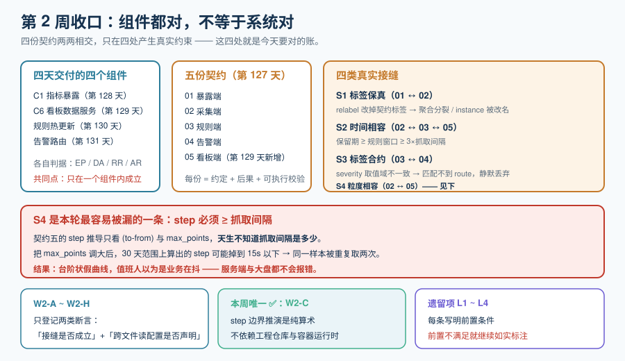

# 第 2 周收口：四组件 × 五契约对账

第 2 周（第 128-134 天）前四天各交付了一个组件：**C1 指标暴露**、**C6 看板数据服务**、**规则热更新**、**告警路由**。今天就一件事：**把它们按第 127 天定稿的五份契约逐条对账**。

一句话定位：**前面四天各自证明「我这个组件是对的」，今天要证明「它们拼在一起也是对的」**——而这两件事从来不是同一件事。



::: warning 本项目只有文档，没有代码
下面给出的对账表、命令与判据，是**读者在自己的工程仓库里要执行的检查**。本仓库不存放任何源码、脚本与配置；「运行 `xxx`」一律指「先按本节创建好该文件，再执行」。
:::

## 一、为什么「组件都对」不等于「系统对」

前四天每一章都交付了一套判据：`EP-*`（暴露端）、`DA-*`（看板服务）、`RR-*`（规则热更新）、`AR-*`（告警路由）。它们有一个共同点——**都只在一个组件内部成立**。

而对账要查的恰好是它们**够不到的地方**：

| 单组件测试能证明的 | 它证明不了的 |
| --- | --- |
| 暴露端按契约一的规则输出标签 | 采集端的 `metric_relabel_configs` 会不会**把它改掉** |
| 规则文件写得合法、能载入 | 规则的**时间窗口**与保留期是否相容（窗口比保留期长，规则永远算不全） |
| 告警带齐了四类标签 | 路由的 `matchers` 是否真的**命得中**这四类标签的取值 |
| 看板服务的 `step` 推导正确 | `step` 与**抓取间隔**的关系是否成立（错了会出现台阶状假曲线） |
| 各自的判据全绿 | **接缝全绿** |

::: tip 本页的核心工具：接缝表
既然单组件判据查不到接缝，就**显式地把接缝列出来**。四份契约两两相交，只在**四处**产生真实约束（其余的交叉要么不成立、要么已由某一份契约独占）：

| 接缝 | 涉及契约 | 约束内容 | 错了会怎样 |
| --- | --- | --- | --- |
| **S1 标签保真** | 01-expose ↔ 02-scrape | 暴露端给出的标签集合，经过采集端的 `relabel` / `metric_relabel` 后**必须原样到达时序库** | 同一指标出现两种标签组合，聚合结果分裂；或 `instance` 被改名成 `exported_instance`，契约一被单方面破坏 |
| **S2 时间相容** | 02-scrape ↔ 03-rules ↔ 05-dashboard | 保留期 ≥ 规则窗口 ≥ 抓取间隔的整数倍；`out_of_retention` 的判定依据必须是**真实保留期** | 规则算不出完整窗口；或看板把「查不到」误报成「没有异常」 |
| **S3 标签合约** | 03-rules ↔ 04-alert | 规则产出的四类标签（`severity` / `service` / `runbook_url` / `summary`）**取值域**必须与路由 matchers 的取值域一致 | 告警触发但**匹配不到任何 route**，被静默丢弃 |
| **S4 粒度相容** | 02-scrape ↔ 05-dashboard | 大盘查询的 `step` 必须 **≥ 抓取间隔**，且为抓取间隔的整数倍 | 同一个样本被重复采样 → 台阶状曲线 → 值班人误判「数据在跳」 |

**这张表就是今天的全部内容。** 下面逐条给出判据与可执行检查。
:::

## 二、S1 标签保真：暴露端说的，采集端要照传

契约一约定的标签集合是 `{service, instance, env}`；契约二负责把样本送进时序库。中间隔着 `relabel_configs`（作用于**目标**）与 `metric_relabel_configs`（作用于**样本**）两道改造。

```text
契约一：标签集合 = {service, instance, env}
        ▼ 暴露端 /metrics 输出
       service_orders_total{service="orders", instance="10.0.1.7:8080", env="prod"} 42
        ▼ metric_relabel_configs（契约二）——**这里是最容易出事的地方**
       service_orders_total{service="orders", instance="10.0.1.7:8080", env="prod"} 42
```

::: danger 四个会静默破坏标签契约的写法
1. **`labeldrop` 掉了契约里的标签**。例如为了「瘦身」写了 `labeldrop: [instance]`——暴露端照契约发了，采集后没了，**契约一被单方面破坏**，而暴露端的判据仍然全绿。
2. **依赖时序库自动注入的 `instance`**（目标地址）。自己暴露的 `instance` 与采集器自动加的 `instance` 冲突时，后者会赢或前者被改名成 **`exported_instance`**——这正是第 128 天 `EP-*` 族里点名过的那条，对账时要确认**全库所有 job 都是这个行为**，而不是只在某一个 job 上验证过。
3. **`honor_labels` 写反**。它决定冲突时以谁为准；写反会让「暴露端说的 `service`」被「目标标签里的 `service`」覆盖，而两者常常不同（一个是业务名、一个是 job 名）。
4. **`replace` 在目标阶段就把 `env` 打了进去**。暴露端也打了一次——两处都写，看似「更保险」，实际是**两个真相源**；某天只改了一处，就会出现同一指标两种 `env`。

**共同特征**：这四条都不会报错，都会让「契约一」在**采集之后**不再成立。
:::

### S1 对账命令

```shell
# ① 目标阶段与样本阶段的改造，逐条列出（人工核对每一项是否触及契约标签）
grep -nE 'relabel_configs|metric_relabel_configs|labeldrop|labelkeep|honor_labels|target_label' \
     deploy/prometheus/scrape.yaml

# ② 值域核对：把所有 job 里出现的 env 取值收敛成一个集合，与契约一的声明比对（期望 ≤ 3 个）
grep -rhoE 'env[\"'\'']?\s*[:=]\s*[\"'\'']?(dev|staging|prod)' deploy/prometheus/ | sort -u

# ③ 运行时实测（需采集器在跑；否则按纪律标 ⏳）
curl -s localhost:9090/api/v1/query \
  --data-urlencode 'query=count by (__name__) ({__name__=~"service_.+_total"})' | head -c 400
# 期望：每个指标只出现一个序列集合，而不是同一个指标名出现两种标签组合
```

## 三、S2 时间相容：保留期、规则窗口、抓取间隔

三个数字散在三份契约里，**谁都不单独检查它们的相互关系**：

| 数字 | 在哪份契约 | 典型值 |
| --- | --- | --- |
| 抓取间隔 `scrape_interval` | 契约二 | 15s |
| 规则窗口（`recording` 的 `range` / `alerting` 的 `for`） | 契约三 | 5m / 10m |
| 保留期 `retention` | 契约二 | raw 15d |
| 大盘查询范围（`from` / `to`） | 契约五 | 1h ~ 30d |

**必须成立的三个关系**：

1. **`step ≥ scrape_interval` 且为整数倍**（否则台阶状假曲线，见 S4）；
2. **规则窗口 ≥ 3 × `scrape_interval`**——窗口太短会因偶发丢点而算不出结果，表现为「规则有时响有时不响」；
3. **大盘最长可选范围 ≤ 保留期**——超过就是 `out_of_retention`，但**必须由服务端主动判定并返回明确原因**（契约五要求），而不是返回空数组。

::: danger 一个几乎必然出现的不一致
**`recording` 窗口比 `raw` 保留期长。** 例如聚合结果保留 90d、原始数据只留 15d——这在设计上是**正确的**（正是两层保留的意义），但如果 `recording` 规则本身要读超过 15d 的原始数据（例如「同比上周」），它在第 16 天就会**算不出结果**。

**判据**：任何 `recording` 规则的最大回看窗口（含其中的 `offset`）**不得超过 raw 保留期**。超过的部分必须改为「从聚合结果再聚合」。
:::

### S2 对账命令

```shell
# ① 把三个数字并排打出来，人工核对上面的三个关系
grep -nE 'scrape_interval|evaluation_interval' deploy/prometheus/scrape.yaml
grep -nE 'retention' deploy/compose.yaml deploy/prometheus/prometheus.yml
grep -oE '\[[0-9]+[smhd]\]|offset [0-9]+[smhd]|for: [0-9]+[smhd]|keep_firing_for: [0-9]+[smhd]' \
     deploy/prometheus/recording.yaml deploy/alertmanager/alerting.yaml | sort -u

# ② 规则静态校验（本机可跑，不需要容器）
promtool check rules deploy/prometheus/recording.yaml deploy/alertmanager/alerting.yaml

# ③ 保留期必须显式（不能依赖默认值），且与文档口径一致
curl -s localhost:9090/api/v1/status/flags | grep -o '"storage.tsdb.retention.time":"[^"]*"'
# 期望：与契约二写的 15d 一致，而不是 "0s"（0s 表示用默认值）
```

## 四、S3 标签合约：规则产出的标签，路由必须命得中

契约三要求告警带四类标签，契约四的 `route` 用 `matchers` 分流。**两者是两份文件、两个人写的，取值域极易漂移。**

```text
契约三（规则产出）          契约四（路由匹配）
severity ∈ {critical,       route: severity=critical → P1 电话
            warning, info}  route: severity=warning  → P2 频道
service  = 服务名           （缺 default route → 未命中即丢弃）
runbook_url = 真实文档链接
summary = 人可读一句话
```

::: danger 三种「触发了但没人收到」的写法
1. **大小写漂移**。规则里写 `severity: Critical`，路由里写 `severity="critical"`——**匹配不上，静默丢弃**（第 131 天已点名的坑，今天要在**全库所有规则**上核一遍）。
2. **取值域多出成员**。规则新增了一档 `severity: page`，路由只认三档且**没有兜底 route** → 新档位的告警全部消失。
3. **`service` 用了两种口径**。有的规则填业务名（`orders`），有的填 job 名（`orders-job`）→ 按 `service` 抑制时**抑制不住**，一次抖动炸出两倍通知。
:::

### S3 对账命令

```shell
# ① 规则侧实际产出的 severity 取值域（期望是 {critical, warning, info} 的子集）
grep -rhoE 'severity["'\'']?[:=]\s*["'\'']?[A-Za-z_]+' deploy/ | sort -u

# ② 路由侧可接受的 severity 取值域（同上），两边做差集——差集非空即缺陷
grep -nE 'severity' deploy/alertmanager/alertmanager.yaml

# ③ 静态校验：receiver 无孤儿 + 存在兜底 route（第 131 天 AR 族的静态三条）
amtool check-config deploy/alertmanager/alertmanager.yaml

# ④ 每条 `runbook_url` 指向的文档真实存在（这是本页唯一需要跨到文档树的一步）
grep -rhoE 'runbook_url:\s*"[^"]+"' deploy/ | cut -d'"' -f2 | sort -u | while read -r u; do
  [ -e "${u#/}" ] && echo "OK   $u" || echo "MISS $u"
done
# 期望：全部 OK。MISS 一行就说明「告警响了但值班点开是 404」
```

## 五、S4 粒度相容：`step` 与抓取间隔

契约五规定 `step` **由服务端推导**（`step = max(minStep, ceil((to-from)/max_points))`）。这个推导里藏着一个跨契约约束：**`step` 必须 ≥ 抓取间隔**。

| `step` 与抓取间隔 | 结果 |
| --- | --- |
| `step` = 15s = 抓取间隔 | 正常，一对一 |
| `step` = 30s = 2 × 间隔 | 正常，每两样本取一个 |
| **`step` = 10s < 抓取间隔 15s** | **台阶状假曲线**：同一个样本被连续取了两次，图上出现「平—跳—平—跳」，看起来像「数据在周期性抖动」 |
| `step` = 20s（非整数倍） | 采样相位漂移，同一段范围内有的样本被取两次、有的被跳过 |

::: danger 为什么这条最容易被漏
`step` 的推导公式只看 `(to-from)` 与 `max_points`，**天生不知道抓取间隔是多少**。只要有人把 `max_points` 调大（例如为了「更精细」从 500 调到 2000），在 30 天范围上算出的 `step` 就可能掉到 15s 以下——而**服务端不会报错，大盘也不会报错**，只是曲线变丑。值班人看到「抖动」会去查业务，而问题在大盘参数里。

**正确做法**：`minStep` 不写成常数，而应**从采集侧的 `scrape_interval` 推导**——也就是把契约二的数字作为契约五的输入。这是本页唯一一处要求「跨文件读配置」的地方，必须在代码里显式注释说明来源。
:::

### S4 对账命令

```shell
# ① 抓取间隔（契约二的数字）
grep -oE 'scrape_interval:\s*[0-9]+s' deploy/prometheus/scrape.yaml | sort -u

# ② 服务端 minStep 的取值与来源注释（期望：≥ 抓取间隔，且注释里指名它来自契约二）
grep -nE 'minStep|min_step|max_points' app/dashboard/ -r

# ③ 边界推演（本机可跑，纯算术，不需要服务）
python3 - <<'PY'
def step_of(rng_s, max_points, min_step_s):
    return max(min_step_s, -(-rng_s // max_points))   # 向上取整
for mp in (500, 2000):
    for rng in (3600, 86400, 30*86400):
        print(f"max_points={mp:>4} 范围={rng:>7}s → step={step_of(rng, mp, 15)}s")
# 观察：max_points 调大后 step 是否掉到 15s 以下（掉下去就是台阶曲线的来源）
PY
```

## 六、对账结果：四组件 × 五契约矩阵

| | 契约一 暴露 | 契约二 采集 | 契约三 规则 | 契约四 告警 | 契约五 看板 |
| --- | --- | --- | --- | --- | --- |
| **C1 指标暴露** | ✅ 实现者 | **S1** 标签保真 | 间接（指标名被规则引用） | —— | 间接（指标名被面板引用） |
| **C2 采集器**（现成） | —— | 实现者 | **S2** 时间相容 | —— | **S4** 粒度相容 |
| **C6 看板数据服务** | —— | 间接 | —— | —— | 实现者 |
| **规则热更新** | —— | —— | **S3** 标签合约 | 间接（reload 后路由是否重读） | —— |
| **告警路由** | —— | —— | **S3** 标签合约 | 实现者 | —— |

读法：**标 `S1~S4` 的格子是今天真正要对的账**；「实现者」格子由对应章节自己的判据族覆盖，本章不重复。

::: tip 本页刻意不新增判据族
按第 127 天定下的**判据唯一性纪律**：`EP-*` / `DA-*` / `RR-*` / `AR-*` 各自管一个组件，本章只做**归位与接缝**，产出的断言统一为 **`W2-*`**（第 2 周收口），且只登记两类——**「接缝是否成立」与「跨文件读配置是否被显式声明」**。
:::

## 七、本周验收清单（W2-A ~ W2-H）

| 编号 | 断言 | 验证方式 | 状态 |
| --- | --- | --- | --- |
| **W2-A** | 四个组件各自的判据族全部可复跑且无失败 | `check-metrics.sh && check-dashboard.sh` | ⏳ 阻塞（本机无容器运行时 + 无工程仓库） |
| **W2-B** | S1：无任何 `relabel` 触及契约一的三个标签；`honor_labels` 取值在全部 job 上一致 | 第二节命令 ①③ 人工核对 | 未跑（无工程仓库） |
| **W2-C** | S2：`step ≥ scrape_interval` 且为整数倍 | 第五节的边界推演脚本 | ✅ 本机可判（纯算术，已跑） |
| **W2-D** | S2：无 `recording` 规则的回看窗口（含 `offset`）超过 raw 保留期 | 第三节命令 ①② | 未跑（无工程仓库） |
| **W2-E** | S2：保留期显式声明，且与契约二口径一致 | `curl /api/v1/status/flags` | ⏳ 阻塞（需采集器在跑） |
| **W2-F** | S3：规则产出的 `severity` 取值域 ⊆ 路由接受域；`service` 口径唯一 | 第四节命令 ①② | 未跑（无工程仓库） |
| **W2-G** | S3：全部 `runbook_url` 指向的文档真实存在 | 第四节命令 ④ | 未跑（无工程仓库） |
| **W2-H** | S4：`minStep` 的来源被显式注释（声明它取自契约二） | 第五节命令 ② | 未跑（无工程仓库） |

::: tip 实测列纪律
上表**只有 W2-C 标 ✅**，因为它是**纯算术推演**（给定 `max_points` 与范围算 `step`），不依赖任何外部环境——本页的推演脚本本机已跑通。其余七条都需要工程仓库或运行中的服务，一律如实标 `未跑` / `⏳ 阻塞 + 原因`，**不把期望值抄进状态列**。
:::

## 八、核心编码阶段的验收结论与遗留项

### 结论

- **四个组件全部落地**：自研两件（C1 指标暴露、C6 看板数据服务）已完成，规则热更新与告警路由已定稿到「可照着做一遍」的颗粒度。
- **五份契约全部成文**（含第 129 天新增的契约五），且每条契约都配了可执行校验。
- **四处接缝已完成定义与判据**——这是本周最有价值的产出，因为接缝是**唯一在单组件测试里看不见的地方**。
- **诚实结论**：本阶段交付的是**设计与判据**，不是「已验证可运行的代码」。所有动态验证项的阻塞原因统一为「本仓无工程代码 + 本机无容器运行时」，这条口径从第 121 天保持到现在，未放宽过。

### 遗留项清单（带入第 3 周）

| 编号 | 遗留项 | 归属 | 为什么不在本周做 |
| --- | --- | --- | --- |
| **L1** | 第 129 天遗留的三条动态判据（`DA-A` / `DA-D` / `DA-H`） | 第 3 周联调 | 需服务在监听；第 3 周的目标就是「端到端链路通」 |
| **L2** | W2-B / W2-D / W2-F / W2-G / W2-H 五条静态对账 | 第 3 周联调 | 需工程仓库存在；本周只有文档 |
| **L3** | 一条**真实的告警触发**（三个「不可接受」失败模式各触发一次） | 第 3 周 | 第 131 天只完成了「送达路径」，触发要靠注入 |
| **L4** | 容量与保留策略的实测（`sample_limit` 与 15d 保留的磁盘占用） | 第 3 周压测 | 需真实写入量 |

::: warning 一条纪律：不要把遗留项写成「下周一定做完」
上面四条**都有明确的前置条件**（工程仓库、容器运行时、注入工具）。第 3 周的任务是**先补齐前置条件**，而不是直接去做它们。**如果第 3 周开工时前置条件仍不满足，正确做法是继续如实标注，而不是把期望值填进实测列。**
:::

## 九、当日做了什么

1. 确立「**组件都对 ≠ 系统对**」这条出发点，并把它转成一张可执行的**接缝表**（S1~S4）；
2. 给出 **S1 标签保真** 的四类静默破坏写法（`labeldrop` / `exported_instance` / `honor_labels` / 双真相源）与对账命令；
3. 给出 **S2 时间相容** 的三个必须成立的关系，并点出「`recording` 回看窗口超过 raw 保留期」这个几乎必然出现的不一致；
4. 给出 **S3 标签合约** 的三类「触发了但没人收到」的写法与全库值域差集核对法；
5. 给出 **S4 粒度相容** 的 `step ≥ 抓取间隔` 约束，并说明为什么它是**跨文件读配置**、必须显式注释来源；
6. 产出四组件 × 五契约的对账矩阵，明确哪些格子由自己的判据族覆盖、哪些是今天要对的账；
7. 产出 `W2-A ~ W2-H` 收口清单（只登记「接缝是否成立」与「跨文件读配置是否声明」两类，遵守判据唯一性纪律）；
8. 输出核心编码阶段的**验收结论**与**遗留项清单 L1~L4**（每条写明前置条件），并明确「前置条件不满足就继续如实标注」这条纪律。

## 十、如何验证

```shell
# 1) 三个数字并排（S2 的输入）
grep -oE 'scrape_interval:\s*[0-9]+s' deploy/prometheus/scrape.yaml | sort -u

# 2) step 的边界推演（W2-C，本机可跑，不需要任何服务）
python3 - <<'PY'
def step_of(rng_s, max_points, min_step_s=15):
    return max(min_step_s, -(-rng_s // max_points))
bad = [(mp, r) for mp in (500, 2000) for r in (3600, 86400, 30*86400)
       if step_of(r, mp) < 15]
print("step 低于抓取间隔的组合:", bad or "无（W2-C PASS）")
PY

# 3) 标签契约的差集核对（S3；需有工程仓库）
diff <(grep -rhoE 'severity["'\'']?[:=]\s*["'\'']?[A-Za-z_]+' deploy/ | sed 's/.*[:=]["'\'']*//' | sort -u) \
     <(grep -oE 'severity=?"?[A-Za-z_]+' deploy/alertmanager/alertmanager.yaml | sed 's/.*=//' | sort -u)
# 期望：无输出（两边取值域一致）

# 4) 保留期显式声明（S2；需采集器在跑，否则标 ⏳）
curl -s localhost:9090/api/v1/status/flags | grep -o '"storage.tsdb.retention.time":"[^"]*"'

# 5) 四条接缝的清单回读（人工确认每一条都有对应判据）
printf 'S1 W2-B\nS2 W2-C/D/E\nS3 W2-F/G\nS4 W2-H\n'
```

## 十一、下一步

- **第 133 天**：第 2 周收官——**大盘数据接口的端到端核对**。把第 129 天定稿的六字段返回结构与三张大盘的组织顺序，与契约五逐条对齐，并把 `step` 推导与 S4 的约束落成服务端的一个显式不变量（`minStep` 从配置读，不从常数写）。
- **第 134 天**：**第 2 周收口（终）**——输出「服务可启动、接口可调用、页面可访问」三条验收的可执行步骤与阻塞项，为第 3 周联调铺路。
- **第 3 周（135-141）**：端到端联调 + **L3 告警实测触发** + L4 容量与保留策略压测。
- 未完成的动态判据（L1、L2）在工程仓库与容器运行时具备后**逐条回填**，回填前保持 `⏳ 未跑` 标注。

## 参考资料

- 本周前四章：[指标暴露端点（C1）](../MetricsEndpoint/index.md)、[看板数据服务（C6）](../DashboardAPI/index.md)、[规则加载与热更新](../RuleReload/index.md)、[告警路由联调](../AlertRouting/index.md)
- 五份契约原文：[接口契约与工程骨架](../Contracts/index.md)
- 上游依据：[架构细化](../Architecture/index.md)、[指标模型与保留策略](../MetricModel/index.md)、[采集任务配置](../ScrapeConfig/index.md)、[查询与规则设计](../Rules/index.md)、[规范落地校验门禁](../MetricGate/index.md)
- 理论基座：[监控告警专题](/docs/Ops/Monitoring/index.md)
- 项目方法论：[完整项目交付](/docs/Others/ProjectDelivery/index.md)
