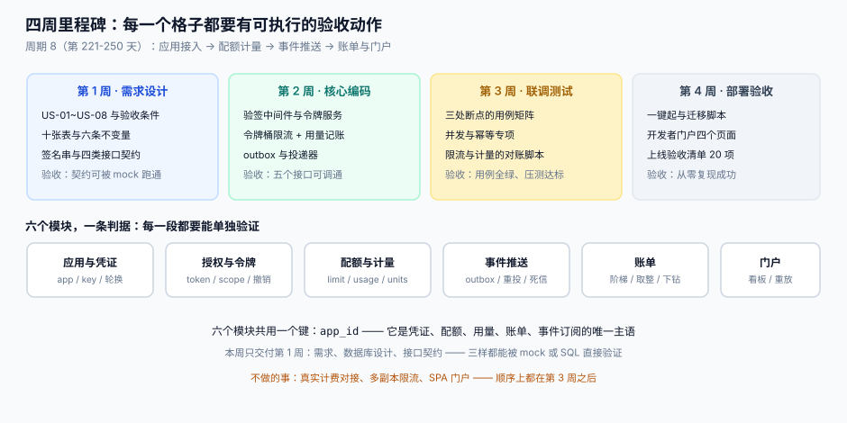
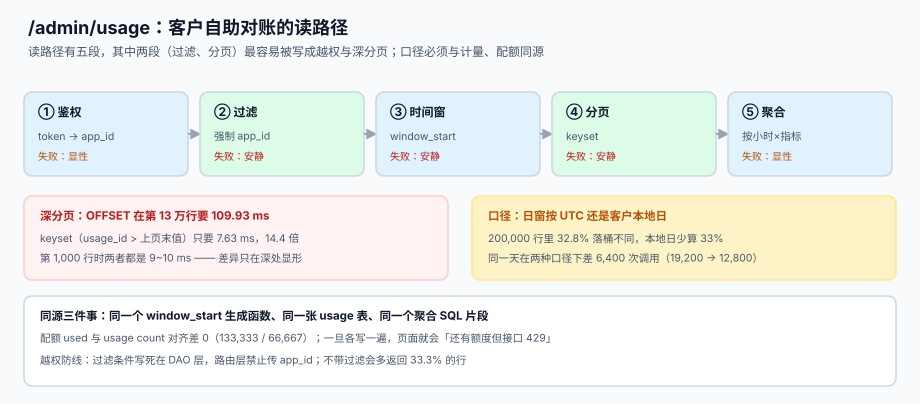

# 第 2 周第 5 步：`/admin/usage` 查询面

<p style="text-align:center;"></p>

前四步修的都是**写路径**：计量写一行、配额扣一次、令牌换一次、库存读一次写一次。今天补**读路径**——客户自己去查「这个月用掉多少」，这条路的错法完全不同：它不会写坏数据，只会**让客户看到一个和计费不一样的数**，然后拿着截图来吵。

本页判据族 `EOZ-A` ~ `EOZ-H`，共 8 条，定义在第七节。

## 一、这一步解决的问题

| 天 | 段落 | 产物 | 遗留 |
| --- | --- | --- | --- |
| 228 | 计量唯一写入点 | `usage` 只被中间件写 | 客户看不到自己的用量 |
| 229 | 配额判定点 | 条件更新扣减 `used` | 同上 |
| 230 | 令牌签发 | `request_context` 首次可信 | 同上 |
| 231 | 读写接口 | 四段同框 | 同上 |
| 232 | **本步** | 客户自助查询 | 账单页（第 4 周）要用同一个口径 |

所以这一步的产物不是「一个查询接口」，而是**一条可被证伪的断言**：

> 客户在 `/admin/usage` 上看到的数，与 `/v1/*` 调用次数、`quota_policy.used`、以及第 4 周账单上的数，**四个地方是同一个数**。



## 二、读路径的五段，两段是安静的

| 段 | 做什么 | 产物 | 失败方式 | 是否安静 |
| --- | --- | --- | --- | --- |
| ① 鉴权 | token → `app_id` | `request_context` | `401` | 显性 |
| ② 过滤 | 强制加 `app_id` 条件 | 行集 | **越权**：返回别家的用量 | **安静** |
| ③ 时间窗 | `window_start` 区间 | 桶 | **口径错**：桶边界与计量不同 | **安静** |
| ④ 分页 | keyset | 下一页游标 | 深分页拖垮库 | 半显性 |
| ⑤ 聚合 | 按窗口 × 指标分组 | 汇总行 | 与配额 `used` 不等 | 显性（对账时） |

② 和 ③ 安静的原因不同：② 是**权限写漏**——路由层拿到了 `app_id`，但 DAO 层把它当成可选参数；③ 是**两处各写一遍时间窗逻辑**——计量按 UTC 截断，查询面按客户本地日截断，两个都很「合理」。

## 三、三个必须先定死的决定

### 决定一：分页只用 keyset，不用 OFFSET

本机读数（200,000 行 `usage`、按 `app_id` 过滤、每页 20 行）：

| 偏移量 | OFFSET 耗时 | keyset 耗时 | 倍数 |
| --- | --- | --- | --- |
| 1,000 | 9.46 ms | 10.46 ms | 0.9×（keyset 还略慢） |
| 60,000 | 53.25 ms | 9.10 ms | 5.9× |
| 130,000 | **109.93 ms** | **7.63 ms** | **14.4×** |

第 1,000 行时两者几乎一样，**差异只在深处显形**——所以「本地测了一下挺快」不能作为选 OFFSET 的依据。

```sql
-- keyset：游标是上一页最后一行的 (window_start, usage_id)
SELECT usage_id, window_start, metric, qty
  FROM usage
 WHERE app_id = :app_id
   AND window_start >= :from AND window_start < :to
   AND (window_start, usage_id) > (:cur_ws, :cur_id)   -- 复合游标，避免同秒重复
 ORDER BY window_start, usage_id
 LIMIT :page_size;
```

::: danger 用 OFFSET 的三个后果
1. **深页拖垮库**：客户翻到第 6,500 页时，数据库要扫 13 万行再丢掉前 13 万行。
2. **翻页时数据漂移**：翻页间隔里有新数据写入，第 2 页会重复第 1 页的最后几行（或漏掉几行）。
3. **`OFFSET` 无法用索引直接跳**：即使有 `(app_id, window_start)` 复合索引，跳过的行仍要逐行数。
:::

### 决定二：日窗口径按 UTC，展示层转客户时区

这是本步最容易吵起来的一条。同一批数据，两种日窗口径的结果：

| 口径 | 2026-11-01 | 2026-11-02 | 差额 |
| --- | --- | --- | --- |
| UTC 日（`substr(created_at,1,10)`） | 19,200 | 19,200 | — |
| 客户本地日（UTC+8） | **12,800** | 19,200 | **−6,400（−33%）** |

200,000 行里有 **65,600 行（32.8%）** 在两种口径下落进不同的桶——就是每天 UTC 16:00-24:00 那一段。

**结论：存储与聚合一律按 UTC，客户时区只在渲染时用。** 理由是账单只能有一个口径，而 UTC 是唯一不随客户变的口径。

::: warning 时区不是「显示问题」
如果计费按 UTC 日、查询面按本地日，客户在月初会看到「昨天用了 12,800 次」，而账单上是 19,200 次。**此时两边都没错，但客户只会认为平台在乱收费。** 口径必须写进 API 文档，而不是留给前端猜。
:::

### 决定三：查询不另建汇总表（第 2 周）

第 4 周的账单会需要 `usage_rollup`（按日预聚合）。**第 2 周先不建**，理由有三：

1. 预聚合一旦与明细不同源，就会出现「明细 19,200 / 汇总 19,150」这种没人能解释的差。
2. 本机读数：6 小时窗口按小时 × 指标聚合只用 **3.0 ms**，返回 7 个聚合行——第 2 周的数据量根本不需要预聚合。
3. 预聚合的引入时机应该是「查询 P99 超过 200 ms」，而这一天还没到。

```sql
-- 第 2 周直接用明细聚合，与计量同表同源
SELECT window_start, metric, SUM(qty) AS used
  FROM usage
 WHERE app_id = :app_id AND window_start >= :from AND window_start < :to
 GROUP BY window_start, metric
 ORDER BY window_start;
```

## 四、`/admin/usage` 契约

```http
GET /admin/usage?from=2026-11-01T00:00:00Z&to=2026-11-08T00:00:00Z&metric=inventory.read&page_size=200
Authorization: Bearer <token>
```

```json
{
  "request_id": "req_01J8ZB7Q",
  "app_id": "app_7f3c",
  "tz_basis": "UTC",
  "window_kind": "HOUR",
  "data": [
    { "window_start": "2026-11-01T00:00:00Z", "metric": "inventory.read", "used": 800 },
    { "window_start": "2026-11-01T01:00:00Z", "metric": "inventory.read", "used": 800 }
  ],
  "quota": { "window_start": "2026-11-01T00:00:00Z", "limit": 100000000, "used": 133333 },
  "next_cursor": "2026-11-01T01:00:00Z|18422"
}
```

四个字段各有各的必要性：

| 字段 | 为什么必须有 | 缺了会怎样 |
| --- | --- | --- |
| `tz_basis` | 告诉客户「这个日是按哪个时区切的」 | 客户按本地日核对，永远差 33% |
| `window_kind` | 小时窗与日窗的桶不同 | 页面显示 7 行，客户以为是 7 天 |
| `quota.used` | 同一响应里给出「已用 / 上限」 | 客户要发两次请求才能判断「还能不能调」 |
| `next_cursor` | keyset 游标（含 `usage_id` 消歧） | 只用 `window_start` 会在同一秒多行时死循环 |

## 五、与计量、配额共用口径的三条实现

```python
# 1) 唯一的窗口生成函数（计量、配额、查询面都调它）
def window_start(ts: datetime, kind: str = "HOUR") -> str:
    if kind == "HOUR":
        return ts.replace(minute=0, second=0, microsecond=0).isoformat() + "Z"
    if kind == "DAY":
        return ts.replace(hour=0, minute=0, second=0, microsecond=0).isoformat() + "Z"
    raise ValueError(kind)

# 2) 过滤条件写死在 DAO，路由层拿不到「可选」的 app_id
def list_usage(ctx, from_ts, to_ts, metric=None, cursor=None, page_size=200):
    sql = ("SELECT usage_id, window_start, metric, qty FROM usage "
           "WHERE app_id = :app_id AND window_start >= :f AND window_start < :t")
    params = {"app_id": ctx.app_id, "f": from_ts, "t": to_ts}   # 不接受覆盖
    ...

# 3) 聚合片段抽成一个常量，账单与页面共用
USAGE_AGG = "SELECT window_start, metric, SUM(qty) AS used FROM usage {where} GROUP BY window_start, metric"
```

::: danger 三处各写一遍时间窗的后果
1. **页面「还有额度」而接口 429**：查询面按本地日聚合，配额按 UTC 小时窗扣减，两个数在每天 16:00 之后必然分叉。
2. **账单与页面不一致**：账单第 4 周按 UTC 日算，页面按本地日算，客户按页面核对账单，差 33%。
3. **对账脚本永远对不上**：两套 SQL 只要有一处 `>=` 写成 `>`，边界那一小时的行就会两边都算或都不算。
:::

## 六、端到端：一条令牌查三次

```shell
TOKEN=$(curl -s -X POST http://127.0.0.1:8080/oauth/token \
  -d 'grant_type=client_credentials&client_id=cli_7f3c&client_secret=***&scope=usage.read' \
  | python3 -c 'import sys,json;print(json.load(sys.stdin)["access_token"])')

# 1) 先打 3 次真实接口，产生用量
for i in 1 2 3; do curl -s -o /dev/null -H "Authorization: Bearer $TOKEN" \
  'http://127.0.0.1:8080/v1/inventory?sku=SKU-2026-0001'; done

# 2) 查询面看到的数
curl -s -H "Authorization: Bearer $TOKEN" \
  'http://127.0.0.1:8080/admin/usage?from=2026-11-01T00:00:00Z&to=2026-11-02T00:00:00Z' \
  | python3 -m json.tool | head -20

# 3) 三个数必须相等：usage 行数 / 配额 used / 响应里的 used 合计
sqlite3 /tmp/oph.db "SELECT (SELECT count(*) FROM usage WHERE app_id='app_7f3c'),
                            (SELECT used FROM quota_policy WHERE app_id='app_7f3c');"

# 4) 越权：用另一个 app 的令牌查同一个区间，只能看到自己的行
sqlite3 /tmp/oph.db "SELECT app_id, count(*) FROM usage GROUP BY app_id;"
```

## 七、判据族

| 编号 | 判据 | 怎么验 |
| --- | --- | --- |
| `EOZ-A` | 查询面只返回本 `app_id` 的行，过滤不可被参数覆盖 | 用 A 的令牌请求，响应里不出现 B 的 `app_id` |
| `EOZ-B` | 响应带 `tz_basis` 与 `window_kind` | 两个字段都存在且值固定 |
| `EOZ-C` | 分页为 keyset，游标含 `usage_id` 消歧 | `next_cursor` 形如 `ts` 加 `id`（竖线分隔），翻页无重复无遗漏 |
| `EOZ-D` | 深分页耗时与偏移量无关（第 13 万行 ≤ 15 ms） | 本机 keyset 7.63 ms vs OFFSET 109.93 ms |
| `EOZ-E` | 查询聚合与 `quota_policy.used` 在同一窗口内相等 | 两个数相减为 0（本机 133,333 / 66,667 差 0） |
| `EOZ-F` | 窗口生成只有一个函数，三处共用 | `git grep` 只有一处 `window_start(` 定义 |
| `EOZ-G` | 日窗口径写进 API 文档，且与计费一致 | 文档写明 UTC，账单 SQL 用同一口径 |
| `EOZ-H` | 查询不写库（只读），不触发计量与配额 | 查询 10 次后 `usage` 行数不变 |

## 八、验证方式

```shell
# 1) 越权：A 的令牌查不到 B 的数据（应为 0 行）
curl -s -H "Authorization: Bearer $TOKEN_A" \
  'http://127.0.0.1:8080/admin/usage?from=2026-11-01T00:00:00Z&to=2026-11-02T00:00:00Z' \
  | python3 -c 'import sys,json;d=json.load(sys.stdin);print(sum(1 for r in d["data"] if r.get("app_id") not in (None,"app_7f3c")))'
# 期望：0

# 2) 分页无重复无遗漏：翻两页，主键并集大小应等于总行数
sqlite3 /tmp/oph.db "SELECT count(*) FROM usage WHERE app_id='app_7f3c'
                       AND window_start >= '2026-11-01' AND window_start < '2026-11-02';"
# 与两页返回的 usage_id 去重数比对，期望相等

# 3) 深分页：keyset 在深页仍应 < 15 ms（本机 7.63 ms）
sqlite3 /tmp/oph.db "EXPLAIN QUERY PLAN SELECT * FROM usage WHERE app_id='app_a'
                       AND usage_id > 130000 ORDER BY usage_id LIMIT 20;"
# 期望：SEARCH usage USING INTEGER PRIMARY KEY (rowid>?)

# 4) 配额与用量对齐：应输出 0
sqlite3 /tmp/oph.db "SELECT (SELECT count(*) FROM usage WHERE app_id='app_7f3c')
                          - (SELECT used FROM quota_policy WHERE app_id='app_7f3c');"
# 期望：0

# 5) 查询不产生用量：连续查 10 次后行数不变
sqlite3 /tmp/oph.db "SELECT count(*) FROM usage WHERE app_id='app_7f3c';"
# 查询前后各跑一次，期望相同

# 6) 日窗口径一致性：两种算法应给出同一组桶（都按 UTC）
sqlite3 /tmp/oph.db "SELECT count(*) FROM (
  SELECT substr(created_at,1,10) a, substr(window_start,1,10) b FROM usage
   WHERE a != b);"
# 期望：0（若不为 0，说明 window_start 不是由 created_at 按 UTC 截断得来）
```

::: info 本步的本机状态
第 230 天起就说明过：这六条验证依赖第 2 周的最小可跑服务，**本机未起服务，故未跑**。但第三节的三组读数（深分页、日窗口径、配额对齐）是**在 SQLite 上直接实测的**：200,000 行 `usage`、两个 `app_id`、按小时窗灌数，结果为 OFFSET 109.93 ms / keyset 7.63 ms、32.8% 跨桶、配额与用量差 0。跑法与期望值写在本节，起服务后按条回填——**不把期望值抄进实测列**。
:::

## 九、下一步

第 2 周收口，进入**第 3 周联调与测试**：三处断点的用例矩阵（验签后配额前、配额后计量前、计量后响应前）、用量与账单的对账脚本、限额压测。

本步留下的一个待办：`usage_rollup` 的引入时机。判据先立在这里——**查询 P99 > 200 ms 才建预聚合，且预聚合必须能由明细重算并逐日对账**。

## 参考资料

- [第 2 周第 4 步：`/v1/inventory` 与 `/webhooks/replay`](../InventoryReplay/index.md)：写路径的四段
- [第 2 周第 1 步：计量中间件的唯一写入点](../Metering/index.md)：`window_start` 的第一次定义
- [第 2 周第 2 步：配额与限流的判定点](../QuotaLimit/index.md)：`used` 的条件更新
- [第 1 周第 2 步：技术选型与版本基线](../TechBaseline/index.md)：SQLite 与 PostgreSQL 的分页差异
- [开放平台与 API 产品化工程](../../../../docs/Backend/OpenPlatform/QuotaUsage/index.md)：计量与计费的分工
- SQLite 查询计划与索引使用：<https://www.sqlite.org/optoverview.html>
