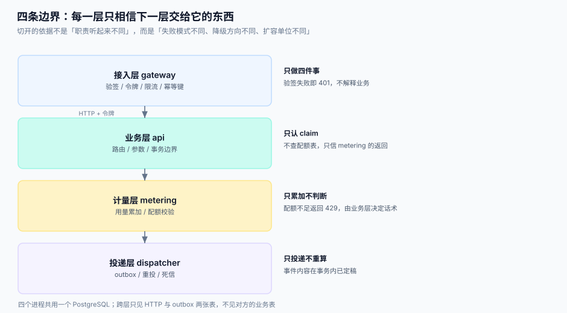

# 第 1 周第 3 步：架构设计与四条边界

前两步定下了「要做哪八件事」与「用哪几个版本」。这一步回答的是**这些代码放在几个进程里、谁可以调谁、某一层挂了往哪儿退**。切分依据不是「职责听起来不同」，而是三个可测的差异：失败模式、降级方向、扩容单位。

::: tip 一句话定位
**四个进程，一条不允许跨过的线。** 接入层只做验签与限流，业务层只认 claim，计量层只累加，投递层只投递。任何一层想「顺手查一下别人的表」，这条线就废了——而它废掉的那天不会有任何报错，只会在第 4 周压测时表现为「不知道为什么这么慢」。
:::



本页判据族 `EOB-A` ~ `EOB-H`，共 8 条。定义表在第六节。

## 一、四个进程与它们的唯一职责

| 进程 | 端口 | 唯一职责 | 明确不做 | 失败时对外表现 |
| --- | --- | --- | --- | --- |
| `gateway` | 8080 | 验签、令牌校验、限流、幂等键 | 不查业务表、不算配额、不写用量 | 401 / 403 / 429，**不解释业务** |
| `api` | 8081 | 路由、参数校验、事务边界 | 不自己算用量、不自己推事件 | 4xx/5xx + `request_id` |
| `metering` | 8082 | 用量累加、配额判定 | 不改业务数据、不发事件 | 只会返回「允许 / 超限」 |
| `dispatcher` | — | 读 outbox、重投、死信 | 不重算事件内容、不改业务状态 | 延迟变大，**不影响主链路** |

**「明确不做」这一列比「职责」更重要**：它才是边界。写不出「这一层不做什么」，说明这一层还没有边界，只是一个文件夹。

## 二、依赖表：谁可以调谁

| 调用方 ↓ / 被调方 → | gateway | api | metering | dispatcher | PostgreSQL |
| --- | --- | --- | --- | --- | --- |
| `gateway` | — | ✅ HTTP | ✅ HTTP（只读配额） | ❌ | ✅ 只读 `app_key` / `nonce` |
| `api` | ❌ | — | ✅ HTTP | ❌ | ✅ 读写业务表 + outbox |
| `metering` | ❌ | ❌ | — | ❌ | ✅ 读写 `usage` / `quota_policy` |
| `dispatcher` | ❌ | ❌ | ❌ | — | ✅ 读写 `outbox` / `delivery` |

三条硬规则：

1. **不允许反向调用**。`api` 不能调 `gateway`，`metering` 不能调 `api`。反向调用一旦出现，两个进程就无法独立重启。
2. **不允许跨层读表**。`gateway` 只读凭证相关两张表，`api` 不读 `usage`。跨层读表是「最快的小聪明」，也是第 4 周最贵的技术债。
3. **`dispatcher` 是唯一没有入站端口的进程**。它只被数据库驱动——这让「事件投递」天然与请求链路解耦。

::: danger 注意
1. **不要用「同一个库所以可以 JOIN」说服自己**。四个进程共用一个 PostgreSQL 是**部署简化**，不是**逻辑合并**；一旦有跨层 JOIN，拆库时那一句 SQL 会变成一场重构。
2. **不要给 `gateway` 加「顺便查一下库存」的便利接口**。开放平台的第一条产品约束是「接入层不认识业务」，加了这句便利，验签层就变成了业务代理。
3. **不要让 `metering` 反查业务表来补数据**。计量只认请求里带的 `app_id` 与 `route`；需要更多维度就在接入层补字段，不要在计量层 JOIN。
:::

## 三、每层的失败模式与降级方向

| 层 | 典型失败 | 影响面 | 降级方向（往安全侧退） | 不许做的降级 |
| --- | --- | --- | --- | --- |
| `gateway` | 验签服务超时 | 全站 401 | 缓存公钥 + 本地验签；失败**拒绝**而非放行 | 放宽成「验签失败也放行」 |
| `api` | 业务库慢查询 | 单接口 5xx | 返回 503 + `Retry-After` | 把超时改大无限等 |
| `metering` | 计量写失败 | 用量缺口 | **拒绝请求（429/503）**，宁可少服务不可少记账 | 先放过、事后补账 |
| `dispatcher` | 下游 webhook 挂 | 事件延迟 | 退避重投 + 死信 + 人工重放 | 丢弃事件或阻塞主链路 |

::: tip 一条不对称原则
**计量失败必须让请求失败**，而**投递失败不能影响请求**。原因是两者的可恢复性不同：用量少记一笔永远补不回来（你不知道少了哪一笔），事件晚到几分钟可以重投。**降级方向永远往「可恢复」的那一侧退。**
:::

## 四、为什么要在这三处切开：本机读数

切进程有成本。本机实测（Python 3.13 + 回环网络 + SQLite，非压测）：

| 操作 | 读数 | 含义 |
| --- | --- | --- |
| 进程内函数调用 | ~0.1 µs（量级） | 基线 |
| 回环 HTTP 往返（含 JSON 编解码） | 中位 **0.46 ms**，p95 **0.84 ms** | 每跨一次进程约 0.5 ms |
| outbox 写入（500 条） | **1.1 ms**（≈2.2 µs/条） | 异步路径的固定成本极低 |
| `json.dumps`（20 行明细） | **9.2 µs** | 序列化不是瓶颈 |

结论有三条：

1. **只在「必须独立失败」的地方切**。一次调用多 0.5 ms，在一个 30 ms 的接口里可以接受；但如果每个字段都要跨进程取一次（N+1 式跨进程），就会变成 15 ms 的固定开销。
2. **能异步的一律走 outbox**。2.2 µs 的写入成本，换掉一次 0.5 ms 的同步等待，这笔交易在任何量级下都划算。
3. **不要为了「架构好看」把计量做成同步强依赖**。它必须是**同事务内的本地写入**（写 `usage` 与写业务数据在同一个事务），而不是一次跨进程调用——否则业务事务会多出一个不可控的失败点。

## 五、单机部署：三个进程 + 一个库

```yaml [docker-compose.yml]
services:
  db:
    image: postgres:18
    environment:
      POSTGRES_PASSWORD: dev
      POSTGRES_DB: oph
    ports: ["5432:5432"]
  gateway:
    build: { context: ., dockerfile: deploy/gateway.Dockerfile }
    environment:
      OPH_DB_DSN: postgresql://postgres:dev@db:5432/oph
      OPH_UPSTREAM: http://api:8081
    ports: ["8080:8080"]
    depends_on: [db]
  api:
    build: { context: ., dockerfile: deploy/api.Dockerfile }
    environment:
      OPH_DB_DSN: postgresql://postgres:dev@db:5432/oph
      OPH_METERING: http://metering:8082
    ports: ["8081:8081"]
    depends_on: [db]
  metering:
    build: { context: ., dockerfile: deploy/metering.Dockerfile }
    environment:
      OPH_DB_DSN: postgresql://postgres:dev@db:5432/oph
    ports: ["8082:8082"]
    depends_on: [db]
```

```shell
docker compose up -d
docker compose ps --format 'table {{.Service}}\t{{.State}}\t{{.Ports}}'
# 期望：db / gateway / api / metering 四个服务都是 running，端口 5432 / 8080 / 8081 / 8082 各有映射
```

## 六、判据

| 判据 | 看什么现象 | 判成什么 | 不满足时改哪里 |
| --- | --- | --- | --- |
| `EOB-A` | 每个进程的 `main` 里注册的路由数是否与其职责表一致（gateway 只有 4 类：验签/令牌/限流/幂等） | 出现业务路由即判「边界被穿透」 | 把业务路由移回 `api`，网关只保留转发 |
| `EOB-B` | `gateway` 的 SQL 是否只出现在 `app_key` / `nonce` 两张表 | 出现别的表即判「跨层读表」 | 抽 `gateway/credential_repo.py`，其余查询移出 |
| `EOB-C` | `api` 是否直接 `INSERT INTO usage` | 直接写即判「绕过计量层」 | 改为同事务写本地 `usage_ledger`，由计量任务汇总 |
| `EOB-D` | `metering` 失败时请求是否被拒绝 | 放行即判「记账可丢」 | 返回 503 并让客户端重试（幂等键保证不重复计费） |
| `EOB-E` | `dispatcher` 是否有 HTTP 入站端口 | 有即判「投递可被外部触发」 | 去掉端口，只由定时器与数据库驱动 |
| `EOB-F` | 依赖表里是否存在反向调用（`api` → `gateway`） | 存在即判「进程不可独立重启」 | 把共享逻辑下沉到 `common/`，不做跨进程回环 |
| `EOB-G` | 每次跨进程调用是否带 `request_id` 与 `trace_id` | 缺失即判「无法定位慢在哪一层」 | 在网关生成，逐层透传，落日志与响应头 |
| `EOB-H` | 降级方向是否都朝「可恢复」一侧（计量拒、投递退避） | 出现「先放过再补账」即判「账不可恢复」 | 改为同步拒，把补账逻辑删掉 |

## 七、如何验证

```shell
# 1. 四个进程都在，端口正确
docker compose ps --services
# 期望：db gateway api metering（dispatcher 作为可选的第五个服务，若已实现应无入站端口）

# 2. 网关只认四类路径（业务路径一律 404 而不是被处理）
curl -s -o /dev/null -w "%{http_code}\n" -X POST http://localhost:8080/v1/inventory
# 期望：404（网关不实现业务路由）

# 3. 未签名请求被拒（负向）
curl -s -o /dev/null -w "%{http_code}\n" -X POST http://localhost:8080/v1/ping
# 期望：401

# 4. 计量不可用时请求失败（负向：先停掉 metering）
docker compose stop metering
curl -s -o /dev/null -w "%{http_code}\n" -H "Authorization: Bearer <token>" http://localhost:8081/v1/ping
# 期望：503（宁可少服务，不可少记账）
docker compose start metering

# 5. 跨进程一次调用的量级（用于第 3 周对比）
python3 - <<'PY'
import time, urllib.request, statistics
ts=[]
for _ in range(50):
    t0=time.perf_counter()
    try: urllib.request.urlopen("http://localhost:8081/health", timeout=2).read()
    except Exception: pass
    ts.append((time.perf_counter()-t0)*1000)
print(f"中位 {statistics.median(ts):.2f} ms")
PY
# 期望：与第四节 0.46 ms 同阶（容器网络会略高，2 倍以内属正常）
```

## 八、下一步

第 1 周第 4 步（第 225 天）：**接口契约与错误码**——把八条用户故事翻译成 12 个接口的请求/响应契约，重点解决三件事：错误码分层（网关 / 业务 / 计量各自的前缀）、分页与游标、以及「同一个错误在四层里的不同表达」。判据族占位 `EOI`。

## 参考资料

- [开放平台与 API 产品化工程](../../../../docs/Backend/OpenPlatform/index.md)：本项目的文档底座
- [总览：七段链与四条边界](../../../../docs/Backend/OpenPlatform/Overview/index.md)：七段链与本页四层的对应
- [采购到付款（P2P）与三单匹配工程](../../../../docs/Backend/ProcureToPay/index.md)：同样按「每段一份证据」组织的相邻专题，可对照「边界即证据」的写法
- [网关深度实践](../../../../docs/Backend/GatewayDeep/index.md)：南北向流量的路由、限流与熔断
