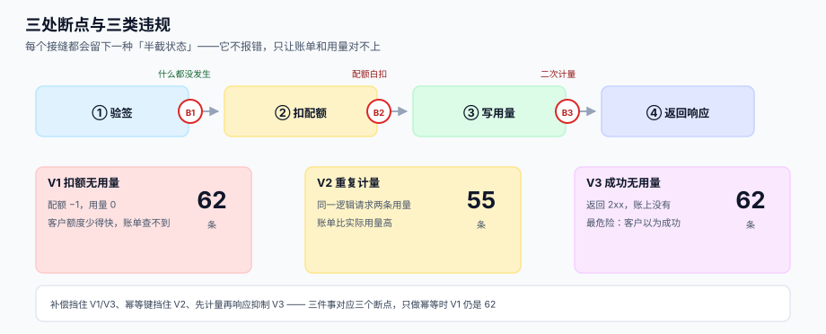

# 第 3 周第 1 步：验签后 / 配额前的断点矩阵

<p style="text-align:center;"></p>

第 2 周把五条写路径各修了一遍，每一步单独看都成立。但真实请求要**连续穿过**这些步骤：验签 → 配额 → 计量 → 响应。中间任何一处失败，都会留下一个「半截状态」——而半截状态不会报错，只会让月底的账单和用量对不上。

这一步只做一件事：**在三个接缝上各插一把刀，看看到底能留下几种半截状态**。

本页判据族 `EPB-A` ~ `EPB-H`，共 8 条，见第六节。

## 一、三处断点在哪

```text
请求 → ①验签 → ┃B1┃ → ②扣配额 → ┃B2┃ → ③写用量 → ┃B3┃ → ④返回响应
```

| 断点 | 位置 | 失败后的状态 | 后果 |
| --- | --- | --- | --- |
| **B1** | 验签通过、扣配额之前 | 什么都没发生 | 最安全：客户收到 5xx，重试即可 |
| **B2** | 扣了配额、写用量之前 | **配额已消耗，用量没有** | 「扣了额度却没记账」——客户额度被吃掉，账单里查不到 |
| **B3** | 写了用量、响应还没发出 | **用量已落库，客户看到失败** | 客户重试 → 除非有幂等键，否则**二次计量** |

三处里 **B2 最阴**：它不会让任何人报错。客户只觉得「额度怎么少得比用量快」，而账单上每一笔都对得上——因为少的那一笔根本没进账单。

## 二、九条用例

三处断点 × 三种处置，形成一张 3×3 的矩阵。每条用例都是一个**可判定的断言**，不是「测试一下」。

| 编号 | 断点 | 注入方式 | 断言（必须成立） |
| --- | --- | --- | --- |
| `C1` | B1 | 配额检查前抛异常 | 配额不变、用量不增、返回 5xx、重试成功 |
| `C2` | B1 | 配额检查超时 | 同上，且**不得**降级为「放行」 |
| `C3` | B1 | 验签服务不可用 | 返回 503，不进入计量链路 |
| `C4` | B2 | 写用量前抛异常（无补偿） | 检出「配额 −1、用量 0」→ 必须有对账任务能发现 |
| `C5` | B2 | 写用量前抛异常（有补偿） | 配额回滚，净变化为 0 |
| `C6` | B2 | 写用量成功但 commit 失败 | 配额与用量同事务，**要么都成，要么都不成** |
| `C7` | B3 | 响应序列化前抛异常 | 用量已落库；客户重试时按幂等键返回首次结果 |
| `C8` | B3 | 网关超时但服务端成功 | 同 `C7`；重试**不得**新增用量行 |
| `C9` | B3 | 客户端未带幂等键 | 允许二次计量，但必须能被**用量对账**归并 |

::: danger 三条最容易写错的断言
1. **`C2` 的「不得降级放行」**：配额检查超时时，最常见的「可用性优先」写法是放行。一旦放行，超时期间的请求全部免费。
2. **`C6` 的「同事务」**：配额和用量在两张表、甚至两个库。跨库时不能靠事务，要靠**先记意图（outbox）再扣配额**。
3. **`C7` 的「返回首次结果」**：幂等键只做「去重」不够，还要**缓存首次响应体**，否则重试拿到的是一个没有数据的 200。
:::

## 三、本机实测：三种防护等级

用 600 条逻辑请求、每处断点 12% 的失败率，对比三种防护：

| 防护等级 | 配额消耗 | 用量行 | 有量请求 | V1 扣额无用量 | V2 重复计量 | V3 成功无用量 | 2xx |
| --- | --- | --- | --- | --- | --- | --- | --- |
| 无防护 | 593 | 528 | 473 | **62** | **55** | **62** | 535 |
| 仅补偿（B2 回滚） | 524 | 524 | 473 | **0** | 51 | **0** | 473 |
| 补偿 + 幂等键 | 454 | 454 | 454 | **0** | **0** | **0** | 383 |

三类违规的定义：

| 编号 | 定义 | 危害 |
| --- | --- | --- |
| `V1` | 扣了配额，但该请求**一条用量都没有** | 客户额度被吃，账单查不到 |
| `V2` | 同一逻辑请求**被计量多次** | 账单比实际用量高 |
| `V3` | 返回 2xx，但**没有任何用量** | 最危险：客户以为成功，账上没这单 |

::: warning 一个反直觉的读数：V1 = 62，但真实发生 B2 失败的次数是 65
差额 3 条来自「B2 失败 + B3 也失败」的叠加：B2 白扣了配额，随后 B3 触发重试，重试**碰巧**把这个请求计量上了。

也就是说，**重试会掩盖一部分漏计量**，让 `V1` 看起来比实际小 4.6%。如果只看 `V1`，你会低估 B2 的发生率；必须同时看「B2 注入次数」这个分母，才能算准漏计量的真实概率。

这条读数也解释了为什么很多系统「上线时看着没问题」：早期的漏计量被用户的重试行为掩盖了，直到某个没重试的客户来投诉。
:::

三种防护的取舍：

| 防护 | 挡住什么 | 代价 |
| --- | --- | --- |
| 补偿（B2 回滚） | `V1` / `V3` 归零 | 多一次写；回滚失败时要靠对账兜底 |
| 幂等键（B3） | `V2` 归零 | 存 24 小时的响应体；键的生成规则要统一 |
| 两者都要 | 三类全零 | 见下 |

**结论：`V1` 靠补偿，`V2` 靠幂等，`V3` 靠「先计量再响应」的顺序。** 三件事分别对应三个断点，缺一不可——只做幂等（很多团队的默认选择），`V1` 仍然是 62。

## 四、当日做了什么

1. **定义三处断点与三类违规**：把「安静的失败」翻译成三个可计数的量（`V1` / `V2` / `V3`），每个都有明确的判定 SQL 或断言。
2. **写出 9 条用例**：每条都是一个断言，而不是「跑一下看有没有报错」。其中 `C6`（同事务）与 `C7`（首次结果缓存）是这一周真正要改代码的两处。
3. **跑出三种防护等级的对比读数**：确认「只做幂等」不足以消除 `V1`，为第 2 步的实现顺序提供依据。
4. **定下对账口径**：`V1` 的兜底不能靠实时，只能靠**日对账**——`usage` 与 `quota.used` 的差必须每天归零，否则漏计量会一直累积。

## 五、如何验证

页面里的读数可以用下面这段脚本复跑（Python 3.13 标准库，无需装包）：

```python
import random

random.seed(20261102)
N, P = 600, 0.12

def run(mode):
    quota, usage, final, qmap = 0, [], {}, {}
    for i in range(N):
        qmap[i] = 0
        if random.random() < P:            # B1
            final[i] = 503
            continue
        quota += 1; qmap[i] += 1           # 扣配额
        if random.random() < P:            # B2
            if mode != "none":
                quota -= 1; qmap[i] -= 1
                final[i] = 500
                continue
        else:
            usage.append((i, 0))
        status = 500 if random.random() < P else 200   # B3
        if status == 500 and mode != "idem":
            quota += 1; qmap[i] += 1
            usage.append((i, 1))
            status = 200
        final[i] = status
    measured = {lid for lid, _ in usage}
    v1 = sum(1 for i, c in qmap.items() if c > 0 and i not in measured)
    v2 = len(usage) - len(measured)
    v3 = sum(1 for i, s in final.items() if s == 200 and i not in measured)
    return quota, len(usage), len(measured), v1, v2, v3

for mode in ("none", "comp", "idem"):
    print(mode, *run(mode))
# 期望（与本页表格逐格一致）：
# none 593 528 473 62 55 62
# comp 524 524 473 0 51 0
# idem 454 454 454 0 0 0
```

服务侧的验证走 SQL（第 2 周建的 `usage` / `quota` 两张表）：

```shell
# V1：扣了配额但没有用量的应用
sqlite3 /tmp/oph.db "SELECT app, used, (SELECT count(*) FROM usage u WHERE u.app=q.app) AS rows
  FROM quota q WHERE used <> (SELECT count(*) FROM usage u WHERE u.app=q.app);"
# 期望：0 行；有行即为 V1，且差值就是漏计量条数

# V2：同一幂等键出现多条用量
sqlite3 /tmp/oph.db "SELECT req_id, count(*) FROM usage GROUP BY req_id HAVING count(*)>1;"
# 期望：0 行

# V3：2xx 响应里查不到用量的请求（需要请求日志表）
sqlite3 /tmp/oph.db "SELECT count(*) FROM req_log r WHERE r.status=200
  AND NOT EXISTS(SELECT 1 FROM usage u WHERE u.req_id=r.req_id);"
# 期望：0
```

::: tip 这三条 SQL 就是第 3 周的验收标准
第 3 周末的「联调测试」里程碑，验收不是「用例跑过了」，而是**这三条查询在压测后仍然返回 0 行**。用例可以挑着跑，对账 SQL 跑的是全量。
:::

## 六、判据清单

| 编号 | 判据 | 怎么验 |
| --- | --- | --- |
| `EPB-A` | 三处断点各至少 3 条用例，且每条都是断言 | 用例表 9 行，每行有「必须成立」 |
| `EPB-B` | B1 失败不得降级放行 | 超时用例断言 `quota` 不变 |
| `EPB-C` | B2 有补偿：配额与用量净变化同号同量 | 补偿用例断言 `Δquota = Δusage` |
| `EPB-D` | B2 无补偿时，对账任务能在 T+1 发现 | 有 `v1_check` 视图或日对账脚本 |
| `EPB-E` | B3 幂等键重试不新增用量行 | 重试用例断言 `count(usage)` 不变 |
| `EPB-F` | 幂等重试返回**首次响应体** | 断言响应体与首次一致 |
| `EPB-G` | 三类违规 `V1`/`V2`/`V3` 各有一条计数 SQL | 三条查询可执行且返回 0 |
| `EPB-H` | 防护等级与违规减少量的对应关系被记录 | 本页第三节表格 |

## 七、下一步

第 3 周第 2 步：**`C6` 与 `C7` 的落地改造**（判据族占位 `EPC`，先用 `judgeidcheck` 验撞号）。

两处具体改动：

1. **`C6` 同事务**：把「扣配额 + 写用量」收进一个本地事务；跨库时改成「先写 `usage_outbox`，再由消费者扣配额」，并加一条「outbox 未消费超过 60 秒」的告警。
2. **`C7` 首次响应缓存**：幂等键表增加 `resp_body` 与 `resp_status`，TTL 24 小时；重试命中时直接回放，不再走业务逻辑。

两处改完之后重跑本页三段脚本，期望 `none / comp / idem` 三行的 `V1`、`V2`、`V3` 全部为 0——**如果 `comp` 行的 `V2` 仍不为 0，说明幂等键没生效，而不是补偿没生效**。

## 参考资料

- [第 2 周第 1 步：计量中间件的唯一写入点](../Metering/index.md)：`usage` 的唯一写入点
- [第 2 周第 2 步：配额与限流的判定点](../QuotaLimit/index.md)：配额的条件更新
- [第 1 周第 4 步：接口契约与错误码](../Contracts/index.md)：5xx 与重试语义
- [开放平台专题：计量与配额](../../../../docs/Backend/OpenPlatform/QuotaUsage/index.md)：平台侧的口径
- [幂等与状态机](../../../../docs/Backend/IdempotencyStateMachine/IdempotencyKey/index.md)：幂等键的通用设计
