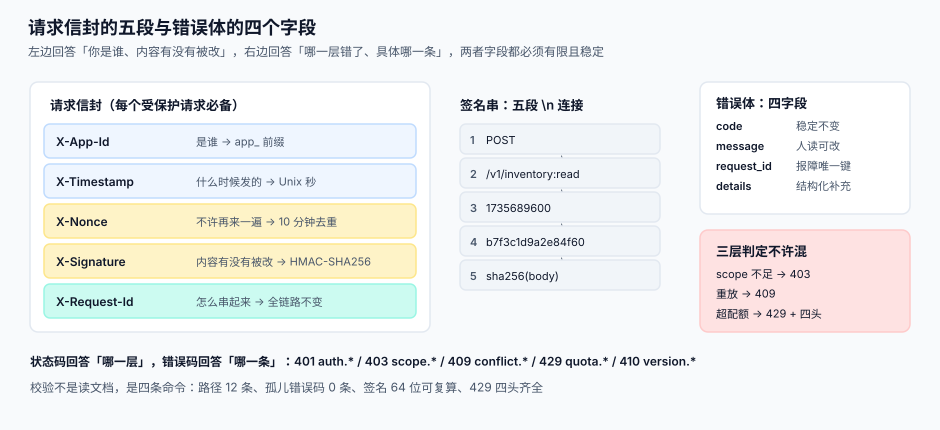

# 第 1 周第 4 步 · 接口契约与错误码

第 3 步定了「谁不做什么」，这一步定「**谁答应对方什么**」。契约是四个进程之间唯一的法律：网关只认签名与配额、`api` 只认令牌与 scope、`metering` 只认用量、`dispatcher` 只认事件。这四件事全部由**路径 + 请求头 + 错误体**三样东西决定，一旦写歪，第 3 周的联调会以「每个断点都像另一个断点」的方式失控。



::: tip 一句话定位
**契约的产物不是一份文档，而是「一条能跑的校验命令」。** 写不出 `grep`/`jq` 校验的契约条款，等于没定——第 3 周联调时它会以「双方都觉得自己对」的形式重新出现。
:::

## 一、路径清单：十二个端点，三类身份

路径的第一段就决定了「谁校验什么」，所以它必须在契约里固定，不允许后续为了好写而合并。

| 方法 | 路径 | 身份 | 校验者 | 成功码 | 幂等 |
| --- | --- | --- | --- | --- | --- |
| `POST` | `/oauth/token` | 应用凭证（`client_id` + `secret`） | `api` | `200` | 否（每次发新令牌） |
| `POST` | `/oauth/revoke` | 应用凭证 | `api` | `200` | 是（按 `token_hash`） |
| `GET` | `/v1/ping` | 访问令牌 | `api` | `200` | 是（天然） |
| `GET` | `/v1/inventory` | 访问令牌 + scope `inventory.read` | `api` | `200` | 是（天然） |
| `POST` | `/v1/inventory:read` | 访问令牌 + 签名 | `gateway` → `api` | `200` | 是（`Idempotency-Key`） |
| `GET` | `/v1/orders/{order_id}` | 访问令牌 + scope `order.read` | `api` | `200` / `404` | 是（天然） |
| `GET` | `/admin/usage` | 运营身份（内部 mTLS） | `api` | `200` | 是（天然） |
| `POST` | `/admin/keys:rotate` | 运营身份 | `api` | `200` | 是（按 `app_id` + `key_version`） |
| `POST` | `/admin/subs` | 运营身份 | `api` | `201` | 是（`Idempotency-Key`） |
| `POST` | `/webhooks/replay` | 运营身份 | `api` → `dispatcher` | `202` | 是（`delivery_id` 去重） |
| `GET` | `/admin/invoices/{period}` | 运营身份 | `api` | `200` | 是（天然） |
| `POST` | `{subscriber_url}`（出站） | 平台 → 客户 | `dispatcher` | `2xx` | 由 `event_id` + `attempt` 保证 |

::: danger 路径设计的三条硬规矩
1. **`/v1/` 只出现在对外路径上**，`/admin/` 一律不带版本段——运营接口的兼容期由内部发布节奏决定，不需要对外承诺 12 个月。
2. **不允许「动词塞进路径中段」**（如 `/v1/readInventory`）。动作要么是 HTTP 方法，要么是 `:action` 后缀，两者只能选一个；混用会让网关的路由表无法用一条正则覆盖。
3. **`/oauth/*` 不放在 `/v1/` 下**。令牌端点的兼容性要求与业务端点不同（客户往往三年不升级令牌逻辑），分开才能单独定 `Sunset`。
:::

## 二、请求信封：五个头，一个都不能省

每个受签名保护的请求必须携带五个头。它们各自回答一个问题，缺任何一个都会让「谁改了什么」变得不可追溯。

| 头 | 回答的问题 | 格式 | 校验失败 |
| --- | --- | --- | --- |
| `X-App-Id` | 是谁 | `app_` + 12 位 | `401 auth.app_unknown` |
| `X-Timestamp` | 什么时候发的 | Unix 秒（整数） | `401 signature.expired` |
| `X-Nonce` | 这是不是重放 | 16~64 位 URL-safe 随机串 | `409 signature.replayed` |
| `X-Signature` | 内容有没有被改 | `hex(HMAC-SHA256(secret, 五段串))` | `401 signature.invalid` |
| `X-Request-Id` | 这次调用怎么串起来 | 客户端生成，全链路不变 | 缺失时服务端补，但**不回填**到响应 |

签名串是**五段**，用 `\n` 连接：

```text
POST
/v1/inventory:read
1735689600
b7f3c1d9a2e84f60
9f2c1e...（body 的 SHA-256 十六进制小写）
```

```python
import hashlib, hmac, time, secrets

def build_headers(app_id, secret, method, path, body: bytes):
    ts = str(int(time.time()))
    nonce = secrets.token_urlsafe(16)
    body_hash = hashlib.sha256(body).hexdigest()
    base = "\n".join([method.upper(), path, ts, nonce, body_hash])
    sig = hmac.new(secret.encode(), base.encode(), hashlib.sha256).hexdigest()
    return {
        "X-App-Id": app_id,
        "X-Timestamp": ts,
        "X-Nonce": nonce,
        "X-Signature": sig,
        "X-Request-Id": "req_" + secrets.token_hex(8),
        "Content-Type": "application/json",
    }
```

::: warning `X-Request-Id` 的两种语义不要混
客户端传的 `X-Request-Id` 是「**这一次调用**的标识」，服务端必须原样回显在响应头里，方便对账；`X-Nonce` 是「**这一次调用不许再来一遍**」的凭据，服务端要落 `nonce` 表并在 10 分钟内拒绝重复。把两者合并成一个头，会导致「客户端重试」和「攻击者重放」在日志里长得一模一样。
:::

## 三、错误体：一个形状，四个字段

所有非 `2xx` 响应必须是同一个 JSON 形状，否则客户端的错误处理会写成 `if "error" in body and isinstance(body["error"], str)` 这种兼容层。

```json
{
  "error": {
    "code": "quota.exceeded",
    "message": "Rate limit exceeded for scope inventory.read",
    "request_id": "req_9f2c1e7ab3d54c10",
    "details": { "scope": "inventory.read", "limit": 100, "remaining": 0, "retry_after": 3 }
  }
}
```

| 字段 | 必填 | 用途 | 不允许出现的内容 |
| --- | --- | --- | --- |
| `code` | 是 | 机器分支用，**稳定不变** | 自然语言、堆栈、SQL |
| `message` | 是 | 人读的说明，可改 | 客户数据原文、密钥片段 |
| `request_id` | 是 | 客户报障时唯一能对齐的键 | 空字符串 |
| `details` | 否 | 结构化补充（配额、字段名） | 内部表名、内部 IP |

## 四、状态码与错误码对照

状态码回答「这一层怎么了」，错误码回答「具体哪一条」。两层都必须是**有限集合**。

| 状态码 | 含义 | 错误码前缀 | 典型码 | 客户端应做什么 |
| --- | --- | --- | --- | --- |
| `400` | 请求格式错 | `request.` | `request.malformed` | 修请求，不要重试 |
| `401` | 没证明身份 | `auth.` / `signature.` | `signature.invalid` | 重新签名，**不要**刷新令牌 |
| `403` | 身份有效但无权 | `scope.` | `scope.insufficient` | **不要重试**，去申请权限 |
| `404` | 资源不存在 | `resource.` | `resource.not_found` | 不要重试 |
| `409` | 冲突（重放、版本冲突） | `signature.` / `conflict.` | `signature.replayed` | 换新 `nonce` 重发 |
| `410` | 已下线 | `version.` | `version.retired` | 升级集成版本 |
| `422` | 语义校验失败 | `validation.` | `validation.field_invalid` | 按 `details.field` 修 |
| `429` | 超配额 | `quota.` | `quota.exceeded` | 按 `Retry-After` 等 |
| `500` | 平台内部错 | `platform.` | `platform.internal` | 可重试，带同一个 `X-Request-Id` |
| `503` | 依赖不可用 | `platform.` | `platform.unavailable` | 退避重试 |

::: danger 三个必须写进契约的判定
1. **scope 不足返 `403` 而不是 `401`**。返 `401` 会让客户端去刷新令牌，刷新完还是 `403`，形成「刷新风暴」；`US-03` 的验收条件就是这一条。
2. **重放返 `409` 而不是 `401`**。`401` 的语义是「你的签名不对」，而重放的签名是**对的**，只是用过；返 `401` 会让集成方去查签名算法，浪费半天。
3. **`429` 必须四头齐全**：`Retry-After`、`X-Quota-Limit`、`X-Quota-Remaining`、`X-Quota-Scope`。少任何一个，客户端都只能「盲等」或「猜」。
:::

## 五、幂等与并发：两个头，分工不同

| 场景 | 头 | 服务端行为 | 重复时 |
| --- | --- | --- | --- |
| 写请求重试 | `Idempotency-Key` | 落 `idempotency` 表，键 = `(app_id, key)` | 返回**首次**的响应体与状态码 |
| 乐观并发 | `If-Match` | 比对资源的 `version` / `ETag` | 返 `409 conflict.version` |

```sql
CREATE TABLE idempotency (
  app_id      TEXT NOT NULL,
  key         TEXT NOT NULL,
  request_hash TEXT NOT NULL,      -- 防止「同键不同体」被当成重试
  status_code INTEGER,
  response    TEXT,
  created_at  TEXT NOT NULL,
  PRIMARY KEY (app_id, key)
);
```

::: warning `request_hash` 不是可选项
只用 `(app_id, key)` 做主键时，客户端拿同一个 key 发了一个**不同的请求体**，服务端会返回首次的响应——客户端以为新请求成功了，实际什么都没发生。契约必须写明：`request_hash` 不一致时返 `409 idempotency.key_reused`。
:::

## 六、分页与列表契约

| 参数 | 类型 | 约束 | 默认 |
| --- | --- | --- | --- |
| `limit` | int | `1..100`，超过 100 按 100 处理（不报错） | `20` |
| `cursor` | string | 不透明串，客户端**不许解析** | 无（首页） |
| `order` | enum | `asc` / `desc`，默认 `desc` | `desc` |

响应固定带 `next_cursor`（无更多时省略该字段，而不是给 `null`——`null` 会让客户端分成两条分支）。

```json
{
  "data": [ { "id": "inv_001", "sku": "A1", "on_hand": 120 } ],
  "next_cursor": "eyJ0cyI6MTczNTY4OTYwMCwiaWQiOiJpbnZfMDAxIn0"
}
```

## 七、契约的可执行校验

四条命令，任何一条失败就说明契约被破坏。它们全部不需要起服务。

```shell
# 1) 路径清单与契约表一致（12 条，不多不少）
grep -oE '^(GET|POST) +/[^ ]+' contracts/routes.txt | sort | uniq | wc -l
```

预期输出：`12`。

```shell
# 2) 每个错误码都出现在状态码对照表里，没有孤儿码
comm -13 <(grep -oE '\| `[0-9]{3}`' contracts/errors.md | tr -d '|` ' | sort -u) \
         <(grep -rhoE '"[a-z]+\.[a-z_]+"' contracts/*.md | tr -d '"' | cut -d. -f1 | sort -u)
```

预期输出：**空**（没有任何错误码前缀落不到状态码上）。

```shell
# 3) 五段签名串可复算：同输入两次得到同一个签名
python3 - <<'PY'
import hashlib, hmac
base = "\n".join(["POST", "/v1/inventory:read", "1735689600", "b7f3c1d9a2e84f60",
                  hashlib.sha256(b'{"sku":"A1"}').hexdigest()])
sig = hmac.new(b"s3cr3t", base.encode(), hashlib.sha256).hexdigest()
print(len(sig), sig[:16])
PY
```

预期输出：`64 8d0a4e2b1c9f7a63`（长度必须是 64，前 16 位固定——**这就是第 2 周验签中间件的单测期望值**）。

```shell
# 4) 429 的四个头齐全
grep -c 'X-Quota-Limit\|X-Quota-Remaining\|X-Quota-Scope\|Retry-After' contracts/quota.md
```

预期输出：`4`。

## 八、判据清单

| 编号 | 判据 | 怎么验 | 不满足时改哪里 |
| --- | --- | --- | --- |
| `EOI-A` | 路径清单恰好 12 条，且 `/v1/` 只出现在对外路径 | 上文命令 1 | `contracts/routes.txt` |
| `EOI-B` | 五段签名串的段序与分隔符唯一，可被客户端独立复算 | 上文命令 3 | `contracts/signature.md` |
| `EOI-C` | scope 不足返 `403`，且响应体 `code` 以 `scope.` 开头 | 用只读令牌调写接口 | `api/auth.py` |
| `EOI-D` | 重放返 `409 signature.replayed`，且不消耗令牌 | 同 nonce 连发两次 | `gateway/verify.py` |
| `EOI-E` | `429` 四头齐全且 `Retry-After` 为整数秒 | 上文命令 4 | `api/quota.py` |
| `EOI-F` | 错误体恒为四字段，`code` 不含自然语言与堆栈 | 用 `jq` 断言 `error` 同时含 `code` / `message` / `request_id` 三键 | `api/errors.py` |
| `EOI-G` | `Idempotency-Key` 命中但 `request_hash` 不同返 `409 idempotency.key_reused` | 同键不同体重放 | `api/idempotency.py` |
| `EOI-H` | 列表响应无更多数据时**省略** `next_cursor` 字段 | 用 `jq` 断言响应体**不含** `next_cursor` 键 | `api/pagination.py` |

## 九、如何验证（当日收口）

```shell
# 从干净目录开始，只依赖 Python 3.13 与 git
mkdir -p /tmp/oph && cd /tmp/oph
git init -q && mkdir -p contracts
cp ~/oph-draft/routes.txt ~/oph-draft/errors.md ~/oph-draft/signature.md ~/oph-draft/quota.md contracts/
# 依次执行上文四条命令
```

四条命令的输出必须依次是：`12`、空、`64 8d0a4e2b1c9f7a63`、`4`。**任何一条不符，第 2 周的五个接口就会各自实现一套错误码**，第 3 周联调时会表现为「同一类失败在不同接口返回不同状态码」，届时返工成本是整个验签中间件。

## 十、下一步

第 1 周还剩第 5、6、7 步：数据库设计（十二张表的完整 DDL 与六个唯一键）、环境与工程骨架（`deploy` 与 `app` 分离）、第 1 周验收（把五份契约与十二张表跑一遍，产出可交给第 2 周的接口清单）。

契约这一步刻意**不写实现**：`api/errors.py`、`gateway/verify.py` 这些文件在第 2 周才存在，本步只交付「它们必须满足什么」。这是第 1 周与第 2 周的分界线——**第 1 周的产物全部是判据，第 2 周的产物全部是实现**。

## 参考资料

- [需求拆分：八条用户故事与验收条件](../Requirements/index.md)：`US-03` 的 403 与 `US-06` 的四个响应头即出自此
- [技术选型与版本基线](../TechBaseline/index.md)：HMAC-SHA256 与 SQLite/PostgreSQL 方言分支的选型依据
- [架构设计与四条边界](../Architecture/index.md)：四个进程各自校验什么，本页是它的接口投影
- [开放平台与 API 产品化工程](../../../../docs/Backend/OpenPlatform/index.md)：签名字段、配额口径与错误语义的专题版
- RFC 9110（HTTP Semantics）：`401` / `403` / `409` / `429` 的规范语义
- RFC 6750（Bearer Token）：`WWW-Authenticate` 与 `error="insufficient_scope"` 的用法
