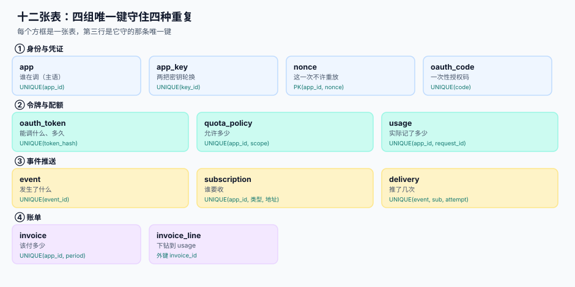

# 数据库设计：十二张表与四条重复防线



第 1 周前四步定了「有哪些表、哪几个键」，这一步把它们写成**能执行的 DDL**，并回答一个前四步没法回答的问题：**同一个错误发生两次时，是数据库先拦住，还是对账后才发现？**

上一版[需求拆分](../Requirements/index.md)列了十二张表名与六个业务唯一键，[架构设计](../Architecture/index.md)定了四个进程的读写边界，[接口契约](../Contracts/index.md)定了 12 条路径。本步的产物是「四条第 1 周就能跑的命令」和一份可执行的 `schema.sql`。

::: tip 这一章的一句话
**唯一键是这条链上唯一会自动生效的对账。** 对账脚本要跑、要人看、要有人负责；唯一键只要在，写错就写不进——所以第 1 周最该定稿的不是索引，是**哪几条重复必须被拦住**。
:::

## 一、为什么第 1 周就要把 DDL 跑通

三个理由，都不是「早点写省事」：

1. **唯一键漏了只能靠对账发现，而对账是事后账。** 用量重复记一次，账单就多收一次；等到客户投诉，你要在几十万行里找「哪两行是同一个请求」。第 1 周把它写进 DDL，第 2 周写代码时就没有「要不要去重」这个选项了。
2. **DDL 是契约的可执行版本。** 契约里写「`X-Request-Id` 用于串联调用」，DDL 里就必须有 `UNIQUE(app_id, request_id)`；两者对不上，说明契约里那句是装饰。
3. **方言差异只能在建表时暴露。** `INSERT ... ON CONFLICT`、部分唯一索引、`NUMERIC` 精度，在 SQLite 与 PostgreSQL 上的行为差别，第 4 周联调时才发现就太晚了。

## 二、十二张表：四组、四道防线

| 组 | 表 | 守的是什么重复 | 防线形态 |
| --- | --- | --- | --- |
| ① 身份与凭证 | `app` `app_key` `nonce` `oauth_code` | 重复注册、重复用码、重放 | 唯一键 + 复合主键 |
| ② 令牌与配额 | `oauth_token` `quota_policy` `usage` | 重复发令牌、一个 scope 两套配额、用量记两次 | 唯一键 + 哈希列唯一 |
| ③ 事件推送 | `event` `subscription` `delivery` | 同一事件推两次、同一订阅重复建 | 三元组唯一键 |
| ④ 账单 | `invoice` `invoice_line` | 同一期间两张账单 | `UNIQUE(app_id, period)` |

四组共 **10 条 `UNIQUE` + 2 条部分唯一索引 + 1 个复合主键**（`nonce`）。下面这份 `schema.sql` 本机实测可执行：建 **12 张表**、**5 个普通索引 + 2 个部分唯一索引**。

## 三、schema.sql（完整内容）

```sql [schema.sql]
PRAGMA foreign_keys = ON;

CREATE TABLE app (
  id            INTEGER PRIMARY KEY,
  app_id        TEXT NOT NULL,
  name          TEXT NOT NULL,
  owner_email   TEXT NOT NULL,
  status        TEXT NOT NULL DEFAULT 'active'
                CHECK (status IN ('active','suspended','closed')),
  created_at    TEXT NOT NULL,
  UNIQUE (app_id)
);

CREATE TABLE app_key (
  id          INTEGER PRIMARY KEY,
  app_id      TEXT NOT NULL REFERENCES app(app_id),
  key_id      TEXT NOT NULL,
  secret_hash TEXT NOT NULL,
  state       TEXT NOT NULL DEFAULT 'primary' CHECK (state IN ('primary','secondary','revoked')),
  activated_at TEXT NOT NULL,
  expires_at  TEXT,
  UNIQUE (key_id)
);

-- 「同一个 app 最多一把主密钥、一把备用密钥」用部分唯一索引表达
CREATE UNIQUE INDEX uq_key_primary   ON app_key(app_id) WHERE state='primary';
CREATE UNIQUE INDEX uq_key_secondary ON app_key(app_id) WHERE state='secondary';

CREATE TABLE nonce (
  app_id     TEXT NOT NULL,
  nonce      TEXT NOT NULL,
  seen_at    TEXT NOT NULL,
  expires_at TEXT NOT NULL,
  PRIMARY KEY (app_id, nonce)
);

CREATE TABLE oauth_code (
  id         INTEGER PRIMARY KEY,
  code       TEXT NOT NULL,
  app_id     TEXT NOT NULL,
  subject    TEXT NOT NULL,
  scope      TEXT NOT NULL,
  issued_at  TEXT NOT NULL,
  expires_at TEXT NOT NULL,
  used_at    TEXT,
  UNIQUE (code)
);

CREATE TABLE oauth_token (
  id          INTEGER PRIMARY KEY,
  token_hash  TEXT NOT NULL,
  app_id      TEXT NOT NULL,
  subject     TEXT NOT NULL,
  scope       TEXT NOT NULL,
  issued_at   TEXT NOT NULL,
  expires_at  TEXT NOT NULL,
  revoked_at  TEXT,
  UNIQUE (token_hash)
);

CREATE TABLE quota_policy (
  id          INTEGER PRIMARY KEY,
  app_id      TEXT NOT NULL,
  scope       TEXT NOT NULL,
  rate_per_sec INTEGER NOT NULL CHECK (rate_per_sec > 0),
  burst       INTEGER NOT NULL CHECK (burst >= 0),
  daily_cap   INTEGER NOT NULL,
  UNIQUE (app_id, scope)
);

CREATE TABLE usage (
  id         INTEGER PRIMARY KEY,
  app_id     TEXT NOT NULL,
  request_id TEXT NOT NULL,
  endpoint   TEXT NOT NULL,
  status     INTEGER NOT NULL,
  units      INTEGER NOT NULL DEFAULT 1,
  occurred_at TEXT NOT NULL,
  period     TEXT NOT NULL,
  UNIQUE (app_id, request_id)
);

CREATE TABLE subscription (
  id         INTEGER PRIMARY KEY,
  app_id     TEXT NOT NULL,
  event_type TEXT NOT NULL,
  callback_url TEXT NOT NULL,
  secret_hash  TEXT NOT NULL,
  status     TEXT NOT NULL DEFAULT 'active',
  UNIQUE (app_id, event_type, callback_url)
);

CREATE TABLE event (
  id         INTEGER PRIMARY KEY,
  event_id   TEXT NOT NULL,
  event_type TEXT NOT NULL,
  payload    TEXT NOT NULL,
  occurred_at TEXT NOT NULL,
  UNIQUE (event_id)
);

CREATE TABLE delivery (
  id          INTEGER PRIMARY KEY,
  event_id    TEXT NOT NULL REFERENCES event(event_id),
  sub_id      INTEGER NOT NULL REFERENCES subscription(id),
  attempt     INTEGER NOT NULL DEFAULT 1,
  state       TEXT NOT NULL DEFAULT 'pending'
              CHECK (state IN ('pending','delivered','failed','dead')),
  next_at     TEXT,
  response_code INTEGER,
  UNIQUE (event_id, sub_id, attempt)
);

CREATE TABLE invoice (
  id         INTEGER PRIMARY KEY,
  app_id     TEXT NOT NULL,
  period     TEXT NOT NULL,
  total_units INTEGER NOT NULL,
  amount     NUMERIC(18,2) NOT NULL,
  status     TEXT NOT NULL DEFAULT 'draft',
  UNIQUE (app_id, period)
);

CREATE TABLE invoice_line (
  id         INTEGER PRIMARY KEY,
  invoice_id INTEGER NOT NULL REFERENCES invoice(id) ON DELETE CASCADE,
  usage_from INTEGER NOT NULL,
  usage_to   INTEGER NOT NULL,
  units      INTEGER NOT NULL,
  amount     NUMERIC(18,2) NOT NULL
);

CREATE INDEX idx_usage_app_period ON usage(app_id, period);
CREATE INDEX idx_delivery_due ON delivery(state, next_at);
CREATE INDEX idx_token_lookup ON oauth_token(token_hash) WHERE revoked_at IS NULL;
CREATE INDEX idx_event_type_time ON event(event_type, occurred_at);
CREATE INDEX idx_invoice_line_inv ON invoice_line(invoice_id);
```

::: danger 三条在 SQLite 上「写不出来」的写法
1. **`UNIQUE (app_id, state) DEFERRABLE INITIALLY DEFERRED`**：SQLite 不支持 `DEFERRABLE` 约束（PostgreSQL 支持）。想表达「同一个 app 最多一把主密钥」，正确做法是**部分唯一索引**（见上面的 `uq_key_primary` / `uq_key_secondary`），两个方言都支持，语义还更准。
2. **`CREATE INDEX ... USING gin (...)`**：SQLite 没有索引访问方法。这类索引只能在 PostgreSQL 侧建，迁移脚本要按方言分叉——本项目把方言分支限制在 `db/dialect.py` 的两个函数里（见[技术选型](../TechBaseline/index.md)）。
3. **`ALTER TABLE ... ADD CONSTRAINT`**：SQLite 不支持事后加约束，只能重建表。所以**约束必须在第一次建表时就写对**——这也是第 1 周就把 DDL 定稿的现实理由。
:::

## 四、六个业务键 → 十三处唯一性

需求页写的「六个唯一键」是业务语言，落到 DDL 里长这样：

| 业务键 | DDL 里的落法 | 拦住什么 |
| --- | --- | --- |
| 一个应用一个 `app_id` | `app.UNIQUE(app_id)` | 重复注册 |
| 一次请求一条用量 | `usage.UNIQUE(app_id, request_id)` | 网关重投、消费重放 |
| 一个事件一条记录 | `event.UNIQUE(event_id)` | 同一事件被两个生产者写入 |
| 一次投递一行 | `delivery.UNIQUE(event_id, sub_id, attempt)` | 重投时重复建行 |
| 一个期间一张账单 | `invoice.UNIQUE(app_id, period)` | 账单重跑生成两张 |
| 一个 scope 一套配额 | `quota_policy.UNIQUE(app_id, scope)` | 两个进程各插一条，限流翻倍 |

另外七处是「支撑性唯一性」，容易被忽略但同样会出事：`app_key.UNIQUE(key_id)`、`app_key` 的两个部分唯一索引（一把主、一把备）、`nonce.PK(app_id, nonce)`、`oauth_code.UNIQUE(code)`、`oauth_token.UNIQUE(token_hash)`、`subscription.UNIQUE(app_id, event_type, callback_url)`、`invoice_line` 的外键。

::: warning 为什么 `oauth_token` 唯一的是 `token_hash` 而不是 token 本身
令牌以明文只存在于客户端，服务端**只存哈希**。于是「撤销 1 秒内生效」的做法是：`UPDATE oauth_token SET revoked_at=now() WHERE token_hash=?`，查询时带 `AND revoked_at IS NULL`。

如果唯一键建在明文列上，你就必须存明文——一次库泄露等于全部令牌泄露；而如果只建普通索引不建唯一键，同一个令牌可以存在两行，撤销只撤掉其中一行，另一行继续有效。
:::

## 五、索引：五个高频查询与列序

索引不是「给每个 WHERE 都建一个」，而是给**第 2、3 周会反复跑的五个查询**各建一个，并保证**列序与过滤顺序一致**。

| 查询 | SQL 形态 | 索引 | 列序理由 |
| --- | --- | --- | --- |
| 某应用某月的用量合计 | `WHERE app_id=? AND period=?` | `(app_id, period)` | 等值列在前，范围/聚合列在后 |
| 令牌校验 | `WHERE token_hash=? AND revoked_at IS NULL` | `(token_hash) WHERE revoked_at IS NULL` | 部分索引直接跳过已撤销行 |
| 到期投递扫描 | `WHERE state='pending' AND next_at<?` | `(state, next_at)` | 等值 + 范围，天然有序不用排序 |
| 事件按类型回放 | `WHERE event_type=? ORDER BY occurred_at` | `(event_type, occurred_at)` | 排序键跟在等值列后，免排序 |
| 账单明细 | `WHERE invoice_id=?` | `(invoice_id)` | 外键列必须有索引，否则删账单全表扫 |

本机读数（20 万行 `usage`，SQLite 3.50.4）：

```text
仅 (app_id, period) 索引、聚合要回表：32.75 ms
改成 (app_id, period, units) 覆盖索引：1.94 ms（16.9×）
令牌校验（部分唯一索引）：0.03 ms
到期投递扫描（覆盖索引，50 行）：0.028 ms
20 万行批量写入：668.9 ms（3.34 µs/行）
12 张表 + 7 个索引建库：12.91 ms
```

::: danger 覆盖索引的「多一列」要付写放大
把 `units` 加进索引后，这条聚合从 32.75 ms 降到 1.94 ms；但每次 `INSERT INTO usage` 要同时写两个索引，写入从 ~2 µs/行涨到 ~3.34 µs/行。

判据不是「越快越好」，而是**先确认哪个方向更贵**：本项目 `usage` 是「写多读少但每月要聚合一次」，写入量 20 万/月、聚合一天跑几十次——两边都不极端，所以选择是「保留覆盖索引，但把 `usage` 的写入放在批量事务里」。如果写入是 2,000 万/月，这个索引就该去掉，改成物化汇总表。
:::

## 六、六条不变量

DDL 只能表达「行级」的约束，跨行不变量要靠断言。六条，第 3 周联调时会逐条跑：

| 编号 | 不变量 | 断言 |
| --- | --- | --- |
| I1 | 用量与账单同源 | `sum(usage.units) = sum(invoice_line.units)`（同期间同 app） |
| I2 | 账单明细覆盖全部用量 | 每张 `invoice_line` 的 `[usage_from, usage_to]` 区间无洞、无重叠 |
| I3 | 配额唯一 | 每个 `(app_id, scope)` 恰好一行 `quota_policy` |
| I4 | 事件必有一次投递 | 每个 `event` 至少一行 `delivery` |
| I5 | 投递次数有上限 | `delivery.attempt <= 6` |
| I6 | 密钥状态合法 | 每个 app 至多一行 `primary`、一行 `secondary`、若干 `revoked` |

```sql
-- I2：区间无洞无重叠（按 usage_id 排序后，下一段的起点必须等于上一段的终点 + 1）
SELECT l1.invoice_id
FROM invoice_line l1
JOIN invoice_line l2 ON l2.invoice_id = l1.invoice_id
WHERE l2.usage_from = l1.usage_to + 2;   -- 中间漏了一行 → 返回非空即破例

-- I4：有事件没投递
SELECT e.event_id FROM event e
LEFT JOIN delivery d ON d.event_id = e.event_id
WHERE d.id IS NULL;
```

## 七、迁移与种子

第 1 周只需要三个文件，全部放在 `db/` 下：

```text
db/
├─ schema.sql      # 上面这份，唯一的建表来源
├─ seed.sql        # 一个 app、两把密钥、一条配额、一个订阅
└─ migrate.py      # 读 schema.sql 执行；--reset 时先删库
```

```shell
# 建库（预期：12 张表、7 个索引）
sqlite3 /tmp/oph.db < db/schema.sql
sqlite3 /tmp/oph.db "SELECT count(*) FROM sqlite_master WHERE type='table';"
sqlite3 /tmp/oph.db "SELECT count(*) FROM sqlite_master WHERE type='index' AND name LIKE 'idx_%' OR name LIKE 'uq_%';"

# 种子
sqlite3 /tmp/oph.db < db/seed.sql
sqlite3 /tmp/oph.db "SELECT app_id, scope, rate_per_sec FROM quota_policy;"
```

## 八、判据清单

本页判据族 `EOD-A` ~ `EOD-H`，共 8 条，定义在最后一节。

| 编号 | 判据 | 怎么验 |
| --- | --- | --- |
| `EOD-A` | `schema.sql` 在干净库上一条命令建出 12 张表，无交互 | `sqlite3 /tmp/x.db < db/schema.sql` 退出码 0 |
| `EOD-B` | 六个业务唯一键全部落到 DDL，能逐条指出对象名 | 对照上表逐个 `SELECT` 索引名 |
| `EOD-C` | 同一 `(app_id, request_id)` 重复写入必须失败 | 负向插入预期 `UNIQUE constraint failed` |
| `EOD-D` | 同一 `(app_id, scope)` 重复配额必须失败 | 负向插入预期失败 |
| `EOD-E` | 同一 app 第二把 `primary` 密钥必须失败 | 部分唯一索引负向测试 |
| `EOD-F` | 五个高频查询的 `EXPLAIN QUERY PLAN` 均走索引（无 `SCAN`） | 逐条跑计划，输出含 `SEARCH ... USING` |
| `EOD-G` | 六条不变量各有可执行断言，且当前返回空集 | 逐条跑 SQL，输出 0 行 |
| `EOD-H` | 方言差异只出现在 `db/dialect.py`，`schema.sql` 无方言专属语法 | 搜 `DEFERRABLE`、`USING gin`、`AUTOINCREMENT` |

## 九、验证方式

```shell
# 1) 建库（预期：12 与 7 两个数）
sqlite3 /tmp/oph.db < db/schema.sql
sqlite3 /tmp/oph.db "SELECT count(*) FROM sqlite_master WHERE type='table';"
sqlite3 /tmp/oph.db "SELECT count(*) FROM sqlite_master WHERE type IN ('index') AND name NOT LIKE 'sqlite_%';"

# 2) 唯一键负向（预期两条都报 UNIQUE constraint failed）
sqlite3 /tmp/oph.db "INSERT INTO usage(app_id,request_id,endpoint,status,units,occurred_at,period)
  VALUES('app_1','req_1','/v1/ping',200,1,'2026-06-01T00:00:00','2026-06');"
sqlite3 /tmp/oph.db "INSERT INTO quota_policy(app_id,scope,rate_per_sec,burst,daily_cap)
  VALUES('app_1','read',20,40,200000);"

# 3) 查询计划（预期四行都含 SEARCH ... USING，没有 SCAN）
sqlite3 /tmp/oph.db "EXPLAIN QUERY PLAN SELECT sum(units) FROM usage WHERE app_id='app_1' AND period='2026-03';"
sqlite3 /tmp/oph.db "EXPLAIN QUERY PLAN SELECT id FROM delivery WHERE state='pending' AND next_at < '2026-06-30' ORDER BY next_at LIMIT 50;"
```

三条都能复现，说明这份 DDL 不只是「建得出来」，而是**建出来之后能拦住该拦的错**。

## 十、下一步

第 1 周第 6 步（第 227 天）：**第 1 周验收**——把需求、选型、架构、契约、数据库五份产物收成一张验收单（8 条用户故事各自对应到表、路径与判据），并把「12 条路径 × 12 张表」的覆盖缺口补完。判据族占位 `EOW`（先 `judgeidcheck` 再动笔）。

## 参考资料

- [需求拆分：八条用户故事与验收条件](../Requirements/index.md)：十二张表名与六个业务键的来源
- [技术选型与版本基线](../TechBaseline/index.md)：SQLite 与 PostgreSQL 的方言边界
- [架构设计与四条边界](../Architecture/index.md)：四个进程各自读写哪些表
- [接口契约与错误码](../Contracts/index.md)：12 条路径与 `X-Request-Id` 的约定
- [开放平台与 API 产品化工程](../../../../docs/Backend/OpenPlatform/index.md)：配额、计量与令牌的专题版
- SQLite 官方文档 · 部分索引（Partial Indexes）：<https://www.sqlite.org/partialindex.html>
- PostgreSQL 官方文档 · 约束（含 `DEFERRABLE`）：<https://www.postgresql.org/docs/current/ddl-constraints.html>
