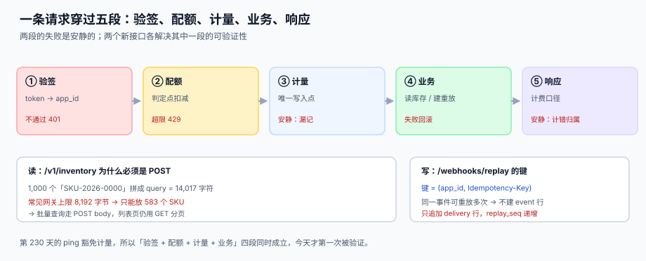

# 第 2 周第 4 步：`/v1/inventory` 与 `/webhooks/replay`

第 230 天的 `/v1/ping` 只证明了一件事：令牌能验、身份能解析。它**豁免计量**，所以「验签 + 配额 + 计量 + 业务」四段从来没有在同一条请求上同时成立过。今天补上两个接口，一个读、一个写，各自钉住其中一段。

::: tip 一句话理解
**`/v1/inventory` 证明「四段能串起来」，`/webhooks/replay` 证明「写接口的重投不会变成两次写入」。** 前者是链路的完整性，后者是写接口的幂等性——开放平台只有这两件事做对了，才轮得到谈账单。
:::

本页判据族 `EOY-A` ~ `EOY-H`，共 8 条，定义在第七节。

## 一、这一步解决的问题

前四步各自修好一段路：

| 天 | 段落 | 产物 | 遗留 |
| --- | --- | --- | --- |
| 228 | 计量唯一写入点 | `usage` 只被中间件写 | 身份是参数传的，可伪造 |
| 229 | 配额判定点 | 条件更新扣减 `used` | 同上 |
| 230 | 令牌签发 | `request_context` 首次可信 | ping 豁免计量，四段没同框 |
| 231 | **本步** | 一条真实读写请求走完五段 | 仍需第 3 周联调矩阵 |

所以本步的产物不是「两个接口」，而是**两条可被证伪的断言**：

1. 调用 `/v1/inventory` 一次，`usage` 恰好 +1，配额 `used` 恰好 +1，响应里的 `request_id` 能在 `usage` 里查到同一行。
2. 调用 `/webhooks/replay` 三次（同一 `Idempotency-Key`），`delivery` 只 +1，第二次和第三次返回的 body 与第一次**逐字节相同**。



## 二、五段链：哪两段是安静的

| 段 | 做什么 | 产物 | 失败方式 | 是否安静 |
| --- | --- | --- | --- | --- |
| ① 验签 | `Authorization: Bearer <token>` → `app_id` + `scope` | `request_context` | `401 auth.token_invalid` | 显性 |
| ② 配额 | 判定点扣减（条件更新） | `quota_policy.used` +1 | `429 quota.exceeded` | 显性 |
| ③ 计量 | 唯一写入点写 `usage` | `usage` 行 | **漏记**：配额扣了、账上没有 | **安静** |
| ④ 业务 | 读库存 / 建重放投递 | `inventory` 行 / `delivery` 行 | 抛错则 5xx | 显性 |
| ⑤ 响应 | 组装 body + 计费口径 | JSON | **归属错**：记到了别的 `app_id` | **安静** |

③ 和 ⑤ 安静的原因不同：③ 是「顺序问题」——如果先写业务再写 `usage`，业务失败回滚会连 `usage` 一起回滚，配额却已经扣了（配额在另一个事务里），于是**扣了配额却没有用量**；⑤ 是「上下文问题」——响应在中间件之外组装，稍不注意就拿不到 `request_context`，于是 `app_id` 退回成空值。

## 三、三个必须先定死的决定

### 决定一：`/v1/inventory` 的批量查询用 POST

单看语义，查库存是 GET。但客户真实的用法是「一次问我 1,000 个 SKU」：

```text
单个 SKU：SKU-2026-0001（13 字符）
1,000 个拼进 query：/v1/inventory?sku=... → 14,017 字符
常见网关 URL 上限：8,192 字节 → 只能放 583 个 SKU
```

所以拆成两条路径，而不是一条：

| 用途 | 方法 | 约束 |
| --- | --- | --- |
| 单个 / 少量查询（≤ 100 个） | `GET /v1/inventory?sku=a,b` | 走缓存，可被 CDN 缓存 |
| 批量查询（≤ 1,000 个） | `POST /v1/inventory/batch` | 不缓存，body 上限 256 KB |

::: danger 把批量查询也塞进 GET 的三个后果
1. **超长 URL 被网关拦掉**：返回的不是你的错误码，是网关的 `414 URI Too Long`，客户以为是平台挂了。
2. **URL 进了日志与监控**：1,000 个 SKU 会把访问日志打成一片，排障时找不到别的东西。
3. **缓存键爆炸**：每个不同的 SKU 组合都是一个新缓存键，命中率接近 0，反而比不缓存慢。
:::

### 决定二：重放的幂等键是 `(app_id, Idempotency-Key)`，不是事件 ID

`/webhooks/replay` 的语义是「请把某个事件再推一次」。它有三个特点：

- **同一个事件可以被合法地重放多次**（客户第一次没收到、第二次要补发）；
- **同一个请求可能被重投多次**（网关超时重试），这三次必须只产生一次重放；
- **重放不能伪造事件**：它只能引用已经存在的 `event_id`，不能新建。

所以键必须区分「哪一个请求」而不是「哪一个事件」：

```http
POST /webhooks/replay
Authorization: Bearer <token>
Idempotency-Key: 8f3c1e2a-...        ← 客户端生成，24 小时内唯一
Content-Type: application/json

{ "event_id": "evt_01J8Z9...", "endpoint_id": "ep_7f3c" }
```

| 情形 | 键相同？ | 期望行为 |
| --- | --- | --- |
| 同一请求超时重投 3 次 | 是 | 只建 1 行 `delivery`，后两次返回首次的 body |
| 客户手动重放同一事件 3 次 | 否（三个新键） | 建 3 行 `delivery`，`replay_seq` = 1/2/3 |
| 重投时改了 `endpoint_id` | 是 | **拒绝**（`409 idempotency.key_reused`），不能「同键不同请求」 |

### 决定三：重放只追加 `delivery`，`replay_seq` 单调递增

```sql
-- 重放不新建 event，只新建 delivery
INSERT INTO delivery(event_id, endpoint_id, attempt_no, replay_seq, status, created_at)
VALUES (:event_id, :endpoint_id, 1,
        (SELECT COALESCE(MAX(replay_seq), 0) + 1 FROM delivery
          WHERE event_id = :event_id AND endpoint_id = :endpoint_id),
        'PENDING', datetime('now'));
```

`replay_seq` 有三个用途：客户按它去重、平台按它计费（重放算一次新调用）、运维按它判断「这个客户是不是在刷重放」。

::: warning 重放的计费归属要说清楚
重放是一次真实的 API 调用，**计一次用量**（走第 ②③ 段），但**不重新生成事件内容**。客户经常会问「重放为什么也收费」——答案写在计费口径页里：「我们卖的是投递次数，不是事件数量」。这条口径必须在第 4 周的账单页出现，不能等到客户来争议。
:::

## 四、`/v1/inventory` 契约

```http
GET /v1/inventory?sku=SKU-2026-0001,SKU-2026-0002
Authorization: Bearer <token>
```

```json
{
  "request_id": "req_01J8ZA2K",
  "data": [
    { "sku": "SKU-2026-0001", "available": 128, "reserved": 12, "updated_at": "2026-11-30T09:12:03Z" },
    { "sku": "SKU-2026-0002", "available": 0,   "reserved": 0,  "updated_at": "2026-11-30T09:12:03Z" }
  ],
  "not_found": ["SKU-2026-0003"]
}
```

三条契约细节，每一条都来自前四步踩过的坑：

| 细节 | 为什么 | 违反后果 |
| --- | --- | --- |
| `available` 与 `reserved` 分列 | 客户要判断「能不能下单」，不是「仓库里有没有」 | 客户拿 `on_hand` 下单，超卖 |
| 不存在的 SKU 进 `not_found`，不报错 | 批量查询里一个坏 SKU 不该让整批失败 | 客户为了容错只能一次问一个 |
| 响应必须带 `request_id` | 客户报障时唯一能对上账的坐标 | 工单只能写「大概十点那次」 |

错误码沿用第 225 天定下的契约，本步只新增两个：

| 场景 | HTTP | code |
| --- | --- | --- |
| 批量超过 1,000 个 SKU | 400 | `inventory.batch_too_large` |
| 批量 body 超过 256 KB | 413 | `inventory.payload_too_large` |

## 五、`/webhooks/replay` 契约

```json
// 200 OK（首次）
{ "request_id": "req_01J8ZA3M", "delivery_id": "dlv_01J8ZA3N", "replay_seq": 1 }

// 200 OK（同键重投，body 与首次逐字节相同）
{ "request_id": "req_01J8ZA3M", "delivery_id": "dlv_01J8ZA3N", "replay_seq": 1 }
```

注意第二次返回的 `request_id` **也是第一次的那个**——这正是「逐字节相同」的实现方式：把首次响应整体存进 `idempotency` 表，命中时原样返回，而不是重新组装一个「看起来一样」的响应。

```sql
-- 第 226 天建好的表，本步第一次真正用上
CREATE TABLE idempotency (
  app_id      TEXT NOT NULL,
  idem_key    TEXT NOT NULL,
  req_hash    TEXT NOT NULL,      -- 请求体的 sha256，用于识别「同键不同请求」
  status_code INTEGER,
  resp_body   TEXT,
  created_at  TEXT NOT NULL,
  expires_at  TEXT NOT NULL,
  PRIMARY KEY (app_id, idem_key)
);
```

`req_hash` 是这张表里最容易被省掉的一列。省掉之后，「同一个键发了不同请求」会被当成「重投」处理，客户改了一个参数以为生效了，实际拿到的是上一次的结果——**而且看起来完全成功**。

## 六、端到端：一条令牌走完两个接口

```shell
TOKEN=$(curl -s -X POST http://127.0.0.1:8080/oauth/token \
  -d 'grant_type=client_credentials&client_id=cli_7f3c&client_secret=***&scope=inventory.read webhook.replay' \
  | python3 -c 'import sys,json;print(json.load(sys.stdin)["access_token"])')

# 1) 读一次库存
curl -s -H "Authorization: Bearer $TOKEN" \
  'http://127.0.0.1:8080/v1/inventory?sku=SKU-2026-0001' | python3 -m json.tool

# 2) 计量与配额各 +1（同一个 app_id）
sqlite3 /tmp/oph.db "SELECT count(*) FROM usage WHERE app_id='app_7f3c';"
sqlite3 /tmp/oph.db "SELECT used FROM quota_policy WHERE app_id='app_7f3c';"

# 3) 写一次重放，再用同一个键重投两次
for i in 1 2 3; do
  curl -s -X POST http://127.0.0.1:8080/webhooks/replay \
    -H "Authorization: Bearer $TOKEN" \
    -H "Idempotency-Key: 8f3c1e2a-0001" \
    -d '{"event_id":"evt_01J8Z9","endpoint_id":"ep_7f3c"}'; echo; done

# 4) 三次请求只应留下一条投递
sqlite3 /tmp/oph.db "SELECT count(*) FROM delivery WHERE event_id='evt_01J8Z9';"
```

## 七、判据族

| 编号 | 判据 | 怎么验 |
| --- | --- | --- |
| `EOY-A` | 读接口一次调用恰好产生一行 `usage`，且 `request_id` 可反查 | `SELECT count(*) FROM usage WHERE request_id=:rid` = 1 |
| `EOY-B` | 配额 `used` 与 `usage` 行数在同一窗口内相等 | 两个数相减为 0 |
| `EOY-C` | 批量查询超过 1,000 个 SKU 返回 400 `inventory.batch_too_large`，不返回 500 | 构造 1,001 个 SKU |
| `EOY-D` | 不存在的 SKU 进 `not_found`，整批仍返回 200 | 混一个坏 SKU |
| `EOY-E` | 同 `Idempotency-Key` 重投 3 次只建 1 行 `delivery` | `count(*)` = 1 |
| `EOY-F` | 重投的响应体与首次**逐字节相同**（含 `request_id`） | `diff <(curl...) <(curl...)` 无输出 |
| `EOY-G` | 同键不同请求返回 `409 idempotency.key_reused`，不静默返回旧结果 | 改 `endpoint_id` 重投 |
| `EOY-H` | 重放不新建 `event` 行，`replay_seq` 在同一 `(event_id, endpoint_id)` 上递增 | `count(event)` 不变、`seq` = 1,2,3 |

## 八、验证方式

```shell
# 1) 读接口的计量与配额同时 +1：两个数应相等
sqlite3 /tmp/oph.db "SELECT (SELECT count(*) FROM usage WHERE app_id='app_7f3c'),
                            (SELECT used FROM quota_policy WHERE app_id='app_7f3c');"
# 期望：两个数相同

# 2) 批量上限：1,001 个 SKU 应 400 而不是 500
python3 -c "print(','.join('SKU-2026-%04d'%i for i in range(1001)))" > /tmp/skus.txt
curl -s -o /dev/null -w '%{http_code}\n' -X POST http://127.0.0.1:8080/v1/inventory/batch \
  -H "Authorization: Bearer $TOKEN" --data-binary @/tmp/skus.txt
# 期望：400

# 3) 重投幂等：三次同键只留一行
sqlite3 /tmp/oph.db "SELECT count(*) FROM delivery WHERE event_id='evt_01J8Z9';"
# 期望：1

# 4) 响应逐字节相同：应无输出
A=$(curl -s -X POST http://127.0.0.1:8080/webhooks/replay -H "Authorization: Bearer $TOKEN" \
      -H 'Idempotency-Key: 8f3c1e2a-0002' -d '{"event_id":"evt_01J8Z9","endpoint_id":"ep_7f3c"}')
B=$(curl -s -X POST http://127.0.0.1:8080/webhooks/replay -H "Authorization: Bearer $TOKEN" \
      -H 'Idempotency-Key: 8f3c1e2a-0002' -d '{"event_id":"evt_01J8Z9","endpoint_id":"ep_7f3c"}')
diff <(echo "$A") <(echo "$B") && echo SAME
# 期望：SAME

# 5) 同键不同请求必须 409
curl -s -o /dev/null -w '%{http_code}\n' -X POST http://127.0.0.1:8080/webhooks/replay \
  -H "Authorization: Bearer $TOKEN" -H 'Idempotency-Key: 8f3c1e2a-0002' \
  -d '{"event_id":"evt_01J8Z9","endpoint_id":"ep_OTHER"}'
# 期望：409
```

::: info 本步的本机状态
第 230 天已经说明：这五条验证依赖第 2 周的最小可跑服务，**本机未起服务，故未跑**。跑法与期望值已写进本节，起服务后按条回填即可——**不把期望值抄进实测列**，是本仓从第 121 天起就定下的纪律。
:::

## 九、下一步

第 2 周还剩最后一步：**`/admin/usage` 查询面**（判据占位 `EOZ`）——它是客户自助对账的唯一入口，必须与第 228 天的计量、第 229 天的配额共用同一个 `window_start` 口径，否则会出现「页面显示还有额度、接口却返回 429」。

再往后是第 3 周联调：三处断点的用例矩阵（验签后配额前、配额后计量前、计量后响应前）、用量与账单的对账脚本、限额压测。

## 参考资料

- [第 2 周第 3 步：`/oauth/token` 与 `/v1/ping`](../AuthToken/index.md)：本步的身份来源
- [第 2 周第 1 步：计量中间件的唯一写入点](../Metering/index.md)：`usage` 的唯一写入
- [第 2 周第 2 步：配额与限流的判定点](../QuotaLimit/index.md)：`used` 的条件更新
- [第 1 周第 4 步：接口契约与错误码](../Contracts/index.md)：本步新增两个错误码的命名依据
- [幂等键与状态机](../../../../docs/Backend/IdempotencyStateMachine/IdempotencyKey/index.md)：`Idempotency-Key` 的通用设计
- RFC 9110 HTTP 语义（`Idempotency-Key` 的行业惯例来源）：<https://www.rfc-editor.org/rfc/rfc9110.html>
