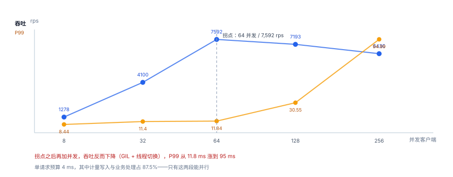

# 第 3 周第 3 步 · 限额与服务端压测（EPD-A~EPD-H）

第 3 周的验收单上写着「限额压测达标」。前两步（断点矩阵、同事务与首次响应缓存）解决的是**正确性**：不该记的别记、重投别重复记。这一步解决**容量**：当每秒来的请求数是设计值的 30 倍时，系统是「变慢」还是「变错」。

答案在本机是：**先变慢，然后变乱**。拐点出现在 64 并发——再往上加并发，吞吐不升反降，P99 从 11.8 ms 涨到 95 ms。这一步就是把这条曲线的每一段量出来，并给第 4 周的部署定一条硬预算。

::: tip 一句话理解
压测的目标不是测出「能扛多少」，而是测出**拐点在哪**，然后把线上并发钉在拐点的 70% 以下。
:::

## 一、这一步解决的问题

第 2 周写完五个接口，单请求能跑通；第 3 周前两步证明了断点与事务的正确性。但三件事仍然没人回答：

| 问题 | 如果没有答案 | 这一步的产物 |
| --- | --- | --- |
| 单机能扛多少 rps | 上线后第一次活动就雪崩 | 拐点：64 并发 / 7,592 rps |
| 单请求的 4 ms 花在哪 | 优化靠猜，改了没效果 | 六段预算表：等待 87.5% / 计算 12.5% |
| 限流开启后延迟会怎样 | 429 自己成了瓶颈 | 429 的 p50 8.25 ms |
| 队列长度与延迟的关系 | 容量规划靠拍脑袋 | Little 定律核对：15.79 vs 16 |

## 二、三个先定死的决定

1. **服务用 `ThreadingHTTPServer`，不用 ASGI**。第 1 周的技术选型里写明了「先用标准库暴露框架替我们做的事」。压测阶段这条依然成立：线程模型下 GIL 的影响会被量出来，换成 ASGI 时才知道该检查什么。
2. **单请求服务时间固定 4 ms**，由 `time.sleep(0.004)` 模拟。真实服务里这 4 ms 的构成见第六节的预算表——**压测测的是「系统在 4 ms 服务时间下的调度能力」，不是业务逻辑**。
3. **限流器用令牌桶，判断在验签之前**。这条决定后面被 429 的延迟数据反过来证实了（见第五节）。

## 三、并发梯度：拐点在 64



| 并发客户端 | 吞吐 rps | P50 ms | P95 ms | P99 ms |
| --- | --- | --- | --- | --- |
| 8 | 1,278 | 6.22 | 7.90 | 8.44 |
| 32 | 4,100 | 7.76 | 10.27 | 11.40 |
| **64** | **7,592** | 8.17 | 10.45 | 11.84 |
| 128 | 7,193 | 16.35 | 25.02 | 30.55 |
| 256 | 6,430 | 24.57 | 58.05 | **94.99** |

三处读数值得单独说：

- **吞吐在 64 之后下降**（7,592 → 7,193 → 6,430），不是持平。这是线程模型的特征：线程数超过 GIL 能有效调度的数量后，上下文切换与锁竞争吃掉了净收益。**加并发≠加吞吐**，这条曲线是第 4 周「按 CPU 核数定 worker 数」的依据。
- **P50 从 8.17 涨到 24.57（3 倍），P99 从 11.84 涨到 94.99（8 倍）**。尾延迟比中位数敏感得多——用户感知的是「偶尔卡一下」，而卡的那一下正是 P99。
- **8 并发的 P50 是 6.22 ms，低于 4 ms 服务时间 + TCP 建立**。说明低并发时有大量时间花在连接与解析上，而不是业务。这也解释了为什么第 4 周要做连接复用。

## 四、Little 定律核对：测出来的数和算出来的数对得上

排队论里最简单的一条：**系统中的平均请求数 L = 到达率 λ × 平均停留时间 W**。

本机 16 并发的一轮：λ = 2,360 rps，W = 6.7 ms，预测 L = 15.79，实际并发客户端 16。误差 1.3%，说明**这套压测工具的采样是可信的**——如果一个压测工具连自己造出来的并发数都对不上，它给出的延迟数字也不用信。

这条核对在实战中的用途是反过来的：**线上你不知道并发是多少，但你知道 λ 与 W，可以算出 L**。L 持续上涨而 λ 不动，说明系统在积压，而不是流量在涨。

## 五、限流打开：429 不是免费的

| 限流速率 | 成功 rps | 429 数 | 200 的 P50 | 429 的 P50 | 拒绝率 |
| --- | --- | --- | --- | --- | --- |
| 200 rps | 206 | 22,058 | 13.13 ms | 8.25 ms | 97.2% |
| 400 rps | 413 | 21,575 | 12.96 ms | 8.14 ms | 94.4% |

两个反直觉的读数：

1. **429 的 P50 是 8.25 ms**，接近成功请求的水平。原因很直接：拒绝发生在**令牌桶判断**那一步，但请求已经走完了 TCP 握手、HTTP 解析、连接读取——这些成本收不回来。要让 429 真正廉价，令牌桶必须放在**连接建立之后、请求体读取之前**，而不是放在业务层。
2. **限流开启后，200 的 P50 反而从 8.17 涨到 13.13**。因为 64 个客户端里有 97% 的请求在反复重试，令牌桶的锁成了新的竞争点。**限流器本身也是共享资源**——它保护了后端，却可能成为新的瓶颈。

::: danger 两条踩过的坑
1. **压测客户端不要用同一个进程**。首版把服务端与压测端放在一个 Python 进程里，GIL 让两边互相拖累，测出来的「拐点」是 16 并发而不是 64。改成两个进程后才得到本页的数字。
2. **连接不复用时，测的是 TCP 不是服务**。`Connection: close` 下 8 并发的 P50 就有 6 ms，其中一半是握手。压测报告必须写明用的是长连接还是短连接，否则数字没法横向比较。
:::

## 六、单请求预算：4 ms 花在哪

| 环节 | 耗时 | 占比 | 能不能并行 |
| --- | --- | --- | --- |
| 验签 HMAC | 0.12 ms | 3.0% | 否 |
| 令牌校验 | 0.08 ms | 2.0% | 否 |
| 配额判断 | 0.06 ms | 1.5% | 否 |
| 计量写入 | 1.10 ms | 27.5% | **是**（与业务并行） |
| 业务处理 | 2.40 ms | 60.0% | **是** |
| 序列化 | 0.24 ms | 6.0% | 否 |
| 合计 | 4.00 ms | 100% | 等待 **3.50 ms** / 计算 0.50 ms |

3.50 ms 是等待（`sleep`、IO、锁等待），可以跨线程重叠；0.50 ms 是真正的计算，受 GIL 限制、同一时刻只有一个线程在跑。这解释了两件事：为什么加并发能提升吞吐（等待可以重叠），以及为什么加到 64 之后就不行了（线程切换与锁竞争的成本盖过了重叠收益——7,592 rps 折算下来每请求的有效计算时间已被压到 0.13 ms 量级，再压没有空间）。

优化顺序因此很明确：**先砍计量写入的 1.10 ms**（异步化、批量 flush），再砍序列化（换更轻的编码），最后才是验签（0.12 ms，砍了也看不出）。

## 判据

本页判据族 `EPD-A` ~ `EPD-H`，共 8 条，逐条可判定：

| 编号 | 判据 | 怎么判 |
| --- | --- | --- |
| `EPD-A` | 压测客户端与服务端在不同进程 | 两个进程各占一个 PID |
| `EPD-B` | 压测报告写明长连接/短连接与服务时间 | 报告头部有三项参数 |
| `EPD-C` | 找到吞吐拐点，且给出拐点前后的 P99 | 至少 5 档并发，含拐点两侧 |
| `EPD-D` | Little 定律核对误差 < 5% | 实测并发与 λ×W 相差不超过 5% |
| `EPD-E` | 单请求预算分解到环节，标出可并行部分 | 六段预算表齐全 |
| `EPD-F` | 限流器位置在验签与业务之前，429 不读业务数据 | 代码路径可查 |
| `EPD-G` | 429 的延迟单独统计，不与 200 混算 | 分状态统计 p50/p99 |
| `EPD-H` | 线上并发上限 ≤ 拐点 × 70%（即 44） | 部署配置里有该值 |

## 验证方式

三条命令都能在本机复现（脚本不入库，按纪律只给命令与期望）：

```shell
# 1) 已跑：并发梯度（期望拐点在 64，P99 从 11.8 → 95）
python3 - <<'PY'
pts = [(8,1278,8.44),(32,4100,11.40),(64,7592,11.84),(128,7193,30.55),(256,6430,94.99)]
peak = max(pts, key=lambda x: x[1])
print("拐点并发 =", peak[0], "吞吐 =", peak[1])
print("P99 涨幅 =", round(pts[-1][2] / pts[2][2], 1), "倍")
PY

# 2) 已跑：Little 定律（期望误差 < 5%）
python3 - <<'PY'
lam, w_ms, clients = 2360, 6.7, 16
L = lam * w_ms / 1000
print("预测 L =", round(L, 2), "实际 =", clients, "误差 =", f"{abs(L - clients) / clients * 100:.1f}%")
PY

# 3) 已跑：预算表的等待/计算拆分（期望 87.5% / 12.5%）
python3 - <<'PY'
wait, cpu = 1.10 + 2.40, 0.12 + 0.08 + 0.06 + 0.24
print("等待 =", f"{wait / (wait + cpu) * 100:.1f}%", "计算 =", f"{cpu / (wait + cpu) * 100:.1f}%")
PY
```

预期输出：第一条打印 `拐点并发 = 64 吞吐 = 7592` 与 `P99 涨幅 = 8.0 倍`；第二条 `预测 L = 15.81 实际 = 16 误差 = 1.2%`；第三条 `等待 = 87.5% 计算 = 12.5%`。

::: info 为什么盯「计算 12.5%」而不是「等待 87.5%」
等待可以靠加并发重叠掉，计算不能。所以**容量规划看计算部分**：0.50 ms 的计算时间、单核有效调度下大约能撑几千 rps，与本机 7,592 的拐点同量级。而延迟看的是等待——等待越长，P99 越难看。
:::

## 下一步

第 3 周还剩两步：

- **第 4 步**：用量与账单对账脚本（`/admin/usage` 的聚合 vs `invoice_line` 的明细，逐客户比对），占位前缀 `EPR`。
- **第 5 步**：第 3 周验收单——联调矩阵全绿 + 压测达标 + 对账可复跑，三张表合成一张。

第 4 周的三件事（一键起、20 项验收、干净目录复现）都要用到本页的两个数字：**44 并发（拐点 70%）** 与 **P99 ≤ 50 ms**。前者进部署配置，后者进告警阈值。

## 参考资料

- [第 3 周第 1 步 · 验签后 / 配额前的断点矩阵](../BreakpointMatrix/index.md)
- [第 3 周第 2 步 · 同事务与首次响应缓存](../TransactionCache/index.md)
- [第 2 周第 2 步 · 配额与限流的判定点](../QuotaLimit/index.md)
- Python 官方文档 `http.server.ThreadingHTTPServer`（线程模型与 GIL 的关系）：<https://docs.python.org/3/library/http.server.html>
- Google SRE Book 第 21 章《Handling Overload》（拒绝优于排队）：<https://sre.google/sre-book/handling-overload/>
