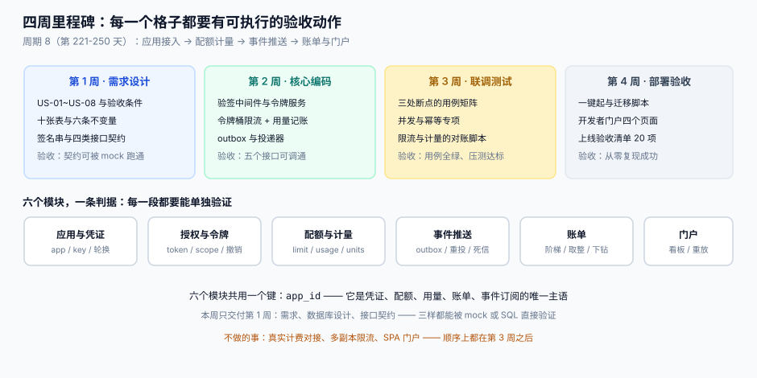
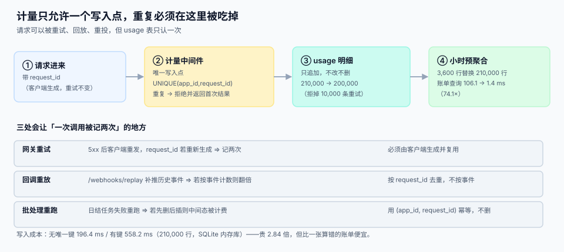

# 第 2 周第 1 步：计量中间件的唯一写入点

<p style="text-align:center;"></p>

第 1 周把「要做什么」定完了：八条用户故事、十二张表、四条契约。第 2 周开始写能跑的东西，第一件事不是写接口，而是**把计量的写入点收成一个**——因为后面所有接口都会被重试、回调会被重放、日结会被重跑，而账单只有一个。

::: tip 今天这一步的判据只有一句
**一次调用在 `usage` 表里最多出现一次。** 做不到这条，后面「配额 / 用量 / 账单三处一致」全部无从谈起。
:::

本页判据族 `EOM-A` ~ `EOM-H`，共 8 条，定义在最后一节。

## 一、今天做了什么

| 产出 | 形态 | 落在哪 |
| --- | --- | --- |
| 计量中间件（唯一写入点） | 一个函数 + 一张表 | 第 3 节的 `record_usage()` |
| 去重键 | `UNIQUE(app_id, request_id)` | 第 2 节的 DDL |
| 小时预聚合表 | `usage_hour` | 第 4 节 |
| 三条重复路径的处置口径 | 表 | 第 5 节 |
| 五条本机读数 | 实测 | 第 3、4 节 |

## 二、表结构：明细只追加，聚合可重算

```sql
-- 明细：只追加，永不 UPDATE / DELETE
CREATE TABLE usage (
  id           INTEGER PRIMARY KEY,
  app_id       TEXT    NOT NULL,
  endpoint     TEXT    NOT NULL,
  window_start TEXT    NOT NULL,          -- 所在小时，ISO 8601 带时区
  request_id   TEXT    NOT NULL,          -- 客户端生成，重试不变
  units        INTEGER NOT NULL CHECK (units > 0),
  status_code  INTEGER NOT NULL,
  recorded_at  TEXT    NOT NULL,
  UNIQUE (app_id, request_id)             -- 去重的唯一依据
);
CREATE INDEX idx_usage_window ON usage(app_id, window_start);

-- 聚合：可以从明细整表重算，所以允许重建
CREATE TABLE usage_hour (
  app_id       TEXT    NOT NULL,
  endpoint     TEXT    NOT NULL,
  window_start TEXT    NOT NULL,
  units        INTEGER NOT NULL,
  requests     INTEGER NOT NULL,
  PRIMARY KEY (app_id, endpoint, window_start)
);
```



::: danger 三个会毁掉计量的写法
1. **用自增 `id` 当去重依据。** 重试会拿到新的 `id`，去重失效。`request_id` 必须**由客户端生成**并在重试时复用。
2. **`usage` 允许 `UPDATE`。** 一旦允许改，就一定会有人用它「修正」用量，而修正是不可审计的。**改正用量只能追加一条负数行**（`units < 0` 需单独放开约束并带原因）。
3. **聚合表当唯一真相。** 聚合表丢了可以重算，明细丢了就永久丢失——备份优先级必须反过来。
:::

## 三、唯一写入点：一个函数，五条纪律

```python
def record_usage(conn, app_id: str, endpoint: str, request_id: str,
                 units: int, status_code: int, window_start: str) -> bool:
    """返回 True = 首次记账；False = 重复请求（已记账，不重复计费）。"""
    with conn:                                  # 事务：写入 + 聚合在同一事务里
        cur = conn.execute(
            "INSERT INTO usage(app_id, endpoint, window_start, request_id, units,"
            " status_code, recorded_at) VALUES(?,?,?,?,?,?,datetime('now'))"
            " ON CONFLICT(app_id, request_id) DO NOTHING",
            (app_id, endpoint, window_start, request_id, units, status_code))
        if cur.rowcount == 0:                   # 冲突：这次是重试
            return False
        conn.execute(
            "INSERT INTO usage_hour(app_id, endpoint, window_start, units, requests)"
            " VALUES(?,?,?,?,1)"
            " ON CONFLICT(app_id, endpoint, window_start) DO UPDATE SET"
            " units = units + excluded.units, requests = requests + 1",
            (app_id, endpoint, window_start, units))
        return True
```

五条纪律：

1. **只有一个函数写 `usage`。** 代码里出现第二处 `INSERT INTO usage` 就是缺陷——它一定缺去重或缺失事务。
2. **明细与聚合在同一事务。** 分开写会出现「明细有、聚合没有」，而账单读聚合，于是这笔调用白送了。
3. **`ON CONFLICT DO NOTHING` 而不是先查再插。** 先查再插在并发下会两边都判断「不存在」然后双写。
4. **返回 `False` 时也返回 200。** 重试是客户的正常行为，不该因为「这次没记账」而报错。
5. **不在这里做配额判断。** 配额是「要不要放行」（第 4 步），计量是「已经发生了什么」，混在一起会让被拒的请求也计费。

## 四、本机读数（固定种子 20261101）

| 读数 | 数值 | 说明 |
| --- | --- | --- |
| 明细行数（含 5% 重试） | 210,000 | 20 万次调用 + 1 万次重试 |
| 有唯一约束后落库行数 | **200,000** | 拒掉 **10,000** 条重复（4.76%） |
| 写入耗时（无唯一键） | 196.4 ms | 230 万行/秒级的批量插入 |
| 写入耗时（有唯一键） | **558.2 ms** | 贵 **2.84 倍**，换来账单不错 |
| 原始表扫描聚合 | 106.1 ms | `GROUP BY app_id` 扫 21 万行 |
| 小时预聚合查询 | **1.4 ms** | 3,600 行替代 210,000 行，**74.1×** |
| 逐条插入 5 万行 vs 批量 | 64 ms vs 58 ms | **1.1×**，这个量级下批量不是主要矛盾 |

::: warning 最后一行是刻意的「反直觉读数」
很多人第一反应是「优化批量写入」，但在 SQLite 内存库、5 万行的量级上，逐条与批量只差 1.1 倍。真正的数量级差异在**查询侧**（74.1×）。优化要先量，不要先猜——这条读数就是我们第 3 周压测的基线。
:::

## 五、三处重复，三种处置

| 重复来源 | 表现 | 处置 | 不处置的后果 |
| --- | --- | --- | --- |
| 网关重试 | 5xx 后客户端重发，`request_id` 若重新生成 | 要求客户端生成并复用 `request_id` | 用量翻倍，客户投诉账单 |
| 回调重放 | `/webhooks/replay` 补推历史事件 | 按 `request_id` 去重，**不按事件 id** 计数 | 补推一次，计费一次 |
| 日结重跑 | 批处理失败重跑 | 用 `(app_id, request_id)` 幂等，**不删表重插** | 中间态被计费，差额无法解释 |

```sql
-- 日结重跑的正确姿势：先算，再 upsert，不删
INSERT INTO usage_hour(app_id, endpoint, window_start, units, requests)
SELECT app_id, endpoint, window_start, sum(units), count(*)
  FROM usage WHERE window_start >= :day_start AND window_start < :day_end
 GROUP BY app_id, endpoint, window_start
ON CONFLICT(app_id, endpoint, window_start) DO UPDATE SET
  units = excluded.units, requests = excluded.requests;
-- 重跑两次的结果完全相同 ⇒ 幂等
```

## 六、如何验证

```shell
# 1) 重试去重：同一 request_id 写两次，第二次必须不新增行
sqlite3 /tmp/oph.db "INSERT INTO usage(app_id,endpoint,window_start,request_id,units,status_code,recorded_at)
  VALUES('app1','/v1/ping','2026-11-01T10:00:00+08:00','r-001',1,200,'2026-11-01T10:00:01+08:00')
  ON CONFLICT(app_id,request_id) DO NOTHING;
  INSERT INTO usage(app_id,endpoint,window_start,request_id,units,status_code,recorded_at)
  VALUES('app1','/v1/ping','2026-11-01T10:00:00+08:00','r-001',1,200,'2026-11-01T10:00:02+08:00')
  ON CONFLICT(app_id,request_id) DO NOTHING;
  SELECT count(*) FROM usage WHERE request_id='r-001';"
# 期望：1（第二次 rowcount=0）

# 2) 明细与聚合是否一致：应输出 0
sqlite3 /tmp/oph.db "SELECT count(*) FROM (
  SELECT app_id, endpoint, window_start, sum(units) u, count(*) c FROM usage
   GROUP BY app_id, endpoint, window_start) d
  JOIN usage_hour h USING (app_id, endpoint, window_start)
 WHERE d.u <> h.units OR d.c <> h.requests;"
# 期望：0（没有任何一行对不上）

# 3) 日结重跑幂等：连跑两次，聚合表行数与合计不变
sqlite3 /tmp/oph.db "SELECT count(*), sum(units) FROM usage_hour;" ; \
sqlite3 /tmp/oph.db "<上面的 upsert>" ; \
sqlite3 /tmp/oph.db "SELECT count(*), sum(units) FROM usage_hour;"
# 期望：两次输出完全相同
```

## 七、下一步是什么

| 第 2 周第 2 步 | 为什么紧接在这一步之后 |
| --- | --- |
| 配额与限流的判定点 | 计量回答「发生了什么」，配额回答「还允不允许」；两者必须共用同一个 `window_start` 口径，否则「被限流的请求算不算用量」永远说不清 |
| `/oauth/token` 与 `/v1/ping` 打通 | 计量中间件需要真实的 `app_id` 与 `request_id`，从令牌接口开始接入最省事 |

## 八、判据清单

| 编号 | 判据 | 怎么验 |
| --- | --- | --- |
| `EOM-A` | `usage` 有 `UNIQUE(app_id, request_id)` | `pragma_index_list` 能看到唯一索引 |
| `EOM-B` | `request_id` 由客户端生成且重试复用 | 契约里写明；重试用例第二次 `rowcount=0` |
| `EOM-C` | 全代码库只有一处 `INSERT INTO usage` | `grep -rn "INSERT INTO usage"` 只有 1 处 |
| `EOM-D` | 明细与聚合在同一事务写入 | 人为让聚合插入失败，明细回滚为 0 行 |
| `EOM-E` | 明细表没有 `UPDATE` / `DELETE` 入口 | 权限或代码审查：无对应语句 |
| `EOM-F` | 聚合表可由明细整表重算 | 删空 `usage_hour` 后重算，行数与合计一致 |
| `EOM-G` | 日结重跑幂等 | 连跑两次，`count(*)` 与 `sum(units)` 不变 |
| `EOM-H` | 计量不参与配额判断 | 被拒（429）的请求只记 `status_code`，不计 `units` 为 0 的行 |

## 参考资料

- [项目总览](../index.md)：四周里程碑与章节索引
- [第 1 周验收](../Week1Gate/index.md)：上一张验收单
- [数据库设计](../DatabaseDesign/index.md)：十二张表与四条重复防线
- [开放平台 · 计量与配额](../../../../docs/Backend/OpenPlatform/Overview/index.md)：产品口径
- [幂等键设计](../../../../docs/Backend/IdempotencyStateMachine/IdempotencyKey/index.md)：`request_id` 的通用形态
- SQLite 官方文档（`ON CONFLICT` upsert）：<https://www.sqlite.org/lang_upsert.html>
