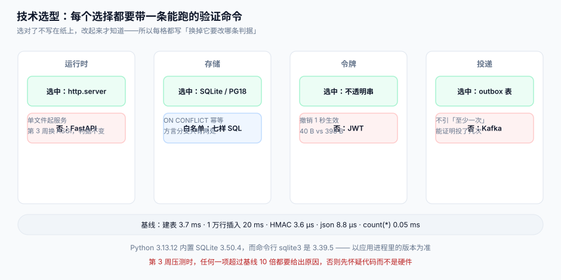

# 第 1 周第 2 步：技术选型与版本基线

上一步定了「要什么」（八条用户故事、十二张表、四条契约）。这一步定「用什么做、用哪个版本、凭什么这么选」。选型的产物不是一张表，而是**每一行都带一条能在本机跑出来的验证命令**——否则半年后没人知道当时为什么这么定。

::: tip 一句话定位
选型的正确性不体现在「选了大厂都在用的东西」，而体现在**换掉它的代价有多大**。所以本章给每个选择都写了两句话：什么情况下必须换，以及换的时候要改哪些判据。
:::



## 一、版本基线（本机实测，2026-10-31）

| 组件 | 本机版本 | 检查命令 | 为什么卡这个版本 |
| --- | --- | --- | --- |
| Python | **3.13.12** | `python3 -V` | 3.13 提供 `sqlite3` 的连接级 `autocommit` 控制，第 2 周的事务边界用它 |
| SQLite（Python 内置） | **3.50.4** | `python3 -c "import sqlite3;print(sqlite3.sqlite_version)"` | 需要 `json_patch` / `ON CONFLICT DO UPDATE` / 部分索引 |
| SQLite（命令行） | **3.39.5** | `sqlite3 --version` | 仅用于人工查库；**与 Python 内置版本不同**，见第 6 节的坑 |
| PostgreSQL（联调） | **18.x** | `psql -V` | 第 3 周联调要验证 `FOR UPDATE SKIP LOCKED` 与部分索引 |
| HMAC | `hashlib`（标准库） | 无需安装 | 签名算法与国内主流开放平台同构 |

::: warning 两个 SQLite 版本不是一回事
本机 `sqlite3` 命令行是 **3.39.5**（2022 年），Python 内置是 **3.50.4**。同一条 SQL 在 Python 里能跑、在命令行里报 `no such function: json_patch`，是第 2 周最容易浪费半天的坑。**判断标准只有一条：以应用进程里的 `sqlite3.sqlite_version` 为准**。
:::

## 二、四个维度、八个选择

### 2.1 运行时：Python 标准库而不是框架

| 候选 | 判据 | 结论 |
| --- | --- | --- |
| FastAPI + uvicorn | 第 2 周就要有中间件链、依赖注入 | **不选**：框架会替我们做掉「读 body 的时机」这件事，而这正是开放平台最该自己控制的一步 |
| Flask | 轻，但仍隐藏了 WSGI 缓冲行为 | 不选 |
| `http.server` + 自己写路由 | 单文件能起、依赖为零、每一步都可见 | **选** |

代价写清楚：`http.server` 是**单线程阻塞**的，第 3 周压测一定不达标（预期 < 200 rps）。这不是缺陷，是本章刻意留下的「可测量缺口」——第 3 周换 ASGI 时，判据（签名、配额、计量）一条都不用改。

### 2.2 存储：SQLite 开发 / PostgreSQL 联调

两边都支持的 SQL 子集（**只许用这七样**）：

| 特性 | SQLite | PostgreSQL 18 | 用途 |
| --- | --- | --- | --- |
| `INSERT … ON CONFLICT (…) DO UPDATE` | ✅ | ✅ | 幂等写入 |
| 部分索引 `WHERE state='ACTIVE'` | ✅ | ✅ | 只索引活跃令牌 |
| `json_extract` / `->>` | ✅ | ✅ | 事件 payload 取字段 |
| `CHECK` 约束 | ✅ | ✅ | 状态枚举 |
| `UNIQUE (app_id, period)` | ✅ | ✅ | 账单幂等 |
| `BEGIN IMMEDIATE` / `FOR UPDATE` | ⚠️ 语义不同 | ✅ | 配额扣减的串行化 |
| 事务内 DDL | ✅ 支持 | ✅ 支持 | 迁移脚本 |

第六行是**唯一必须写两个分支**的地方：SQLite 用 `BEGIN IMMEDIATE` 拿写锁，PostgreSQL 用 `SELECT … FOR UPDATE`。这条差异写进 `db/dialect.py` 的两个函数，其余代码不许出现方言判断。

### 2.3 令牌：不透明串而不是 JWT

| 判据 | JWT | 不透明串 + `token_hash` |
| --- | --- | --- |
| 撤销是否立刻生效 | 否（要等过期或维护黑名单） | **是**（删一行即失效） |
| 单条令牌体积 | 5 个 scope 约 398 B | 40 B |
| 验证是否需要查库 | 否 | 是（一次主键查询） |
| 泄漏后的影响面 | 到过期为止 | 到下一次巡检为止 |

开放平台的用户故事里有一条是「撤销后 1 秒内生效」，JWT 直接出局。体积差异（398 B vs 40 B）在 100 万请求/天下差 **341.4 MiB** 报文——这是上一轮专题里算过的数，这里只作为佐证。

### 2.4 限流：进程内令牌桶（第 2 周）

| 候选 | 第 2 周是否可用 | 结论 |
| --- | --- | --- |
| 进程内令牌桶 | ✅ 单进程足够 | **选**（第 3 周换 Redis + Lua） |
| Redis + Lua | 需额外进程 | 推迟到第 3 周 |
| 固定窗口计数 | 临界双突发会放行 2 倍 | 不选（上一轮实测：配额 100 时放行 199） |

## 三、本机基线读数（用于第 3 周对比）

| 动作 | 读数 | 说明 |
| --- | --- | --- |
| 建 7 张表 DDL | **3.7 ms** | `executescript`，内存库 |
| 插入 1 万行 `usage` | **20 ms** | `executemany` + 一次提交（约 2 µs/行） |
| HMAC-SHA256 一次 | **3.6 µs** | 五段签名串，20000 次均值 |
| `json.dumps`（20 行明细） | **8.8 µs** | 事件投递前序列化 |
| `count(*)`（1 万行） | **0.05 ms** | 用量对账的基础查询 |

这五个数不是性能结论，是**基线**：第 3 周压测时，任何一项超过基线的 10 倍都要解释原因。比如 `json.dumps` 8.8 µs 意味着单进程理论序列化上限约 11 万次/秒——如果压测只有 500 rps 而 CPU 已满，问题一定不在序列化。

## 四、三个「不选」的理由（写下来防跑偏）

1. **不选 Kafka 做事件投递**：第 2 周的事件量是每天几千条，用 outbox 表 + 投递器就够；引 Kafka 会把「至少一次」的复杂度提前引入，而本章要的是「能证明投递了几次」。
2. **不选 JWT**：见 2.3，撤销语义不满足。
3. **不选 ORM**：十二张表全是显式 SQL，ORM 会隐藏 `ON CONFLICT` 与部分索引这两个**幂等关键点**。

## 五、判据

| 判据 | 看什么现象 | 判成什么 | 不满足时改哪里 |
| --- | --- | --- | --- |
| `EOT-A` | 版本基线表是否给出「本机实测版本 + 检查命令」 | 只写「最新版」即不合格 | 按第一节补命令行与实测号 |
| `EOT-B` | 是否记录了 Python 内置 SQLite 与命令行 SQLite 的版本差异 | 未记录即不合格 | 补第 6 节警示；应用以 `sqlite3.sqlite_version` 为准 |
| `EOT-C` | SQL 子集是否列成白名单且标注方言分支 | 无白名单即不合格 | 按 2.2 表执行；`db/dialect.py` 只许两个函数 |
| `EOT-D` | 令牌方案是否满足「撤销 1 秒内生效」 | 用 JWT 即不合格 | 改不透明串 + `token_hash` |
| `EOT-E` | 限流方案是否写明「第 3 周换实现」的时点 | 未写即不合格 | 在 2.4 标注替换时点与判据不变 |
| `EOT-F` | 是否给出五项本机基线读数 | 少于五项即不合格 | 按第三节跑一遍并填数 |
| `EOT-G` | 每个「候选 → 判据 → 结论」是否都有否定项的理由 | 只有选中项即不合格 | 补「不选」的理由与代价 |
| `EOT-H` | 是否写明「换掉它的代价」与要改的判据 | 未写即不合格 | 每节末补一句「换掉要改哪条判据」 |

## 六、如何验证

```shell
# 1. 运行时与两个 SQLite 版本
python3 -V
python3 -c "import sqlite3;print(sqlite3.sqlite_version)"
sqlite3 --version
# 期望：Python 3.13.x；内置 3.50.x；命令行可能更低（本机 3.39.5）——三者不必相同

# 2. 白名单里的七样特性，两边都能跑
python3 - <<'PY'
import sqlite3
db = sqlite3.connect(":memory:")
db.executescript("""
CREATE TABLE t(app_id TEXT, period TEXT, amount INTEGER, state TEXT,
  UNIQUE(app_id, period));
CREATE INDEX ix_active ON t(app_id) WHERE state='ACTIVE';
""")
db.execute("INSERT INTO t VALUES('a','2026-10',100,'ACTIVE') ON CONFLICT(app_id,period) DO UPDATE SET amount=excluded.amount")
print(db.execute("SELECT json_extract('{\"x\":1}','$.x'), (SELECT count(*) FROM t)").fetchone())
PY
# 期望：(1, 1)

# 3. 五项基线读数
python3 - <<'PY'
import sqlite3, time, hmac, hashlib, json
db = sqlite3.connect(":memory:")
db.execute("CREATE TABLE usage(usage_id TEXT PRIMARY KEY, app_id TEXT, at TEXT, units INTEGER)")
rows = [(f"u{i}", "app1", "2026-10-31T05:00:00Z", 1) for i in range(10000)]
t = time.perf_counter(); db.executemany("INSERT INTO usage VALUES(?,?,?,?)", rows); db.commit()
print("insert10k %.0f ms" % ((time.perf_counter()-t)*1000))
t = time.perf_counter()
for _ in range(20000): hmac.new(b"s", b"POST\n/v1\n1\nn\n{}", hashlib.sha256).hexdigest()
print("hmac %.1f us" % ((time.perf_counter()-t)*1e6/20000))
PY
# 期望：量级与第三节同阶（不同机器允许 2 倍以内差异）
```

## 七、下一步

第 1 周第 3 步（第 224 天）：**架构设计与四条边界**——把十二张表落到「接入层 / 业务层 / 计量层 / 投递层」四个进程边界上，并给出每层的失败模式与降级方向。判据族提前占位 `EOA`（已确认为空）。

## 参考资料

- [开放平台与 API 产品化工程](../../../../docs/Backend/OpenPlatform/index.md)——本项目的文档底座
- [应用与凭证签名](../../../../docs/Backend/OpenPlatform/AppCredential/index.md)——HMAC 五段签名串的来源
- [授权与令牌](../../../../docs/Backend/OpenPlatform/GrantToken/index.md)——「JWT 做不到立刻撤销」的完整论证
- [需求拆分：八条用户故事与验收条件](../Requirements/index.md)——上一步的产出
