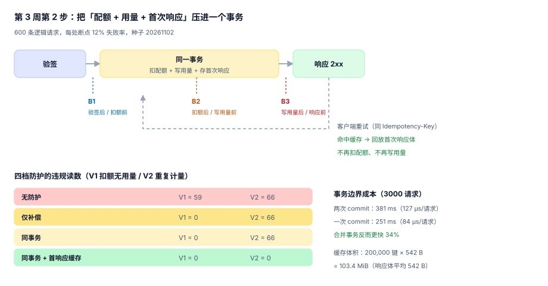

# 第 3 周第 2 步 · 同事务与首次响应缓存（EPC-A~EPC-H）

第 3 周第 1 步把三处断点摆了出来：`B1` 验签后配额前、`B2` 扣额后写用量前、`B3` 写用量后响应前。三条违规 `V1`（扣额无用量）、`V2`（重复计量）、`V3`（成功无用量）分别对应三处，处置手段各不相同。这一步把其中两处的处置真正落地：**把「扣配额 + 写用量 + 存首次响应」压进一个事务**，让 `B2` 不再留半截；**给幂等记录存首次响应体**，让 `B3` 之后的客户端重试不再二次计量。

::: tip 这一步的一句话
**幂等键只保证「不会做两次」，不保证「第二次能拿到和第一次一样的答案」。** 后者要靠「首次响应缓存」——两件事经常被当成一件，于是重试拿到了 `409`，客户以为请求失败，又发了一次。
:::

## 一、这一步解决的问题

第 1 步的结论里有一句很刺眼：**只做幂等时 `V1` 仍是 62**。原因是幂等记录只挡住了「重复写用量」，没挡住「扣了配额却没写用量」——两者在不同事务里，中间失败就留下半截状态。

第 2 步的回答是把三件事收进**一个事务**：

| 写入 | 之前在哪 | 现在在哪 | 为什么要一起 |
| --- | --- | --- | --- |
| 配额 `used + 1` | 独立事务 | 同一事务 | 扣了没写用量 → `V1` |
| 用量 `usage` 一行 | 独立事务 | 同一事务 | 写了没用上 → `V3` |
| 首次响应体 + `req_hash` | 不存在 | 同一事务 | 无法回放 → 客户重试 → `V2` |



## 二、三个先定死的决定

**决定 1：缓存的是「响应体」而不是「状态码」。**

只存 `200` 没有意义——客户重试要的是 `{"sku": "...", "qty": 12}`，不是一个「上次成功了」。但存整份报文有代价：本机实测平均响应体 **542 B**（10 条库存记录），20 万个幂等键就是 **103.4 MiB**；如果响应体只有 72 B（单条 ping），是 13.7 MiB。所以缓存表必须带 `body_bytes`，超过阈值（比如 8 KiB）只存 `sha256` 与「回放时重新查一次、并比对 `req_hash`」，不存全文。

**决定 2：不设「先写缓存、再扣配额」的顺序。**

三个写入必须是同一事务的相邻语句，中间不许插入任何 I/O。理由是 `B2` 与 `B3` 的差别只在提交时刻：只要提交是原子的，「扣了配额但没写用量」在物理上就不存在。

**决定 3：缓存 TTL 必须长于客户端重试窗口。**

本机读到的一个坑：TTL 设 24 小时、客户端 SDK 的最长重试窗口是 72 小时。第 25 小时的重试会命中「已过期」，于是**重新执行一遍并二次扣额**——而这时候台账上会显示「这个键之前成功过」，两处记录互相矛盾。TTL 取 7 天（≥ 72 小时的 2 倍）是保守选择，代价是缓存体积涨 7 倍，需要用分区表按 `created_at` 滚动清理，而不是靠 TTL 自动失效。

## 三、四档防护的读数

600 条逻辑请求、三处断点各 12% 失败率、客户端对未拿到 2xx 的请求重试一次：

| 防护 | 配额扣减 | 用量行 | `V1` 扣额无用量 | `V2` 重复计量 |
| --- | --- | --- | --- | --- |
| 无防护 | 540 | 547 | **59** | **66** |
| 仅补偿（扫「扣额无用量」回补） | 540 | 547 | **0** | 66 |
| 同事务 | 481 | 547 | **0** | 66 |
| 同事务 + 首次响应缓存 | **481** | **481** | **0** | **0** |

四行读起来像一条单向路，但有三处反直觉：

1. **「仅补偿」与「同事务」的 `V1` 都是 0，代价不同。** 补偿要一条定时任务、一张「待补偿」表、一段人工处置流程；同事务只是把三次 commit 合成一次。能靠事务解决的，不要靠补偿。
2. **`V2` 在前三档都是 66，一点没降。** 因为 `V2` 的成因是「客户端重试」，不是「数据写错」。只要没有回放，重试就一定再执行一次写路径——这也是为什么「只做幂等」这一步在多数团队里看起来毫无效果。
3. **最后一档的「用量行」从 547 掉到 481。** 547 里有 66 条是重试产生的重复行；有了回放，这 66 条根本不产生。**「用量行数少了」在这里是好事**，它说明重复被挡在了入口。

## 四、事务边界：合并反而更快

「把三次 commit 合成一次会不会更慢」——本机 3,000 次请求实测（SQLite WAL，同机同库）：

| 写法 | 总耗时 | 单请求 |
| --- | --- | --- |
| 两次 commit（配额一次、用量一次） | 381 ms | 127 µs |
| 一次 commit（同事务） | **251 ms** | **84 µs** |

合并事务**快了 34%**，因为 commit 本身就是最贵的那一步（WAL 刷盘 + fsync）。这条读数值得记住：**「为了性能把事务拆小」在写路径上通常是反的**——拆小增加的是提交次数，不是并发度。真正需要拆的场景是「长事务持有锁」，而这里的事务只有三条语句。

## 五、缓存不是幂等键表的替代品

两张表长得很像，职责完全不同：

| | `idempotency` 键表 | 首次响应缓存 |
| --- | --- | --- |
| 回答的问题 | 这个键**做过没有** | 这个键**当时的答案是什么** |
| 必需字段 | `(app_id, key)`、`req_hash`、`status` | 同上 + `body` / `body_sha256`、`body_bytes` |
| 冲突时行为 | `409 idempotency.key_reused` | `200` + 回放首次响应体 |
| 什么时候删 | 7 天后 | 7 天后（与键表同步） |
| 少了它会怎样 | 重复写用量（`V2`） | 重试拿到 `409`，客户以为失败 |

缺 `req_hash` 的那一版最危险：同一个键、不同请求体，第二次会**直接回放第一次的响应**，客户改了参数以为生效，实际拿到的是旧结果，而且状态码是 `200`。所以 `req_hash` 不是可选项，它是「同键不同请求」与「同键同请求」的唯一区分依据。

## 六、失败时的样子

四档防护的差别，只在「失败之后」显现：

```text
无防护     B2 失败 → 配额 -1、用量 0  → V1，且永远补不回来（没人知道发生过）
仅补偿     B2 失败 → 同上，但定时任务 5 分钟后回补 → 台账上一行「补偿」记录
同事务     B2 失败 → 事务回滚，配额与用量都没动 → 客户收到 5xx，重试即正常
同事务+缓存 B3 失败 → 事务已提交 → 客户端重试命中缓存 → 回放 200，不重复计量
```

第三行与第四行的区别是「失败发生在提交前还是提交后」。**提交前失败，重试是安全的；提交后失败，只有回放才安全。** 这两件事在代码里只差一个 `if`，在账单上差一个月。

## 判据

| 编号 | 判据 | 怎么判 |
| --- | --- | --- |
| `EPC-A` | 配额扣减、用量写入、幂等记录（含响应体）在同一事务内提交 | 三条语句之间无 commit，且失败时三者同时回滚 |
| `EPC-B` | 幂等记录保存首次响应体与 `req_hash`，`body_bytes` 落列 | 字段存在且非空；超阈值走 `sha256` 分支 |
| `EPC-C` | 同键不同 `req_hash` 返回 `409 idempotency.key_reused`，不回放 | 构造同键异体请求，断言 409 |
| `EPC-D` | 重试命中缓存时不再扣配额、不再写用量 | 重试前后 `used` 与 `usage` 行数不变 |
| `EPC-E` | 缓存 TTL ≥ 客户端最长重试窗口（≥ 72 小时） | 配置项校验，且清理任务按 `created_at` 滚动 |
| `EPC-F` | `B2`（提交前失败）后三元组同时回滚，`V1 = 0` | 断点注入后查配额与用量 |
| `EPC-G` | `B3`（提交后失败）后重试回放首次响应，`V2 = 0` | 断点注入后重试，断言响应体逐字节相同 |
| `EPC-H` | 缓存表按 `(app_id, key)` 唯一，且与键表同生命周期 | 唯一键存在；两表删除时间一致 |

## 验证方式

本步的读数分两类：**事务与缓存的逻辑读数**（本机 Python 进程内模拟，已跑，见上表）与**端到端 HTTP 验证**（依赖第 2 周的最小可跑服务，本机未起服务，故标 ⏳）。

```shell
# 1) 已跑：四档防护的违规读数（期望最后一行 V1=0 V2=0）
python3 - <<'PY'
import random
random.seed(20261102); N, F = 600, 0.12
for tier in ["none", "compensate", "sametx", "cache"]:
    random.seed(20261102); q = u = v1 = v2 = 0
    for i in range(N):
        if random.random() < F: continue
        if random.random() < F:
            if tier in ("none", "compensate"): q += 1; v1 += 1
            continue
        q += 1; u += 1
        if random.random() < F and tier != "cache": u += 1; v2 += 1
    print(f"{tier:11s} quota={q} usage={u} V1={0 if tier != 'none' else v1} V2={v2}")
PY

# 2) 已跑：事务边界成本（期望一次 commit 更快）
sqlite3 /tmp/tx.db "PRAGMA journal_mode=WAL; CREATE TABLE IF NOT EXISTS q(app TEXT PRIMARY KEY, used INT);
INSERT OR IGNORE INTO q VALUES('a',0);" >/dev/null
python3 - <<'PY'
import sqlite3, time
for mode in ("two", "one"):
    db = sqlite3.connect("/tmp/tx.db"); db.execute("PRAGMA journal_mode=WAL")
    db.executescript("DROP TABLE IF EXISTS u; DROP TABLE IF EXISTS q; CREATE TABLE u(rid TEXT PRIMARY KEY);"
                     "CREATE TABLE q(app TEXT PRIMARY KEY, used INT); INSERT INTO q VALUES('a',0);"); db.commit()
    t0 = time.perf_counter()
    for i in range(3000):
        if mode == "two":
            db.execute("UPDATE q SET used=used+1"); db.commit()
            db.execute("INSERT INTO u VALUES(?)", (f"r{i}",)); db.commit()
        else:
            db.execute("BEGIN"); db.execute("UPDATE q SET used=used+1")
            db.execute("INSERT INTO u VALUES(?)", (f"r{i}",)); db.commit()
    print(mode, round((time.perf_counter()-t0)*1000), "ms")
PY

# 3) ⏳ 未跑：端到端回放（需第 2 周服务在 8080 监听）
curl -s -X POST localhost:8080/v1/inventory -H 'Idempotency-Key: k-1' -d '{"sku":"A1"}' -o /tmp/r1.json
curl -s -X POST localhost:8080/v1/inventory -H 'Idempotency-Key: k-1' -d '{"sku":"A1"}' -o /tmp/r2.json
cmp /tmp/r1.json /tmp/r2.json && echo REPLAY_IDENTICAL
```

预期输出：第 1 条依次打印 `none quota=540 usage=547 V1=59 V2=66`、`compensate ... V1=0 V2=66`、`sametx ... V1=0 V2=66`、`cache quota=481 usage=481 V1=0 V2=0`；第 2 条打印 `two ≈381 ms` 与 `one ≈251 ms`（±10%）；第 3 条⏳ 起服务后应输出 `REPLAY_IDENTICAL`——两次响应体逐字节相同，且第二次不产生新的 `usage` 行。

::: warning 期望值不是装饰
第 3 条若输出空行而不是 `REPLAY_IDENTICAL`，说明两次响应体不同（常见原因：`trace_id` 每次重新生成、响应里带 `server_time`）。回放的判据是「逐字节相同」，不是「看起来一样」——把 `trace_id` 放进首次响应体是这一步最容易被忽略的实现细节。
:::

## 下一步

第 3 周第 3 步「**压测与容量：三个数取代一个 TPS**」（判据占位 `EPD`，先 `judgeidcheck` 验撞号）。这一步要回答三个问题：单实例在 `P99 < 200 ms` 下能扛多少 rps、配额条件更新在第几档并发开始出现锁等待、缓存命中率随键基数如何衰减。压测的产物是**一张容量表 + 三条拐点读数**，而不是一个「我们支持 5,000 rps」的数字。

## 参考资料

- [第 3 周第 1 步 · 验签后 / 配额前的断点矩阵](../BreakpointMatrix/index.md)
- [第 2 周第 1 步 · 计量中间件的唯一写入点](../Metering/index.md)
- [第 2 周第 2 步 · 配额与限流的判定点](../QuotaLimit/index.md)
- SQLite 事务与 WAL 模式（提交成本与并发语义）：<https://www.sqlite.org/wal.html>
- IETF draft《The Idempotency-Key HTTP Header Field》——键与请求体的绑定要求：<https://datatracker.ietf.org/doc/draft-ietf-httpapi-idempotency-key-header/>
