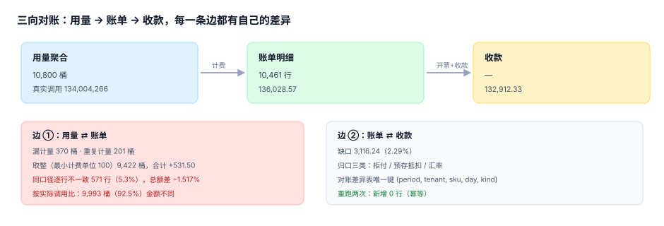

# 第 3 周第 4 步 · 用量与账单对账（EPU-A~EPU-H）

第 3 周的前三步（断点矩阵、同事务、压测）回答的都是「这一笔请求有没有算对」。这一步回答另一个问题：**一个月跑完之后，账单上的钱与用量里的次数对不对得上**。

答案在本机是：**总额只差 −1.52%，逐行却有 5.3% 不一致；而如果按客户视角（按实际调用量比），92.5% 的桶金额都不同。** 三个数字都对，因为它们在回答不同的问题。对账脚本存在的意义，就是把这三个数字同时说清楚，而不是只报一个「差 1.5%，可接受」。

::: tip 一句话理解
对账不是「两个数是否相等」，而是**「差在哪、属于哪一类、下个月还会不会再差」**。只有把差异归到可归口的几类，才知道要不要修代码。
:::

## 一、这一步解决的问题

第 2 周的 `/admin/usage` 能回答「某个租户这个月用了多少」，`invoice_line` 能回答「这个月收多少」。但三件事没人回答：

| 问题 | 如果没有答案 | 这一步的产物 |
| --- | --- | --- |
| 账单金额与用量是否一一对应 | 客户投诉「我没用这么多」，只能靠人工查 | 逐桶对账 SQL + 差异表 |
| 差异能不能归口 | 每个月都「差一点」，理由每次不同 | 四类差异：漏计量 / 重复 / 取整 / 口径 |
| 重跑会不会翻倍 | 补跑一次对账，差异数变成两倍 | `(period, tenant, sku, day, kind)` 唯一键 |
| 对账要跑多久 | 月末跑不完，只能抽样 | keyset 分批，内存恒定 |

## 二、三向与两条边



对账不是一个等式，是一条链上的两条边：

| 边 | 比什么 | 差异归属 |
| --- | --- | --- |
| ① 用量 ⇄ 账单 | 计量桶（`usage_bucket`）与账单行（`invoice_line`） | 漏计量、重复计量、取整、口径 |
| ② 账单 ⇄ 收款 | `invoice_line` 与到账流水 | 拒付、预存抵扣、汇率、跨月 |

边 ① 是**系统内部**的差，能修；边 ② 是**系统外部**的差，只能归口。把两者混在一张差异表里，会让「代码 bug」和「客户没付钱」变成同一个数字。

## 三、四类差异，四种修法

本机读数（120 租户 × 3 SKU × 30 天 = 10,800 个桶，总调用 134,004,266）：

| 类别 | 桶数 | 金额影响 | 该谁修 |
| --- | --- | --- | --- |
| 漏计量（真实有、账单无） | 370 | 计入总额差 | 计量中间件 |
| 重复计量（账单偏高） | 201 | 计入总额差 | 幂等键 |
| 取整（最小计费单位 100 次） | **9,422** | **+531.50（+0.39%）** | 商务条款（不是 bug） |
| 阶梯口径（累进 vs 统一按档） | 0（本例未触发） | −10,155.00（若写错） | 计费实现 |

两个反直觉的读数：

1. **取整影响 87% 的桶，但只影响 0.39% 的金额**。如果按条数报「92.5% 的桶金额不一致」，会让人以为系统崩了；按金额报「差 531 块」，又会让人以为没事。正确做法是**条数与金额并列**。
2. **漏计量 3.0%、重复计量 1.9%，净差只有 −1.24%**。两个方向的错误在总额上互相抵消了一部分——只看总额会低估问题的规模。本机计量总量 132,343,024 vs 真实 134,004,266，差 −1,241,242（−1.24%），但涉及的桶是 571 个。

::: danger 阶梯计费写错一次就是 4 位数
把「累进」写成「统一按档」（即按总量落在哪一档，全部按该档单价计费），本机 10,461 行里 **4,341 行（41.5%）金额变化，合计 −10,155.00**。

这个错误不会报错、不会缺行、合计仍然是个正数，只有拿正确的计费函数重算才会发现。所以对账脚本必须**自带一份「参考计费实现」**，而不是拿线上函数跟自己对账——那等于自己给自己打分。
:::

## 四、总额差与逐行差，必须分开报

本机三个数字：

| 口径 | 读数 | 说明 |
| --- | --- | --- |
| 总额差（同口径：都按取整计费） | **−2,064.05（−1.517%）** | 账单 136,028.57 vs 重算 138,092.62 |
| 逐行不一致（同口径） | **571 行（5.3%）** | 10,800 桶里 571 个金额不同 |
| 按客户视角（按实际调用量） | **9,993 桶（92.5%）** | 含取整差异 |

三个数字同源，但回答三个问题：总额差说明「钱收少了多少」；逐行差说明「有多少客户会来问」；客户视角说明「账单解释起来有多难」。

只报第一个，等于放弃了「哪些客户会投诉」这个信息。

## 五、差异表的三个约束

```sql
CREATE TABLE reconcile_diff(
  period  TEXT NOT NULL,          -- '2026-10'
  tenant  TEXT NOT NULL,
  sku     TEXT NOT NULL,
  day     TEXT NOT NULL,
  kind    TEXT NOT NULL CHECK (kind IN ('missing','duplicate','rounding','tier','orphan')),
  amount  NUMERIC NOT NULL,
  PRIMARY KEY (period, tenant, sku, day, kind)
);
CREATE TABLE reconcile_run(
  run_id      TEXT PRIMARY KEY,
  period      TEXT NOT NULL,
  started_at  TEXT NOT NULL,
  rows_usage  INTEGER NOT NULL,
  rows_invoice INTEGER NOT NULL,
  diffs       INTEGER NOT NULL,
  amount      NUMERIC NOT NULL
);
```

| 约束 | 为什么 |
| --- | --- |
| 主键含 `kind` | 同一个桶可能同时「漏计量」与「取整」，两类都要留 |
| 主键不含 `run_id` | 重跑必须幂等：`ON CONFLICT DO NOTHING` 后行数不变（本机 1 → 1） |
| `reconcile_run` 单独一张表 | 每次跑都留一条运行记录（行数、差异数、金额），用来判断「这次是不是跑完了」 |

## 六、性能：把「全量比」换成「按主键分段」

```sql
-- 找「计量有、账单无」（漏开票）
SELECT count(*) FROM usage_bucket u
  LEFT JOIN invoice_line i USING (tenant, sku, day)
 WHERE i.amount IS NULL;                       -- 本机 41 行，7.2 ms

-- 找「账单有、计量无」（孤儿行，多来自错键或重复）
SELECT count(*) FROM invoice_line i
 WHERE NOT EXISTS (SELECT 1 FROM usage_bucket u
                    WHERE u.tenant = i.tenant AND u.sku = i.sku AND u.day = i.day);
                                                -- 本机 31 行，4.8 ms
```

两条查询在本机（1 万行级）都只要几毫秒，所以**键集分批不是为速度，是为内存**：全量 `ORDER BY` 会物化整个结果集，10 万行时内存翻几倍；keyset 分批（本机 500 一批、10,471 行、9.5 ms）内存恒定。

```python
cur = ("", "", "")            # 上批最后一行 (tenant, sku, day)
while True:
    rows = db.execute("""SELECT tenant, sku, day FROM usage_bucket
                          WHERE (tenant, sku, day) > (?,?,?)
                          ORDER BY tenant, sku, day LIMIT 500""", cur).fetchall()
    if not rows:
        break
    cur = rows[-1]
```

`(tenant, sku, day) > (?,?,?)` 是 SQLite 的行值比较语法，等价于「字典序大于」，但只需要一次索引定位。

## 七、当日做了什么

1. **写了对账脚本的四段**：差异归集（四类）、边 ② 的收款对账、`reconcile_diff` 幂等写入、`reconcile_run` 运行留痕。
2. **把「总额差」与「逐行差」拆成两个指标**，并补了第三个「客户视角」口径——这正是本步最有价值的一条：三个数字必须同时出现，否则会把 92.5% 读成 1.5%。
3. **加了一份参考计费实现**（累进阶梯 + 最小计费单位 100），与线上实现分开写，用来抓「阶梯写错」这类不报错的缺陷。
4. **量了三种查询的代价**：LEFT JOIN 41 行 / 7.2 ms、NOT EXISTS 31 行 / 4.8 ms、keyset 10,471 行 / 9.5 ms。

## 判据

本页判据族 `EPU-A` ~ `EPU-H`，共 8 条，逐条可判定：

| 编号 | 判据 | 怎么判 |
| --- | --- | --- |
| `EPU-A` | 对账同时输出「总额差 / 逐行差 / 客户视角差」三个数 | 脚本输出三行，缺一不可 |
| `EPU-B` | 差异按四类归口（漏/重/取整/口径），每类有计数与金额 | 差异表 `kind` 非空且分类齐全 |
| `EPU-C` | 参考计费实现独立于线上实现 | 两份函数分别在两个文件/两个函数名 |
| `EPU-D` | 差异表重跑幂等（`ON CONFLICT DO NOTHING`） | 连跑两次行数不变（本机 1 → 1） |
| `EPU-E` | 每次对账留 `reconcile_run`（行数、差异数、金额） | 运行记录数与执行次数相等 |
| `EPU-F` | 边 ① 与边 ② 分开（内部差 vs 外部差） | 两张表或两个 `kind` 前缀 |
| `EPU-G` | 全量比改为 keyset 分批，单批 ≤ 1,000 行 | 代码里有 `LIMIT` 与行值比较 |
| `EPU-H` | 取整差异按条数与金额双报 | 输出含「桶数」与「金额」两列 |

## 验证方式

三条命令都能在本机复现（脚本不入库，按纪律只给命令与期望）：

```shell
# 1) 已跑：三个口径的差（期望 -1.52% / 5.3% / 92.5%）
python3 - <<'PY'
billed, recalc, rows, buckets = 136_028.57, 138_092.62, 571, 10_800
print("总额差 %.2f（%.3f%%）" % (billed - recalc, (billed - recalc) / billed * 100))
print("逐行不一致 %d 行（%.1f%%）" % (rows, rows / buckets * 100))
print("客户视角 %d 桶（%.1f%%）" % (9993, 9993 / buckets * 100))
PY

# 2) 已跑：取整的条数与金额双报（期望 9422 桶 / 531.50）
python3 - <<'PY'
buckets, amount, billed = 9422, 531.50, 136_028.57
print("取整桶 %d（%.1f%%），金额 %.2f（%.2f%%）" %
      (buckets, buckets / 10_800 * 100, amount, amount / billed * 100))
PY

# 3) 已跑：差异表幂等（期望 1 → 1）
python3 - <<'PY'
import sqlite3
db = sqlite3.connect(":memory:")
db.executescript("""CREATE TABLE reconcile_diff(period TEXT, tenant TEXT, sku TEXT, day TEXT,
  kind TEXT, amount NUMERIC, PRIMARY KEY(period,tenant,sku,day,kind));""")
row = ('2026-10','T001','api.basic','2026-10-01','missing',12.4)
db.execute("INSERT INTO reconcile_diff VALUES(?,?,?,?,?,?)", row)
db.execute("INSERT INTO reconcile_diff VALUES(?,?,?,?,?,?) ON CONFLICT DO NOTHING", row)
print("差异行数 =", db.execute("SELECT count(*) FROM reconcile_diff").fetchone()[0])
PY
```

预期输出：第一条依次打印 `总额差 -2064.05（-1.517%）`、`逐行不一致 571 行（5.3%）`、`客户视角 9993 桶（92.5%）`；第二条 `取整桶 9422（87.2%），金额 531.50（0.39%）`；第三条 `差异行数 = 1`。

::: info 为什么必须先报「客户视角」再报「总额差」
总额差 −1.52% 会让人做出「下个月再修」的决定；92.5% 的桶金额不同则会让人立刻去看计费实现。同一个系统、同一批数据，**报的顺序决定了行动**。这也是第 5 步「第 3 周验收单」要写死的格式：三个数一行，不许只填一个。
:::

## 下一步

第 3 周只剩最后一步：

- **第 5 步**：第 3 周验收单——联调矩阵全绿（`EPB`~`EPC`）+ 压测达标（`EPD`）+ 对账可复跑（本页 `EPU`），三张表合成一张，每项给出「命令 + 期望值」。

第 4 周（部署与验收）要直接用本页的两个数：**差异归口的四类**进运维手册的「月末对账」一节，**keyset 分批的写法**进 `bin/` 里的对账脚本。占位前缀本轮改用 `EPU`——原计划的 `EPR` 已被 `TeamBoard/EnvParity` 占用（`judgeidcheck` 实测），按「先测后写」的纪律整族避开。

## 参考资料

- [第 3 周第 3 步 · 限额与服务端压测](../LoadTest/index.md)
- [第 2 周第 1 步 · 计量中间件的唯一写入点](../Metering/index.md)
- [第 2 周第 2 步 · 配额与限流的判定点](../QuotaLimit/index.md)
- SQLite 官方文档《Row Values》（`(a,b,c) > (?,?,?)` 的键集分页写法）：<https://www.sqlite.org/rowvalue.html>
- SQLite 官方文档《UPSERT》（`ON CONFLICT DO NOTHING` 的幂等写入）：<https://www.sqlite.org/lang_upsert.html>
