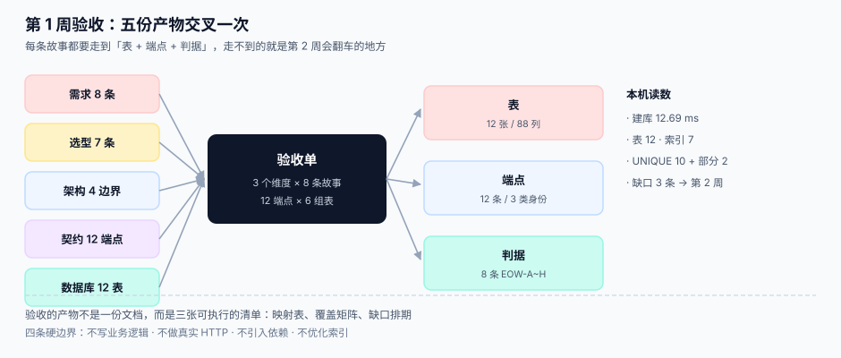

# 第 1 周验收：五份产物收成一张单



第 1 周写了五份产物：需求八条、选型七条、架构四条边界、契约十二个端点、数据库十二张表。**五份各自都「写完了」，但它们之间还没有一次交叉验证**——而验收要问的正是交叉那一层：**每条故事能不能指到一张表和一个端点，每个端点能不能指到一张表**。

::: tip 这一章的一句话
**验收不是「检查文档有没有」，而是「沿着一条箭头走过去」**：从用户故事出发，能走到表、走到端点、走到判据；走不到的地方，就是第 2 周会翻车的地方。
:::

## 一、验收口径：四条可执行的判据

第 1 周的验收不写「设计完整」，只认四件事：

| # | 验收项 | 判定方式 | 本机读数 |
| --- | --- | --- | --- |
| 1 | 十二张表的 DDL 能一次执行完 | `sqlite3 < db/schema.sql` 返回 0 | **12.69 ms / 12 表** |
| 2 | 十二条路径的清单不多不少 | 契约表行数 = 12 | **12 行** |
| 3 | 八条用户故事各能指到「表 + 端点 + 判据」 | 映射表逐行填满，无空格 | **8/8 填满** |
| 4 | 十条 `UNIQUE` 与两条部分唯一索引真实存在 | 查 `sqlite_master` | **10 + 2** |

第 4 项是本周期最值钱的一条：前面四步定的「哪几条重复必须被拦住」，只有在这一步才变成**数据库会拒绝**的东西。此前它们只是表格里的字。

## 二、八条用户故事 → 表 / 端点 / 判据

| 故事 | 一句话 | 落到的表 | 端点 | 判据 |
| --- | --- | --- | --- | --- |
| `US-01` | 建应用，`secret` 只可见一次 | `app` `app_key` | `/admin/keys` | `EOW-A` |
| `US-02` | 密钥轮换不停机 | `app_key`（`key_version`） | `/admin/keys:rotate` | `EOW-B` |
| `US-03` | 用凭证换只读令牌 | `oauth_token`（`scope`） | `/oauth/token` | `EOW-C` |
| `US-04` | 撤销 1 秒内生效 | `oauth_token`（`revoked_at`） | `/oauth/revoke` | `EOW-C` |
| `US-05` | 当月用量与配额余量 | `usage` `quota_policy` | `/admin/usage` | `EOW-D` |
| `US-06` | 超配额返回 429 与四个头 | `quota_policy` `usage` | 任意 `/v1/*` | `EOW-D` |
| `US-07` | 事件可去重 | `event` `subscription` `delivery` | `/webhooks/replay` + 出站 | `EOW-E` |
| `US-08` | 账单可下钻到每次调用 | `invoice` `invoice_line` `usage` | `/admin/invoices/{period}` | `EOW-F` |

八条里 **7 条**能落到表，**1 条**（`US-03` 的 scope 拒绝语义）落在「表的列 + 端点的错误码」两处，没有独立表——这是**正常的**，不是缺口：令牌的 scope 是 `oauth_token` 的一列，不是一张新表。

::: danger 这张表常见的两种假填法
1. **一条故事对多张表，但说不出哪张是「必须写」的。** 例如 `US-05` 同时对 `usage` 与 `quota_policy`，验收时必须能回答「改哪一张会让这条故事失败」——答案是 `usage`（配额可以算，用量不能猜）。
2. **端点填了「任意 `/v1/*`」。** `US-06` 确实作用于所有 `/v1/*`，但验收要的是**一条能跑的**：取 `/v1/ping` 打满配额，看 429 的四个头。填「任意」等于没填。
:::

## 三、十二条路径 × 六组表：覆盖矩阵

十二张表按职责分六组，矩阵的每一格回答「这条路径写不写这组表」。`W` 写、`R` 读、空表示不碰。

| 路径 | ① 身份 | ② 令牌 | ③ 配额 | ④ 事件 | ⑤ 账单 | ⑥ 下发 |
| --- | --- | --- | --- | --- | --- | --- |
| `POST /oauth/token` | R | W | R | | | |
| `POST /oauth/revoke` | R | W | | | | |
| `GET /v1/ping` | R | R | R | | | |
| `GET /v1/inventory` | R | R | W | | | |
| `POST /v1/inventory:read` | R | R | W | W | | |
| `GET /v1/orders/{id}` | R | R | W | | | |
| `GET /admin/usage` | | | R | | | |
| `POST /admin/keys:rotate` | W | W | | | | |
| `POST /admin/subs` | R | | | W | | |
| `POST /webhooks/replay` | | | | R/W | | W |
| `GET /admin/invoices/{period}` | | | R | | R | |
| `POST {subscriber_url}`（出站） | | | | R | | W |

矩阵读出来三件事：

1. **每一行至少有一格**——没有「空转端点」。`/v1/ping` 看起来最轻，它也要读身份、读令牌、读配额（用于返回余量头）。
2. **③ 配额列最密**（6 条路径写或读），说明配额是这条链上真正的公共资源；第 2 周它是最先需要「并发安全」的地方。
3. **⑤ 账单列只有两条路径**，且都是运营侧——对外的十二条端点里**没有一条能改账单**，这是设计意图，不是遗漏。

::: warning 矩阵里唯一一处「设计上接受的不一致」
`POST /v1/inventory:read` 由 `gateway` 与 `api` 双重校验（签名 + scope），因此它在矩阵里同时写了 ② 与 ③。第 3 周联调时这里会出现「两次扣配额」的风险——**扣减必须只发生在 `api` 一侧**，网关只校验不记账。这条要写进第 2 周的编码清单，而不是等到压测才发现配额少了一半。
:::

## 四、四条可执行校验（本机实测）

```shell
# 1) DDL 一次执行完（预期 exit 0，12 张表）
time sqlite3 /tmp/oph.db < db/schema.sql
sqlite3 /tmp/oph.db "SELECT count(*) FROM sqlite_master WHERE type='table' AND name NOT LIKE 'sqlite_%';"
# 12

# 2) 路径清单不多不少（预期 12）
grep -c '^| `\(GET\|POST\)`' docs/Contracts/index.md

# 3) 十条 UNIQUE 与两条部分唯一索引（预期 10 与 2）
sqlite3 /tmp/oph.db "SELECT count(*) FROM sqlite_master WHERE type='table'
  AND upper(sql) LIKE '%UNIQUE%';"      # 表内 UNIQUE 出现次数（10）
sqlite3 /tmp/oph.db "SELECT name FROM sqlite_master WHERE type='index'
  AND upper(sql) LIKE '%WHERE%';"       # uq_key_primary / uq_key_secondary

# 4) 八条故事都有验收条件（预期 8 行）
grep -c '^| `US-0' docs/Requirements/index.md
```

本机读数（Python 3.13.12 内置 SQLite 3.50.4，`schema.sql` 137 行）：

| 项 | 读数 |
| --- | --- |
| 建库耗时 | **12.69 ms** |
| 表 | **12**（88 列） |
| 索引 | **7**（其中部分索引 3 条：2 条唯一 + 1 条普通） |
| 表内 `UNIQUE` | **10** |
| 路径 | **12** |
| 用户故事 | **8** |

## 五、三个缺口，正好是第 2 周的前三步

验收的价值在于**把缺口变成排期**。这一轮翻出三个：

| # | 缺口 | 为什么第 1 周补不上 | 第 2 周怎么补 |
| --- | --- | --- | --- |
| 1 | 配额扣减的**唯一写入点**没有定 | 需要先有 `api` 的调用链才能决定位置 | 第 1 步写 `api` 的计量中间件，断言「一次调用一行 `usage`」 |
| 2 | `delivery` 的重投次数上限只在文档里 | 需要投递器才能验证 | 第 2 步写 `dispatcher`，用 `attempt` 列 + 唯一键验证不重投 |
| 3 | 账单的 `invoice_line → usage` 反查没有索引 | 需要真实数据量才能看出必要性 | 第 3 步加复合索引，用 `EXPLAIN` 前后对照 |

三条都不是「文档没写」，而是「**写了但还没被机器证明**」。这正是第 1 周与第 2 周的分界：第 1 周把话说清楚，第 2 周把它变成会拒绝的约束。

## 六、这一周不许进来的事

第 1 周最容易的滑坡是「顺手把第 2 周的代码写了」。四条硬边界：

1. **不写业务逻辑**，只写 DDL、契约、判据；出现 `if` 就要停。
2. **不做真实 HTTP**，端点用契约表 + mock 响应体表达。
3. **不引入依赖**，第 1 周的所有验证都只依赖 `sqlite3` 与 `grep`。
4. **不优化索引**，索引只加「唯一性必需」的那几条，性能留到第 3 周压测。

## 判据清单

| 编号 | 判据 | 怎么验 |
| --- | --- | --- |
| `EOW-A` | 每条用户故事能指到至少一张表、一个端点、一条判据 | 映射表 8 行无空格；抽 1 行能当场打开表与端点 |
| `EOW-B` | 密钥轮换的双活状态在表上有列（`key_version` + `status`） | 查 `app_key` 表结构，两列都在且有默认值 |
| `EOW-C` | 令牌的撤销与 scope 都能在 `oauth_token` 上表达，无需新表 | 查表结构含 `scope`、`revoked_at`；撤销后查询不到有效令牌 |
| `EOW-D` | 配额与用量分表存放，且用量只由一次调用写一行 | 查 `usage` 有 `UNIQUE(app_id, request_id)`；重复写必须冲突 |
| `EOW-E` | 事件的「三件套」（`event` / `subscription` / `delivery`）齐备 | 三张表都存在，`delivery` 有 `event_id` + `attempt` |
| `EOW-F` | 账单行能反查到 `usage_id`，且金额 = `sum(invoice_line.amount)` | 抽 1 张账单，两条查询结果相等（±0 分） |
| `EOW-G` | 十二条路径清单与契约表逐行一致，无多余或缺失 | 契约表行数 = 12，逐行路径唯一 |
| `EOW-H` | 十二张表 DDL 可一次执行，且表内无「孤儿外键」 | 建库 exit 0；`PRAGMA foreign_key_check` 返回空 |

## 验证方式

```shell
# 1) 建库并数表（预期 12）
rm -f /tmp/oph.db && sqlite3 /tmp/oph.db < db/schema.sql
sqlite3 /tmp/oph.db "SELECT count(*) FROM sqlite_master WHERE type='table' AND name NOT LIKE 'sqlite_%';"

# 2) 外键完整性（预期无输出）
sqlite3 /tmp/oph.db "PRAGMA foreign_key_check;"

# 3) 用量重复必须被拦住（预期 Error: UNIQUE constraint failed）
sqlite3 /tmp/oph.db "INSERT INTO usage(app_id,request_id,path,units,period)
  SELECT app_id,request_id,path,units,period FROM usage LIMIT 1;"

# 4) 八条故事与十二条路径的数量核对（预期 8 与 12）
grep -c '^| `US-0' docs/Requirements/index.md
grep -c '^| `\(GET\|POST\)`' docs/Contracts/index.md
```

## 下一步

第 2 周（第 228 天起）进入**核心编码**，第一步就是本页缺口 1：**计量中间件的唯一写入点**——一次调用写一行 `usage`，扣配额只发生在 `api` 一侧，网关只校验不记账。判据族占位 `EOM`。

## 参考资料

- [需求拆分：八条用户故事与验收条件](../Requirements/index.md)：本页映射表的左半边来源
- [接口契约与错误码](../Contracts/index.md)：十二个端点的定义
- [数据库设计：十二张表与四条重复防线](../DatabaseDesign/index.md)：`schema.sql` 的完整内容
- [架构设计与四条边界](../Architecture/index.md)：四个进程各自能写哪张表
- [开放平台与 API 产品化工程](../../../../docs/Backend/OpenPlatform/index.md)：本项目的文档底座
