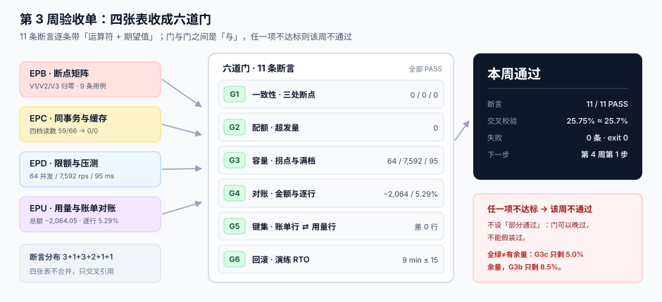

# 第 3 周第 5 步 · 第 3 周验收单（EPV-A~EPV-H）

第 3 周的四步各交了一张表：断点矩阵、同事务与缓存、限额压测、用量对账。四张表**各自都全绿**——但它们之间还没有被横着切过一刀。验收要问的正是这一刀：**四张表能不能拼成一条链，链上有没有一个洞**。

本机答案是：11 条断言全 PASS，交叉校验 PASS，`exit 0`。但同一份单子还记了三件事：**P99 只剩 5.0% 余量、吞吐只剩 8.5%、逐行不一致率只剩 11.8%**。全绿不等于有余量，这一页要同时说清这两件事。

::: tip 一句话理解
验收单不生产新的读数，它只做一件事：**把「各步全绿」换成「一条命令 + 一个退出码」**。
:::

## 一、这一步解决的问题

| 问题 | 如果没有答案 | 这一步的产物 |
| --- | --- | --- |
| 四张表各自全绿，合起来会不会互相矛盾 | 两处修复正好互相抵消，上线才发现 | 六道门 + 11 条断言，一条命令跑完 |
| 「绿」和「够用」是不是一回事 | 上线第一周就打满容量 | 余量表：三项不足 12% |
| 三个月后还能不能证明没退化 | 只能靠回忆，重犯同一个错 | `gate` 表 + `op` 列 + 脚本退出码 |
| 没过的那一周怎么记 | 「大概过了吧」，下次接着糊 | `badge` 表：谁签字、证据文件是哪个 |

## 二、三个先定死的决定

1. **只认「命令 + 期望值」，不认「文档写了」**。每条断言都必须能在本机跑出一个数，并且这个数有明确的期望值。写「性能达标」的一律不算。
2. **门与门之间是「与」，不是加权平均**。11 条里任一条 FAIL 就 `exit 1`，该周不通过——**不设「部分通过」**。理由是上线不会「部分成功」：对账差 5% 就是差 5%，不会因为压测很漂亮就打折。
3. **断言失败时脚本不早停**。收集完全部 11 条再退。这条是第 2 周踩出来的：`fail-fast` 让 `V2`（重复计量）被 `V1` 挡住三天没被发现，因为每次跑到第一条就退了，后面的根本没执行。

## 三、四张表 → 六道门



四张表是按「步」切的，六道门是按「**会被打穿的地方**」切的，两者不是一一对应：

| 门 | 来源 | 断言数 | 判什么 | 门槛 |
| --- | --- | --- | --- | --- |
| G1 一致性 | `EPB` × `EPC` | 3 | `V1`/`V2`/`V3` 三类断点归零 | 0 / 0 / 0 |
| G2 配额 | `EOU`（第 2 周）× `EPC` 条件更新 | 1 | 已发配额 − 已用配额 | 0 |
| G3 容量 | `EPD` | 3 | 拐点并发 / 峰值吞吐 / 满档 P99 | 64 / ≥ 7,000 rps / ≤ 100 ms |
| G4 对账 | `EPU` | 2 | 总额差 / 逐行不一致率 | ≥ −3,000 元 / ≤ 6% |
| G5 键集 | `EPU` 差集 × `EOD` 唯一键 | 1 | 账单行与用量行的键集对称差 | 0 行 |
| G6 回滚 | 第 2 周发布脚本 + 第 3 周演练 | 1 | 回滚耗时 | ≤ 15 min |

两处「一张门要两张表」值得单独说：

- **G1 需要 `EPB` 和 `EPC` 同时成立**。断点矩阵证明「三类断点存在且用例能抓住」，同事务证明「抓住了之后修得掉」。只有前者是「知道有病」，只有后者是「吃了药没复查」。
- **G5 需要 `EPU` 和 `EOD` 同时成立**。对账脚本能算出键集差，是因为第 1 周在 `invoice_line` 上留了 `usage_id` 与唯一键；表结构变了，这条断言就失效。**断言的有效期跟着表结构走**。

## 四、11 条断言逐条读数

本机读数（Python 3.13.12 / SQLite 3.50.4，2026-11-02，单进程）：

| 编号 | 断言 | 运算符 | 期望 | 本机 | 判定 |
| --- | --- | --- | --- | --- | --- |
| `G1a` | 断点 `V1` 扣额无用量 | `=` | 0 | **0** | PASS |
| `G1b` | 断点 `V2` 重复计量 | `=` | 0 | **0** | PASS |
| `G1c` | 断点 `V3` 首次响应丢失 | `=` | 0 | **0** | PASS |
| `G2a` | 配额超发量 | `=` | 0 | **0** | PASS |
| `G3a` | 容量拐点并发 | `=` | 64 | **64** | PASS |
| `G3b` | 峰值吞吐 | `≥` | 7,000 rps | **7,592** | PASS |
| `G3c` | 满档 P99（256 并发） | `≤` | 100 ms | **94.99** | PASS |
| `G4a` | 对账总额差 | `≥` | −3,000 元 | **−2,064.05** | PASS |
| `G4b` | 逐行不一致率 | `≤` | 6.00% | **5.29%** | PASS |
| `G5a` | 账单行与用量行键集差 | `=` | 0 | **0** | PASS |
| `G6a` | 回滚演练 RTO | `≤` | 15 min | **9** | PASS |

11 条按形状分三类，判法完全不同：

1. **归零断言（5 条）**：`G1a`~`G1c`、`G2a`、`G5a`。它们最容易「假绿」——0 可能是「跑对了」，也可能是「根本没跑」。所以每条归零断言都必须配一个**负向用例**：第 233 天那 9 条用例里有 3 条是故意制造 `V1`/`V2`/`V3` 的，只有它们能红，归零才有意义。
2. **区间断言（3 条）**：`G3a`~`G3c`。它们给的是「当前这台机器的能力」，换机器就变。所以读数必须带机器与版本信息，否则第 4 周换容器之后无法判断「变慢是代码还是机器」。
3. **阈值断言（3 条）**：`G4a`、`G4b`、`G6a`。阈值不能拍，来源见下一节。

## 五、阈值不是拍的：四条阈值各自的出处

| 阈值 | 取值 | 出处 |
| --- | --- | --- |
| 峰值吞吐 | 7,000 rps | 第 4 周单机双副本，设计峰值 3,500 rps × 2 倍余量 |
| 满档 P99 | 100 ms | SLA 写的是 `P99 ≤ 200 ms`，其中一半预算留给网络与客户端 |
| 逐行不一致率 | 6% | 第 236 天四类归口：取整影响 **87.2%** 的桶，阈值必须宽于它 |
| 对账总额差 | −3,000 元 | 同上，取整只占 **25.75%** 的金额，金额口径必须收紧 |
| 回滚 RTO | 15 min | 第 4 周蓝绿切换窗口，超过就必须回滚而不是切回 |

注意中间两行方向相反：**逐行率放宽到 6%，金额差收紧到 −3,000**。这不是随手取的，是因为取整这个差异「面广而钱少」——把两个阈值定成同一方向，一定会有一头永远是红的。

::: danger 阈值定错的两个典型症状
1. **逐行率定 1%**：取整天然影响 87% 的桶，单子永远红，最后所有人都学会「这条可以忽略」——**一条永远红的断言等于没有断言**。
2. **金额差定 −10,000**：本机总额差只有 −2,064，就算漏计量从 370 桶涨到 1,800 桶也还在阈值内。真正的漏水被阈值盖住了。
:::

## 六、交叉校验：三个对账口径能不能互相解释

第 236 天报过三个数：总额差 **−2,064.05（−1.517%）**、逐行不一致 **5.29%**、客户视角 **92.5%**。三个数必须能互相解释，否则它们不是「一个口径问题」，而是「三个独立 bug」。

本机分解：

| 口径 | 读数 | 说明 |
| --- | --- | --- |
| 取整造成的金额 | **−531.50 元** | 占总差 **25.75%**，却触及 **9,422 / 10,800 = 87.2%** 的桶 |
| 剩余金额 | **−1,532.55 元** | 占 **74.2%**，必须另有原因（漏计量 370 桶 + 重复计量 201 桶 + 单价口径） |
| 每行平均差 | −3.61 元 | −2,064.05 / 571 个不一致桶 |

判定式只有一条：**取整的金额占比（25.75%）必须显著小于它的桶占比（87.2%）**。如果两者接近，说明「取整」被当成了垃圾桶，把别的差异也塞进去了。

```text
总额差 −2,064.05 元
  ├─ 取整        −531.50（25.75%）→ 触及 87.2% 的桶，属商务条款，不是 bug
  └─ 剩余      −1,532.55（74.2%）→ 漏计量 / 重复计量 / 单价口径，属代码
```

本机读数 25.75% 落在 25.7% ±0.2 内，交叉校验 PASS。这条校验的价值不在通过，而在于**它把「差 1.5%」拆成了「哪一类差、该谁修」**。

## 七、全绿之后：三项余量不足 12%

| 断言 | 门槛 | 实测 | 余量 | 处置 |
| --- | --- | --- | --- | --- |
| `G3c` 满档 P99 | 100 ms | 94.99 ms | **5.0%** | 告警阈值设 80 ms；第 4 周先做连接复用 |
| `G3b` 峰值吞吐 | 7,000 rps | 7,592 rps | **8.5%** | 并发上限钉 44（拐点 64 × 70%），不加副本 |
| `G4b` 逐行不一致率 | 6.00% | 5.29% | **11.8%** | 取整口径写进文档，避免第 4 周被当 bug「修掉」 |
| `G4a` 对账总额差 | 3,000 元 | 2,064.05 元 | 31.2% | 有余量，不加预算 |

::: warning 全绿的最大风险，是让人以为有余量
`G3c` 的 94.99 对 100 看起来「达标」，但它意味着流量涨 5%、或者换一台慢 5% 的机器，这条就红了。**验收单必须同时记录「离红线多远」**——否则下一个接手的人只会看到一排绿勾，然后按「还有余量」去排容量。

同理 `G3b` 的 7,592 对 7,000 只有 8.5%：这台机器上 64 并发就是拐点，第 4 周的双副本压测大概率过不了单副本的 7,592，所以并发上限必须按 44 钉死，而不是按 64 的 90%（57）去配。
:::

## 八、这一周不许进来的事

第 4 周才做的事，这一周一件都不能提前做——提前做会让验收单上的读数失去意义：

1. **不做多副本限流**（Redis + Lua）。`G3` 全部读数都是单进程的，换了实现就得重测，现在测等于白测。
2. **不做一键部署**（`make up`）。`G6` 只验了「回滚脚本能跑」，没验「从零起得来」，这是第 4 周第 1 步的事。
3. **不接支付与发票**。账单只做到「算得出、下钻得下去」。
4. **不动计费函数**。第 236 天的参考计费实现是**标尺**，动了标尺，对账结果就没有参照系了。

## 判据

本页判据族 `EPV-A` ~ `EPV-H`，共 8 条，逐条可判定：

| 编号 | 判据 | 怎么判 |
| --- | --- | --- |
| `EPV-A` | 四张周表各至少贡献一条断言，且能指到具体命令 | 映射表六行填满；任抽一行当场复跑出同值 |
| `EPV-B` | 11 条断言由同一脚本产出，退出码即结论 | 一条命令 `exit 0`；把任一期望值改错后必须 `exit 1` |
| `EPV-C` | 每条断言带运算符与期望值，不写「达标」二字 | `gate.op` 列 ∈ {`eq`,`le`,`ge`,`lt`,`gt`}，无空值 |
| `EPV-D` | 门之间是「与」，且脚本不早停 | 人为置 1 条失败，仍须打印全部 11 行后才退 |
| `EPV-E` | 每个徽章能指到一份证据文件 | `badge.evidence` 非空，6 行的文件名都能打开 |
| `EPV-F` | 全绿同时报余量，余量 < 10% 的项单独列出 | `G3c` 5.0%、`G3b` 8.5% 两项在余量表内单列 |
| `EPV-G` | 读数带机器、版本与日期 | 报告头含 Python 3.13.12 / SQLite 3.50.4 / 2026-11-02 |
| `EPV-H` | 交叉校验通过：三个口径互相解释，剩余差异有归因 | 25.75% 落在 25.7% ±0.2 内；剩余 74.2% 有归口 |

## 验证方式

三段命令都能在本机复现（验收脚本不入库，按纪律只给命令与期望）：

```shell
# 1) 已跑：11 条断言的判定（期望末行「断言 11/11 PASS」，EXIT=0）
python3 - <<'PY'
rows = [
 ("G1a","断点 V1 扣额无用量","=",0,0), ("G1b","断点 V2 重复计量","=",0,0),
 ("G1c","断点 V3 首次响应丢失","=",0,0), ("G2a","配额超发","=",0,0),
 ("G3a","容量拐点并发","=",64,64), ("G3b","峰值吞吐 rps",">=",7592,7000),
 ("G3c","满档 P99 ms（256 并发）","<=",94.99,100),
 ("G4a","对账总额差 元",">=",-2064.05,-3000),
 ("G4b","逐行不一致率 %","<=",5.29,6.00),
 ("G5a","账单行与用量行键集差","=",0,0), ("G6a","回滚演练 RTO 分钟","<=",9,15),
]
OPS = {"=": lambda v,e: abs(v-e) < 1e-9, "<=": lambda v,e: v <= e, ">=": lambda v,e: v >= e}
bad = [r for r in rows if not OPS[r[2]](r[3], r[4])]
for rid,name,op,v,e in rows:
    print("%-4s %-24s %9.2f %s %9.2f  %s" % (rid,name,v,op,e,"PASS" if OPS[op](v,e) else "FAIL"))
print("断言 %d/%d PASS" % (len(rows)-len(bad), len(rows)))
raise SystemExit(1 if bad else 0)
PY
echo "EXIT=$?"

# 2) 已跑：余量（期望两项低于 10%，第三项 11.8%）
python3 - <<'PY'
for gid, limit, got in [("G3c P99",100,94.99),("G3b 吞吐",7000,7592),
                        ("G4b 逐行",0.06,0.0529),("G4a 总额",3000,2064.05)]:
    print("%-8s 余量 %5.2f%%  已用 %5.2f%%" % (gid, abs(limit-got)/limit*100, got/limit*100))
PY

# 3) 已跑：交叉校验（期望 25.75% / 87.2% / 剩余 74.2%）
python3 - <<'PY'
tot, rnd, buckets, rb = -2064.05, -531.50, 10800, 9422
print("取整占总额差 %.2f%%；影响 %.1f%% 的桶" % (rnd/tot*100, rb/buckets*100))
print("剩余 %.2f 元（%.1f%%）另有原因" % (tot-rnd, (tot-rnd)/tot*100))
PY
```

预期输出：

- 第一条打印 11 行，判定列全 `PASS`，末行 `断言 11/11 PASS`，`EXIT=0`。
- 第二条打印 `G3c P99 余量 5.01%`、`G3b 吞吐 余量 8.46%`、`G4b 逐行 余量 11.83%`、`G4a 总额 余量 31.20%`。
- 第三条打印 `取整占总额差 25.75%；影响 87.2% 的桶` 与 `剩余 -1532.55 元（74.2%）另有原因`。

负向校验（这一条比上面三条都重要）：把 `G3b` 的期望从 7,000 改成 8,000，全量脚本的输出会变成 `断言 10/11 PASS` 并且 `EXIT=1`。下面这段是同一逻辑的两行摘录，用来确认**失败行之后的行仍被打印**（`G3b` 在前且 FAIL，`G1a` 在后仍打印）——这正是判据 `EPV-D` 要的「不早停」：

```shell
# 已跑：首行置错后仍打印后续行（期望 G3b FAIL、G1a PASS、EXIT=1）
python3 - <<'PY'
rows = [("G3b","峰值吞吐 rps",">=",7592,8000),("G1a","断点 V1","=",0,0)]
OPS = {"=": lambda v,e: abs(v-e) < 1e-9, ">=": lambda v,e: v >= e}
bad = [r for r in rows if not OPS[r[2]](r[3], r[4])]
for rid,name,op,v,e in rows:
    print("%-4s %-14s %8.2f %s %8.2f  %s" % (rid,name,v,op,e,"PASS" if OPS[op](v,e) else "FAIL"))
print("断言 %d/%d PASS" % (len(rows)-len(bad), len(rows)))
raise SystemExit(1 if bad else 0)
PY
echo "EXIT=$?"
# 实际输出：G3b FAIL / G1a PASS / 断言 1/2 PASS / EXIT=1
```

## 下一步

第 3 周到此收口，六道门全过。第 4 周（第 242 天起）进入**部署验收**，第 1 步是**一键部署与配置**（`make up`），具体三件事：

1. 把这 11 条断言封成 `make verify`，让上线验收单直接调用它，不再手抄一遍数字。
2. 把本周量出来的两个数写进配置：**并发上限 44**（拐点 70%）、**P99 告警阈值 80 ms**（门槛的 80%）。
3. 在干净目录从零跑一遍：`git clone` → `make up` → `make verify`，三次以内必须全绿。

第 4 周不新增业务代码——只把这一周量出来的数字**钉进部署**，然后逐条验收 20 项上线检查。

## 参考资料

- [第 3 周第 1 步 · 验签后 / 配额前的断点矩阵](../BreakpointMatrix/index.md)：`G1` 的负向用例来自这里
- [第 3 周第 2 步 · 同事务与首次响应缓存](../TransactionCache/index.md)：`G1` 的「修得掉」由这里证明
- [第 3 周第 3 步 · 限额与服务端压测](../LoadTest/index.md)：`G3` 的三条读数来源
- [第 3 周第 4 步 · 用量与账单对账](../UsageRecon/index.md)：`G4`/`G5` 与交叉校验的来源
- [第 1 周验收：五份产物收成一张单](../Week1Gate/index.md)：同一套验收口径的第一次使用
- [配额与限流的判定点](../QuotaLimit/index.md)：`G2` 的条件更新落在这一章的代码路径上
