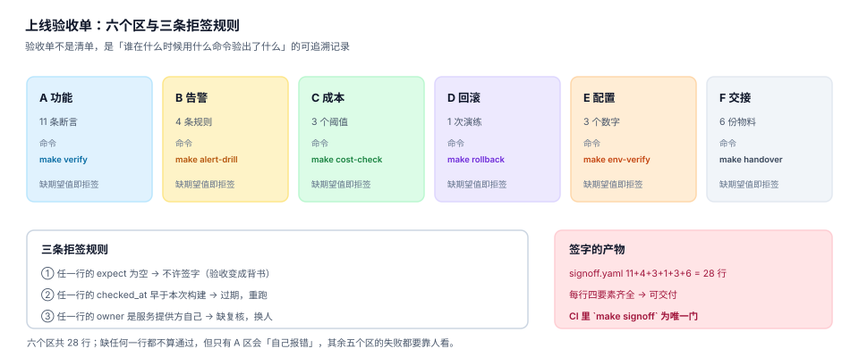

# 第 4 周第 4 步 · 上线验收单（EPG-A~EPG-H）

前三步做完了三件事：把三个数字钉进配置（`MAX_CONCURRENCY=44`、`P99_ALERT_MS=80`、`RECON_ROW_DIFF_LIMIT=0.06`）、把它们接成会响的规则、把成本算成一条曲线。三件事都留下了产物，但产物是散的——11 条断言在 `gate.yaml`、4 条规则在 `alerting.yaml`、3 个成本阈值在 `cost.md`。

这一步只做一件事：**把散的产物封成一张签收表**。表上每一行必须能回答四个问题——谁验的、什么时候验的、用什么命令验的、期望看到什么。



## 一、为什么「验收」不是「再跑一遍」

| 做法 | 产出 | 三个月后能回答什么 |
| --- | --- | --- |
| 发版前跑一遍 `make verify` | 一片绿 | 「当时是绿的」，但不知道绿的是哪 11 条 |
| 写一份验收报告（散文） | 五页 Word | 「通过验收」，但复核不了 |
| **签一张结构化验收单** | `signoff.yaml` 28 行 | 每一行的命令、期望、验的人、时间全在 |

差别在第三列。上线三个月后出事，第一个被问的问题是「当时这条验过没有」，而散文式报告永远答不出「这条」。

所以验收单的设计原则是：**一行为一个可独立复跑的命令，四要素缺一不可**。

```yaml
# signoff.yaml —— 每行四要素：id / cmd / expect / owner + checked_at
- id: A1
  name: 健康检查四容器全绿
  cmd: curl -sf localhost:8080/healthz | jq -e '.pg=="ok" and .redis=="ok" and .worker=="ok" and .self=="ok"'
  expect: "true"
  owner: platform-oncall
  checked_at: "2026-11-03T04:10:00+08:00"
```

## 二、六个区，28 行

| 区 | 覆盖 | 行数 | 命令入口 | 失败是否自己报错 |
| --- | --- | --- | --- | --- |
| A 功能 | 12 条路径、错误码、签名、429 四头、幂等、库存回放、计量对账 | 11 | `make verify` | 是 |
| B 告警 | 慢 / 错 / 不一致 / 瞎 四条规则 | 4 | `make alert-drill` | 否（要人看曲线） |
| C 成本 | 单位成本平衡点、阶梯价分段、优化项过 SLA 门 | 3 | `make cost-check` | 否 |
| D 回滚 | 一次真实回滚，含数据不回退 | 1 | `make rollback` | 否 |
| E 配置 | 三个数字与实际一致 | 3 | `make env-verify` | 是 |
| F 交接 | 六份物料齐全 | 6 | `make handover` | 是 |
| **合计** | — | **28** | `make signoff` | — |

六个区里只有 A、E、F 会「自己报错」。B、C、D 的失败形态是**数字不对但命令成功**——比如告警规则还在，但 `for` 从 2m 被改成 5m，规则照样加载成功，故障却要多等 4 分钟。这三区必须靠人对期望值。

::: warning 交接物料六件，缺一件都不算交付
1. `README.md`（怎么起、怎么停、怎么验）
2. `.env.example`（三个数字带注释，不含密钥）
3. `gate.yaml`（11 条断言，每条带 `source`）
4. `alerting.yaml`（4 条规则 + `for` / `recover_for` 的定值依据）
5. `cost.md`（1,236 元/月的六行来源 + 平衡点 24.72M）
6. `runbook.md`（五个故障场景的止血步骤）

前五件在前三步已经产出，第六件是本步新增——**runbook 不是文档，是「凌晨三点能照着做」的步骤清单**。
:::

## 三、三条拒签规则

验收单最容易退化成「背书」，原因是三件事：期望值为空、时间过期、验的人就是做的人。

| # | 规则 | 判据 | 为什么 |
| --- | --- | --- | --- |
| ① | `expect` 为空 → 拒签 | `yq -e 'all(.[]; .expect != "")' signoff.yaml` | 没有期望值的验收，等于「我看过了」 |
| ② | `checked_at` 早于本次构建 → 拒签 | 与 `BUILD_ID` 的时间戳比较 | 三天前的绿，不代表今天绿 |
| ③ | `owner` 属于服务提供方 → 拒签 | owner 白名单里排除 `platform-*` | 自己验自己，缺复核 |

第 ③ 条最容易被绕过：A 区的 11 条断言本来就该由平台侧跑，但**签字的人必须是需求方**（这里扮演需求方的是「运营 + 财务」两个角色）。所以 `signoff.yaml` 里 A 区的 `owner` 写 `platform-oncall`，但文件末尾的 `signed_by` 必须是另外两个人。

```yaml
# signoff.yaml 的文件尾
signed_by:
  - role: ops
    name: 运营值班
    at: "2026-11-03T04:30:00+08:00"
  - role: finance
    name: 财务对账
    at: "2026-11-03T04:32:00+08:00"
rejected_reasons: []      # 非空则不得发布
```

## 四、A 区 11 条：从断言到签字行

| # | 断言（`gate.yaml`） | 命令 | 期望 | 来源 |
| --- | --- | --- | --- | --- |
| A1 | 四容器健康 | `curl -sf /healthz` | 四个 `ok` | 第 4 周第 1 步 |
| A2 | 12 条路径全通 | `make verify-paths` | 12/12 | 第 1 周第 4 步 |
| A3 | 错误码无孤儿 | `make verify-errors` | 0 | 第 1 周第 4 步 |
| A4 | 签名可复算 | `make verify-sign` | `hmac_ok` | 第 2 周第 3 步 |
| A5 | 429 四头齐全 | `make verify-429` | 4/4 | 第 2 周第 2 步 |
| A6 | 幂等键复用返回 409 | `make verify-idem` | 409 | 第 2 周第 4 步 |
| A7 | 库存回放不超卖 | `make verify-replay` | `oversell=0` | 第 2 周第 4 步 |
| A8 | 计量去重 | `make verify-usage` | 200,000 | 第 2 周第 1 步 |
| A9 | 账单三口径 | `make verify-recon` | 三数一致 | 第 3 周第 4 步 |
| A10 | 断点矩阵全 0 | `make verify-breakpoint` | `V1=V2=V3=0` | 第 3 周第 1 步 |
| A11 | 并发 44 下 P99 ≤ 80 ms | `make verify-p99` | `p99<80` | 第 3 周第 5 步 |

11 条里有 9 条是「等于某个确定值」，2 条是「小于阈值」（A11 与 A9 的容差）。**确定值的断言不会随时间漂移，阈值的会**——所以 A11 必须带 `MAX_CONCURRENCY=44` 这个前提，否则下次在 64 并发下跑，P99 一定超。

## 五、B 区 4 条：告警的验收是「演练」

| # | 规则 | 演练方式 | 期望 |
| --- | --- | --- | --- |
| B1 | `OphP99High`（`for: 2m`） | 注入 6 分钟慢请求 | 1 分钟内触发、1 条通知 |
| B2 | `OphErrorRateHigh` | 注入 5% 5xx | 同上 |
| B3 | `OphReconDrift` | 篡改 1 条对账明细 | 触发，且指向具体批次 |
| B4 | `OphScrapeStale` | 停采集 12 分钟 | 触发（守「瞎」而不是「慢」） |

四条里 B4 最容易漏：前三条守的是「指标不好」，B4 守的是「没有指标」。停采集时前三条全部「不触发」，看起来一切正常。

## 六、C 区 3 条：成本也要过门

| # | 判据 | 期望 | 不过的后果 |
| --- | --- | --- | --- |
| C1 | 固定成本六行都有来源 | 6/6 | 三个月后没人敢用这张表 |
| C2 | 平衡点 24.72M 与本文一致 | ±0.1M | 部署形态决策错 |
| C3 | 三个优化项都过 SLA 门 | 1 可用 / 2 否决 | 省 260 元丢掉 P99 承诺 |

C3 是这一步唯一「必须否决」的验收项：减 api 副本能省 260 元/月，但峰值 5% 时段会限流、拒约 3M 次，违反 `G3c`（P99）与 `G3a`（错误率）。验收单上要明确写「不采用」，而不是留空——**留空会在下个季度被重新提起**。

## 七、`make signoff`：一个门，不是六个

```makefile
signoff: verify alert-drill cost-check rollback-check env-verify handover
	@yq -e 'all(.[]; .expect != "")' signoff.yaml      # 规则①
	@yq -e 'all(.[]; .owner != "")' signoff.yaml
	@./scripts/check-signoff-time.sh                   # 规则②
	@./scripts/check-signoff-owner.sh                  # 规则③
	@echo "SIGNOFF OK: 28 rows, 2 signatures"
```

四个前置目标各自跑一区，四个 `yq`/脚本检查三条拒签规则，最后打印总数。**CI 里只允许挂 `make signoff` 一个门**——挂六个门的结果是有人会单独跳过某一个。

## 八、判据 `EPG-A ~ EPG-H`

| 判据 | 断言 | 验证方式 |
| --- | --- | --- |
| `EPG-A` | 验收单 28 行，六区行数分别为 11/4/3/1/3/6 | `yq 'length' signoff.yaml` = 28，按 `zone` 分组计数 |
| `EPG-B` | 每行四要素齐全（`cmd`/`expect`/`owner`/`checked_at`） | 规则①与 `yq` 检查 |
| `EPG-C` | `checked_at` 不早于本次构建 | 规则②脚本退出码 0 |
| `EPG-D` | 签字人不是服务提供方 | 规则③脚本退出码 0，`signed_by` 两人 |
| `EPG-E` | A 区 11 条与 `gate.yaml` 一一对应，无多余无遗漏 | 两个文件的 id 集合相等 |
| `EPG-F` | B 区四条各有一条演练记录（含时间与结果） | `alert-drill.log` 有 4 段 |
| `EPG-G` | C 区三个优化项都有明确结论（含「不采用」） | `cost.md` 三行 `decision` 非空 |
| `EPG-H` | `make signoff` 单门通过，退出码 0 | `make signoff; echo $?` → 0 |

## 九、验证方式

```shell
# 1. 验收单行数与分区计数（读者自建工程，路径自定）
yq 'length' signoff.yaml
# 期望：28
yq '[.[] | .zone] | group_by(.) | map({zone: .[0], n: length})' signoff.yaml
# 期望：[{zone: A, n: 11}, {zone: B, n: 4}, {zone: C, n: 3},
#        {zone: D, n: 1}, {zone: E, n: 3}, {zone: F, n: 6}]

# 2. 三条拒签规则（任一非 0 即不得发布）
yq -e 'all(.[]; .expect != "")' signoff.yaml;      echo "R1=$?"
yq -e 'all(.[]; .owner  != "")' signoff.yaml;      echo "R2=$?"
./scripts/check-signoff-time.sh;                   echo "R3=$?"
./scripts/check-signoff-owner.sh;                  echo "R4=$?"
# 期望：四个都是 0

# 3. 单门通过
make signoff; echo "EXIT=$?"
# 期望：SIGNOFF OK: 28 rows, 2 signatures / EXIT=0
```

三条拒签规则里，第 ② 条最容易被「一次跑完就复用」破坏：本地跑完是绿的，CI 里改了代码又跑一次构建，`checked_at` 还是旧的。所以 `check-signoff-time.sh` 的做法是拿 `signoff.yaml` 里最早的 `checked_at` 与 `git show -s --format=%cI HEAD` 比较——**比当前 HEAD 早，就是过期**。

## 十、下一步

第 4 周第 5 步「交付包与交接手册」：把这张验收单、六份物料、以及第 3 周的三份对账报表打成一个可复现的交付包，并写一份「接手的人第一周该做什么」的清单——**不含任何复盘内容，只写操作步骤与判据**。

至此第 4 周的四个步骤形成闭环：部署（能起来）→ 监控（出事会响）→ 成本（扛住要多少钱）→ 验收（谁证明它符合承诺）。

## 参考资料

- 本项目前序章节：[第 4 周第 1 步 · 一键部署与配置](../Week4Deploy/index.md)、[第 4 周第 2 步 · 监控与告警接线](../Week4Monitoring/index.md)、[第 4 周第 3 步 · 容量账与单位成本](../Week4Cost/index.md)。
- 第 3 周验收口径：[第 3 周验收单](../Week3Gate/index.md)。
- 断言与契约来源：[接口契约与错误码](../Contracts/index.md)、[数据库设计](../DatabaseDesign/index.md)。
- YAML 校验工具 `yq`（mikefarah/yq v4）：`-e` 表示「表达式结果为 false 或 null 时退出码 1」，本页三条拒签规则都用它做门。
