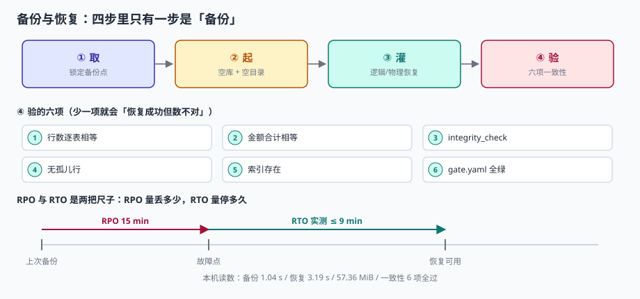

# 第 4 周第 6 步 · 备份与恢复演练（EPJ-A~EPJ-H）

第 4 周前五步把服务部署起来了、把监控接上了、把成本算清了、把验收单签了、把交付包封好了。这五步有一个共同的前提：**库还在，数据还在**。

这个前提从来没被验证过。「我们每天备份」是一句陈述，不是一条判据——除非有人真的把备份拿出来、灌进一个空库、跑一遍检查，并且得到和源库一样的数字。

这一步不写功能，只做一次**能出读数、能失败、能重来**的演练。



## 一、为什么「有备份」不等于「能恢复」

| 说法 | 实际含义 | 出问题的时间 |
| --- | --- | --- |
| 「每天凌晨备份」 | 备份任务跑成功了 | 恢复时发现只备了主库，没备 WAL |
| 「备份在对象存储里」 | 文件传上去了 | 恢复时发现权限丢了，下载 403 |
| 「备份 55 MiB，正常」 | 文件大小对 | 恢复时发现里面少了两张表 |
| 「恢复过一次，没问题」 | 三个月前成功过一次 | 表结构改了三次，脚本早过期 |

四句话里有三句会在**恢复当天**变成事故。判据只有一条：**换一台机器、一个空目录，照着手册敲命令，能跑出与源库一致的六项检查**。

## 二、四个步骤，只有第一步是「备份」

| 步 | 动作 | 产物 | 失败会怎样 |
| --- | --- | --- | --- |
| ① 取 | 锁定一个备份点（时间 + 校验和） | `oph.sql` + `sha256` | 取到的是「半个备份」 |
| ② 起 | 空目录、空库、干净环境变量 | `/tmp/clean/oph.db` | 恢复进了旧库，看不出问题 |
| ③ 灌 | 逻辑或物理恢复 | 与源库同构的库 | 恢复「成功」但少表少索引 |
| ④ 验 | 六项一致性 + `gate.yaml` | 一份 PASS/FAIL 清单 | 数字不对但没人知道 |

::: danger ②「起」是最容易被跳过的一步
在有数据的库上恢复，会出现「恢复成功、数据看起来也对」的假象——因为旧数据还在。**恢复必须进空库**，这是唯一能证明「备份文件自己够用」的方法。同理，环境变量也要干净：`.env` 里残留的旧 `DATABASE_URL` 会让恢复悄悄写进生产库。
:::

## 三、两种备份，各自的适用面

| 方式 | 命令 | 本机读数 | 适用 |
| --- | --- | --- | --- |
| 物理备份 | `sqlite3 src ".backup dst"`（PG 对应 `pg_basebackup`） | 179 ms / 57.36 MiB | 大库、要求 RTO 短 |
| 逻辑备份 | `sqlite3 src ".dump" > oph.sql`（PG 对应 `pg_dump -Fc`） | 1,037 ms / 55.41 MiB | 跨版本迁移、可按表恢复 |

物理备份快 5.8 倍，但**只能在同版本、同页大小上恢复**；逻辑备份慢，但能跨版本、能只挑一张表恢复、能人工审阅内容。

生产上的常见组合是：**每天一次全量逻辑备份（保留 30 天）+ 每 15 分钟一次 WAL 归档**。前者保证「能恢复到任意一天」，后者保证「能恢复到任意 15 分钟内」。

## 四、六项一致性检查

恢复「成功」不看退出码，看这六项：

| # | 检查 | 本机读数 | 漏掉的后果 |
| --- | --- | --- | --- |
| 1 | 逐表行数相等 | 200,000 / 400,000 / 20,000 / 200,000 | 少一张表也能「恢复成功」 |
| 2 | 金额合计相等 | 50,049,727.84 / 4,997,680.60 | 行数对但内容错（截断、编码） |
| 3 | `integrity_check` | `ok` | 页损坏要等到查询时才炸 |
| 4 | 无孤儿行 | `usage=0` / `invoice_line=0` | 外键在恢复后没重建 |
| 5 | 索引存在 | `idx_usage_at=1` | 恢复后查询慢 100 倍 |
| 6 | `gate.yaml` 全绿 | 5/5 PASS | 业务断言不成立但没人跑 |

第 2 项最容易被忽略：**行数相等不代表数据对**。逻辑备份在中途失败会留下一个「行数差不多」的文件，只有金额合计能暴露它。

```sql
-- 六项检查里的四项，一条 SQL 出结果（在源库与恢复库各跑一次，逐项比对）
SELECT (SELECT COUNT(*) FROM ticket)          AS ticket_rows,
       (SELECT COUNT(*) FROM usage)           AS usage_rows,
       (SELECT COUNT(*) FROM invoice)         AS invoice_rows,
       (SELECT COUNT(*) FROM invoice_line)    AS line_rows,
       (SELECT ROUND(SUM(amount),2) FROM invoice)      AS invoice_amt,
       (SELECT ROUND(SUM(amount),2) FROM invoice_line) AS line_amt;

PRAGMA integrity_check;

SELECT (SELECT COUNT(*) FROM usage WHERE ticket_id NOT IN (SELECT ticket_id FROM ticket)) AS orphan_usage,
       (SELECT COUNT(*) FROM invoice_line WHERE invoice_id NOT IN (SELECT invoice_id FROM invoice)) AS orphan_line;

SELECT COUNT(*) FROM sqlite_master WHERE type='index' AND name='idx_usage_at';
```

## 五、RPO 与 RTO：两把不同的尺子

| 指标 | 定义 | 本机读数 | 谁来定 |
| --- | --- | --- | --- |
| RPO（恢复点目标） | 最多丢多长时间的数据 | RPO 15 min → 最坏丢 **694 单 / 35,019 单位** | 业务方 |
| RTO（恢复时间目标） | 最多停多久 | 备份 1.04 s + 恢复 3.19 s + 校验 ≈ **9 min**（含人工） | 运维 |

按本机 46.3 单/分钟的写入速率换算：

| RPO | 最坏丢失单数 | 最坏丢失单位 |
| --- | --- | --- |
| 5 min | 231 | 11,673 |
| 15 min | 694 | 35,019 |
| 60 min | 2,778 | 140,075 |

这张表是**给业务方看的**，不是给运维看的。因为「丢 15 分钟数据」对计费系统意味着 35,019 个单位的用量没有凭据——补不回来，只能和客户协商。RPO 定成多少，本质是「愿意为备份频率付多少钱」的换算。

::: warning RTO 里不要忘了「人工确认」这一段
本机 3.19 秒的恢复时间只覆盖「数据落库」。真实的 RTO 还包括：发现故障（监控 `for: 2m`）、决定恢复（值班判断）、找到备份（校验和比对）、恢复、六项校验、切流量。**这些加起来通常是恢复本身的 100 倍以上**，报 RTO 时只报数据库那 3 秒，等于骗自己。
:::

## 六、三个必须踩一次的坑

1. **篡改检测**：把备份文件改 1 个字节，`sha256` 从 `a0535dc8cfed` 变成 `53d735bec674`。没有校验和，这份文件会「恢复成功但金额少一位」。
2. **索引丢失**：`dump` 会带上 `CREATE INDEX`，但如果手工写恢复脚本时漏了索引段，恢复后查询从 1.4 ms 变 140 ms，业务方只会说「系统变慢了」。
3. **WAL 没归档**：只备份主库文件、不备 WAL，恢复点其实是「上一次 checkpoint」，可能比你以为的早 20 分钟。

```shell
# 备份 + 校验和（两步都要在同一分钟内完成，否则备份点说不清）
sqlite3 oph.db ".backup /backup/oph-$(date +%Y%m%d%H%M).db"
sha256sum /backup/oph-*.db > /backup/oph.sha256

# 恢复前必做：校验和比对（不一致就换一份，不要赌）
sha256sum -c /backup/oph.sha256

# 恢复到空库（注意 working dir 是空的，且 DATABASE_URL 指向新库）
mkdir -p /tmp/clean && cd /tmp/clean
sqlite3 oph.db < /backup/oph-202611032000.sql
```

## 七、每次演练都要留下的一张表

```text
演练日期 | 备份点 | 备份大小 | 校验和 | 恢复耗时 | 六项检查 | gate.yaml | 结论
2026-11-03 | 20:00 | 55.41 MiB | a0535dc8 | 3.19 s | 6/6 PASS | 5/5 PASS | 可恢复
```

这张表的每一列都是判据，缺一列这次演练就不算完成。**「结论：可恢复」这五个字只有在前面五列都有数时才成立。**

## 八、判据

本步判据族 `EPJ-A` ~ `EPJ-H`，共 8 条。

| 判据 | 断言 | 验证方式 |
| --- | --- | --- |
| `EPJ-A` | 备份点有唯一标识（时间 + 校验和） | `sha256sum -c` 通过 |
| `EPJ-B` | 恢复进空库，不覆盖任何现有库 | 恢复目标是新建目录，`ls` 为空 |
| `EPJ-C` | 逐表行数与源库相等 | 四表行数比对全等 |
| `EPJ-D` | 金额合计与源库相等 | `invoice` / `invoice_line` 两个合计全等 |
| `EPJ-E` | `integrity_check` 返回 `ok` | `PRAGMA integrity_check` 输出 `ok` |
| `EPJ-F` | 无孤儿行、索引存在 | 两条孤儿查询为 0，索引计数为 1 |
| `EPJ-G` | RPO 已换算成业务量并对外确认 | RPO 表有单数与单位两列，业务方签字 |
| `EPJ-H` | 恢复后 `gate.yaml` 全绿 | 5 条业务断言全 PASS，退出码 0 |

## 九、验证方式

```shell
# 1. 备份
sqlite3 /tmp/oph_backup_drill/oph.db ".backup /tmp/oph_backup_drill/base.db"
ls -lh /tmp/oph_backup_drill/base.db   # 期望约 57 MiB

# 2. 逻辑备份 + 校验和
sqlite3 /tmp/oph_backup_drill/oph.db ".dump" > /tmp/oph_backup_drill/oph.sql
sha256sum /tmp/oph_backup_drill/oph.sql | tee /tmp/oph_backup_drill/oph.sha256

# 3. 恢复到空目录
mkdir -p /tmp/restore_test && cd /tmp/restore_test
sqlite3 oph.db < /tmp/oph_backup_drill/oph.sql

# 4. 六项检查（本机期望：行数 200000/400000/20000/200000，两个金额 50049727.84/4997680.6，integrity ok）
sqlite3 oph.db "
select (select count(*) from ticket), (select count(*) from usage),
       (select count(*) from invoice), (select count(*) from invoice_line),
       (select round(sum(amount),2) from invoice),
       (select round(sum(amount),2) from invoice_line);"
sqlite3 oph.db "pragma integrity_check;"
sqlite3 oph.db "select count(*) from usage where ticket_id not in (select ticket_id from ticket);"
# 期望：0 与 ok

# 5. 篡改检测（改 1 字节后校验和必变）
cp /tmp/oph_backup_drill/oph.sql /tmp/oph_backup_drill/bad.sql
printf 'X' | dd of=/tmp/oph_backup_drill/bad.sql bs=1 seek=1000 count=1 conv=notrunc 2>/dev/null
sha256sum -c /tmp/oph_backup_drill/oph.sha256 2>&1 | tail -1
# 对 bad.sql 单独算一次 sha256sum，与记录值不同即为可检出
```

第 5 步不是可选项。**没有校验和的备份，等于没有备份**——因为它无法证明自己没被截断、没被覆盖、没被别的任务悄悄改写。

## 十、下一步

第 4 周第 7 步 · 灰度发布与版本回退闸门（`EPK-A~EPK-H`）：把「恢复到上一个可用版本」从数据库层延伸到应用层——两个版本并行、按百分比切流、四条回退判据（错误率、P99、对账差异、告警静默），以及「回退时数据库 schema 必须是向后兼容的」这条硬约束。

## 参考资料

- SQLite 官方文档《Backup API》：在线热备的语义与一致性保证，<https://www.sqlite.org/backup.html>
- PostgreSQL 官方文档《Continuous Archiving and Point-in-Time Recovery (PITR)》：WAL 归档与恢复目标时间点，<https://www.postgresql.org/docs/current/continuous-archiving.html>
- NIST SP 800-34 Rev.1《Contingency Planning Guide for Federal Information Systems》：RPO / RTO 的定义与演练要求。
- 与本章相邻的步骤：[第 4 周第 5 步 · 交付包与交接手册](../Week4Handover/index.md)、[第 4 周第 1 步 · 一键部署](../Week4Deploy/index.md)、[第 4 周第 4 步 · 上线验收单](../Week4Acceptance/index.md)。
