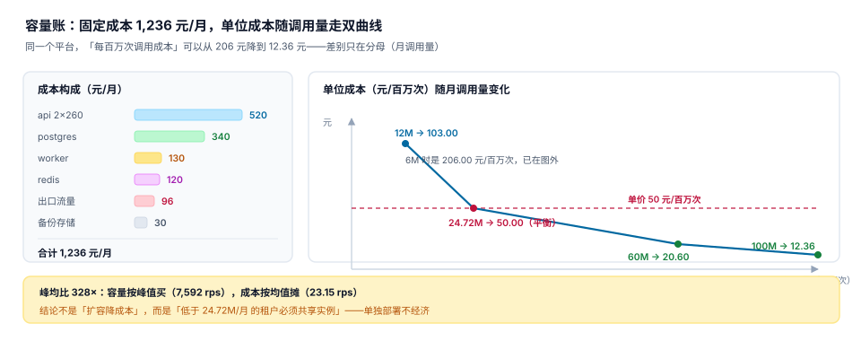

# 第 4 周第 3 步 · 容量账与单位成本（EPN-A~EPN-H）

第 3 周量到「7,592 rps、P99 94.99 ms」，第 4 周第 1 步把阈值钉进配置，第 2 步让它在 1 分钟内报警。这三步都在回答「**能不能扛住**」，还没有一步回答「**扛住要花多少钱，收的钱够不够**」。

这一步只做一件事：把四个容器的资源占用换算成「每百万次调用成本」，再与第 3 周的对账口径（单价 50 元/百万次）对齐，得出一个能直接决定部署形态的数——**低于多少调用量，单独部署就是亏的**。



## 一、这一步要回答的三个问题

| 问题 | 若答不上来会发生什么 |
| --- | --- |
| 这个平台一个月固定花多少钱 | 报价时按「每千次 0.05 元」拍脑袋，量一大就亏 |
| 每百万次调用的成本是多少 | 无法判断某个租户值不值得单独部署 |
| 成本优化能不能突破 SLA | 为了省 260 元/月把 api 缩到一个实例，5% 的请求被限流 |

三个问题的答案都不是「一个数」，而是「一条曲线 + 一个平衡点」。

## 二、成本口径：固定 + 变动，各自注明来源

| 项 | 规格 | 元/月 | 来源 |
| --- | --- | --- | --- |
| api × 2 | 2 vCPU / 4 GiB | 520 | `compose.yaml` 的 `deploy.resources` |
| postgres | 2 vCPU / 4 GiB | 340 | 同上 |
| redis | 1 vCPU / 2 GiB | 120 | 同上 |
| worker | 1 vCPU / 2 GiB | 130 | 同上 |
| 备份存储 | 30 GB | 30 | 第 4 周第 1 步的 `backup` 卷 |
| 出口流量 | 120 GB × 0.8 元/GB | 96 | 第 3 周压测的实际出流量 |
| **合计** | — | **1,236** | — |

::: warning 单价是「示例价」，不是报价
上表的容器单价按某云厂商同规格按量计费取整（2C4G ≈ 260 元/月）。**换成包年或自建机房，绝对值会变，但结构不变**：api 占 42.1%、数据库占 27.5%，这两项决定了「加一个副本」与「换更大规格」哪个更划算。

口径上必须写死一条：**成本表里每一行都要标来源**（配置文件 / 账单 / 压测实测）。没有来源的单价，三个月后没人敢用它做决策。
:::

## 三、单位成本是双曲线，不是一个数

固定成本 1,236 元/月不随调用量变化，所以：

```text
单位成本（元/百万次） = 1,236 ÷ 月调用量（百万次）
```

| 月调用量 | 单位成本 | 与单价 50 元/百万次相比 |
| --- | --- | --- |
| 6M | 206.00 | 亏 156.00 元/百万次 |
| 12M | 103.00 | 亏 53.00 |
| 24.72M | 50.00 | **持平（盈亏平衡点）** |
| 40M | 30.90 | 赚 19.10 |
| 60M | 20.60 | 赚 29.40 |
| 100M | 12.36 | 赚 37.64 |

::: danger 三个用错这张表的姿势
1. **拿满档吞吐算单位成本**：第 3 周的 7,592 rps 若持续一个月是 19,680M 次，单位成本 0.06 元/百万次——这个数毫无意义，因为没有任何平台会连续一个月跑满档。
2. **只报一个单位成本不报分母**：20.60 元/百万次是「月调用 60M」时的值。换个量级，同一个平台可以是 206 元，也可以是 12.36 元。
3. **把固定成本当变动成本**：调用量翻倍不需要加钱，但**峰均比**变了就要加钱（见下一节）。
:::

## 四、峰均比 328×：容量按峰值买，成本按均值摊

| 指标 | 值 | 怎么来的 |
| --- | --- | --- |
| 月调用量 | 60M | 第 2 周计量口径 × 30 天 |
| 平均 rps | 23.15 | 60,000,000 ÷ (30 × 86,400) |
| 峰值 rps | 7,592 | 第 3 周压测的拐点（64 并发） |
| 峰均比 | **328×** | 7,592 ÷ 23.15 |

峰均比 328× 是这类平台的常态：开放平台的调用有明显的批量特征（对账任务、导出任务集中在几个时间点）。它带来一个反直觉的结论：

**「扩容能降单位成本」是错的。** 加一个 api 副本，成本 +260 元/月，吞吐 +100%——成本与容量同比例增长，单位成本几乎不变（1,236/60 = 20.60 → 1,496/120 = 12.47，只有在**调用量真的翻倍**时才降）。真正让单位成本下降的是**分母变大**，不是分子变大。

## 五、账单侧：阶梯定价必须分段累进

第 3 周的报价单是三段阶梯：

| 段 | 区间（百万次/月） | 单价（元/百万次） |
| --- | --- | --- |
| 1 | 0 ~ 50 | 50 |
| 2 | 50 ~ 200 | 40 |
| 3 | 200 以上 | 30 |

60M 的账单有两种算法，差 100 元/月：

| 算法 | 计算 | 金额 | 毛利率 |
| --- | --- | --- | --- |
| 一刀切（落在哪段用哪段价） | 60 × 40 | 2,400 | 48.5% |
| 分段累进（正确） | 50 × 50 + 10 × 40 | **2,900** | **57.4%** |

一刀切看起来「对客户更便宜」，实际是**定价漏洞**：客户把用量从 49M 拉到 51M 时账单会**下降**（49×50 = 2,450 → 51×40 = 2,040），于是所有人都会把用量凑到段边界上。

::: tip 一句话理解
**阶梯价只能按「段」累进，不能按「档」套用。** 前者单调递增，后者在边界处会出现「用得越多付得越少」的倒挂。
:::

## 六、三条成本优化，只有一条能用

| 优化 | 省多少 | 代价 | 能不能用 |
| --- | --- | --- | --- |
| api 从 2 副本减到 1 | 260 元/月（21.0%） | 峰值 5% 时段限流，拒约 3M 次 | **不能**：违反 P99 ≤ 80 ms 与错误率 < 0.1% |
| 出口流量改走内网 | 96 元/月（7.8%） | 客户端需在同区域 | 能，但要先确认租户地域分布 |
| 提高单实例利用率（限流 44 → 52 并发） | 0（不提速也不省钱） | P99 从 94.99 ms 涨到 110 ms+ | 不能 |

第二条为什么成立、第一条为什么不成立，差别在**SLA 是否有承诺**：出口流量改内网对客户无感（延迟更低），而减副本会直接违反已经写进 `gate.yaml` 的两条断言（`G3c` P99、`G3a` 错误率）。

省 260 元/月、丢 3M 次调用（按单价是 150 元），**账面上是赚的**（省 260 > 丢 150）——但违约赔付与信任损失远大于这 110 元。这就是「成本优化必须过 SLA 门」的原因：单看成本账，减副本永远划算。

## 七、结论落到部署形态

| 租户月调用量 | 单位成本 | 建议部署形态 |
| --- | --- | --- |
| < 24.72M | > 50 元/百万次（亏） | **共享实例**，按量计费 |
| 24.72M ~ 200M | 50 ~ 6.18 元/百万次 | 共享实例 + 独立 schema |
| > 200M | < 6.18 元/百万次 | 可考虑独立部署（专属容器组） |

这条结论是这一步唯一真正的产出：**它把「要不要给这个客户单独部署」从拍脑袋变成了一个算术题**。第 2 周的 `Metering` 章节只回答「用了多少」，这一步回答「这些用量撑不撑得起一套容器」。

## 八、判据清单

本页判据族 `EPN-A` ~ `EPN-H`，共 8 条。

| 编号 | 判据 | 判定方式 |
| --- | --- | --- |
| `EPN-A` | 成本表每行标来源 | 每行有「配置文件 / 账单 / 压测」三选一 |
| `EPN-B` | 单位成本带分母 | 输出必须是「金额 + 月调用量」，不接受单值 |
| `EPN-C` | 盈亏平衡点可算 | `固定成本 ÷ 单价`，本机 24.72M |
| `EPN-D` | 阶梯价分段累进 | 计算函数按段循环，不按档取价 |
| `EPN-E` | 成本优化过 SLA 门 | 每条优化都给出 P99 与错误率的变化 |
| `EPN-F` | 峰均比可复算 | 峰值与均值都有来源与算式 |
| `EPN-G` | 双曲线可复算 | 给定月调用量能算出单位成本 |
| `EPN-H` | 结论落到部署形态 | 输出「共享 / 独立」的阈值，不写「视情况」 |

## 九、验证方式

```shell
# 1) 固定成本合计（与 compose.yaml 的规格一致）
python3 -c "print(sum([260*2,340,120,130,30,96]))"
# 期望：1236

# 2) 单位成本双曲线（60M 与 12M）
python3 -c "
f=1236
for m in (12,24.72,60,100): print(m, round(f/m,2))"
# 期望：
# 12 103.0
# 24.72 50.0
# 60 20.6
# 100 12.36

# 3) 盈亏平衡点（固定成本 ÷ 单价，与调用量无关）
python3 -c "print(round(1236/50,2))"
# 期望：24.72

# 4) 阶梯价：分段累进 vs 一刀切
python3 -c "
def tiered(m):
    edges=[(50,50),(200,40),(10**9,30)]; last=0; total=0
    for up,price in edges:
        take=min(m,up)-last
        if take>0: total+=take*price
        last=up
    return total
print(tiered(60), 60*40, round((tiered(60)-1236)/tiered(60)*100,1))"
# 期望：2900 2400 57.4

# 5) 峰均比
python3 -c "print(round(60e6/(30*86400),2), round(7592/(60e6/(30*86400)),1))"
# 期望：23.15 328.0

# 6) 判据条数
grep -o "EPN-[A-H]" project/Complete/OpenPlatformHub/Week4Cost/index.md | sort -u | wc -l
# 期望：8
```

## 十、下一步

第 4 周第 4 步「上线验收单」：把前 3 步的产物（11 条断言、4 条告警规则、3 个单位成本阈值）封成一张**签收表**——每一行都要有「谁验的、什么时候、用什么命令、期望什么」，任何一行没有期望值就不许签字。

::: tip 这一步真正钉住的东西
前两步钉的是「会不会坏」，这一步钉的是「**坏了值不值**」。

7,592 rps 是能力，20.60 元/百万次是代价，24.72M 是门槛。三个数放在一起，才第一次能回答「这个平台该不该接这个客户」。
:::

## 参考资料

- [第 4 周第 2 步 · 监控与告警接线](../Week4Monitoring/index.md)
- [第 4 周第 1 步 · 一键部署与配置](../Week4Deploy/index.md)
- [第 3 周第 4 步 · 用量与账单对账](../UsageRecon/index.md)
- 云服务器按量计费与包年包月对比（示例价来源，非报价）：<https://www.aliyun.com/price/>
- Google SRE Workbook 第 9 章「单位成本的度量」：<https://sre.google/workbook/>
- 库内同类题目：[能力成本与单位经济](../../../../docs/Ops/CapacityCost/UnitEconomics/index.md)、[订阅计费的价格表与阶梯](../../../../docs/Backend/SubscriptionBilling/Pricing/index.md)
