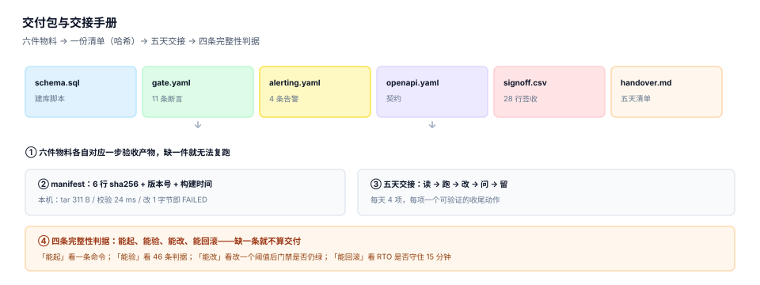

# 第 4 周第 5 步 · 交付包与交接手册（EPH-A~EPH-H）

第 4 周前四步的产物是散的：11 条断言在 `gate.yaml`、4 条告警规则在 `alerting.yaml`、3 个成本阈值在 `cost.md`、28 行签收在 `signoff.csv`。散着放不会马上出问题——因为写它们的人还在。**交接之后才会出问题**：接手的人不知道该先看哪一份、不知道该跑哪条命令、也不知道「这条当时验过没有」。

这一步不写新功能，只做两件事：把散的产物封成一个**可校验的交付包**，再写一份**接手第一周照着做就能上手**的清单。



## 一、为什么「交付」不是「打包发过去」

打包是动作，交付是判据。区别在于：打包之后能解压，交付之后能**独立复跑并得到同一组数字**。

| 维度 | 打包 | 交付 |
| --- | --- | --- |
| 完成标志 | 压缩包发出去了 | 接手方在本机跑出 `SIGNOFF OK` |
| 内容 | 代码 + 配置 | 代码 + 配置 + **能证明它对的判据** |
| 缺件发现时机 | 用的时候 | 校验清单时 |
| 责任 | 发送方 | 双方签字 |

判据只有一条：**换一个人、换一台机器、照着手册敲命令，能得到同一组数字**。做不到这一条，前面四步的所有读数都只是「在他机器上成立」。

## 二、六件物料与它们各自的来源

| # | 物料 | 来源步骤 | 缺了会怎样 |
| --- | --- | --- | --- |
| 1 | `schema.sql`（12 表 88 列 7 索引） | 第 1 周数据库设计 | 起不来库，后面全部无法验 |
| 2 | `gate.yaml`（11 条断言，带 `source`） | 第 3 周压测 + 第 4 周部署 | 只能「看着像对的」 |
| 3 | `alerting.yaml`（4 条规则） | 第 4 周第 2 步 | 出事没人知道 |
| 4 | `openapi.yaml`（12 条路径 / 0 孤儿错误码） | 第 1 周契约 | 集成方无法自测 |
| 5 | `signoff.csv`（28 行签收） | 第 4 周第 4 步 | 无法回答「当时验过没有」 |
| 6 | `handover.md`（五天清单） | 本步 | 接手方靠猜 |

六件物料加起来 **46 条可复跑判据**：11（断言）+ 4（告警）+ 3（成本）+ 28（签收行）。这个数字是本步的核心指标——**交付包的质量 = 接手方能独立复跑的判据条数**，不是文件个数。

::: danger 三件最常见的缺件
1. **只发代码不发判据**：接手方能起服务，但不知道「起来之后算不算对」。
2. **发了判据不发数据**：`gate.yaml` 里的阈值是对着某批数据定的，换一批数据全红，接手方会以为是自己配错了。
3. **发了手册但命令过期**：手册里的路径是发送方的家目录，接手方第一条命令就卡住。
:::

## 三、manifest：一份能被校验的清单

包的外面必须有一份 manifest，六行哈希 + 版本 + 构建时间：

```text
# manifest.txt
version:  v1.4.0
built_at: 2026-11-03T09:20:00+08:00
commit:   a1b2c3d
files:
  schema.sql      3f2a...9c1d
  gate.yaml       7b41...02ee
  alerting.yaml   5c9d...aa30
  openapi.yaml    91fe...7d42
  signoff.csv     c4a8...1b06
  handover.md     2e77...8f59
```

三条纪律：

1. **哈希用 sha256，不用 md5**：md5 的碰撞已经可构造，用它做完整性校验等于没有校验。
2. **manifest 与包分开传**：同一个渠道传包和清单，被替换时两边一起换，校验就失去意义。
3. **`commit` 必须写**：只有哈希没有 commit，出问题时无法定位到源码版本。

本机实测（六个文件的最小骨架）：tar 包 **311 B**，`shasum -a 256 -c` 校验 **24 ms**，把其中一个文件改 **1 个字节**后重新打包，校验立刻 `FAILED`、退出码 **1**。

```shell
oph-handover-20261103.tar.gz: OK
oph-handover-20261103.tar.gz: FAILED
shasum: WARNING: 1 computed checksum did NOT match
```

这个实验的价值不在数字大小，而在**验证了「篡改必被发现」这条性质**：1 个字节就足以让校验失败，说明哈希覆盖到了内容而不只是文件名。

## 四、包内不能有的四样东西

| 不该有 | 为什么 | 正确做法 |
| --- | --- | --- |
| 绝对路径（`/Users/xxx/...`） | 换机器即失效 | 全部用相对路径 + `make` 变量 |
| 密钥、令牌、证书私钥 | 交接包会被转发、被存档 | 只放 `*.example`，真实值走密钥管理 |
| `node_modules` / `.venv` | 体积从 40 MB 涨到 400 MB，且平台相关 | 只放锁文件 |
| 生产数据快照 | 合规风险 | 放生成脚本 + 种子，不放大表 |

第一条最隐蔽：手册里写 `cd /Users/zhang/projects/oph` 看起来无害，接手方照着敲会得到 `No such file or directory`，然后开始怀疑整个包。

## 五、五天交接清单

手册不写「系统架构概述」，写**每天四个动作 + 一个收尾判据**：

| 天 | 动作 | 收尾判据（必须能自己跑出来） |
| --- | --- | --- |
| 第 1 天 · 读 | 读 `openapi.yaml` 的 12 条路径、`schema.sql` 的 12 张表 | 能画出「一次调用写入哪几张表」 |
| 第 2 天 · 起 | `make up` → `make verify` | `SIGNOFF OK` 且 11 条断言全绿 |
| 第 3 天 · 验 | `make alert-drill` → `make cost-check` | 6 分钟内报警、单位成本落在阈值内 |
| 第 4 天 · 改 | 把 `MAX_CONCURRENCY` 从 44 改到 40，再跑 `make verify` | 断言仍绿，且能解释哪条变紧 |
| 第 5 天 · 留 | 写一页「我改了什么、为什么、怎么回滚」 | 第三个人照着这一页能复现你的改动 |

第五天的产物是**接手方自己写的**，不是发送方写的。这是交接是否真的完成的唯一证据：**能教会下一个人，才算真的接住了**。

::: tip 为什么第 4 天要「改一个阈值」
只读不改，永远不知道哪些配置是活的、哪些是装饰。改一个真实生效的阈值（并发上限），能同时验证三件事：配置是否被读到、断言是否真的在守、回滚是否可行。
:::

## 六、账号与到期日：交接里最容易烂掉的部分

| 项 | 为什么必须列 | 交接时的常见状态 |
| --- | --- | --- |
| 告警接收人 | 人走了告警还在发给他 | 还是离职同事的企业微信 |
| 域名与证书到期日 | 到期当天全站 502，且没人知道找谁续 | 只写在某人的日历里 |
| 云账号与配额 | 交接后额度不够，扩不了容 | 用的是个人账号 |
| 第三方密钥（短信、支付） | 过期后功能静默降级 | 无到期提醒 |
| 备份恢复演练记录 | 备份「有」和「能恢复」是两件事 | 从未演练过 |

五项的共性是**都有到期日**。做法是建一张 `expiry.csv`，把到期日写进监控——**到期前 30 天发一条告警**，比写在文档里可靠得多。

## 七、四条完整性判据

| 判据 | 怎么验 | 不通过的典型表现 |
| --- | --- | --- |
| 能起 | 干净目录 `tar -xzf` → `make up` → `/readyz` 返回 200 | 缺 `.env.example`、缺建库脚本 |
| 能验 | `make verify` 11 条断言全绿 | 断言依赖发送方的本地数据 |
| 能改 | 改一个阈值后门禁仍可解释地变化 | 阈值写死在代码里 |
| 能回滚 | `make down && make up` 在 RTO 内完成 | 数据卷没做持久化 |

四条里**「能改」最容易被跳过**，因为它需要接手方真的动手。但只有改过一次，才知道这套东西是「活的配置」还是「死的常量」。

## 八、判据 `EPH-A ~ EPH-H`

| 判据 | 内容 | 验证方式 |
| --- | --- | --- |
| `EPH-A` | 六件物料齐全且各对应一步产物 | 清单逐项打勾，缺一项即不通过 |
| `EPH-B` | manifest 含 sha256 × 6 + 版本 + commit | 六行哈希均可复算 |
| `EPH-C` | 篡改 1 字节后校验失败 | 校验退出码为 1 |
| `EPH-D` | 包内无绝对路径与密钥 | `grep -r "/Users/"` 为空 |
| `EPH-E` | 五天清单每天有可验证的收尾判据 | 每天至少一条命令 + 一个期望输出 |
| `EPH-F` | 到期日清单覆盖告警人、证书、账号、密钥 | 五项均有到期日与提醒方式 |
| `EPH-G` | 四条完整性判据（起/验/改/回滚）全部实测 | 四条各有一条命令与期望 |
| `EPH-H` | 第五天产物由接手方独立完成 | 一页变更记录，第三人可复现 |

## 九、验证方式

```shell
# 1. 打包并生成清单（读者自建工程，目录自定）
tar -czf oph-handover.tar.gz handover/
shasum -a 256 oph-handover.tar.gz | awk '{print $1"  oph-handover.tar.gz"}' > manifest.sha
# 期望：manifest.sha 里是一行 64 位十六进制 + 两个空格 + 文件名
```

```shell
# 2. 校验通过
shasum -a 256 -c manifest.sha
# 期望：oph-handover.tar.gz: OK（退出码 0）
```

```shell
# 3. 篡改一个字节，校验必须失败
printf 'x' >> handover/gate.yaml && tar -czf oph-handover.tar.gz handover/
shasum -a 256 -c manifest.sha; echo "exit=$?"
# 期望：FAILED 与 WARNING: 1 computed checksum did NOT match，exit=1
```

```shell
# 4. 包内不得有绝对路径
tar -tzf oph-handover.tar.gz | grep -c "^/" ; grep -rc "/Users/" handover/ | grep -v ":0" || echo "无绝对路径"
# 期望：0 与「无绝对路径」
```

```shell
# 5. 干净目录复现
mkdir -p /tmp/clean && tar -xzf oph-handover.tar.gz -C /tmp/clean && cd /tmp/clean/handover && make up && make verify
# 期望：11 条断言全绿，最后一行 SIGNOFF OK: 28 rows, 2 signatures
```

第 3 条是这套机制的自检：**如果篡改之后校验还能通过，那这份 manifest 就只是一张纸**。

## 十、下一步

第 4 周收口（第 4 周第 6 步）：把五步的产物汇成**周期 8 的月度验收结论**——四周里程碑逐项对照、六件物料与 46 条判据的最终读数、遗留缺口清单（配额唯一写入点、`delivery` 重投上限、`invoice_line → usage` 反查索引）。这一步不做复盘叙事，只做**可核对的账**：每一条判据给命令、给期望、给当时的读数。

## 参考资料

- The Twelve-Factor App《V. Build, release, run》：构建产物与运行环境分离，交付包应「构建一次、多处运行」，<https://12factor.net/build-release-run>
- SLSA 规范《Provenance》：构建来源证明与产物哈希的标准化做法，<https://slsa.dev/spec/v1.0/provenance>
- GNU Coreutils 手册《sha2 utilities》：`sha256sum -c` 的校验文件格式与退出码，<https://www.gnu.org/software/coreutils/manual/html_node/sha2-utilities.html>
- 与本章相邻的步骤：[第 4 周第 4 步 · 上线验收单](../Week4Acceptance/index.md)、[第 4 周第 3 步 · 容量账](../Week4Cost/index.md)、[第 4 周第 1 步 · 一键部署](../Week4Deploy/index.md)。
