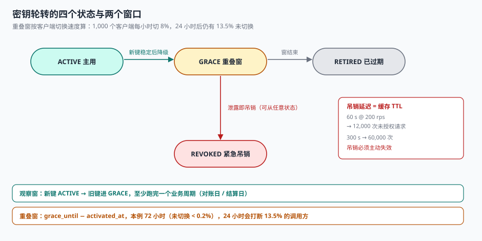

# 第 4 周第 8 步 · 密钥轮转与凭证吊销（EPZ-A~EPZ-H）

前七步让服务能起来、能报警、能算账、能签收、能复跑、能回滚、能回退。七步都假设一件事：**手上那把密钥是安全的**。

这一步处理反面：**密钥泄露了怎么办，或者只是到期了要换，怎么换**。

换密钥看起来是运维动作，实际上是一次**必须全员配合的分布式变更**：服务端换一把新键是 1 秒钟的事，而调用方有 1,000 个、发版节奏各不相同。所以这一步的核心不是「怎么生成新键」，而是**「新旧两把键同时有效多久」**。



## 一、直接换键为什么会变成一次事故

最直觉的做法是「删旧键、加新键」，一秒完成。它的后果与客户端数量成正比：

| 客户端 | 更新方式 | 直接换键的后果 |
| --- | --- | --- |
| 自家前端 | 跟随发布 | 无感 |
| 自家后端服务 | 跟随发布 | 无感 |
| 集成方（第三方） | 自己的发版节奏 | **全部 401**，且他们不知道为什么 |
| 硬编码在客户端里的 | 无法更新 | **永久 401**，只能出新版本 |

最后一行是真正的难点：**你无法强迫对方什么时候换**。所以轮转必须设计成「旧键在某个窗口内继续可用」，而不是「到点即失效」。

本机实测的切换速度（1,000 个客户端，每小时切换剩余量的 8%）：

| 时间 | 未切换的客户端 | 占比 |
| --- | --- | --- |
| 6 小时 | 606 | 60.6% |
| 12 小时 | 368 | 36.8% |
| 24 小时 | 135 | **13.5%** |
| 48 小时 | 18 | 1.8% |
| 67 小时 | < 5 | 0.2% |

**24 小时的重叠窗，会打断 13.5% 的调用方。** 这个数字是「拍一个 24 小时」的说法最直接的反驳：窗口长度必须按切换速度算，而不是按「一天比较整」。

## 二、四个状态，两个窗口

| 状态 | 含义 | 能否通过校验 | 出口 |
| --- | --- | --- | --- |
| `ACTIVE` | 当前主用键，新签发用它 | 是 | → `GRACE` |
| `GRACE` | 已退役但仍在重叠窗内 | 是 | → `RETIRED` / `REVOKED` |
| `RETIRED` | 重叠窗结束，正常失效 | 否 | → `REVOKED`（仅存证） |
| `REVOKED` | 紧急吊销（泄露） | **否，且立即** | 终态 |

两个窗口：

```text
重叠窗  = grace_until  − activated_at      ← 决定「旧键还能用多久」
观察窗  = 新键 ACTIVE 后到旧键进 GRACE 的间隔  ← 决定「新键稳不稳」
```

观察窗的作用常被忽略：**新键一上线就立刻把旧键降级，等于没有重叠窗**。正确顺序是「新键先 ACTIVE 并稳定一段 → 旧键进 GRACE → 重叠窗结束 → RETIRED」。

```sql
CREATE TABLE api_key (
  kid          TEXT PRIMARY KEY,            -- 键标识，随请求头 X-Key-Id 传上来
  secret_hash  TEXT NOT NULL,               -- 只存哈希，不存明文
  tenant_id    TEXT NOT NULL,
  state        TEXT NOT NULL
               CHECK (state IN ('ACTIVE','GRACE','RETIRED','REVOKED')),
  activated_at TEXT NOT NULL,
  grace_until  TEXT,                        -- 进 GRACE 时写死，不按「现在 + 24h」现算
  retired_at   TEXT,
  revoked_at   TEXT,
  revoke_reason TEXT
);
CREATE INDEX ix_key_state ON api_key(state) WHERE state IN ('ACTIVE','GRACE');
```

`grace_until` 必须落库，理由和[占位到期](../../../../docs/Backend/AppointmentBooking/Hold/index.md)那条一模一样：现算的时间在批量改数据、时钟漂移、规则调整三种情况下都会给出错误的答案。

## 三、重叠窗该开多久

按上表的收敛曲线，窗口长度可以直接算出来：

```text
未切换比例(t) = (1 − 每小时切换率)^t
要让未切换比例 < 0.5%，需要 t ≥ ln(0.005) / ln(1 − 0.08) ≈ 63 小时
```

所以对「1,000 个集成方、每小时切 8%」这个场景，重叠窗的合理值是 **72 小时**，不是 24 小时，也不是「一周」。

| 窗口 | 未切换比例 | 判断 |
| --- | --- | --- |
| 24 小时 | 13.5% | 太短，会打断一成以上的调用方 |
| 48 小时 | 1.8% | 勉强，18 个调用方仍会被打断 |
| 72 小时 | 0.2% | 合理（2 个） |
| 168 小时 | ≈ 0% | 过长，等于旧键永不失效，失去轮转意义 |

::: danger 三个让重叠窗失效的写法
1. **`grace_until` 现算**：`UPDATE ... SET grace_until = datetime('now','+24 hours')` 在补数据时会把一批历史键的窗口统一延长。
2. **观察窗为 0**：新键一建好就把旧键赶进 GRACE，等于没有观察期。至少要等新键跑过一个完整的业务周期（对账日、结算日）。
3. **只按「天」粒度判断**：`grace_until` 只存日期，同一时刻进 GRACE 的键会在当天 00:00 一起失效——凌晨的批量流量全部 401。
:::

## 四、吊销：缓存是这里唯一的敌人

正常轮转允许重叠，**紧急吊销不允许**。密钥泄露时，旧键每多活一秒，就多一秒的未授权访问。

而吊销失效几乎总是同一个原因：**验证路径上有一层缓存**。

| 缓存位置 | TTL | 吊销后仍放行的请求（@200 rps） |
| --- | --- | --- |
| 进程内 LRU | 60 s | 12,000 |
| 本地缓存 | 300 s | 60,000 |
| 网关负缓存 | 30 s | 6,000 |
| 无缓存，每次查库 | 0 | 0（代价：每次请求一次查询） |

本机 HMAC-SHA256（32 字节键、短消息）校验耗时 **3.6 µs**，而一次带索引的主键查询在同一台机器上是几十微秒量级——**也就是说，校验本身不贵，「每次都查库」贵在数据库连接与网络**。

可行的组合是三层：

```text
① 本地缓存「键状态」，但 TTL ≤ 5 s，且吊销事件主动失效（pub/sub）
② 校验用 kid 查出的公钥/密钥在内存里算 HMAC（3.6 µs）
③ 吊销写库 + 发失效事件，两条路径都必须成功，否则告警
```

::: danger 吊销的三个反模式
1. **吊销后靠缓存自然过期**：泄露场景下 60 秒就是 12,000 次未授权请求。吊销必须**主动失效**。
2. **`REVOKED` 与 `RETIRED` 共用一个 401 码**：运维看不出「是被吊销了」还是「正常过期了」，排查方向完全不同。
3. **吊销不清会话**：API Key 吊销了，但它换来的 JWT 还有 2 小时有效期——等于没吊销。吊销必须级联到令牌。
:::

## 五、可诊断性：401 要分三种

这是这一步最容易被砍掉、又最省时间的部分。三种 401 的原因完全不同：

| 返回码 | 含义 | 调用方该做什么 |
| --- | --- | --- |
| `invalid_signature` | 签名算错 / 密钥不对 | 检查密钥与签名算法 |
| `key_retired` | 键已正常过期 | 换新键（我们发过通知） |
| `key_revoked` | 键被吊销 | **联系平台方**，不要重试 |
| `key_unknown` | `kid` 不存在 | 检查请求头 |

把四种都返回 `401 Unauthorized` 的系统，会让每一个集成方在轮转当天都来问同一句话：**「我的密钥为什么失效了」**。而答案本来就在返回体里。

```json
{
  "error": {
    "code": "key_retired",
    "message": "key kid_2026Q3 has been retired at 2026-11-04T00:00:00Z, please switch to kid_2026Q4",
    "retired_at": "2026-11-04T00:00:00Z",
    "replacement_kid": "kid_2026Q4"
  }
}
```

`replacement_kid` 是这段返回体里最有用的字段：**它把「你该换成哪个」直接告诉了对方**，省掉一轮工单。

## 六、kid 与查表成本

请求头里带 `X-Key-Id: kid_2026Q4`，验证时按 `kid` 查一次键表。三个工程细节：

| 细节 | 做法 | 不做的后果 |
| --- | --- | --- |
| `kid` 必须随请求传 | 请求头或签名串里 | 只能遍历所有键逐个试，O(n) 次 HMAC |
| 未命中即拒绝 | `kid` 不在表里直接 401 | 遍历一遍才失败，放大攻击面 |
| 保留历史 `kid` | `RETIRED` 保留 1 年 | 旧日志里的 `kid` 无法追溯 |

按 90 天轮转一次，三年累积 12 个 `kid`；如果每次都遍历，验证成本从 3.6 µs 涨到 43 µs，**且随时钟增长**。这不是理论问题：一个上线三年没清理过的平台，键表里通常有几十把 `RETIRED` 的键。

```sql
-- 验证路径只有这一条，且必须走主键
SELECT kid, state, secret_hash FROM api_key WHERE kid = :kid;
-- 未命中 → key_unknown；state = 'RETIRED'/'REVOKED' → 对应的 401 码
```

## 七、判据

本页判据族 `EPZ-A` ~ `EPZ-H`，共 8 条。

| 判据 | 断言 | 验证方式 |
| --- | --- | --- |
| `EPZ-A` | 键表存哈希不存明文 | 表内无 `secret` 明文字段，只有 `secret_hash` |
| `EPZ-B` | 四个状态互斥且迁移合法 | 非法迁移被 `CHECK` 或触发器拒绝 |
| `EPZ-C` | `grace_until` 落库，不现算 | 进 `GRACE` 后该字段非空且不再变动 |
| `EPZ-D` | 重叠窗覆盖客户端切换周期 | 窗口长度 ≥ 收敛时间的 1.2 倍（本例 72 h） |
| `EPZ-E` | 吊销立即生效 | `REVOKED` 后同一个 `kid` 的下一次请求被拒 |
| `EPZ-F` | 401 分四种码 | 四种场景各返回对应 `code` |
| `EPZ-G` | 吊销级联到已签发令牌 | 吊销后该 `kid` 换出的 JWT 全部失效 |
| `EPZ-H` | 轮转与吊销都有审计留痕 | `api_key_event` 有 `ROTATE` / `REVOKE` 记录 |

## 八、怎么验

```shell
# 1. 重叠窗内新旧两把键同时有效（期望两行 OK）
sqlite3 op.db "
select kid, state from api_key where state in ('ACTIVE','GRACE') order by activated_at;"

# 2. 吊销立即生效：REVOKED 之后同一个 kid 必须查不到可用记录（期望 0 行）
sqlite3 op.db "
update api_key set state='REVOKED', revoked_at=datetime('now') where kid='kid_2026Q3';
select kid from api_key where kid='kid_2026Q3' and state in ('ACTIVE','GRACE');"
# 期望：空

# 3. 重叠窗长度的算法（期望 63 小时以上）
python3 - <<'PY'
import math
rate = 0.08
for target in (0.05, 0.01, 0.005):
    h = math.log(target) / math.log(1 - rate)
    print(f"未切换 < {target:.1%} 需要 {h:.0f} 小时")
PY
# 期望：39 / 55 / 63 小时

# 4. 401 四种码各命中一次（在测试环境跑）
for h in "X-Key-Id: kid_unknown" "X-Key-Id: kid_retired" "X-Key-Id: kid_revoked" "X-Key-Id: kid_active"; do
  curl -s -H "$h" -H "X-Signature: bad" http://localhost:8080/v1/ping | grep -o '"code":"[a-z_]*"'
done
# 期望：key_unknown / key_retired / key_revoked / invalid_signature
```

第 3 步的三个小时数是这一步唯一需要「算」的地方。**63 小时不是结论，是「8% 每小时」这个前提下的结论**——换一个客户群体，前提变了，小时数就得重算。

## 九、下一步

第 5 周第 1 步是**线上故障注入与熔断阈值校准**（`EPL-A~EPL-H`）：在不影响真实租户的前提下，用混沌注入把「下游超时 / 连接池耗尽 / 缓存雪崩」按 5%/20%/50% 的强度打进预发环境，校准熔断器的三个阈值（错误率、半开探测间隔、最小请求数）。

这一步与本步的接口是：**故障注入期间禁止轮转**——注入会制造大量 401 与 5xx，与「轮转导致的鉴权失败」混在一起就分不清了。闸门文件里要加一条 `freeze_rotation`。

## 参考资料

- NIST SP 800-57 Part 1 Rev.5《Recommendation for Key Management》：密钥生命周期（生成、激活、停用、销毁）与重叠期的建议。
- OWASP ASVS v5.0 第 6 章《Authentication》：密钥轮转、吊销与错误信息最小暴露的要求。
- RFC 2104《HMAC: Keyed-Hashing for Message Authentication》：HMAC 的构造与密钥长度建议。
- 与本步相邻：[第 4 周第 7 步 灰度发布与版本回退闸门](../Week4RolloutGate/index.md)、[第 4 周第 1 步 一键部署](../Week4Deploy/index.md)、[签发与令牌](../../../../docs/Backend/OpenPlatform/Overview/index.md)。
