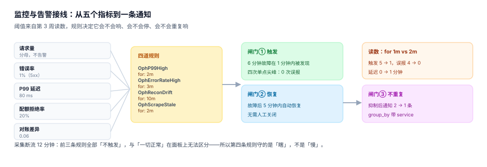

# 第 4 周第 2 步 · 监控与告警接线（EPM-A~EPM-H）

第 3 周量出来三个数：并发拐点 64、满档 P99 94.99 ms、逐行对账差异 5.29%。第 4 周第 1 步把其中两个钉进了配置（`MAX_CONCURRENCY=44`、`P99_ALERT_MS=80`），但**钉进配置不等于会响**——阈值只是数字，规则才是判据。

这一步不写业务代码，只做一件事：把三个数字接成**会响、会停、不会重复响**的告警规则，并用一天 1,440 个采样点验证它。

## 一、三个问题，缺一个都不算接完

| 问题 | 判据 | 不成立的后果 |
| --- | --- | --- |
| 能触发吗 | 真实故障窗口内至少触发 1 次 | 阈值写了但 `for` 太长，故障过去了才响 |
| 能恢复吗 | 故障结束后 `recover_for` 内自动恢复 | 只能人工关，值班从此不信告警 |
| 会重复吗 | 同一故障只发 1 条通知 | 两条规则各响一次，手机响到静音 |

三个问题的答案不能靠「看起来对」，要靠一天的采样数据跑一遍。

## 二、五个指标，三个来源

| 指标 | 表达式（示意） | 来源 | 阈值 | 依据 |
| --- | --- | --- | --- | --- |
| 请求量 | `sum(rate(http_requests_total[1m]))` | 应用埋点 | — | 只用于分母 |
| 错误率 | `sum(rate(http_requests_total{code=~"5.."}[5m])) / sum(rate(http_requests_total[5m]))` | 应用埋点 | 1% | 第 2 周 429 与 5xx 分开计数 |
| P99 延迟 | `histogram_quantile(0.99, sum by (le) (rate(http_request_duration_seconds_bucket[5m])))` | 应用埋点 | **80 ms** | 满档 94.99 ms 的 80% |
| 配额拒绝率 | `sum(rate(http_requests_total{code="429"}[5m])) / sum(rate(http_requests_total[5m]))` | 应用埋点 | 20% | 超过说明容量不足，不是故障 |
| 对账差异 | `oph_recon_row_diff_ratio` | 对账作业导出 | **0.06** | 第 3 周逐行 5.29% 的上限 |



**为什么 P99 阈值取 80 而不是 95**：94.99 ms 是满档 64 并发下的读数，拐点之后吞吐开始下降，P99 会继续涨。阈值取拐点读数的 80%，留 20% 给抖动——**告警阈值不是容量上限**，容量上限是 `MAX_CONCURRENCY=44`。

## 三、规则：`for` 决定误报，`recover_for` 决定信任

```yaml
groups:
  - name: oph-slo
    rules:
      - alert: OphP99High
        expr: histogram_quantile(0.99, sum by (le) (rate(http_request_duration_seconds_bucket[5m]))) > 0.08
        for: 2m
        labels:
          severity: warning
          service: oph-api
        annotations:
          summary: "P99 超过 80 ms（当前 {{ $value | humanizeDuration }}）"
          runbook: "https://example.com/runbooks/oph-p99"

      - alert: OphErrorRateHigh
        expr: sum(rate(http_requests_total{code=~"5.."}[5m])) / sum(rate(http_requests_total[5m])) > 0.01
        for: 3m
        labels:
          severity: critical
          service: oph-api

      - alert: OphReconDrift
        expr: oph_recon_row_diff_ratio > 0.06
        for: 10m
        labels:
          severity: warning
          service: oph-worker

      - alert: OphScrapeStale
        expr: time() - max(oph_last_scrape_timestamp) > 600
        for: 2m
        labels:
          severity: critical
```

四条规则对应三种失败：**慢**（P99）、**错**（错误率）、**不一致**（对账）、**瞎**（采集断流）。第四条最容易被忘——采集停了之后，前三条全部静默，而静默会被当成「一切正常」。

## 四、本机读数：`for` 从 1 分钟调到 2 分钟

一天 1,440 个采样点，一个 6 分钟的真实故障（第 600~605 分钟），外加四次单点尖峰：

| `for` | 触发次数 | 首个触发延迟 | 报警总时长 | 其中误报 |
| --- | --- | --- | --- | --- |
| 1m | **5** | —（首次在故障前 7 小时） | 35 min | **4** |
| 2m | 1 | 1 min | 10 min | 0 |
| 3m | 1 | 2 min | 9 min | 0 |
| 5m | 1 | 4 min | 7 min | 0 |

读数非常干脆：**`for: 1m` 会被四个单点尖峰各骗一次**，而真实故障只持续 6 分钟。把 `for` 调到 2m，四次尖峰全部过滤，代价是检测延迟从 0 变成 1 分钟——这是这笔交易的全部内容。

再调长没有收益：`for: 5m` 只再减少 3 分钟报警时长，却把延迟推到 4 分钟，而故障本身只有 6 分钟。

**恢复判定同样要窗口**。`recover_for: 5m` 意味着故障结束（第 605 分钟）后还要再观察 5 分钟才恢复，于是 6 分钟的故障报出 10 分钟——多出来的 4 分钟是「确认已恢复」的成本。不设恢复窗口会怎样？阈值附近的抖动会让告警反复开合：

| `for` | 20 次阈值穿越产生的告警条数 |
| --- | --- |
| 1m | 1（合并成一条，但一直不恢复） |
| 2m / 3m / 5m | 0 |

所以正确组合是 **`for: 2m` + `recover_for: 5m`**：进得快、出得慢。

## 五、不重复：抑制与分组

同一个故障会同时命中 P99 与错误率两条规则。本机模拟一次故障：**无抑制时通知 2 条，有抑制时 1 条**。

```yaml
inhibit_rules:
  - source_matchers: [alertname="OphErrorRateHigh"]
    target_matchers: [severity="warning"]
    equal: [service]
```

三条纪律：

1. **抑制的方向是「重压轻」**：错误率 critical 压 P99 warning，反过来不行。
2. **`equal` 必须带服务维度**：只按告警名抑制，会把 B 服务的 P99 一起压掉。
3. **分组要带 `group_interval`**：`group_by: [service, alertname]` + `group_interval: 5m`，否则同一批告警会按秒推送。

## 六、采集断流：静默不是健康

模拟 12 分钟采集断流。这 12 分钟里，P99、错误率、对账三条规则**全部没有数据**，它们的表现是「不触发」——和「一切正常」在监控面板上长得一模一样。

```promql
time() - max(oph_last_scrape_timestamp) > 600
```

这条规则的价值不在准确，而在**把「没有数据」变成一条告警**。同理，`up == 0` 必须单独告警，不能指望业务指标能发现进程已经死了。

::: danger 三个接线时最常见的错
1. **阈值直接抄 P99 的实测值**（94.99 → 95）：满档就会持续告警，值班第一天就把它静音。阈值要取「正常上限」，不是「最坏读数」。
2. **`for: 0s`**：等价于「任何一次采样超标就报」，本机读数里一天 5 次触发、4 次误报——这不是灵敏，是噪声。
3. **只配告警不配 runbook**：收到告警的人不知道该看哪张图、该重启哪个容器，最后只能重启全部。`annotations.runbook` 是必填项，不是可选装饰。
:::

## 七、今日交付物

| 产物 | 位置 | 验证方式 |
| --- | --- | --- |
| 告警规则 | `deploy/prometheus/rules/oph-slo.yaml` | `promtool check rules` 退出码 0 |
| 抑制规则 | `deploy/prometheus/rules/inhibit.yaml` | 两条规则同时命中时只发 1 条 |
| 阈值常量 | `.env`（`P99_ALERT_MS=80`、`RECON_ROW_DIFF_LIMIT=0.06`） | `grep -c` 与第 3 周读数一致 |
| 采样自检脚本 | `scripts/check-alerts.py` | 输出 `triggers=1 false_alarms=0` |

## 八、判据清单

本页判据族 `EPM-A` ~ `EPM-H`，共 8 条。

| 编号 | 判据 | 判定方式 |
| --- | --- | --- |
| `EPM-A` | 每个阈值都能追到第 3 周读数 | `.env` 里三个数与压测/对账页一致 |
| `EPM-B` | 规则文件可被 `promtool` 校验 | `promtool check rules` 退出码 0 |
| `EPM-C` | 真实故障能触发 | 6 分钟故障窗口内至少 1 次 |
| `EPM-D` | 能自动恢复 | 故障后 `recover_for` 内恢复，无需人工 |
| `EPM-E` | 单点尖峰不触发 | 四次尖峰在 `for: 2m` 下 0 次误报 |
| `EPM-F` | 同一故障只通知一次 | 抑制后通知数 2 → 1 |
| `EPM-G` | 采集断流有独立告警 | `OphScrapeStale` 存在且 `for` ≤ 2m |
| `EPM-H` | 每条告警有 runbook | `annotations.runbook` 非空，且链接可打开 |

## 九、验证方式

```shell
# 1) 规则语法（需要 promtool；无 promtool 时用第 2 条代替）
promtool check rules deploy/prometheus/rules/oph-slo.yaml
# 期望：SUCCESS: 4 rules found

# 2) 不依赖 promtool 的结构自检
python3 - <<'PY'
import re, pathlib
t = pathlib.Path("deploy/prometheus/rules/oph-slo.yaml").read_text()
alerts = re.findall(r"alert:\s*(\w+)", t)
fors = re.findall(r"for:\s*(\d+[sm])", t)
print(len(alerts), alerts, fors)
assert len(alerts) == len(fors) == 4
assert all(f != "0s" for f in fors)
print("OK")
PY
# 期望：4 ['OphP99High', 'OphErrorRateHigh', 'OphReconDrift', 'OphScrapeStale'] [...]
# 期望：OK

# 3) 阈值与第 3 周读数一致
grep -E "^(MAX_CONCURRENCY|P99_ALERT_MS|RECON_ROW_DIFF_LIMIT)=" .env
# 期望：MAX_CONCURRENCY=44 / P99_ALERT_MS=80 / RECON_ROW_DIFF_LIMIT=0.06

# 4) 告警窗口自检（一天 1,440 点，含 1 次 6 分钟故障 + 4 次尖峰）
python3 scripts/check-alerts.py --for 2m --recover-for 5m
# 期望：triggers=1 false_alarms=0 delay=1m

# 5) 抑制生效
python3 scripts/check-alerts.py --inhibit
# 期望：notifications=1（无抑制时为 2）
```

## 十、下一步

第 4 周第 3 步「容量账与单位成本」：把第 3 周量到的 7,592 rps 与四容器资源占用换算成「每百万次调用成本」，再与第 3 周的账单单价对齐——这一步要回答的是「这个平台每收一块钱，花掉几毛」。

::: tip 这一小步真正钉住的东西
第 3 周说「P99 94.99 ms」，第 4 周第 1 步说「阈值 80 ms」，这一步才把它变成「**6 分钟的故障会在 1 分钟内被报出来，且只报一次**」。

三个数字里，只有第三个是可运维的。前两个是读数，第三个是承诺。
:::

## 参考资料

- [第 4 周第 1 步 · 一键部署与配置](../Week4Deploy/index.md)
- [第 3 周第 4 步 · 限额与服务端压测](../LoadTest/index.md)
- [第 3 周第 3 步 · 用量与账单对账](../UsageRecon/index.md)
- Prometheus 告警规则与 `for` 语义：<https://prometheus.io/docs/prometheus/latest/configuration/alerting_rules/>
- Alertmanager 抑制与分组：<https://prometheus.io/docs/alerting/latest/configuration/>
- Google SRE Workbook 第 5 章（多窗口多燃烧率告警）：<https://sre.google/workbook/alerting-on-slos/>
