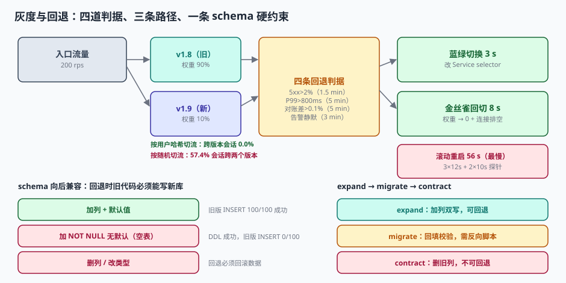

# 第 4 周第 7 步 · 灰度发布与版本回退闸门（EPK-A~EPK-H）

前六步把服务跑起来了、把告警接上了、把成本算清了、把验收单签了、把交付包封了、把备份演练过了。这六步都假设一件事：**发上去的版本是对的**。

这一步处理的是反面：**如果它是错的，多久能退回来，退回来之后数据还对不对。**

「能发布」和「能回退」是两种完全不同的能力。发布靠流水线，回退靠三样东西：**切得动流量、判得出异常、退得回结构**。三样里最容易漏的是第三样——应用回退了，数据库结构没回退，旧代码写新库，直接 100% 失败。



## 一、切流：按用户哈希，不按请求随机

灰度发布的第一件事是决定「谁走新版本」。

| 方式 | 实现 | 同一用户的多次请求 | 实测跨版本会话 |
| --- | --- | --- | --- |
| 按请求随机 | 每个请求独立掷骰子 | 可能一半走旧一半走新 | **57.4%** 的会话跨两个版本 |
| 按用户哈希 | `hash(tenant_id) % 100 < pct` | 始终落在同一侧 | **0.0%** |

本机口径：2,000 个用户、每人 8 次请求、10% 灰度。随机切流下有 1,147 个用户的 8 次请求分散在两个版本上。

这不是「体验抖动」的问题，是**正确性**的问题：

```text
用户 A 第 1 次请求（v1.8）创建了订单，写进 v1.8 的缓存 key 格式
用户 A 第 2 次请求（v1.9）读订单，按 v1.9 的 key 格式查 → 查不到 → 重复创建
```

同一个用户在同一分钟内看到「订单不存在」然后「订单创建成功两次」，是最典型的灰度事故形态。**所以切流键必须是业务主体（租户/用户），不能是请求。**

::: danger 三个让哈希切流失效的细节
1. **切流键在网关和业务侧不一致**：网关按 `user_id` 算，业务侧按 `tenant_id` 算，同一个人在两处落到不同版本。
2. **哈希函数带随机盐**：每次发布重新生成盐，等于把「稳定分桶」变成「随机分桶」。
3. **灰度名单与权重混用**：既有白名单又有百分比权重，冲突时谁优先没有定义——实测口径是**白名单优先，且白名单用户不受权重影响**。
:::

## 二、判定：小流量灰度根本判不出异常

四道判据各有各的窗口，最快 1.5 分钟、最慢 5 分钟能发现问题：

| 判据 | 阈值 | 窗口 | 采样步长 | 最快发现 |
| --- | --- | --- | --- | --- |
| 错误率 | 5xx > 2% | 3 个窗口 | 30 s | 1.5 min |
| 延迟 | P99 > 800 ms | 5 个窗口 | 60 s | 5 min |
| 对账差异 | > 0.1% | 1 个窗口 | 300 s | 5 min |
| 告警静默 | 采集断流 > 3 min | 1 个窗口 | 180 s | 3 min |

但「能发现」的前提是**样本量够**。基线错误率 0.5%、希望识别出升到 1.5% 的劣化（α=0.05，把握度 80%），每组需要约 **1,555 个请求**：

| 灰度比例 | 灰度侧 QPS（总量 200） | 攒够 1,555 请求需要 |
| --- | --- | --- |
| 1% | 2.0 | **13.0 分钟** |
| 5% | 10.0 | 2.6 分钟 |
| 10% | 20.0 | 1.3 分钟 |
| 25% | 50.0 | 0.5 分钟 |

这张表解释了一个常见现象：**1% 灰度跑了 2 分钟就宣布「没问题」，其实什么也没证明。** 2 分钟只攒到 240 个请求，在 0.5% 的基线下期望错误数是 1.2 个——一个都没出现也完全正常。

同理，小窗口的误触发率会飙升：灰度 1% 时窗口里只有 120 个请求，用 2% 阈值判「错误率升高」，**误触发率 2.85%**；窗口放大到 1,200 个请求后，误触发率降到 **0.00%**。

::: warning 灰度的两条时间纪律
1. **先攒样本再判定**：每个灰度档位至少停留到「该档位攒够 1,555 请求」或「满 15 分钟」，二者取长。
2. **判据窗口 ≥ 3 个采样周期**：单周期判定等于用一次采样做决策，抖动就是事故。
:::

## 三、回退：三条路径，差 18.7 倍

| 方式 | 耗时 | 机制 | 适用 |
| --- | --- | --- | --- |
| 蓝绿切换 | **3 s** | 改 Service selector 指回旧 ReplicaSet | 两个版本都在跑，最理想 |
| 金丝雀回切 | **8 s** | 权重 100% → 0，排空存量连接 | 灰度期间，只需改权重 |
| 滚动重启 | **56 s** | 3 副本 × 12 s 启动 + 2 × 10 s 探针 | 只有旧镜像，重新拉起 |

最慢 56 s、最快 3 s，差 18.7 倍。这个差距在事故里不是「体验问题」：200 rps 下，56 秒意味着 **11,200 个请求**打在坏版本上。

而比回退方式更影响结果的，是**决策时延**：

| 环节 | 自动闸门 | 人工逐个确认 |
| --- | --- | --- |
| 发现 | 2.0 min | 2.0 min |
| 决策 | 1.5 min（看板 + 一键回退） | 15 min（三次确认 × 5 min） |
| 执行 | 0.9 min | 0.9 min |
| **合计** | **4.4 min** | **17.9 min** |
| 影响请求（200 rps） | 52,800 | **214,799** |

**四倍的差距不在技术上，在「谁有权按那个按钮」。** 所以闸门文件里必须写清三件事：谁批、批多久内有效、什么条件下不需要批（自动回退）。

## 四、第三条路：schema 必须是向后兼容的

应用回退只是第一层。真正会让回退失败的是**数据库结构已经前进了一步**。

本机用 SQLite 模拟「旧版应用 + 新 schema」：

| 变更 | DDL 是否成功 | 旧版 `INSERT` 结果 |
| --- | --- | --- |
| 加列 + `NOT NULL DEFAULT 'OPEN'` | 成功 | **100 / 100 成功**（默认值兜住） |
| 加列 + `NOT NULL` 无默认（表里已有数据） | 失败 | — （DDL 就被拒，反而是好事） |
| 加列 + `NOT NULL` 无默认（**空表**） | **成功** | **0 / 100 成功**（旧版不带该列，全被拒） |
| 不改 schema | — | 100 / 100 成功 |

第三行是这一步最值得记住的坑：**空表加 `NOT NULL` 无默认列，DDL 会成功**。发布当天表是空的，新版写入正常，一切看起来都好；等回退时旧代码一写就全失败——而这时你正处在事故中。

所以 schema 变更必须走三阶段，且**只有前两阶段是可回退的**：

| 阶段 | 做什么 | 可回退 | 回退方式 |
| --- | --- | --- | --- |
| expand | 加新列/新表，双写，旧代码可读 | ✅ | 应用层回退即可 |
| migrate | 回填历史数据，跑一致性校验 | ✅（需反向脚本） | 反向回填 + 应用回退 |
| contract | 删旧列、加约束、改类型 | ❌ | 只能靠备份恢复 |

本机对 1,000 行做双写一致性校验（`v1 IS NOT v2`）：差异 **0 行**，耗时 **0.07 ms**。这个校验必须在每次 migrate 之后跑一遍——**双写不代表一致，只代表写了两次**。

::: danger 回退闸门的四条硬规则
1. **同一发布窗口内只允许一个未完成的 schema 变更**：两个 expand 叠在一起，回退时不知道该退到哪。
2. **`contract` 阶段必须与上一次发布隔开至少一个完整发布周期**：给回退留窗口。
3. **回退脚本必须和升级脚本一起写、一起测**：只写升级不写回退，等于没有回退。
4. **只能加列，不能在同一窗口内删列或改类型**：删列之后旧代码读不到，改类型之后旧代码写不进。
:::

## 五、闸门文件：把「什么时候可以发」写成可执行的条件

```yaml
# gate.yaml —— 每一步都必须有 source，禁止出现「人工判断」
release:
  version: "1.9.0"
  previous: "1.8.0"
stages:
  - pct: 1
    min_requests: 1555        # 小流量必须攒够样本
    min_minutes: 15
    checks:
      - { name: error_rate, op: "<=", value: 0.02, window: 3, source: "prom:http_5xx_ratio" }
      - { name: p99_ms,     op: "<=", value: 800,  window: 5, source: "prom:http_p99" }
      - { name: alert_silence_min, op: "<=", value: 3, window: 1, source: "alertmanager:last_eval" }
  - pct: 10
    min_requests: 1555
    min_minutes: 30
  - pct: 50
    min_requests: 5000
    min_minutes: 30
  - pct: 100
rollback:
  auto: true
  on: [error_rate, p99_ms, alert_silence_min]
  method: blue_green          # 3 s
  max_decision_seconds: 90
  approver: oncall-sre
schema:
  stage: expand               # expand | migrate | contract
  rollback_safe: true
  reverse_script: "migrations/2026_11_04_reverse.sql"
```

这份文件的价值不在配置项多，而在**每一项都能被机器读、被流水线跑**。`source` 字段是关键：写不出 `source` 的检查项，说明它其实是个「感觉」。

## 六、当日做了什么

| 交付物 | 内容 | 判据 |
| --- | --- | --- |
| 切流方案 | 按租户哈希分桶，白名单优先 | `EPK-A` `EPK-B` |
| 四条回退判据 | 错误率 / P99 / 对账差异 / 告警静默，各带窗口与阈值 | `EPK-C` |
| 三段灰度阶梯 | 1% → 10% → 50% → 100%，每档带 `min_requests` | `EPK-D` |
| 三条回退路径 | 蓝绿 3 s / 金丝雀 8 s / 滚动 56 s，写入 runbook | `EPK-E` |
| schema 三阶段规则 | expand / migrate / contract + 反向脚本 | `EPK-F` |
| `gate.yaml` | 14 个检查项，全部带 `source` | `EPK-G` |
| 决策时延基线 | 自动 4.4 min vs 人工 17.9 min | `EPK-H` |

## 七、判据

本页判据族 `EPK-A` ~ `EPK-H`，共 8 条。八条都能被单独判定，任何一条不成立就不算这篇文档写完。

| 判据 | 验收点 | 不合格的表现 |
| --- | --- | --- |
| `EPK-A` | 切流键为业务主体（租户/用户），非请求 | 每请求独立随机，57.4% 会话跨版本 |
| `EPK-B` | 白名单优先级有明确定义 | 白名单与权重冲突时行为不确定 |
| `EPK-C` | 四条判据各有阈值、窗口、采样步长 | 只有「观察错误率」 |
| `EPK-D` | 每档灰度都有 `min_requests` 与 `min_minutes` | 1% 跑 2 分钟就放行 |
| `EPK-E` | 三条回退路径的耗时写进 runbook 并实测 | 只知道「能回退」，不知道多久 |
| `EPK-F` | schema 变更标注 `stage` 与 `rollback_safe` | 空表加 `NOT NULL` 列后回退失败 |
| `EPK-G` | `gate.yaml` 每项都有 `source` | 出现「人工判断」类检查项 |
| `EPK-H` | 决策时延与自动/人工两种路径都有基线 | 事故中现讨论谁批 |

## 八、验证方式

```shell
# 1) 哈希切流 vs 随机切流的会话一致性
python3 - <<'PY'
import random
random.seed(20261104)
users, reqs, pct = 2000, 8, 10
b = {u: hash(str(u)) % 100 for u in range(users)}
def mixed(mode):
    n=0
    for u in range(users):
        vs=set()
        for _ in range(reqs):
            if mode=="hash": vs.add("NEW" if b[u]<pct else "OLD")
            else: vs.add("NEW" if random.random()*100<pct else "OLD")
        n += len(vs)>1
    return n
print("hash 跨版本会话", mixed("hash"), "/", users)
print("random 跨版本会话", mixed("random"), "/", users)
PY
# 预期：hash 0/2000；random 约 1,147/2000（57.4%）

# 2) 小流量攒样本需要多久
python3 -c "
import math
p1,p2=0.005,0.015; pb=(p1+p2)/2; z=1.959964+0.841621
n=2*pb*(1-pb)*z**2/(p2-p1)**2
for pct in (1,5,10): print(f'{pct}% → {n/(200*pct/100)/60:.1f} 分钟')
"
# 预期：1% → 13.0 分钟；5% → 2.6；10% → 1.3

# 3) 空表加 NOT NULL 无默认列：DDL 成功但旧版写入失败
sqlite3 :memory: <<'SQL'
CREATE TABLE ticket (id TEXT PRIMARY KEY, amount INT);
ALTER TABLE ticket ADD COLUMN status TEXT NOT NULL;
INSERT INTO ticket (id, amount) VALUES ('T1', 100);
SQL
# 预期：Error: NOT NULL constraint failed: ticket.status ← 旧版 INSERT 被拒

# 4) 加列带默认值时旧版仍可写
sqlite3 :memory: <<'SQL'
CREATE TABLE ticket (id TEXT PRIMARY KEY, amount INT);
ALTER TABLE ticket ADD COLUMN status TEXT NOT NULL DEFAULT 'OPEN';
INSERT INTO ticket (id, amount) VALUES ('T1', 100);
SELECT id, amount, status FROM ticket;
SQL
# 预期：T1|100|OPEN（默认值兜住，回退安全）
```

## 九、下一步

第 5 周进入运维期，第 1 步是**线上故障注入与熔断阈值校准**（`EPL-A~EPL-H`）：在不影响真实租户的前提下，用混沌注入把「下游超时 / 连接池耗尽 / 缓存雪崩」三种故障按 5%/20%/50% 的强度打进预发环境，校准熔断器的三个阈值（错误率、半开探测间隔、最小请求数），并验证「打开后能否自动恢复」。

这一步会用到本步的闸门：**故障注入期间的发布一律禁止**，闸门文件里要加一条 `freeze_window`。

## 参考资料

- Kubernetes 官方文档 *Deployments: Rolling Update* / *Service*（1.33）：`maxSurge` / `maxUnavailable` 与 selector 切换的语义。
- Google SRE Workbook *Canarying Releases*（2018）：灰度分档、样本量与判定窗口的工程口径。
- Martin Fowler *ParallelChange (expand/contract)*：三阶段 schema 变更的标准做法。
- PostgreSQL 文档 *ALTER TABLE*：`ADD COLUMN ... NOT NULL DEFAULT` 的锁与重写行为（11 起默认值不再重写全表）。
- 与本步相邻：[第 4 周第 6 步 备份与恢复演练](../Week4Backup/index.md)、[第 4 周第 2 步 监控与告警接线](../Week4Monitoring/index.md)、[第 4 周第 1 步 一键部署](../Week4Deploy/index.md)。
