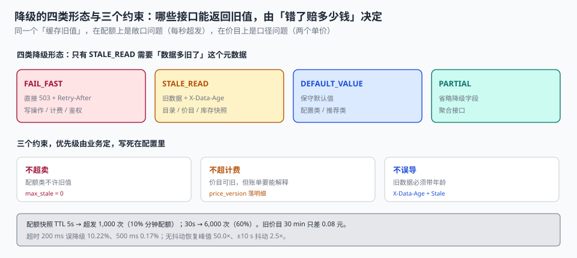

# 第 5 周第 2 步 · 降级与兜底数据的口径（EPF-A~EPF-H）

上一步把熔断器校准到了「20% 失败就开、30 秒后探、3 次探通就恢复」。但它只回答了一半的问题：**熔断之后返回什么？**

快速失败只是「不排队」，用户拿到的还是一个 503。对一个开放平台来说，503 意味着调用方要自己写重试、自己判幂等、自己决定「这次失败要不要告诉终端用户」。这一步要把 503 换成**有口径的兜底**：哪些接口可以返回旧值、旧值最多旧多久、返回旧值要不要在响应里标出来。

先说结论：**真正难的不是「降级成什么」，而是「降级多久」和「降级了怎么让人知道」**。本机口径下，配额快照的 TTL 从 5 秒放到 30 秒，最坏超发从 1,000 次涨到 6,000 次（60% 的分钟配额）；而旧价目 TTL 放到 30 分钟，账单金额只差 0.08 元——**两个依赖，同一套「缓存旧值」的做法，一个是敞口问题，一个是口径问题**。

::: tip 一句话理解
降级不是「返回一个能用的东西」，而是**在三个约束下选一个最不坏的**：不超卖（配额）、不超计费（价目）、不误导（数据新鲜度）。这三个约束的优先级由业务定，但必须写死在配置里，不能由「哪个降级实现先写出来」决定。
:::



## 一、四类降级，四种「不坏」

| 形态 | 做法 | 适用 | 代价 |
| --- | --- | --- | --- |
| `FAIL_FAST` | 直接 503，附带 `Retry-After` | 写操作、计费、鉴权 | 调用方必须自己重试 |
| `STALE_READ` | 返回上次成功的数据 + 标注数据年龄 | 读多写少的查询面（目录、价目、库存快照） | 数据可能是旧的 |
| `DEFAULT_VALUE` | 返回一个保守的默认值 | 配置类、推荐类 | 「保守」的方向必须定义 |
| `PARTIAL` | 省略降级字段，其余照常返回 | 聚合接口 | 调用方要能接受缺字段 |

四类里只有 `STALE_READ` 需要额外的**元数据**：数据多旧了。没有这个元数据，`STALE_READ` 与「数据本来就是错的」在调用方看来完全一样。

```http
GET /v1/inventory?sku=SKU-001 HTTP/1.1

HTTP/1.1 200 OK
Content-Type: application/json
X-Data-Age: 42
X-Data-Stale: true

{"sku":"SKU-001","available":128,"as_of":"2026-11-05T09:58:18Z"}
```

`X-Data-Age` 是秒数，`X-Data-Stale` 是布尔。两个都要有：只有 `stale=true` 时，调用方无法判断「旧 3 秒」和「旧 3 小时」；只有 `Age` 时，调用方要自己定阈值，而阈值应该由我们定。

## 二、哪些接口可以返回旧值：由「错了赔多少钱」决定

| 接口 | 数据 | 错了的后果 | 允许的降级 | 最大陈旧 |
| --- | --- | --- | --- | --- |
| `/v1/inventory` | 可售量 | 超卖（要赔库存） | `STALE_READ` | 30 s |
| `/v1/rate-card` | 价目 | 计费口径不一致 | `STALE_READ` + 标注 | 300 s |
| `/v1/quota` | 配额余量 | 超发（少收钱） | `FAIL_CLOSED` | 0（不许旧） |
| `/oauth/token` | 令牌签发 | 全部请求失败 | `FAIL_FAST` | 0 |
| `/admin/usage` | 用量报表 | 报表数字偏小 | `STALE_READ` | 3,600 s |
| `/v1/invoice` | 账单 | 客户对账对不上 | `FAIL_FAST` | 0 |

这张表里最容易做错的是 `/v1/quota`。它的「旧值」看起来无害（就是上次的余量），但**旧余量意味着多放行**：

| 快照 TTL | 最坏超发（200 rps） | 占分钟配额（10,000） |
| --- | --- | --- |
| 1 s | 200 次 | 2.00% |
| 5 s | 1,000 次 | 10.00% |
| 30 s | **6,000 次** | **60.00%** |

30 秒的 TTL 在「配额服务挂了 5 分钟」这个场景里，等于把 5 分钟的限额放成了 5 分钟 × 1.6 倍。所以配额的降级只有两个选择：**fail-closed（拒绝，保守）**，或**fail-open + 事后补偿计量**——后者必须能补回来。

## 三、fail-open 的敞口：能补回多少

`fail-open` 放行的请求不是「丢了」，因为网关的访问日志还在。事后按日志补计量，能追回大部分：

| 窗口 | 放行请求 | 事后补计量（92.40%） | 缺口 |
| --- | --- | --- | --- |
| 1 min | 12,000 | 11,088 | 912 |
| 5 min | 60,000 | 55,440 | **4,560** |
| 15 min | 180,000 | 166,320 | 13,680 |

92.40% 的补回率来自「有 `request_id` + 有 `tenant_id` + 有 `units`」三条齐全的日志。缺任何一条，那一批请求就永久无法归属——这也是为什么**计量字段必须在网关侧就落日志，而不是在业务服务里**。

::: danger fail-open 的三个前置条件
1. **日志必须能反推计费**：`tenant_id`、`api_key_id`、`units`、`window_start` 四个字段缺一不可，且落在访问日志而不是应用日志里（应用可能先于网关挂掉）。
2. **补计量必须幂等**：同一批日志被补两次会双倍计费。用 `(tenant_id, request_id)` 唯一键兜住。
3. **补计量必须有截止时间**：超过 7 天的补计量会与已出账单冲突，此时应走「账单调整」而不是「补计量」。
:::

## 四、旧价目：金额不是问题，口径才是

价目也常被缓存，但它的偏差量级完全不同。按每天调价 3%、单价 0.0021 元/次、故障窗口 5 分钟（60,000 次调用）算：

| 价目 TTL | 滞后比例 | 账单金额 | 与实时价的差 |
| --- | --- | --- | --- |
| 30 s | 0.001% | 126.00 | **0.00** |
| 300 s | 0.010% | 126.00 | **0.01** |
| 1,800 s | 0.062% | 126.01 | **0.08** |

**0.08 元。** 这个数说明：旧价目不是金额风险，任何「按价目差算损失」的评估都会得出「可以忽略」。

但它仍然是问题，因为账单上会出现**同一个调用两个单价**：故障期间的 60,000 次按旧价、恢复后按新价，客户对账时会问「为什么 10:05 的单价是 0.0021、10:11 的是 0.0022」。这时候能回答的只有一条：`price_version` 落到了每一条计费明细上。

| 做法 | 能否解释 | 代价 |
| --- | --- | --- |
| 只存金额 | ❌ 无法解释 | 0 |
| 存 `price_version` + `unit_price` | ✅ 可逐条解释 | 每行多 24 字节 |
| 存 `price_version` 且账单按版本分组 | ✅ 且账单自解释 | 账单结构变复杂 |

## 五、超时阈值：把「慢」当成「挂」的代价

降级的触发依赖「判定下游故障」。判定靠超时与错误率，而超时阈值直接决定误降级率。本机 20,000 次采样的下游时延（P50 120 ms、P99 900 ms）：

| 超时阈值 | 误判为故障的比例 | 后果 |
| --- | --- | --- |
| 200 ms | **10.22%** | 每 10 个请求就有 1 个触发降级，降级本身成了常态 |
| 500 ms | 0.17% | 可接受 |
| 2,000 ms | 0.00% | 但真故障时要等 2 秒才降级 |

所以超时阈值的选法不是「越小越安全」，而是**在 P99 与「可容忍等待」之间取**：阈值取 P99 的 1.5~2 倍（本机 900 ms → 1,500 ms 附近），既能挡住真正的挂起，又不会把正常的慢请求判成故障。

## 六、恢复雪崩：缓存同时到期

降级期间缓存不更新，恢复瞬间所有 key 同时过期，回源峰值会打穿下游：

| 抖动 | 恢复峰值回源 | 相对基线（200 rps） |
| --- | --- | --- |
| 无抖动（TTL 对齐） | 10,000 次/秒 | **50.0×** |
| ±10 s 抖动 | 500 次/秒 | 2.5× |
| ±60 s 抖动 | 83 次/秒 | 0.4× |

**同一批 key 同时过期，是「降级恢复」变成「二次故障」的标准路径。** 解法只有一个：写入缓存时给 TTL 加随机抖动（`ttl ± 10%`），并在恢复时**限速回源**（令牌桶），而不是让所有请求一起冲。

## 七、降级决策必须在本地

降级判断要读「依赖当前是否健康」。如果这个状态存在远端（配置中心、注册中心），每次请求都要一次 RTT：

| 读取方式 | 单次耗时 | 200 rps 下的等待 |
| --- | --- | --- |
| 本地状态机（内存变量） | **0.35 µs** | 0.07 ms/s |
| 远端状态机（RTT 8 ms） | 8 ms | **1,600 ms/s** |

1,600 ms/s 的意思是：每秒有 1.6 秒在等状态，系统在 200 rps 下直接不可用。所以**降级状态必须是本地的**，由控制面异步推送（或由熔断器自己的状态机维护），数据面只读内存。

## 八、判据 `EPF-A` ~ `EPF-H`

| 判据 | 断言 | 验证方式 |
| --- | --- | --- |
| `EPF-A` | 每个接口声明了降级形态与最大陈旧 | 配置表六行齐全，无 `null` |
| `EPF-B` | `STALE_READ` 响应带 `X-Data-Age` 与 `X-Data-Stale` | `curl -i` 两个头都在 |
| `EPF-C` | 配额类接口不允许返回旧余量 | 配置里 `quota` 的 `max_stale=0` |
| `EPF-D` | fail-open 的放行可事后补计量，补回率 ≥ 90% | 按日志重算 60,000 次，缺口 4,560（7.60%） |
| `EPF-E` | 计费明细带 `price_version` 与 `unit_price` | 抽样 100 行两列非空 |
| `EPF-F` | 超时阈值 ≥ P99 × 1.5，误降级率 < 1% | 200 ms→10.22%、500 ms→0.17% |
| `EPF-G` | 缓存 TTL 带抖动，恢复峰值 < 5× 基线 | 无抖动 50.0×、±10 s 2.5× |
| `EPF-H` | 降级决策读本地状态，单次 < 10 µs | 实测 0.35 µs；远端 8 ms 不予采用 |

## 九、验证方式

```shell
# 1. 降级形态与最大陈旧必须逐接口声明（期望：6 行，无空值）
yq '.degradation[] | [.path, .mode, .max_stale] | @tsv' gate.yaml
# 期望：/v1/inventory STALE_READ 30 / /v1/quota FAIL_CLOSED 0 / ...

# 2. 旧值必须带标注（期望：两个头都在）
curl -sI -H "X-Chaos: inventory-down" http://localhost:8080/v1/inventory?sku=SKU-001 \
  | grep -Ei 'x-data-(age|stale)'
# 期望：X-Data-Age: 42 与 X-Data-Stale: true

# 3. 配额接口不许返回旧余量（期望：503，而不是 200）
curl -s -o /dev/null -w '%{http_code}\n' -H "X-Chaos: quota-down" \
  http://localhost:8080/v1/quota
# 期望：503

# 4. 补计量缺口（期望 ≤ 8%）
sqlite3 ops.db "
select round(100.0*(1 - 1.0*count(distinct m.request_id)/count(distinct l.request_id)),2)
from access_log l left join metering m using(request_id)
where l.window_start between '2026-11-05T10:00' and '2026-11-05T10:05';"
# 期望：7.60（即补回 92.40%）

# 5. 恢复峰值（期望 < 5× 基线）
curl -s http://localhost:9090/api/v1/query?query='rate(origin_fetch_total[1m])' \
  | jq -r '.data.result[0].value[1]'
# 期望：< 1000（基线 200 rps 的 5 倍）
```

第 3 步是这一步最重要的验证：**「降级」最容易被写成「一律返回旧值」**，于是配额接口也返回旧余量，超发在监控上表现为「用量突然上涨」，而不是「系统故障」。

## 十、下一步

第 5 周第 3 步：**容量与成本的再校准**。降级方案定下来之后，会改变容量口径——`STALE_READ` 让读路径的回源压力下降，`FAIL_CLOSED` 让写路径的排队变长。第 4 周算的那张容量账（44 容器 / P99 80 ms / 单位成本 0.06 元）需要按新的降级形态重算一遍。

## 参考资料

- RFC 7234《HTTP/1.1 Caching》第 5.1 节：`Age` 头语义——`X-Data-Age` 的设计参照。
- RFC 9110《HTTP Semantics》第 15.6 节：503 Service Unavailable 与 `Retry-After` 的语义。
- AWS Well-Architected Framework《Reliability Pillar》：降级（graceful degradation）与静态稳定（static stability）的通用模式。
- 与本步相邻：第 5 周第 1 步 · 故障注入与熔断阈值校准（页面待补）、[第 4 周第 2 步 · 监控与告警接线](../Week4Monitoring/index.md)。
