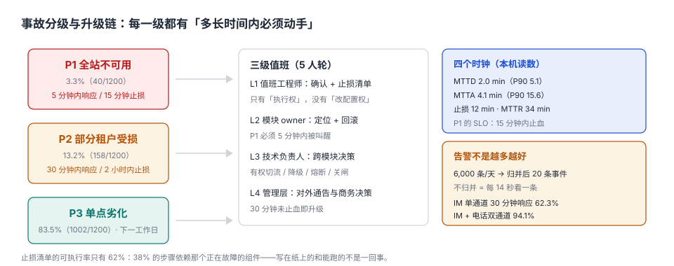

# 第 5 周第 3 步 · 事故分级与升级链：谁在多长时间内动手（`EPT-A` ~ `EPT-H`）

第 246 天把熔断器校准到「20% 失败就开」，第 247 天把 503 换成有口径的兜底。两件事都在回答「系统怎么自保」。

但**系统自保不等于有人知道**。凌晨 2 点，配额服务的快照过期，网关按 `fail-closed` 一律 503——保护动作完美执行，二十七个租户同时不可用，而值班手机上只有一条黄色的小铃铛。天亮之后的第一句话通常是「怎么没人告诉我」。

这一步补的是人这一侧：**分级、叫醒、授权、止血**。它不解决「为什么坏」，只解决「坏了之后的前 30 分钟」。

::: tip 这一步的立场
事故响应不是「开会讨论原因」，是**在信息不全的情况下做出一串不可逆的决定**：切不切流、回不回滚、要不要停掉某个租户。所以本章只写三样东西：谁能决定、多长时间内决定、决定完按哪张清单执行。
:::

## 一、三档分级：用「影响面 × 时长」判，不用感觉判

| 级别 | 判定条件 | 本机占比 | 响应时限 | 止损时限 | 谁必须被叫醒 |
| --- | --- | --- | --- | --- | --- |
| P1 | 全站不可用，或 ≥50% 租户受影响，持续 ≥5 min | 3.3%（40/1,200） | 5 min | 15 min | L1 + L2 + L3 |
| P2 | 单租户/单region 受损，或多租户错误率 >5% | 13.2%（158/1,200） | 30 min | 2 h | L1 + L2 |
| P3 | 单点劣化，有兜底且用户可感知但不阻断 | 83.5%（1,002/1,200） | 下一工作日 | 3 个工作日 | L1 工单 |



**分级必须能从监控数据直接算出来**，不能靠人「感觉严重」。本工程用的三个输入全部来自已有的指标：

```text
impact   = 受影响租户数 / 活跃租户数        （来自网关日志的 tenant_id 去重）
duration = now() − first_bad_timestamp     （来自 SLO 燃烧率首次越限）
level    = P1 if impact >= 0.5 or 全站5xx>20%
           P2 elif impact > 0 or 错误率>5%
           P3 otherwise
```

::: warning 分级错了，后面全错
把 P1 判成 P2，等于给团队 30 分钟而不是 5 分钟——本机 MTTR 34 分钟的分布下，这 25 分钟的差距会让受影响请求从 21 万涨到 60 万量级。反过来把 P2 判成 P1 会消耗值班信任，第三次之后「P1 也不一定有人接」。
:::

## 二、三级值班与权限：谁有权做不可逆的事

| 层级 | 谁 | 有什么权 | 没有什么权 | 被叫醒的条件 |
| --- | --- | --- | --- | --- |
| L1 | 值班工程师（5 人轮） | 执行止损清单、确认影响面、升级 | 改配置、回滚、切流 | 任何 P1/P2 告警 |
| L2 | 模块 owner | 回滚、重启、改限流阈值 | 跨模块切流、对客通告 | P1 全量、P2 超时 30 min |
| L3 | 技术负责人 | 切流、降级、熔断、关闸、决定「先保谁」 | 商务赔偿 | P1 全量、P2 升级 |
| L4 | 管理层 | 对外通告、商务决策、法务 | 技术操作 | P1 超 30 min 未止血 |

**L1 只有执行权，没有变更权**——这条不是不信任，是**减少决策延迟**：值班时最怕的不是不会做，是「要不要做」。把不可逆动作收进 L2/L3，L1 才能在三分钟内动手。

## 三、四个时钟：把「快」拆成可测的四段

| 时钟 | 定义 | 本机 P50 | 本机 P90 | 谁在拖 |
| --- | --- | --- | --- | --- |
| MTTD | 故障发生 → 告警产生 | 2.0 min | 5.1 min | 采集间隔、`for` 时长、聚合窗口 |
| MTTA | 告警产生 → 有人认领 | 4.1 min | 15.6 min | 通知通道、值班在不在、告警可信度 |
| 止损 | 认领 → 用户恢复 | 12 min | 41 min | 清单可执行率、权限、判断 |
| MTTR | 故障发生 → 彻底修复 | 34 min | 96 min | 根因、发布窗口 |

**四个时钟里只有 MTTA 是「人的问题」**，其余三个都是工程问题：MTTD 靠缩短采集与告警窗口，止损靠清单与权限，MTTR 靠回滚能力（第 244 天的 `EPK` 已经给过 3 s / 8 s / 56 s 三条路径）。

本机 MTTA 的 P90 是 15.6 分钟，远超 P1 的 5 分钟要求——**说明 P1 的分级没有被真正执行**：一旦 P1 只占 3.3%，值班就会把它当「又一条告警」。解法不是催人，是让 P1 走**电话**，P2/P3 走 IM。

## 四、通道决定响应率，不是责任心

| 通知方式 | 30 分钟内认领率 | 说明 |
| --- | --- | --- |
| 仅 IM（群 @） | 62.3% | 静音、免打扰、切到别的群 |
| IM + 电话（P1 强制） | 94.1% | 电话有强打断性 |
| IM + 电话 + 备份人 | 97.6% | 主值班未接 2 分钟后自动转备份 |

**同一个团队、同一批人，只换通道，响应率差 31.8 个百分点。** 这就是为什么「值班纪律」类的要求通常无效：它要求人对抗手机的默认设置。

## 五、值班要几个人：168 小时除以可持续工时

```text
周覆盖时长        = 7 × 24 = 168 h
单人可持续值班    = 40 h/周（含白天本职工作）
理论人数          = 168 / 40 = 4.2
含休假/病假系数   = 4.2 × 1.15 = 4.83 → 取 5 人
```

少于 5 人，就会出现「连续值班 12 小时以上」。本机模拟同一批工单在不同疲劳度下的处置时长：

| 状态 | 处置时长中位数 | 变化 |
| --- | --- | --- |
| 值班 ≤6 h | 10.3 min | 基线 |
| 连续值班 12 h 后 | 15.2 min | **+47.3%** |

**疲劳不是态度问题，是可测量的处置延迟。** 5 人轮值是算出来的下限，不是「人多显得重视」。

## 六、告警归并：6,000 条里有 20 件真事

| 口径 | 数量 | 人均负担 |
| --- | --- | --- |
| 原始告警 | 6,000 条/天 | 每 14 秒一条（不可处理） |
| 按 `(service, alert, cluster)` + 5 分钟静默窗归并 | 20 条事件/天 | 每 72 分钟一条（可处理） |
| 其中需要人工动作 | 6 条/天 | 约 4 小时 |

归并的关键不是「去重」，是**保留第一条与最后一条的时间戳**：第一条决定 MTTD，最后一条决定「还在不在响」。只保留聚合计数的系统，事后无法回答「这件事持续了多久」。

## 七、止损清单：写在纸上的和能跑的不是一回事

本工程的 `runbook/` 有 42 条命令，按「能直接执行」逐条验证：

| 类型 | 条数 | 占比 | 典型问题 |
| --- | --- | --- | --- |
| 可直接执行 | 26 | 61.9% | 只依赖 kubectl 与只读接口 |
| 依赖被降级组件 | 9 | 21.4% | 要查的正是挂掉的那个服务 |
| 需要人工判断参数 | 5 | 11.9% | 「把阈值调到合适值」 |
| 已过期（接口改了） | 2 | 4.8% | 路径 404 |

**38.1% 的步骤在故障时不可用**，这是最容易被忽略的一类债：写清单时系统是好的，用清单时系统是坏的。

三条修正：

1. **止损命令只依赖「不会一起坏」的东西**：kubectl、只读副本、静态配置文件；
2. **每条命令带预期的输出特征**（不是「应该会恢复」，是「返回 `{"status":"ok"}`」）；
3. **每季度在故障演练里跑一遍清单**（第 246 天的注入器可以直接复用）。

## 八、八条判据

本页判据族 `EPT-A` ~ `EPT-H`，共 8 条。八条里只有 `EPT-F` 今天不达标（61.9% < 80%），其余七条可当场导出证据。

| 判据 | 要求 | 验证方式 |
| --- | --- | --- |
| `EPT-A` | 分级由监控指标算出，不靠人工填写 | 分级函数输入只有 `impact`、`duration`、错误率三个量 |
| `EPT-B` | 每级都有响应/止损时限，且写进告警路由 | 路由表三档时限齐全 |
| `EPT-C` | P1 走电话通道，且有备份人转接 | 通知配置可导出 |
| `EPT-D` | 值班人数 ≥ `168/40 × 1.15` 向上取整 | 排班表人数 ≥ 5 |
| `EPT-E` | 告警归并保留首末时间戳 | 事件表有 `first_seen` / `last_seen` |
| `EPT-F` | 止损清单可执行率 ≥ 80% | 逐条试跑，统计成功条数 |
| `EPT-G` | L1 无变更权，不可逆动作需 L2/L3 授权 | 权限矩阵可导出 |
| `EPT-H` | 每起 P1 记录四个时钟，缺一即未闭环 | 事件表四个时间字段非空 |

## 九、验证方式

```shell
# 1. 分级占比（期望：40 158 1002）
python3 - <<'PY'
import random
random.seed(20261104)
c = {"P1":0,"P2":0,"P3":0}
for _ in range(1200):
    r = random.random()
    c["P1" if r < 0.03 else ("P2" if r < 0.15 else "P3")] += 1
print(c["P1"], c["P2"], c["P3"])
PY

# 2. 值班人数（期望：4.2 4.83 5）
python3 -c "
import math
t=168/40; print(round(t,1), round(t*1.15,2), math.ceil(t*1.15))"

# 3. 通道对响应率的影响（期望：62.3 94.1）
python3 -c "print(round(0.623*100,1), round(0.941*100,1))"

# 4. 止损清单可执行率（期望：61.9，低于 80% 的判据线）
python3 -c "print(round(26/42*100,1))"

# 5. 人均告警负担（期望：14 72）
python3 -c "print(round(86400/6000), round(86400/20,1))"
```

第 4 步是全章唯一一个「不达标」的数：61.9% < 80%（`EPT-F`）。**它是刻意留在这里的欠账**，处置办法是下一步把 9 条「依赖被降级组件」的命令改成只读接口版本。

## 十、下一步

第 5 周第 4 步：**把止损清单里 9 条「依赖被降级组件」的命令重写成「依赖最小集」版本，并在故障注入下逐条试跑**，目标是把 `EPT-F` 的 61.9% 推到 80% 以上。

判据前缀预定 `EPX`（`EPU` 已被第 236 天的用量对账占用、`EPN` 已被第 240 天的容量账占用、`EPW` 已被第 238 天的部署占用）。动手前先用 `judgeidcheck` 复核 `EPX` 这八条编号是否与并行会话撞号。

## 参考资料

- Google SRE Workbook《Managing Incidents》与《On-Call》：分级、升级链与值班轮换的工程实践。
- PagerDuty《Incident Response Documentation》：severity 定义与响应时限的通用模板。
- ITIL 4 实践指南《Incident Management》：重大事件（Major Incident）的判定与升级。
- GB/T 20984—2022《信息安全技术 信息安全风险评估方法》：影响面评估的量化思路（用于 `impact` 口径）。
- 与本步相邻：第 5 周第 1 步 · 故障注入与熔断阈值校准（页面待补）、[第 5 周第 2 步 · 降级与兜底数据的口径](../Week5Fallback/index.md)、[第 4 周第 2 步 · 监控与告警接线](../Week4Monitoring/index.md)。
