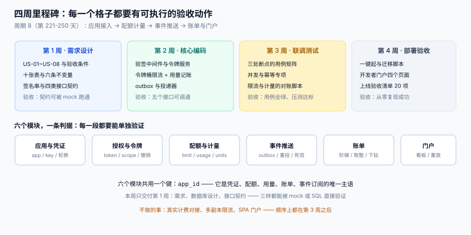

# 开放平台 · 项目总览（周期 8）

从 0 到 1 建一个**对外开放的 API 平台**：应用能注册、能拿令牌、能调接口、能被计量、能被限流、能被推事件、能收到账单、能被下线。周期 8（第 221-250 天），每周一个里程碑，每天都留一个能在本机跑出来的验证动作。



::: tip 一句话定位
这个项目不追求「接口多」，追求**一条调用链上的七个接缝都能被单独验证**：签名对不对、令牌能不能撤、配额是不是同一个数、用量会不会重复、事件丢了怎么办、账单能不能下钻、版本能不能下线。
:::

## 一、为什么做这个项目

前七个周期分别做了前端模板、全栈、监控、协作看板、订单履约，它们的共同点是**服务自己人**。开放平台是第一个「**服务外部**」的项目，难点完全换了地方：

| 维度 | 内部系统 | 开放平台 |
| --- | --- | --- |
| 谁在用 | 自己人，出事打电话 | 客户，出事发工单 |
| 变更影响面 | 一次发布 | 几百个集成方的发版节奏 |
| 失败代价 | 重试即可 | 数据不一致 + 账单争议 |
| 正确性判据 | 接口返回 200 | 用量 = 配额 = 账单，三处一致 |
| 下线方式 | 删代码 | 公告 12 个月 + `410 Gone` |

## 二、六个模块与十张表

| 模块 | 核心表 | 一句话职责 |
| --- | --- | --- |
| 应用与凭证 | `app` / `app_key` / `nonce` | 谁在调、用什么证明 |
| 授权与令牌 | `oauth_token` / `oauth_code` | 能调什么、多久失效 |
| 配额与计量 | `quota_policy` / `usage` | 允许多少、记了多少 |
| 事件推送 | `subscription` / `event` / `delivery` | 发生了什么、推了几次 |
| 账单 | `invoice` / `invoice_line` | 该付多少、明细能否下钻 |
| 门户 | —（读上面五组） | 客户自助做的事 |

**十张核心表（六张业务 + 四张流水）+ 两张账单表 = 十二张**。它们共用一个主语：`app_id`。任何一张表里出现「用 `tenant_id` 代替 `app_id`」的地方，都是后面的坑（[多租户上下文](../../../docs/Backend/MultiTenantSaaS/TenantContext/index.md) 与本项目最容易在这里打架）。

## 三、技术选型与理由

| 选择 | 取值 | 理由 |
| --- | --- | --- |
| 语言 | Python 3.13 + 标准库 `http.server` | 第 1~2 周只需「能跑」，不引入框架差异；第 3 周再换 ASGI 也不影响判据 |
| 存储 | SQLite（开发）/ PostgreSQL 18（联调） | 唯一键、部分索引、`INSERT ... ON CONFLICT` 两边一致 |
| 令牌 | 不透明串 + `token_hash` 存储 | 撤销要「立刻」，JWT 做不到（见[授权与令牌](../../../docs/Backend/OpenPlatform/GrantToken/index.md)） |
| 签名 | HMAC-SHA256，五段串 | 与国内主流开放平台同构，客户容易对照 |
| 限流 | 令牌桶（容量 = 突发，速率 = 持续） | 与「套餐写两个数」的产品口径一致 |
| 事件 | outbox + 投递器 + 死信 | 事务保证不丢，重投保证最终送达 |
| 门户 | 服务端渲染的四个页面 | 第 4 周才做，先保证接口面完整 |

::: warning 选型里唯一「不主流」的一条
用 Python 标准库起 HTTP 服务，是**刻意的**：它把「框架帮你做的那部分」全部暴露出来（读 body 的时机、URL 解析、并发模型）。第 2 周写完验签中间件之后，你会明确知道换任何框架时该检查哪五件事。
:::

## 四、四周里程碑与验收

| 周 | 目标 | 验收（必须能跑） |
| --- | --- | --- |
| 第 1 周（221-227） | 需求拆分、数据库设计、接口契约 | 十二张表 DDL 可执行；契约能被 mock 跑通；八条用户故事各有一条可判定验收 |
| 第 2 周（228-234） | 核心编码 | 五个接口可调通：`/oauth/token`、`/v1/ping`、`/v1/inventory`、`/webhooks/replay`、`/admin/usage` |
| 第 3 周（235-241） | 联调与测试 | 三处断点的用例矩阵全绿；限额压测达标；用量与账单对账脚本可复跑 |
| 第 4 周（242-250） | 部署与验收 | 一键起（`make up`）；20 项上线验收逐条实测；干净目录能从零复现 |

## 五、章节索引

| 天 | 步骤 | 章节 | 判据族 |
| --- | --- | --- | --- |
| 222 | 第 1 周第 1 步 | [需求拆分：八条用户故事与验收条件](Requirements/index.md) | `EOP-A` ~ `EOP-H` |

> 后续章节按周追加，每章都包含「当日做了什么 / 如何验证 / 下一步是什么」。

## 六、判据纪律

- 每个章节 8 条判据，编号 `EOP-A` ~ `EOP-H` 起，**逐章独立**（下一章用新的前缀，不复用）。
- 每条判据必须能被一条命令、一条 SQL 或一次人工核对判定，**不写「应当合理」这种话**。
- 判据的「不满足时改哪里」必须指向**具体文件或表**，不能写「优化设计」。

## 七、本周不做的事（写下来是为了不跑偏）

1. **真实计费对接**：账单只做到「能算出金额并能下钻」，不对接发票与支付。
2. **多副本限流**：第 2 周用进程内令牌桶，第 3 周才换 Redis + Lua（在此之前不做压测结论）。
3. **SPA 门户**：四个服务端渲染页面足够验证「客户能自助」，前端工程化不在本周期范围。
4. **OAuth 全部模式**：只实现授权码 + PKCE 与客户端凭证两种，其余两种只写进文档对比。

## 八、如何验证今天这一步

```shell
# 1. DDL 能执行（十二张表）：把 Requirements 页里的 sql 代码块整段存成 /tmp/ddl.sql
sqlite3 /tmp/oph.db < /tmp/ddl.sql
sqlite3 /tmp/oph.db ".tables"
# 期望：app app_key delivery event invoice invoice_line nonce oauth_code oauth_token quota_policy subscription usage

# 2. 六条不变量能被 SQL 直接查出违反行（应为 0）
sqlite3 /tmp/oph.db "SELECT count(*) FROM usage u LEFT JOIN app a ON a.app_id=u.app_id WHERE a.app_id IS NULL;"
# 期望：0
```

## 九、下一步

第 1 周第 2 步（第 223 天）：**技术选型与版本基线**，产出 `TechBaseline/index.md` —— 把上表里的每一条选型写成「候选 → 判据 → 结论」，并给出本机实测的版本号与启动耗时。

## 参考资料

- [开放平台与 API 产品化工程](../../../docs/Backend/OpenPlatform/index.md)（本项目的文档底座）
- [总览：七段链与四条边界](../../../docs/Backend/OpenPlatform/Overview/index.md)
- [事件驱动订单与履约中心](../EventOrderHub/index.md)（outbox 与状态机的同源章节）
