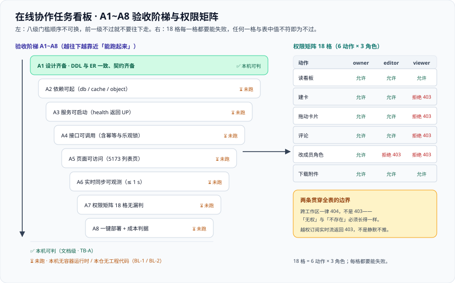

# 验收：把「做完了」变成可执行的步骤

这一页回答的是全项目最后一个、也是最容易被含糊过去的问题：**「做完了」到底怎么判？** 答案不是一张勾选清单，而是**八步能照着跑的命令、一张 18 格的权限矩阵、八条能回答「怎样才能失败」的判据，以及一份如实登记的阻塞项台账**。它是 [需求拆分](../Requirements/index.md) 第五节映射表的落点——那边说「哪条需求归哪条判据」，这里说「那条判据到底怎么跑」。



::: warning 本项目只有文档，没有代码
下面的命令要在**你自己搭好的工程**里执行。本仓库不存放可执行副本；「运行 `xxx`」一律指「先按 [环境与工程骨架](../Environment/index.md) 创建好该文件，再执行」。
:::

## 一、验收口径三条

三条口径决定了这一页所有表格的形态，**它们比表格本身重要**：

| 口径 | 含义 | 违反它的典型后果 |
| --- | --- | --- |
| **一、每条判据都要能回答「怎样才能失败」** | 一条判据如果找不到一个让它变红的输入，它就不是判据，只是一句描述 | 「`step` 整数倍」写成不等式 → 恒真；「接口返回 200」写成「不报错」→ 恒真。**答不上来就不要写进表里** |
| **二、运行期结论与设计完成分开写** | 「设计齐备」与「跑起来验证过」是两件事，两列分开登记 | 把「设计完成」写成「验收通过」，下一阶段就会从「联调」变成「返工」 |
| **三、阻塞项与缺陷分表登记** | **阻塞项不是缺陷**：缺陷是设计错了，阻塞项是「还没到能跑的环境」 | 把两者塞进同一张表，会让「本机没装容器」看起来像「系统有 bug」 |

::: danger 「怎样才能失败」这句话为什么放在第一条
它是本项目从上一个周期带过来的**唯一一条零成本纪律**，也是抓出问题最多的一条。
具体做法：写完一条判据，立刻构造一个**期望它失败**的输入。例如权限矩阵写完，就临时把 `viewer` 的写接口放行——**矩阵必须变红**；不变红说明判据测的是别的东西。
对应到本页：第二节每一行都带一条「反例」，第四节每一条 `TB-*` 都必须在第五节找到它被谁挡住——**找不到挡住它的东西，就说明它不需要环境也能跑，那它就该被写成文档级判据。**
:::

## 二、A1~A8 验收步骤

八步**固定顺序**，每步给出命令、通过标准与当前状态。「反例」一列写的是**让这一步失败的最小改法**——它是这条判据的证明。

| 步骤 | 命令 | 通过标准 | 反例（怎样才能失败） | 当前状态 |
| --- | --- | --- | --- | --- |
| **A1** 设计齐备（ER 与 DDL 一致、契约齐备） | 见第四节的四条 `grep` | DDL 里恰好 14 条 `CREATE TABLE`；`US-01~US-12` 十二条齐全；ADR 四条齐全；三份契约目录齐备 | 把任一张表从 DDL 里删掉，计数立刻变 13 | ✅ 本机可判 |
| **A2** 依赖可起 | `docker compose up -d db cache object object-init` 后 `docker compose ps` | 三个长驻服务 `running`（`db`/`cache` 为 `healthy`）；`object-init` 为 `exited (0)` | 把 `db` 的宿主端口改成已被占用的值，`up` 直接报 `port is already allocated` | ⏳ 未跑 · 本机无容器运行时 |
| **A3** 服务可启动 | `docker compose up -d app` 后 `curl -s localhost:8080/actuator/health` | 响应体恰好是 `{"status":"UP"}` | 把 `.env` 的 `POSTGRES_PASSWORD` 改错，健康检查转为 `DOWN` | ⏳ 未跑 · 本机无容器运行时 |
| **A4** 接口可调用（含幂等与乐观锁） | 用同一个 `client_op_id` 连发两次 `POST /api/v1/boards/{id}/cards/{cardId}/move`；再用过期 `version` 发一次 | 第一次 `200` 且该看板 `seq` `+1`；第二次返回上次结果且 `seq` **不再 `+1`**；过期 `version` 返回 `409` 且响应体含最新 `version` 与 `position` | 把幂等键的 `(scope, client_op_id)` 主键去掉，第二次调用 `seq` 会 `+2` | ⏳ 未跑 · 本机无容器运行时 + 本仓无工程代码 |
| **A5** 页面可访问 | `cd web && pnpm dev`，访问 http://localhost:5173/ | 列表页可访问；浏览器控制台无报错；列表里能看到 A4 建出来的工作区 | 去掉 `vite.config.ts` 里的 `server.proxy`，页面仍在但接口全部 404 | ⏳ 未跑 · 本仓无工程代码 |
| **A6** 实时同步可观测 | 两个终端 `websocat -t "ws://localhost:8080/ws?token=$TOKEN"` 订阅同一块看板，第三个终端改一张卡片 | 两端在 **1 秒内**各收到一条带 `seq` 与 `version` 的 `card.moved`，且两端的 `seq` 相同；带 `?since=105` 补拉时第一条 `seq` 恰好是 `106` | 把「提交后才广播」改成「先广播后提交」，两端会读到旧数据（现象是「刷新一下就好了」） | ⏳ 未跑 · 本机无容器运行时 |
| **A7** 权限矩阵 18 格 | 逐格执行第三节的 18 个动作 | 18 格全部等于表中值；跨工作区一律 `404` | 临时放行 `viewer` 的建卡接口，第 2 行必须变红 | ⏳ 未跑 · 本机无容器运行时 + 本仓无工程代码 |
| **A8** 一键部署与成本判据 | `docker compose up -d`；拖动一张卡片；按目标到达率做一次开环压测 | 全栈一次起；拖动后该列被改动的行数**恰好 `+1`**；到达率 200 RPS 下 P99 ≤ 300 ms | 把顺序字段换成整数 `position` 并做全列后移，被改动的行数会等于该列长度 | ⏳ 未跑 · 本机无容器运行时 |

::: tip A4 里的两件事为什么不拆成两步
「幂等」和「乐观锁」看起来是两件事，但它们**共用同一条链路与同一个前置**（服务起得来、库连得上），拆开会得到两行永远同时变绿或同时变红的记录——那属于「同一批」，合并在 A4 里更诚实。
判据表那边同理：它们在 `TB-D` 一条里出现，而不是占掉两条编号。
:::

### 2.1 八步与四周里程碑的对应

八步不是凭空排出来的，它们**逐条对应[项目总览](../index.md)四周里程碑里已经承诺过的判据**——本页做的是把那些承诺变成命令：

| 里程碑（计划表轮换日） | 里程碑原文里与八步相关的判据 | 归到哪几步 |
| --- | --- | --- |
| 第 1 周（第 139 天） | 需求含 Given/When/Then；ER 图与 DDL 一致；接口契约齐备；本地最小链路可跑通 | **A1**、**A2** |
| 第 2 周（第 140 天） | 服务可启动、接口可调用、页面可访问、两次拖动不互相覆盖 | **A3**、**A4**、**A5** |
| 第 3 周（第 148 天） | 联调通过、权限矩阵 18 格无漏判、压测达标 | **A6**、**A7** |
| 第 4 周（第 149 天） | 一键起、上线验收清单全部通过、能按文档从零复现 | **A8** |

有一处**跨两步**必须点出来：里程碑里的「**两次拖动不互相覆盖**」同时落在 **A4**（乐观锁在服务端拒绝过期版本）与 **A6**（实时同步下两个人各自看到对方的结果）——**只做 A4 得到的是「不覆盖但看不到别人」，只做 A6 得到的是「看得到但会覆盖」**，两者缺一不可。

## 三、权限矩阵 18 格

6 个动作 × 3 个角色 = **18 格**，每格必须有一个确定的值。**这张表的每一格都要能失败**——逐格执行时，任何一格与表中值不符即为不过。

| 动作 | `owner` | `editor` | `viewer` |
| --- | --- | --- | --- |
| 读看板 | **允许** | **允许** | **允许** |
| 建卡 | **允许** | **允许** | **拒绝 `403`** |
| 拖动卡片 | **允许** | **允许** | **拒绝 `403`** |
| 评论 | **允许** | **允许** | **拒绝 `403`** |
| 改成员角色 | **允许** | **拒绝 `403`** | **拒绝 `403`** |
| 下载附件 | **允许** | **允许** | **允许** |

两条**贯穿全表**的边界（它们不属于 18 格中的任何一格，但每一格都要在它们的约束下成立）：

| 边界 | 口径 | 为什么这样定 |
| --- | --- | --- |
| **跨工作区访问** | 一律 **`404`**，不是 `403` | `403` 会告诉攻击者「这个资源存在，只是你没权限」；`404` 什么都不透露。**「无权」与「不存在」必须长得一样** |
| **越权订阅实时流** | 未授权订阅返回 **`403`**，不是静默不推 | 静默不推会让「这里没数据」与「你没权限」在客户端完全同形；而这个漏洞**没有任何异常日志**，只能靠逐格测试发现 |

::: danger 18 格里最容易漏判的三格
1. **`viewer` 的「评论」**：注释里常写「`viewer` 只读」，但评论接口往往挂在卡片路径下，很容易被当成「读卡片的附带能力」而漏判——**它是写，必须 `403`**。
2. **`owner` 的「拖动卡片」**：`owner` 的专属能力只有「改成员角色」一条；拖动对 `owner` 与 `editor` 应当**同时允许**。把它们做成「`owner` 不能拖」，会在真实使用中立刻暴露为「所有者动不了自己的卡」。
3. **`viewer` 的「下载附件」**：这一格是**唯一一个「读能力被单独列出来判」的格子**。它必须允许，但**签名的同时要重新判定一次成员关系**——否则「先拿到签名、再被移除」的人仍然能下载。
:::

### 3.1 逐格执行的方法

18 格不是「读一遍表格」，而是**每一格发一次真实请求**。执行方式与「判定为错」的形态一并列在下面——**没有「预期失败形态」的格子不算被测过**：

| 格 / 边界 | 怎么跑 | 判定为错的形态 |
| --- | --- | --- |
| 读看板、读评论、下载附件（三格 × 三角色，共 9 格） | 三个角色的令牌各请求一次读接口 | `viewer` 被拒 → 说明读权限被写成了写权限 |
| 建卡、拖动卡片、评论（三格 × 三角色，共 9 格） | 三个角色的令牌各请求一次写接口 | `viewer` 成功 → **漏判**（这三格是本表最容易漏的地方） |
| 改成员角色（已含在上两行的 18 格里） | `owner` 一次 + `editor` / `viewer` 各一次 | `editor` 成功 → 「`owner` 专属能力」没落地 |
| 跨工作区（不在 18 格内，但每一格都要在它约束下成立） | 用工作区 A 的令牌读工作区 B 的看板 | 返回 `403` 即为错，**必须是 `404`** |
| 越权订阅实时流（同上） | 用工作区 A 的令牌订阅工作区 B 看板的 WebSocket 主题 | **静默不推即为错**，必须是 `403` |

## 四、判据表（`TB-A ~ TB-H`）

按**判据唯一性纪律**，本表**只登记「本项目设计是否可执行、可验收」这一类**。它不与 `EP-*` / `DA-*` / `RR-*` / `AR-*` / `S1~S4` / `E2E-*` / `W2F-*` / `ACC-*` / `A3-*` / `RC-*` / `CT-*` 任何一条重合——那些是上一周期各组件的判据族，本项目只引用不复述、不新立编号。

| 判据 | 判什么 | 级别 | 状态 |
| --- | --- | --- | --- |
| **`TB-A`** | 设计齐备性：DDL 与 ER 一致、契约齐备、需求与 ADR 条数齐全 | 文档级 | ✅ **本机可判**（四条 `grep`，见下方） |
| **`TB-B`** | 依赖可起：`db` / `cache` / `object` 三个长驻服务 `running`，`object-init` 建桶成功 | 运行期 | `⏳ 未跑`（原因：本机无容器运行时） |
| **`TB-C`** | 服务可启动：`app` 监听 8080，`/actuator/health` 恰好返回 `{"status":"UP"}` | 运行期 | `⏳ 未跑`（原因：本机无容器运行时） |
| **`TB-D`** | 接口可调用：拖动成功且只前进一个 `seq`；重发不产生第二次副作用；过期 `version` 返回 `409` 且带最新版本与位置 | 运行期 | `⏳ 未跑`（原因：本机无容器运行时 + 本仓无工程代码） |
| **`TB-E`** | 页面可访问：5173 列表页可访问、控制台无报错、能看到建出来的工作区 | 运行期 | `⏳ 未跑`（原因：本仓无工程代码） |
| **`TB-F`** | 实时同步可观测：两个客户端在 1 秒内看到同一改动且 `seq` 相同；带 `since` 补拉拿到缺口里的事件 | 运行期 | `⏳ 未跑`（原因：本机无容器运行时） |
| **`TB-G`** | 权限矩阵 18 格无漏判；跨工作区一律 `404`；越权订阅返回 `403` | 运行期 | `⏳ 未跑`（原因：本机无容器运行时 + 本仓无工程代码） |
| **`TB-H`** | 一键部署与成本判据：全栈一次起；一次拖动只更新一行；200 RPS 下 P99 ≤ 300 ms | 运行期 | `⏳ 未跑`（原因：本机无容器运行时） |

`TB-A` 的四条命令（**本机已跑**，括注为实测值）：

```shell
# 1) DDL 里 14 张业务表一个不少
grep -c '^CREATE TABLE' ../Database/index.md            # 期望 14

# 2) 需求页十二条用户故事齐全
grep -c '^### US-' ../Requirements/index.md             # 期望 12

# 3) 选型页四条 ADR 齐全
grep -c '^### ADR-' ../TechStack/index.md               # 期望 4

# 4) 环境页的编排口径与本节一致（服务名 4 个 + 一次性 1 个）
grep -cE '^  (db|cache|object|app):$' ../Environment/index.md   # 期望 4
```

### 4.1 判据与验收步骤的对应

八条判据与八步验收**一一对应**（这张表的作用是：读判据时能立刻找到它的执行步骤，读步骤时能立刻找到它的判据码）：

| 判据 | 对应步骤 | 一句话 | 级别 |
| --- | --- | --- | --- |
| `TB-A` | A1 | 设计齐备（DDL 与 ER 一致、契约齐备） | 文档级 |
| `TB-B` | A2 | 依赖可起 | 运行期 |
| `TB-C` | A3 | 服务可启动 | 运行期 |
| `TB-D` | A4 | 接口可调用（含幂等与乐观锁） | 运行期 |
| `TB-E` | A5 | 页面可访问 | 运行期 |
| `TB-F` | A6 | 实时同步可观测 | 运行期 |
| `TB-G` | A7 | 权限矩阵 18 格无漏判 | 运行期 |
| `TB-H` | A8 | 一键部署与成本判据 | 运行期 |

::: warning 状态列的读法
八条里**只有 `TB-A` 是文档级、本机可判**，其余七条的原因全部是**环境**（`BL-1` 容器运行时 / `BL-2` 工程代码），**不是设计未定**。
这也解释了一件事：**`TB-A` 的三条命令验的不是「系统跑得对不对」，而是「这份设计是否自洽、是否可被执行」**——它是其余七条的前置：设计里有 14 张表，A2 才可能数出 14 张表。
**不把期望值抄进状态列，也不把「跑过了」写成「通过了」。**
:::

## 五、阻塞项台账（`BL-1 ~ BL-4`）

**阻塞项不是缺陷**：缺陷是设计错了、要改设计；阻塞项是「还没到能跑那个环境」。所以它们**单列一张表、不塞进判据表**——塞进去会让「本机没装容器」看起来像「系统有 bug」。

| 编号 | 阻塞项 | 挡住哪几条验收 | 前置条件 | 解除判据 |
| --- | --- | --- | --- | --- |
| **`BL-1`** | 本机无容器运行时 | A2、A3、A6、A8（以及 A4、A7 的容器侧） | 安装任一容器运行时（Docker Desktop 形态） | `docker compose version` 能打印版本，且 `docker compose up -d db cache object` 起得来 |
| **`BL-2`** | 本仓无工程代码（照文档落地前没有可执行工程） | A3、A4、A5、A6、A7 | 按 [环境与工程骨架](../Environment/index.md) 创建 `app/` 与 `web/` 的最小集 | `curl -s localhost:8080/actuator/health` 返回 `{"status":"UP"}` |
| **`BL-3`** | 本机运行时与基线不一致（Java 25 / Node.js 24 LTS / pnpm 12.x） | A3、A4、A5 | 按 [技术选型](../TechStack/index.md) 第五节核对四项可探测项 | 该节第 5 条自检输出 `OK` |
| **`BL-4`** | 对象存储桶与凭据未就绪 | A2、A7（下载附件一格）、A8 | `.env` 里 `S3_SECRET_KEY` 填非空值，`object-init` 能把桶建出来 | `docker compose logs object-init` 末尾出现「桶 teamboard-attachments 就绪」 |

**四条的关系不是并列的**，这一点决定了解除顺序：

| 关系 | 内容 |
| --- | --- |
| **`BL-1` 与 `BL-2` 是公共前置** | 其余两条都要先有「能起的服务 + 能跑的工程」才有意义——`BL-3` 决定它能不能编译起跑，`BL-4` 决定附件的两条判据能不能判 |
| **`BL-3` 只挡启动与编译** | 它不影响 A1、A2、A6 的判据形态，只影响「起不起来」 |
| **`BL-4` 只挡附件相关** | 建卡、拖动、评论、实时同步四条判据**不需要对象存储**就能判——这一点要写下来，否则「桶没好」会被当成「今天什么都验不了」 |

### 5.1 解除顺序怎么定

四条阻塞项的关系决定了「先解哪个」不是随意的。判断只需两步：

| 顺序 | 条件 | 动作 |
| --- | --- | --- |
| 第 1 步 | —— | 先看本机有没有容器运行时（`docker compose version` 能否打印版本）：没有就先解 `BL-1`，否则跳到第 2 步 |
| 第 2 步 | `BL-1` 已成立 | 核对运行时版本与基线（[技术选型](../TechStack/index.md) 第五节第 5 条自检输出 `OK`）——即先解 `BL-3`，**否则工程建起来也编译不过** |
| 第 3 步 | `BL-1`、`BL-3` 已成立 | 按 [环境与工程骨架](../Environment/index.md) 建出 `app/` 与 `web/` 的最小集，即解 `BL-2` |
| 第 4 步 | `BL-1`~`BL-3` 已成立 | 补 `.env` 里的 `S3_SECRET_KEY` 并让 `object-init` 建桶成功，即解 `BL-4`——**它只挡附件相关的两格，不挡建卡与拖动** |

**为什么 `BL-3` 排在 `BL-2` 前面**：运行时版本决定「工程能不能编译、能不能起」，而建工程是最花时间的一步。先核对版本再动手，避免写完一轮才发现 JDK 与基线不一致——那时返工的不只是环境，还有 `README.md` 里要记的偏差说明。

### 5.2 解除 `BL-1` + `BL-2` 后的最短路径

八步命令序列，**顺序不可换**：

```shell
# 0) 前置：BL-3 已过（java / node / pnpm 与基线一致），且 .env 已填值（BL-4 的凭据部分）
# 1) 起依赖（BL-1 解除后）
docker compose up -d db cache object object-init

# 2) 等库真健康 + 数表（A2；期望 14 张业务表，另加分区子表与索引行）
docker compose exec db pg_isready -U teamboard -d teamboard
docker compose exec db psql -U teamboard -d teamboard -c "\dt"

# 3) 起服务并做健康检查（A3；期望 {"status":"UP"}）
docker compose up -d app
curl -s localhost:8080/actuator/health

# 4) 取一个令牌备用（后续 A4 / A6 / A7 都用它）
TOKEN=$(curl -s -X POST localhost:8080/api/v1/auth/login \
  -H 'Content-Type: application/json' \
  -d '{"email":"owner@example.com","password":"local-dev-password"}' | jq -r '.accessToken')

# 5) A4 幂等与乐观锁：同一个 client_op_id 连发两次，再发一次过期 version
#    期望：seq 只 +1 / 第二次返回上次结果 / 第三次 409 且带最新 version 与 position

# 6) 起前端（A5）
cd web && pnpm dev          # 浏览器打开 http://localhost:5173/，控制台无报错

# 7) A6 实时同步：两个终端订阅同一块看板，第三个终端拖动一张卡片
#    期望：两端 1 秒内各收到一条 card.moved，seq 相同；再用 ?since=105 补拉，第一条 seq 为 106
websocat -t "ws://localhost:8080/ws?token=$TOKEN"

# 8) A8 成本判据：拖动前后对比该列被改动的行数（期望恰好 +1），再按 200 RPS 开环压测
```

::: danger 序列里有一处最容易反着做
第 2 步的「数表」必须在第 3 步「起服务」**之前**完成。反过来做（先起 `app` 再看表）会得到一条很像代码缺陷的现象——`relation "users" does not exist`——而它其实是**数据库初始化还没跑完**。
这与第七节第 2 类启动失败是同一件事的两面：**顺序错了，问题就会被误判到错误的层。**
:::

## 六、当日做了什么

1. 定下**验收口径三条**（每条判据都要能回答「怎样才能失败」/ 运行期结论与设计完成分开写 / 阻塞项与缺陷分表登记），并说明第一条是零成本纪律、第二条决定下一阶段是「联调」还是「返工」。
2. 产出 **A1~A8 验收步骤表**（步骤 / 命令 / 通过标准 / 反例 / 当前状态），覆盖设计齐备、依赖可起、服务可启动、接口可调用（含幂等与乐观锁）、页面可访问、实时同步可观测、权限矩阵 18 格、一键部署与成本判据；**每一行都补了「反例」一列**，让「判据能失败」成为可检查的事实。
3. 产出**权限矩阵 18 格**（6 动作 × 3 角色），并写死两条贯穿全表的边界：**跨工作区一律 `404` 而不是 `403`**、**越权订阅返回 `403` 而不是静默不推**；另点出三格最容易漏判的地方（`viewer` 的评论、`owner` 的拖动、`viewer` 的附件下载）。
4. 产出 **`TB-A ~ TB-H` 八条判据**，按判据唯一性纪律只登记「本项目设计是否可执行、可验收」一类，并显式声明不与 `EP-*` / `DA-*` / `RR-*` / `AR-*` / `S1~S4` / `E2E-*` / `W2F-*` / `ACC-*` / `A3-*` / `RC-*` / `CT-*` 重复。
5. 如实区分**级别与状态**：只有 `TB-A` 是文档级本机可判（四条 `grep`，本机已跑），其余七条标 `⏳ 未跑` 并写明原因（**本机无容器运行时** / **本仓无工程代码**），**不把「跑过了」写成「通过了」**。
6. 产出**阻塞项台账 `BL-1 ~ BL-4`**（本机无容器运行时 / 本仓无工程代码 / 运行时与基线不一致 / 对象存储桶与凭据未就绪），每条登记「挡住哪几条验收 + 前置条件 + 解除判据」，并明确写下「**阻塞项不是缺陷**」。
7. 补出四条阻塞项的**非并列关系**（`BL-1` 与 `BL-2` 是公共前置、`BL-3` 只挡启动与编译、`BL-4` 只挡附件相关），据此给出解除 `BL-1` + `BL-2` 后的**八步最短路径命令序列**。

## 七、如何验证

前六条是本节可跑的自查（**本机已跑**，括注为实测值）；第七条需要容器运行时，只给命令。

```shell
# 1) 八步验收齐全（A1 ~ A8）
grep -cE '^\| \*\*A[1-8]\*\*' index.md                  # 期望 8

# 2) 八行全部带「反例」一列（「能失败」是可检查的事实）
grep -c '| 反[例]（怎样才能失败） | 当前状态 |' index.md   # 期望 1

# 3) 权限矩阵 18 格：6 行动作 × 3 列角色 + 两条贯穿全表的边界
grep -cE '^\| (读看板|建卡|拖动卡片|评论|改成员角色|下载附件) \|' index.md   # 期望 6
grep -c '跨工作[区]' index.md                            # 期望 5

# 4) 八条判据齐全（TB-A ~ TB-H）
grep -cE '^\| \*\*`TB-[A-H]`\*\*' index.md               # 期望 8

# 5) 阻塞项四条齐全 + 「阻塞项不是缺陷」写死
grep -cE '^\| \*\*`BL-[1-4]`\*\*' index.md               # 期望 4
grep -c '阻塞项不是缺[陷]' index.md                      # 期望 5

# 6) 配图被本页引用
grep -c 'assets/tb-gates.sv[g]' index.md                # 期望 1

# 7) 真正跑一次权限矩阵（需要容器运行时 + 工程代码）
#    逐格执行第三节的 18 个动作，任何一格与表中值不符即为不过
```

## 八、下一步

**第 140 天：核心链路编码。** 具体是四件事，顺序不可换：

1. **卡片拖动的服务端实现**：按 [架构设计](../Architecture/index.md) 第三节的十二步落地，重点在第 ⑧ 步（算新顺序键）与第 ⑨ 步（事务内写 `cards` + `audit_log` + `board_events` + outbox）。
2. **接口契约定稿**：拖动、评论、附件签名三条先定，写完立刻用 A4 的两条反例各跑一次。
3. **幂等与并发控制的落地**：`idempotency_keys` 与 `cards.version` 两者都要，**不能只做一个**。
4. **同一套骨架内推进**：按 [环境与工程骨架](../Environment/index.md) 的目录结构编码，**不再新增目录层级**。

## 第 149 天：`BL-1` 解除（实测）与其余两项的状态

**口径变更只有一条**。本页第五节把 `BL-1` 定义为「本机无容器运行时」，解除判据写的是「`docker compose version` 能打印版本，**且** `docker compose up -d db cache object` 起得来」。第 149 天在一次性沙盒里逐条执行了这个判据：

| 判据（第五节原文） | 第 149 天执行结果 | 判定 |
| --- | --- | --- |
| `docker compose version` 打印版本 | 通过 | 通过 |
| `docker compose up -d db cache object` 起得来 | `up -d --wait` **11.8 s**，3 个容器全部 `healthy`，`migrate` 退出码 **0** | 通过 |
| 附带：真正的初始化脚本能跑完 | 从 [数据库设计](../Database/index.md) 的 `sql` 围栏原样抽出 `V1`~`V4` 后建成 **14 张表**，PG **18.6** | 通过 |

因此 **`BL-1` 记「已解除」**，随之 `A2`、`A3`、`A6`、`A8` 四格从「被环境挡住」变成「**可以开始判**」。第五节点出的非并列关系在这个时点仍然成立：

* `BL-1`（容器运行时）**已解除** —— 依赖侧能起来；
* `BL-2`（本仓无工程代码）**状态不变** —— 本轮只把「依赖起得来」这一步走通，`app/` 与 `web/` 仍按 [环境与工程骨架](../Environment/index.md) 照文档落地；
* `BL-3`（运行时不符）与 `BL-4`（对象存储凭据）**本轮未触及**，不得记为已解除。

**一条纪律**：解除一项不等于顺带解除它的下游。`BL-1` 的解除只改变了「哪些格子**可以开始**判」，判据形态与读数位置都没有变——**`A1`~`A8` 的当前状态仍是「环境已就绪、待 `BL-2`」**，不得写成「验收通过」。

## 参考资料

- [需求拆分：角色、故事与验收条件](../Requirements/index.md)（第五节的需求到判据映射表） · [技术选型与版本基线](../TechStack/index.md)
- [架构设计：模块边界与实时链路](../Architecture/index.md)（十二步链路与三处权限判定点） · [数据库设计](../Database/index.md)（14 张表与六条不变量）
- [环境与工程骨架](../Environment/index.md)（一键起与四条验证） · [项目总览](../index.md)
- 同类资产的收口方式：[实时监控大盘 · 第 2 周收口（终）](../../MonitoringDashboard/Week2Final/index.md)（「阻塞项不是缺陷」与八步最短路径的写法）
- [完整项目交付 · 需求与验收条件](/docs/Others/ProjectDelivery/Requirements/index.md)（四类验收条件与「本轮不做」清单的方法论）
- [完整项目交付 · 一键部署](/docs/Others/ProjectDelivery/Delivery/index.md)（上线验收的标准动作）
- [性能与容量工程 · 压测方法论](/docs/Ops/PerformanceEngineering/LoadTesting/index.md)（200 RPS 到达率与 P99 阈值的判读口径）
