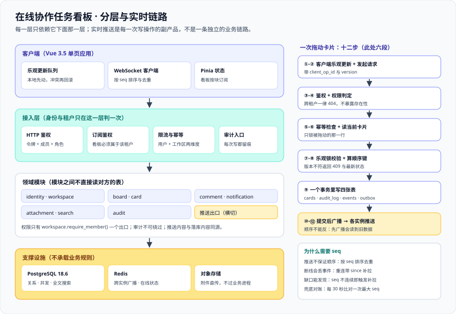

# 架构设计：模块边界与实时链路

这一页回答三个问题：**这套系统的边界切在哪**；**一次「拖动卡片」要穿过哪几层、每一步失败了会怎样**；以及**实时推送凭什么不会把数据推歪**。它是 [需求拆分](../Requirements/index.md) 之后、[数据库设计](../Database/index.md) 之前的中间环节：需求定「要有哪些能力」，架构定「这些能力由谁负责、彼此怎么说话」，数据库再定「话怎么落盘」。



## 一、整体分层

四层，**每一层只允许依赖它下面那一层**（反向依赖一律视为缺陷）：

| 层 | 内容 | 这一层的纪律 |
| --- | --- | --- |
| 客户端 | Vue 3.5 单页应用、本地状态（Pinia）、乐观更新队列、WebSocket 客户端 | 客户端的任何判断都**不是**权限判断；客户端的任何排序都**不是**最终顺序 |
| 接入层 | HTTP 路由与鉴权、WebSocket 握手与订阅鉴权、限流、请求日志 | **所有身份与租户的判定都发生在这里或它下面**，且只发生一次 |
| 领域模块 | 九个业务模块（见第二节），每个模块自带服务、存储与事件 | 模块之间**不直接读对方的表**，只通过服务接口或事件通信 |
| 支撑设施 | PostgreSQL 18、Redis（广播与在线状态）、对象存储 | 设施不承载业务规则；换掉 Redis 不应该需要改业务代码 |

::: tip 为什么把「实时」画成横切而不是一层
实时推送不是一条独立的业务链路，它是**每一次写操作的副产品**：任何模块改完数据，都要把「改了什么」交给同一个推送出口。
把推送做成一个横切的出口（而不是让每个模块自己往连接里写），换来的是两件事：**推送内容与落库内容只有一个生成点**，以及**多实例部署时只需要在一个地方接广播**。
:::

## 二、九个模块的边界

模块划分的判据不是「代码放在哪」，而是**「改它的时候，谁必须一起来评审」**：

| 模块 | 职责 | **明确不做** | 对外契约 |
| --- | --- | --- | --- |
| `identity` | 账号、登录态、令牌签发与撤销 | 不做组织架构、不做角色判定 | `authenticate()` / `current_user()` |
| `workspace` | 工作区、成员关系、邀请 | 不做看板内容 | `require_member(workspaceId, userId)` |
| `board` | 看板、列（list）、看板级设置、看板序号 `seq` | 不做卡片内容 | `append_event(boardId, event)` |
| `card` | 卡片、顺序字段、卡片状态 | 不做权限、不直接发通知 | `move_card(...)` / `append_event(...)` |
| `comment` | 评论、`@` 提及解析 | 不决定「通知发给谁」（那是 `notification` 的规则） | `comment_added` 事件 |
| `notification` | 通知规则、outbox、投递与去重 | 不做实时通道本身（交给推送出口） | `enqueue(notification)` |
| `attachment` | 附件元数据、预签名 URL、生命周期 | **不代理文件流量**（客户端直传对象存储） | `sign_upload()` / `sign_download()` |
| `search` | 全文检索、结果裁剪 | 不做权限过滤的替代品（结果仍要过权限） | `search(userId, workspaceId, q)` |
| `audit` | 不可变审计日志 | 不做业务阻断（只记录） | `record(action, target, diff)` |

::: danger 四条最容易写坏的边界
1. **`card` 里直接查 `memberships` 表判权限**——权限一旦散落在三个模块里，改一次规则要改三处，且必然漏一处。权限只有 `workspace` 模块的 `require_member()` 一个出口。
2. **`notification` 去查卡片表拼通知内容**——通知内容必须在**事件里**带齐（卡片标题、看板、操作人）。否则一条三小时前的通知会显示卡片现在的标题，用户永远对不上发生了什么。
3. **`attachment` 返回永久公开链接**——链接一旦公开，权限体系就形同虚设。只发**短有效期签名 URL**，且签名时必须重新判定一次权限。
4. **`search` 认为「索引里有就等于能看」**——索引是全局的，权限是逐人的；检索必须**先按可见工作区收窄查询范围**，再做相关度排序。
:::

## 三、一次「拖动卡片」的完整链路

把卡片从「待办」列的第 3 位拖到「进行中」列的第 2 位，服务端一共走十二步。**每一步都要写清「失败时会怎样」**，否则排障时只能靠猜：

| 步骤 | 做什么 | 失败时的表现 |
| --- | --- | --- |
| ① 客户端预判 | 本地先移动卡片（乐观更新），记下 `client_op_id` | 无（纯本地） |
| ② 发起请求 | `POST /api/v1/boards/{id}/cards/{cardId}/move`，带 `targetListId`、`beforeCardId`、`version`、`client_op_id` | 网络失败 → 客户端重试队列，`client_op_id` 不变 |
| ③ 鉴权与限流 | 校验令牌、解析 `userId`、按用户与工作区两个维度限流 | `401`（身份未证实）/ `429`（限流），二者不混淆 |
| ④ 权限判定 | `require_member(workspaceId, userId)`，角色必须是 `owner` 或 `editor` | `403`；**跨工作区**一律 `404`（不暴露资源存在性） |
| ⑤ 幂等检查 | 查 `idempotency_keys`，命中则**直接返回上次结果** | 重试不会产生第二次移动 |
| ⑥ 读当前卡片 | `SELECT ... FOR UPDATE` 读卡片与 `version` | 卡片已删 → `409 conflict` + 明确原因 |
| ⑦ 乐观锁校验 | 请求里的 `version` 必须等于库里的 `version` | 不等 → `409`，响应里带上**最新版本与当前位置**，客户端据此刷新而不是盲目重试 |
| ⑧ 计算新顺序键 | 取目标位置**相邻两张卡片**的顺序键，算出一个夹在中间的字符串 | 相邻键之间已无空隙 → 对该列做一次**重排压缩**（低频，见第五节） |
| ⑨ 事务内写入 | 更新 `cards`（`list_id`、`position`、`version = version + 1`）+ 写 `audit_log` + 写 `board_events`（`seq = seq + 1`）+ 写 outbox | 任一步失败则整个事务回滚，**不会出现「动了但没记」** |
| ⑩ 提交后才广播 | 事务提交成功后，把事件投到 Redis 频道 `board:{boardId}` | 广播失败 → 数据已落库，靠**客户端补拉**兜底（幂等键保证不重复） |
| ⑪ 各实例推送 | 每个持有该看板连接的实例订阅频道，按 `seq` 顺序推给本机连接 | 连接断开 → 客户端带着 `since=seq` 重连补拉 |
| ⑫ 客户端对齐 | 客户端按 `seq` 去重与排序，用服务端下发的顺序键**覆盖**本地乐观顺序 | 本地与服务端不一致 → 以服务端为准，界面短暂回弹 |

::: danger 第 ⑩ 与 ⑪ 步的顺序不能反，也不能合并
「**先广播、后提交**」会产生一类最难查的缺陷：另外两个客户端立刻去拉详情，却拉到了旧数据（事务还没提交），于是**它们的界面比广播更旧**——而数据库里最终是正确的，重新刷新又好了。
补救措施是让客户端在收到事件后延迟 200 ms 再拉——这是一条**把 bug 变成小概率事件的补丁**，不是修复。
正确做法只有一种：**事务提交之后再广播**；广播失败不影响正确性，只影响实时性。
:::

## 四、实时同步：为什么要 `seq`

### 4.1 只用「广播」是不够的

WebSocket 推送有三个天然缺口：

1. **推送顺序不保证**：两台实例同时推送，客户端收到顺序可能颠倒。
2. **断线期间的事件会永久丢失**：重连时没有任何机制知道「我错过了什么」。
3. **推送不能作为数据源**：推送失败了、丢了一条，客户端无从发现。

于是给每一块看板维护一个**单调递增的序号 `seq`**：任何改动在事务内都往 `board_events` 追加一行并占用一个 `seq`。这样一来：

| 机制 | 解决什么 | 实现要点 |
| --- | --- | --- |
| 事件里带 `seq` | 顺序问题 | 客户端按 `seq` 排序与去重，而不是按到达时间 |
| 重连时带 `since` | 丢事件问题 | `GET /api/v1/boards/{id}/events?since={seq}` 返回增量 |
| `seq` 缺口检测 | 悄悄丢失问题 | 收到 `seq = 108` 而本地停在 `105` → 主动补拉 106~108 |
| 定期对账 | 兜底 | 每 30 秒比对一次本地最大 `seq` 与服务端，超出阈值则整体刷新 |

### 4.2 事件形状

事件是**自解释**的：客户端不需要再去请求任何接口就能把界面改对。

```json [board_events 的一条记录（对外形态）]
{
  "seq": 108,
  "type": "card.moved",
  "boardId": "b_7f3a",
  "actorId": "u_1024",
  "at": "2026-10-14T11:02:31.412Z",
  "payload": {
    "cardId": "c_9d21",
    "fromListId": "l_todo",
    "toListId": "l_doing",
    "position": "0|hzzzzz:",
    "version": 7
  }
}
```

::: danger 三个会静默变歪的写法
1. **事件里不带 `version`**：客户端无法判断「这条事件是不是比我已经应用的那条更新」，重复推送会造成界面回跳。
2. **`payload` 只带 id 不带内容**：客户端必须再发一次请求，于是**推送的价值退化成一个触发器**，而且刚重连时会瞬间打出一串请求风暴。
3. **用数据库自增主键当 `seq`**：`cards` 表的自增 id 与「这块看板的事件顺序」不是同一个序列，跨表操作会得到交错与空洞。
:::

### 4.3 连接的生命周期

| 阶段 | 关键动作 | 判据（可执行） |
| --- | --- | --- |
| 握手 | 令牌校验 + 解析 `workspaceId`，**每块看板单独订阅** | 未授权订阅返回 `403`，不是静默不推 |
| 心跳 | 服务端每 30 秒发一次 ping，客户端 10 秒无 pong 视为断开 | 连接列表里超过 60 秒无心跳的连接强制关闭 |
| 背压 | 每连接发送队列上限，超过则**丢事件并标记 `resync_required`** | 客户端收到该标记时走整体刷新，而不是继续等 |
| 重连 | 指数退避（1s → 2s → 4s → 8s，上限 30s）+ 随机抖动 | 服务端重启后 30 秒内全部连接恢复 |
| 订阅变更 | 用户切走看板时**显式取消订阅** | 服务器连接数不随「切过的看板数」增长 |

::: warning 「丢事件」不是偷懒，而是唯一诚实的做法
出口是浏览器连接，**没有真背压**：一个卡住的客户端会把事件堆在服务端内存里，最终拖垮所有连接。
所以正确策略是**限制队列、超限丢弃、并明确告知客户端「你需要重新同步」**——丢一条事件、由客户端补拉，代价远小于拖死一个进程。
判断依据：**任何「无限缓冲」的设计，都是在把一次小故障预约成一次大故障。**
:::

## 五、并发与顺序：为什么顺序字段是字符串

### 5.1 整数 `position` 的必然崩坏

如果列里用 `position = 1, 2, 3, ..., n` 表示顺序，把卡片插到第 2 位就必须**更新它后面所有行**：

```sql [整数 position 的代价（不要这样做）]
-- 插入到第 2 位：一行拖动 → 全列更新，并且这中间任何并发拖动都会互相覆盖
UPDATE cards SET position = position + 1
WHERE list_id = 'l_todo' AND position >= 2;
```

三个人同时拖同一列时，这个写法的结果是**顺序最终正确但中间状态混乱**，而且每次拖动都要锁住整列。列里有一千张卡片时，一次拖动产生一千次行更新。

### 5.2 分数排序键

业界做法是把顺序表示成**可比较的字符串**（lexicographic rank），两张相邻卡片之间永远能算出一个「夹在中间」的新键：

```text [在 "0|hzzzzz:" 与 "0|i00000:" 之间插入一个新卡片]
前一张：0|hzzzzz:
后一张：0|i00000:
新卡片：0|hzzzzz:V      ← 只在末位追加，其余行一个字都不用动
```

规则三条：

1. 键是**用 `COLLATE "C"` 比较的字符串**（按字节序），与数据库默认排序规则无关。
2. 插入时取「前一张的键」与「后一张的键」，算出中间值；**只写一行**。
3. 边界：首位插入用「起点 + 中间值」，末位插入用「末位 + 中间值」，**不引入特殊分支**。

### 5.3 什么时候会退化，以及怎么兜底

字符串长度会随插入次数缓慢增长。当「两张相邻卡片之间已经无空隙可插」时（现实里极少发生，但必须处理）：

| 触发条件 | 兜底动作 | 注意 |
| --- | --- | --- |
| 相邻两键之间算不出中间值 | 对**该列**做一次重排压缩，重新生成等间距键 | 重排必须在一个事务里完成，且要占用一个新的 `seq` 广播给所有人 |
| 键长超过上限（例如 255） | 同上，或降低该列的时间粒度 | 别让一个列无限增长到几万张卡片而不做分页 |

::: tip 一条可带走的判据
**「一次拖动只允许更新一行」**——把这句话当成不变量去测：拖动前后各查一次 `cards` 表的 `xmin` 或加一个自增的 `updated_seq`，只要发现有第二行被改动，顺序字段的实现就错了。
:::

### 5.4 乐观锁：把冲突变成一次可解释的失败

`cards.version` 每次写入 +1，请求必须带上读到的版本号：

```shell
# 期望失败的一次请求：客户端手里的版本落后了两个（应为 7，实际 9）
curl -s -o /dev/null -w '%{http_code}\n' \
  -X POST "http://localhost:8080/api/v1/boards/b_7f3a/cards/c_9d21/move" \
  -H "Authorization: Bearer $TOKEN" -H 'Content-Type: application/json' \
  -d '{"targetListId":"l_doing","beforeCardId":null,"version":7,"client_op_id":"op-1"}'
# 预期输出：409
```

`409` 的响应体必须带上**最新版本与最新位置**，客户端据此把本地乐观更新回滚到服务端状态。**只返回「冲突了」而不返回现状，等于逼客户端去猜。**

::: danger 两处一定会踩的坑
1. **把乐观锁做成悲观锁**——为了「不冲突」而给卡片加 `SELECT ... FOR UPDATE` 并一直持有到响应：单个看板的拖动会被串行化，且任何一次慢请求都会阻塞整列。正确做法是**只锁被拖动的那一张卡片所在的那一行**。
2. **幂等键与乐观锁混为一谈**——幂等键解决「同一次操作重发两次」（网络重试），乐观锁解决「两个人改同一张卡片」（业务冲突）。两者都要，缺一不可：只做幂等，重试之外的冲突会静默覆盖；只做乐观锁，一次网络抖动会让用户看到「冲突」。
:::

## 六、通知：事务内写 outbox

评论、`@` 提及、卡片被指派三类事件需要通知。做法固定：

1. 业务事务内写 `notifications_outbox`（与业务改动**同一个事务**）。
2. 独立的投递循环扫描 outbox，投递成功后标记 `delivered_at`（**至少一次**语义）。
3. 接收端按 `dedup_key` 去重（`至少一次` + 去重 = 事实上的恰好一次）。

| 方案 | 后果 |
| --- | --- |
| 事务内直接发通知 | 通知成功但事务回滚 → **凭空多一条通知**；通知失败但事务成功 → **通知永久丢失** |
| 定时全量扫描「最近改动」 | 无法区分「没发过」与「发过但失败」，重复与遗漏同时存在 |
| **事务内写 outbox + 异步投递 + 去重** | 通知与业务改动**同生共死**，代价是「通知最多延迟一个扫描周期」 |

## 七、三处权限判定点

权限判定**只在服务端**，并且只有三处入口，任何第四处都是缺陷：

| 入口 | 判什么 | 判错的后果 |
| --- | --- | --- |
| HTTP 请求 | 令牌有效 → 用户是工作区成员 → 角色是否允许该动作 | 越权读写 |
| WebSocket 订阅 | 握手身份 + `workspaceId` 成员关系 | **越权接收别人的实时数据流**（比读接口更隐蔽：没有 `404`、没有日志异常） |
| 附件签名 | 每次签名时重新判定读取权限 | 一次泄漏的永久链接 = 全部权限失效 |

::: danger 最容易漏的一处：WebSocket 订阅不是「拿到连接就都看得到」
HTTP 接口天然有 URL 与参数，容易逐个加校验；而 WebSocket 只有**一个**握手地址，订阅哪块看板是连上之后用消息发的。
于是「握手时校验了身份，却忘了校验订阅的看板是否属于该用户的工作区」成为本类系统最典型的漏洞——**它是静默的：攻击者收到的是别人正常工作产生的数据流**。
:::

## 八、八个失败模式与它们的可见性

| 失败模式 | 用户看到什么 | 靠什么发现 |
| --- | --- | --- |
| 广播失败（Redis 不可用） | 改动已保存，但别人界面不变 | 「`seq` 落后」告警；写接口指标正常而推送指标归零 |
| 事件丢失（队列超限被丢） | 某个人局部页面偏旧 | 客户端 `resync_required` 计数 |
| 乐观锁冲突率飙升 | 大量 `409`，用户看到回弹 | `409` 比例指标；通常意味着前端在用过期版本，而不是真冲突 |
| 顺序键退化 | 拖动偶尔很慢 | 重排压缩的执行次数（应当接近 0） |
| 幂等键表膨胀 | 无（只是空间与写入变慢） | 表行数与过期清理任务 |
| 越权订阅 | **没有任何异常** | 只靠自动化测试：权限矩阵逐格覆盖 |
| outbox 积压 | 通知延迟 | outbox 未投递行数的年龄 |
| 附件签名泄漏 | 无 | 签名 URL 的有效期与签发次数审计 |

::: tip 判据设计上的一个结论
上表里「用户能直接看到」的只有三条。**其余五条都必须先有指标、后有告警**，否则它们只会在某天以「用户说数据不对」的形式迟到出现。
这也是本项目第 4 周要把指标与告警接进周期 5 那套链路的原因。
:::

## 九、本期明确不做的四件事

1. **不做 CRDT / 离线优先**：本期是「在线优先 + 断线补拉」。真正的离线编辑需要合并语义（谁赢、怎么并），会吃掉整个周期。
2. **不做跨工作区的全局搜索**：搜索范围限定在用户可见的工作区内，既是性能选择也是安全选择。
3. **不做卡片自定义字段引擎**：本期字段是固定的。自定义字段是「用配置生成 SQL」的开始，属于另一个量级的问题。
4. **不做多实例的分库分表**：单库 + 连接池 + 合理索引足够撑住本期的容量目标（见 [需求拆分](../Requirements/index.md) 的非功能需求）。

## 十、验证方式

以下命令在**你自己搭好的工程**里执行（本仓库不存放可执行的工程文件）：

```shell
# 1. 确认服务与依赖都起来了（编排文件里所有长驻服务应为 running）
docker compose ps --status running --format '{{.Service}}\t{{.State}}'

# 2. 确认广播链路真的在工作：订阅一个看板，另开一个终端改一张卡片
websocat -t "ws://localhost:8080/ws?token=$TOKEN"
# 预期：改动的 1 秒内收到一条带 seq 与 version 的 card.moved 事件

# 3. 确认断线补拉能拿到缺口里的事件
curl -s "http://localhost:8080/api/v1/boards/b_7f3a/events?since=105" \
  -H "Authorization: Bearer $TOKEN" | jq '.events | length, .[0].seq'
# 预期：长度 >= 1，且第一条的 seq 恰好是 106

# 4. 确认乐观锁生效（用过期版本号重发上一条请求）
# 预期：409，且响应体里带最新 version 与 position

# 5. 确认「一次拖动只更新一行」（在拖动前后对比该列被改动的行数）
# 预期：被改动的行数 == 1
```

::: warning 这些命令的读法
第 5 条是本页最重要的一条：它测的不是功能，而是**实现口径**。功能测试在「全列更新」的实现上也全绿，只有比对被改动的行数才能分辨。
凡是「正确但昂贵」的实现，都要额外给一条**成本判据**。
:::

## 参考资料

- [需求拆分与验收条件](../Requirements/index.md) · [数据库设计](../Database/index.md) · [环境与工程骨架](../Environment/index.md)
- [完整项目交付 · 架构文档](/docs/Others/ProjectDelivery/Architecture/index.md)（架构文档该产出什么的通用口径）
- [完整项目交付 · 接口契约](/docs/Others/ProjectDelivery/Contract/index.md)（契约三问：约定是什么、定错的后果、怎么验证没被破坏）
- [分布式缓存 · 拓扑](/docs/Backend/DistributedCache/Topology/index.md)（多实例广播与发布订阅的取舍）
- [响应式编程 · 背压](/docs/Backend/ReactiveProgramming/Backpressure/index.md)（出口没有真背压时的正确策略）
- [性能与容量工程 · 概览](/docs/Ops/PerformanceEngineering/Overview/index.md)（容量结论的口径来源）
