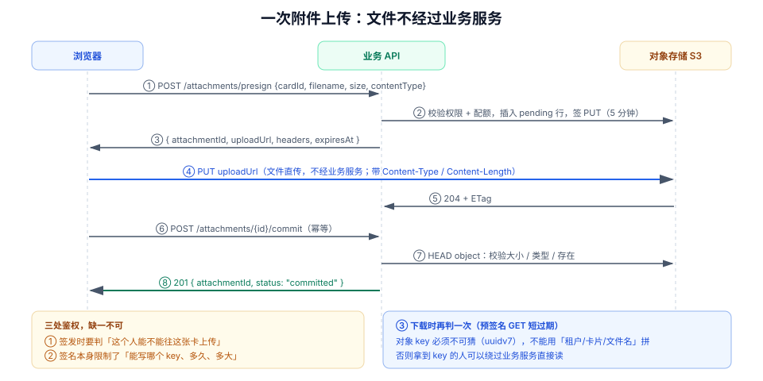

# 附件直传：把大文件从业务链路里摘出去

第 2 周第 6 步：让卡片能挂附件，并且**文件本身永远不经过业务服务**——业务服务只签发一张「限时、限 key、限大小」的通行证，剩下的交给对象存储。

## 当日做了什么

| 项 | 产出 |
| --- | --- |
| 数据模型 | `attachment` 一张表的完整 DDL 与五条约束（复合外键、大小上限、状态枚举、key 唯一、软删部分索引） |
| 接口 | `POST /api/v1/cards/{cardId}/attachments/presign`、`POST /api/v1/attachments/{id}/commit`、`GET /api/v1/attachments/{id}/download-url` 三条契约 |
| 存储约定 | object key 的构成、不可猜性要求、按租户前缀的分区策略 |
| 签名参数 | method、过期时间、content-type 锁定、`content-length-range` 的上限来源 |
| 提交语义 | 为什么必须有一次 `commit`，以及它校验哪三件事 |
| 失败清理 | `pending` 的 24 小时过期、孤儿对象对账、删除的先后顺序 |
| 判据 | `ATT-A` ~ `ATT-H` 八条，每条都给出可执行验收 |

::: tip 本步的位置
第 159 天解决了卡片本身的读写，第 160 天解决了挂在卡片上的文字（评论与提及）。这一步是**挂在卡片上的二进制**：它比文字麻烦的地方在于——**它的体积不受服务端控制**。一段 25MB 的视频如果穿业务服务，会同时吃掉连接、内存与超时预算，而这三样在协作系统里都是稀缺资源。
:::

## 一、为什么不让文件穿业务服务

| 维度 | 文件穿业务服务 | 直传对象存储 |
| --- | --- | --- |
| 内存 | 25MB × 并发数（20 并发 = 500MB 堆外/堆内） | 不占业务服务内存 |
| 连接 | 上传期间连接被长占，挤占 API 连接池 | 上传走存储域名，与 API 连接池隔离 |
| 超时 | 慢网络下 60s 超时，重试要**从头传** | 客户端重试由存储处理，支持分片/断点 |
| 扩展 | 多实例部署时无法做「上传中」的粘性 | 无状态，任意实例都能签发 |
| 成本 | 带宽双倍（进业务服务再出到存储） | 单次 |

一句话：**业务服务只该处理「能不能传」这个判断，不该处理「传了什么」这些字节。**

## 二、一次上传的六步



| 步 | 动作 | 失败时的表现 |
| --- | --- | --- |
| ① | 客户端申请预签名 | 403 / 413（超配额） |
| ② | 服务端判权限、插 `pending` 行、签名 | 500（存储不可用） |
| ③ | 返回 `uploadUrl` / `headers` / `expiresAt` | — |
| ④ | 客户端 `PUT` 直传 | 403（签名过期/不匹配）、413（超限） |
| ⑤ | 存储返回 `204` + `ETag` | 网络中断 → 客户端重试或放弃 |
| ⑥ | 客户端调 `commit` | 409（未上传成功）、422（校验不通过） |

**第 ⑥ 步不能省**。没有 `commit`，服务端只能说「我签过一张票」，不能说「这张卡上真的有一个可下载的附件」——中间那一步是否成功，只有存储知道。

## 三、数据模型

```sql
-- V7__attachment.sql

CREATE TYPE attachment_status AS ENUM ('pending', 'committed', 'aborted');

CREATE TABLE attachment (
  id             uuid              NOT NULL DEFAULT uuidv7(),
  tenant_id      bigint            NOT NULL,
  board_id       uuid              NOT NULL,
  card_id        uuid              NOT NULL,
  uploader_id    bigint            NOT NULL,
  object_key     text              NOT NULL,
  filename       text              NOT NULL,
  content_type   text              NOT NULL,
  size_bytes     bigint            NOT NULL,
  checksum_sha256 text,
  status         attachment_status NOT NULL DEFAULT 'pending',
  expires_at     timestamptz       NOT NULL DEFAULT now() + interval '24 hours',
  committed_at   timestamptz,
  deleted_at     timestamptz,
  created_at     timestamptz       NOT NULL DEFAULT now(),

  CONSTRAINT attachment_pk PRIMARY KEY (id),
  CONSTRAINT attachment_key_uk UNIQUE (object_key),
  CONSTRAINT attachment_size_ck CHECK (size_bytes > 0 AND size_bytes <= 26214400), -- 25 MiB
  CONSTRAINT attachment_ct_ck CHECK (content_type ~ '^[a-z]+/[a-z0-9.+-]+$'),
  CONSTRAINT attachment_board_fk FOREIGN KEY (board_id, tenant_id)
      REFERENCES board (id, tenant_id) ON DELETE CASCADE,
  CONSTRAINT attachment_card_fk FOREIGN KEY (card_id, board_id, tenant_id)
      REFERENCES card (id, board_id, tenant_id) ON DELETE CASCADE,
  CONSTRAINT attachment_committed_ck
      CHECK ((status = 'committed') = (committed_at IS NOT NULL))
);

CREATE INDEX attachment_card_idx ON attachment (card_id, created_at DESC)
  WHERE deleted_at IS NULL;
CREATE INDEX attachment_pending_idx ON attachment (expires_at)
  WHERE status = 'pending';
```

四条约束各自挡住一类错误：

| 约束 | 挡住什么 |
| --- | --- |
| `attachment_key_uk` | 两个 `pending` 行共用同一个 key（会导致互相覆盖） |
| `attachment_size_ck` | 客户端谎报大小、服务端签了 1GB 的票 |
| `attachment_committed_ck` | 「状态说已提交但时间戳为空」这种半截数据 |
| `attachment_pending_idx` | 清理任务扫全表（部分索引只覆盖 `pending`） |

::: danger 三个 DDL 层面的坑
1. **`object_key` 用「租户/卡片/文件名」拼**：文件名可猜，租户 id 是自增的——拿到一个 key 就能枚举别人的附件。key 必须包含不可猜的 `uuidv7()`。
2. **`size_bytes` 不加 CHECK**：客户端可以先申请 1 字节的票，再传 1GB（如果签名没锁 `content-length-range`）。DDL 的 CHECK 是最后一道闸门。
3. **软删用 `deleted_at` 但 `status` 没有 `aborted`**：清理任务无法区分「用户取消」与「上传失败」，只能一刀切删除，导致已提交的附件被误删。
:::

## 四、三条接口契约

### 1. 申请预签名

```http
POST /api/v1/cards/{cardId}/attachments/presign
Authorization: Bearer <token>
Content-Type: application/json

{
  "filename": "设计稿-v3.png",
  "size": 2483102,
  "contentType": "image/png"
}
```

```json
{
  "attachmentId": "0192f0c4-6b1a-7c3e-9b1f-2a5c8d0e4f11",
  "objectKey": "t/7/card/0192f0c4/0192f0c4-6b1a-7c3e-9b1f-2a5c8d0e4f11",
  "uploadUrl": "https://s3.example.com/bucket/t/7/card/...?X-Amz-Signature=...",
  "method": "PUT",
  "headers": { "Content-Type": "image/png" },
  "expiresAt": "2026-10-18T08:12:00Z",
  "maxSize": 26214400
}
```

签发时必须做的四件事：

1. **权限**：当前用户是该看板成员，且对该卡片有写权限（复用第 159 天的 `requireCardWrite`）。
2. **配额**：单文件 ≤ 25MiB；单卡片附件总大小 ≤ 200MiB（超了返回 `413`）。
3. **签名范围**：只允许 `PUT` 到这一个 key、**5 分钟**内有效、`content-length-range` 锁 `[1, 26214400]`、`Content-Type` 必须等于声明值。
4. **先落库再签名**：`pending` 行必须在返回 `uploadUrl` 之前提交，否则 `commit` 时找不到记录。

### 2. 提交

```http
POST /api/v1/attachments/{id}/commit
Authorization: Bearer <token>
```

```json
{
  "attachmentId": "0192f0c4-6b1a-7c3e-9b1f-2a5c8d0e4f11",
  "status": "committed",
  "sizeBytes": 2483102,
  "checksumSha256": "9f2c...",
  "downloadUrl": "/api/v1/attachments/0192f0c4.../download-url"
}
```

`commit` 做三件事，且**按顺序**：

| 顺序 | 检查 | 失败状态码 |
| --- | --- | --- |
| 1 | `HEAD object`：对象存在 | `409`（`UPLOAD_NOT_FOUND`） |
| 2 | 大小与类型与 `pending` 行一致（允许 ±0，不允许漂移） | `422`（`SIZE_MISMATCH`） |
| 3 | 条件更新 `status='pending' → 'committed'` | `409`（已提交时幂等返回原记录） |

```sql
-- 幂等的 commit：用条件更新，受影响行数为 0 时读回原记录
UPDATE attachment
   SET status = 'committed',
       committed_at = now(),
       size_bytes = $2,
       checksum_sha256 = $3
 WHERE id = $1
   AND tenant_id = current_setting('app.tenant_id')::bigint
   AND status = 'pending'
RETURNING id, object_key, size_bytes;
-- 影响 0 行：可能是「已提交」（返回 200 原记录）或「不存在/已过期」（404）
```

::: warning 为什么 commit 要幂等
移动端弱网下，「服务端已提交、响应丢了」极常见，客户端会重试。若第二次 `commit` 返回 `409` 并带上错误，客户端只能显示「上传失败」，而实际上文件是好的——用户会重传一遍。
:::

### 3. 取下载地址

```http
GET /api/v1/attachments/{id}/download-url
Authorization: Bearer <token>
```

```json
{ "url": "https://s3.example.com/bucket/t/7/card/...?X-Amz-Signature=...", "expiresIn": 300 }
```

下载地址**每次现签、5 分钟过期**，不缓存、不落库。三条纪律：

1. **权限在服务端判**：`GET` 时重新校验成员关系，不能因为「URL 已签」就放行。
2. **不返回永久地址**：桶必须私有，公开读等于把权限体系作废。
3. **`Content-Disposition` 由签名参数控制**：文件名带中文时要 `filename*=UTF-8''...`，否则下载后文件名乱码。

## 五、object key 的构成

```text
t/{tenant_id}/card/{card_id}/{attachment_id}
```

| 段 | 作用 | 注意 |
| --- | --- | --- |
| `t/{tenant_id}/` | 按租户分区，便于统计与批量生命周期策略 | **不含用户可控内容** |
| `card/{card_id}/` | 便于「删卡片时按前缀清理」 | 卡片 id 是 uuid，不可枚举 |
| `{attachment_id}` | 唯一且不可猜 | 用 `uuidv7()`，与数据库主键同源 |

不把原始文件名放进 key 的三个理由：文件名可能含 `/`、空格、中文与 emoji（签名与转义问题）；同名文件会互相覆盖；文件名本身是信息泄漏（「裁员名单.xlsx」）。

## 六、失败与清理

| 情形 | 处理 | 判据 |
| --- | --- | --- |
| 签发后用户取消 | 客户端调 `DELETE /attachments/{id}` → `status='aborted'`，对象若存在则删除 | 行状态为 `aborted`，对象 404 |
| 签发后从未上传 | 24h 后清理任务：`status='pending' AND expires_at < now()` → 删对象 + 置 `aborted` | 24h 后不再有 `pending` 行 |
| 上传成功但从未 commit | 同上（先 `HEAD` 确认是否存在，存在则删） | 无孤儿对象 |
| 卡片被删 | 复合外键 `ON DELETE CASCADE` 删行；**对象按前缀异步清理** | 对账脚本报告 0 孤儿 |
| 删附件 | 先置 `deleted_at`（立刻不可见），再异步删对象 | 列表立刻消失，对象稍后 404 |

::: danger 清理顺序反了会留下什么
**先删对象再删行**：删对象成功、删行失败 → 数据库里有一条指向不存在对象的记录，用户点下载得到 404，且无法自愈。
**先删行再删对象**：行没了、对象还在 → 产生孤儿对象，存储成本持续增长，且没有任何线索指向它。

正确做法是**先软删行（立刻不可见）→ 异步删对象 → 删对象成功后硬删行或标记 `aborted`**，并保留一条对账任务，用「库里的 key 集合」与「桶里的前缀列表」做差集。
:::

## 七、验收：八条命令

```shell
# ① 申请预签名（拿 attachmentId 与 uploadUrl）
curl -s -X POST "http://localhost:8080/api/v1/cards/$CARD/attachments/presign" \
  -H "Authorization: Bearer $TOKEN" -H 'Content-Type: application/json' \
  -d '{"filename":"设计稿-v3.png","size":2483102,"contentType":"image/png"}' | tee /tmp/presign.json | jq .
# 期望：200，返回 attachmentId / uploadUrl / expiresAt，objectKey 形如 t/7/card/<uuid>/<uuid>
```

```shell
# ② 直传（注意：Content-Type 必须与签名时一致，否则 403）
UPLOAD=$(jq -r .uploadUrl /tmp/presign.json)
curl -s -o /dev/null -w '%{http_code}\n' -X PUT "$UPLOAD" \
  -H 'Content-Type: image/png' --data-binary @./fixtures/design-v3.png
# 期望：200 或 204；403 说明 Content-Type 不匹配或签名已过期
```

```shell
# ③ 提交
AID=$(jq -r .attachmentId /tmp/presign.json)
curl -s -X POST "http://localhost:8080/api/v1/attachments/$AID/commit" \
  -H "Authorization: Bearer $TOKEN" | jq '{status, sizeBytes}'
# 期望：{"status":"committed","sizeBytes":2483102}
```

```shell
# ④ 重复提交必须幂等（不是 409）
curl -s -o /dev/null -w '%{http_code}\n' -X POST \
  "http://localhost:8080/api/v1/attachments/$AID/commit" -H "Authorization: Bearer $TOKEN"
# 期望：200
```

```shell
# ⑤ 未上传就提交 → 409 且错误码明确
curl -s -X POST "http://localhost:8080/api/v1/attachments/$AID2/commit" \
  -H "Authorization: Bearer $TOKEN" | jq -r .code
# 期望：UPLOAD_NOT_FOUND
```

```shell
# ⑥ 超过 25MiB 的文件在签发阶段就被拒
curl -s -o /dev/null -w '%{http_code}\n' -X POST \
  "http://localhost:8080/api/v1/cards/$CARD/attachments/presign" \
  -H "Authorization: Bearer $TOKEN" -H 'Content-Type: application/json' \
  -d '{"filename":"big.zip","size":31457280,"contentType":"application/zip"}'
# 期望：413；返回 200 说明配额没生效
```

```shell
# ⑦ 越权：用另一个租户的令牌签这张卡 → 404（不是 403，避免探测）
curl -s -o /dev/null -w '%{http_code}\n' -X POST \
  "http://localhost:8080/api/v1/cards/$CARD/attachments/presign" \
  -H "Authorization: Bearer $OTHER_TENANT_TOKEN" \
  -H 'Content-Type: application/json' \
  -d '{"filename":"x.png","size":1024,"contentType":"image/png"}'
# 期望：404
```

```shell
# ⑧ 桶是私有的：直连对象 URL 必须 403
curl -s -o /dev/null -w '%{http_code}\n' "https://s3.example.com/bucket/$(jq -r .objectKey /tmp/presign.json)"
# 期望：403；若为 200，说明桶策略配错，整个权限体系失效
```

::: warning 这八条命令依赖读者自己的工程
`project/` 只有文档、没有代码。命令里的 `$TOKEN` / `$CARD` / `$DB` 指你自己按前面章节搭起来的服务（Java 25 + Spring Boot 4.1 + PostgreSQL 18 + 兼容 S3 的存储，本地可用 MinIO）。
第 ⑧ 条要求桶策略为私有——MinIO 默认私有，但很多教程会让你 `mc anonymous set download`，那一步千万别做。
:::

## 八、判据族 `ATT-A` ~ `ATT-H`

| 判据 | 规则 | 违反时的样子 | 验证方式 |
| --- | --- | --- | --- |
| `ATT-A` | 文件字节不经过业务服务：服务端只有签名与 `HEAD` 调用 | 业务服务出网流量随上传量线性增长 | 上传 100MB 后看服务容器网络计数 |
| `ATT-B` | object key 含 `uuidv7`，不含文件名/邮箱/自增 id | 能从一个 key 猜出另一个 | 读 3 个 key 的结构 |
| `ATT-C` | 预签名锁定 method / 过期 / `content-length-range` / `Content-Type` 四项 | 换 `Content-Type` 仍能传成功 | 用错误 `Content-Type` PUT，应 403 |
| `ATT-D` | `pending` 行先于签名落库，`commit` 时能查到 | `commit` 返回 404 但对象存在 | 检查签发实现的提交顺序 |
| `ATT-E` | `commit` 幂等：重复调用返回 200 与原记录 | 第二次返回 409 导致客户端误报失败 | 连调两次 `commit` |
| `ATT-F` | 桶为私有，下载走 5 分钟短签名 | 直连对象 URL 返回 200 | 命令 ⑧ |
| `ATT-G` | `pending` 有 24h 过期清理，孤儿对象可对账 | 库与桶的 key 集合长期不等 | 跑对账脚本，差集应为空 |
| `ATT-H` | 删除先软删行再异步删对象，顺序不可反 | 出现「死链」（行在、对象无） | 删附件后立刻下载，应 404 且列表已消失 |

## 九、下一步

1. **通知中心读接口**：`GET /api/v1/notifications?cursor=`——把第 160 天写进 outbox 的通知读出来，含未读数与已读回执。
2. **实时推送接线**：把 `board_events` 与附件提交事件接到 STOMP 主题 `t.{tenant}.board.{id}`，跑通「另一个浏览器立刻看到新附件」。
3. **跨租户矩阵补第 19 格**：附件是新增的越权面（key 前缀、签名范围、下载授权三处），要补进第 155 天的 18 格矩阵。
4. **分片上传**：> 25MiB 的场景走 multipart，代价是要处理「已传分片但未 complete」的清理。

## 十、参考资料

- [AWS S3 · Presigned URL 与 PUT 上传](https://docs.aws.amazon.com/AmazonS3/latest/userguide/PresignedUrlUploadObject.html)
- [AWS S3 · `content-length-range` 策略条件](https://docs.aws.amazon.com/AmazonS3/latest/API/sigv4-HTTPPOSTConstructPolicy.html)
- [MinIO · 桶策略与匿名访问](https://min.io/docs/minio/linux/administration/identity-access-management/policy-based-access-control.html)
- [项目章节 · 看板与卡片读写接口](../BoardCardApi/index.md)（`requireCardWrite` 的来源）
- [项目章节 · 评论与 @ 提及的写入接口](../CommentMention/index.md)（同一套事务与幂等口径）

## 与「对象存储工程」专题的分工（第 173 天补充）

| 问题 | 归本页 | 归[文件与对象存储工程](../../../../docs/Backend/ObjectStorage/index.md) |
| --- | --- | --- |
| 这一次直传的六个步骤、`commit` 的七步校验 | ✅ | — |
| 三条上传链路怎么选、预签名到底锁住了什么 | — | ✅ [上传路径与预签名](../../../../docs/Backend/ObjectStorage/UploadPaths/index.md) |
| `attachment` 表的约束与 `pending` 回收 | ✅ | — |
| 校验和为什么不能靠 ETag | — | ✅ [完整性校验](../../../../docs/Backend/ObjectStorage/IntegrityChecksum/index.md) |

一句话边界：本页回答「这个业务怎么把文件从浏览器搬到桶里并落库」，专题回答「换一个业务、换一家云，这些结论还成不成立」。

::: danger 本页特有的坑：`PUT` 预签名锁不住 body 大小
本页的 25 MiB 上限**不是**靠预签名实现的——`PUT` 预签名里没有 `content-length-range` 这个能力（那是 POST Policy 的）。上限实际由 `commit` 阶段的 `HeadObject` 复核兜住。
所以：**任何人把那一步「优化」掉，25 MiB 就只剩前端校验**，而前端校验对 `curl` 无效。改动这页代码时，`commit` 的校验顺序（存在性 → 大小 → 校验和 → 归属）不能调换、不能省略。

:::

