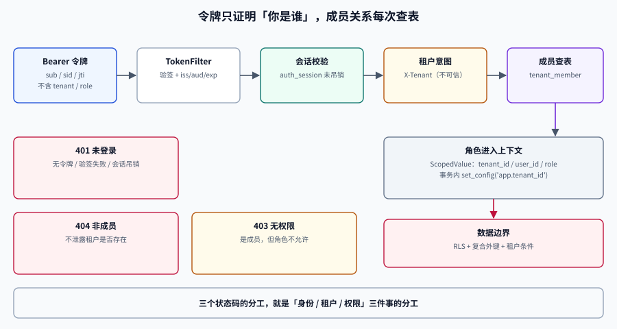

# 认证与租户成员关系：把 X-Tenant 换成令牌

第 156 天让一条请求带着 `X-Tenant: acme` 走到了 SQL，返回了 `[]`。那是**施工脚手架**，不是可上线的鉴权：任何人都能改这个头，任何租户都能被冒充。

这一步把「谁在请求」从**请求头**换成**令牌**，并把「他在这个租户里是什么角色」从**代码里的假设**换成**表里的记录**。做完之后，三种失败必须被分开：**没登录（401）**、**不是这个租户的成员（404）**、**是成员但没这个权限（403）**。

## 判据族声明

本页判据族 `AT-A` ~ `AT-H`，共 8 条。定义表在第十节。

## 一、为什么不直接把租户写进令牌

最省事的做法是把 `tenant_id` 直接放进 JWT，服务端解出来就用。它有两个问题：

| 问题 | 后果 |
| --- | --- |
| 令牌签发后角色/成员关系变了，令牌里的值不会变 | 被移出团队的成员在令牌过期前仍能访问（最长可达数小时） |
| 一个用户属于多个租户时，必须为每个租户签一枚令牌 | 令牌数量随租户数增长，切换租户要重新登录 |

所以本项目的口径是：**令牌只证明「你是谁」，不证明「你能干什么」**。租户与角色在每次请求时从 `tenant_member` 表读，并用短 TTL 缓存。



## 二、三张表：账号、成员、会话

```sql
-- 账号：全局唯一，不属于任何租户
create table app_user (
  id            uuid primary key default gen_random_uuid(),
  email         citext not null unique,
  password_hash text   not null,
  status        text   not null default 'active'
                check (status in ('active', 'disabled')),
  created_at    timestamptz not null default now()
);

-- 成员关系：一个用户在一个租户里的角色
create table tenant_member (
  tenant_id  uuid not null references tenant(id) on delete cascade,
  user_id    uuid not null references app_user(id) on delete cascade,
  role       text not null check (role in ('owner', 'editor', 'viewer', 'guest')),
  status     text not null default 'active' check (status in ('active', 'invited', 'removed')),
  invited_by uuid references app_user(id),
  created_at timestamptz not null default now(),
  primary key (tenant_id, user_id)
);

create index tenant_member_user_idx on tenant_member (user_id, status);

-- 会话：refresh token 的哈希，用于轮换与吊销
create table auth_session (
  id            uuid primary key default gen_random_uuid(),
  user_id       uuid not null references app_user(id) on delete cascade,
  refresh_hash  bytea not null,
  family_id     uuid not null,              -- 一次登录派生出的令牌家族
  expires_at    timestamptz not null,
  revoked_at    timestamptz,
  created_at    timestamptz not null default now()
);

create index auth_session_user_idx on auth_session (user_id) where revoked_at is null;
```

四个设计点：

1. **`tenant_member` 的主键是 `(tenant_id, user_id)`**——同一个用户在同一租户里只能有一个角色，重复插入直接冲突，不需要额外唯一索引。
2. **`status` 与 `role` 分开**——「被移出」不是一种角色，而是一种状态；把 `removed` 放进 `role` 会让权限判断到处出现 `role <> 'removed'`。
3. **`refresh_hash` 存哈希不存明文**——数据库泄露时令牌不可直接使用。
4. **`family_id` 支持「重用检测」**——同一家族的刷新令牌被重复使用时，吊销整个家族（见第五节）。

### RLS 与运维面

`tenant_member` 同样启用行级安全，但**认证阶段本身需要跨租户读**（用户可能属于多个租户）。做法是：

```sql
alter table tenant_member enable row level security;
alter table tenant_member force row level security;

-- 业务请求：只能看到当前租户的成员
create policy tm_tenant_isolation on tenant_member
  using (tenant_id = current_setting('app.tenant_id', true)::uuid);

-- 认证阶段：只按 user_id 查，不看 tenant_id；用独立角色，避免业务连接复用
create policy tm_self_lookup on tenant_member
  to app_auth
  using (user_id = current_setting('app.user_id', true)::uuid);
```

::: danger 认证查询不能复用业务连接
认证发生在「还不知道租户」之前，此时 `app.tenant_id` 是空的。若用业务连接池执行 `select ... from tenant_member where user_id = ?`，RLS 会把 `tenant_id = null` 代入，**返回 0 行且不报错**——表现为「登录成功但所有接口 404」。

**正确做法**：认证查询走独立角色与独立连接池（`app_auth`），或者把查询放进显式事务并先 `set_config('app.user_id', ...)`。
:::

## 三、令牌里放什么

| 字段 | 放不放 | 理由 |
| --- | --- | --- |
| `sub`（user_id） | 放 | 令牌的唯一职责 |
| `sid`（session_id） | 放 | 支持单点吊销与设备管理 |
| `exp` / `iat` / `jti` | 放 | 过期、签发时间、防重放 |
| `tenant_id` | **不放** | 成员关系会变；切换租户不该重新登录 |
| `role` | **不放** | 权限变更必须立即生效 |
| 邮箱、姓名 | 不放 | 属于个人信息，令牌会被记录在日志与浏览器里 |

算法与校验的四条硬要求：

| 要求 | 错误做法的后果 |
| --- | --- |
| 固定算法（如 `RS256`），校验时显式指定 | 不指定算法会被 `alg: none` 或 HS/RS 混淆攻击 |
| 校验 `iss` / `aud` | 其他系统签发的令牌能直接进来 |
| 校验 `exp` 且允许 ≤ 60 s 时钟偏移 | 偏移过大等于延长有效期 |
| 公钥支持轮换（`kid`） | 换密钥必须让所有令牌失效 |

## 四、请求链路：五步，两个必须的查表

```text
① TokenFilter：取 Authorization: Bearer，验签 + 校验 iss/aud/exp → 得到 user_id、session_id
② 会话校验：auth_session 未吊销且未过期（可缓存 30 s，吊销走主动失效）
③ 租户解析：X-Tenant 头（或子域名）→ tenant_id；只作为「想访问哪个租户」的意图
④ 成员校验：select role, status from tenant_member where tenant_id=? and user_id=? and status='active'
⑤ 上下文：把 tenant_id、user_id、role 放进 ScopedValue，进入事务后 set_config
```

第 ③ 步的关键认知：**`X-Tenant` 不是身份，是意图**。它可以是任意值，服务端必须用第 ④ 步验证「这个用户真的属于这个租户」，验证不过就返回 404（不是 403）。

### 401 / 403 / 404 的分工

| 场景 | 状态码 | 理由 |
| --- | --- | --- |
| 无令牌、令牌过期、验签失败 | `401` | 身份未知 |
| 令牌有效，但不是该租户成员 | `404` | **不泄露租户是否存在** |
| 是成员，但角色不允许该操作 | `403` | 身份与租户都已知，缺的是权限 |
| 成员的 `status = 'invited'` | `403` | 还没接受邀请，不是「不存在」 |
| 令牌有效但会话已吊销 | `401` | 等同未登录 |

::: tip 为什么「不是成员」返回 404 而不是 403
`403` 等于告诉攻击者「这个租户存在，你只是没权限」——这本身就是信息泄露，可用于枚举租户 ID。返回 `404` 让「租户不存在」与「你不是成员」不可区分。

代价是排障变难，所以**日志里必须区分**：响应用 `404`，服务端日志记 `tenant_membership_missing`，两者不矛盾。
:::

## 五、刷新与吊销：轮换 + 家族重用检测

| 机制 | 做法 | 防的是什么 |
| --- | --- | --- |
| 短期 access token | 15 分钟 | 泄露后的暴露窗口 |
| refresh token 轮换 | 每次刷新签发新 refresh，旧的立即作废 | 长期令牌被复制后长期可用 |
| 家族重用检测 | 旧 refresh 被再次使用 → 吊销整个 `family_id` | 令牌被窃取后的静默使用 |
| 主动吊销 | 登出、改密、被移出团队 → 写 `revoked_at` | 权限变更后的残留会话 |

「被移出团队」这一条最容易被漏：用户被移出后，access token 仍然有效，但因为第 ④ 步每次都查 `tenant_member`，他会立刻拿到 404。**这正是「令牌不放角色」的收益**。

## 六、成员关系缓存：60 秒与一次主动失效

每请求查一次 `tenant_member` 在低并发下没问题，高并发下会成为热点。缓存口径：

| 项 | 值 | 依据 |
| --- | --- | --- |
| 键 | `member:{tenant_id}:{user_id}` | 必须含租户，否则串号 |
| TTL | 60 s | 权限变更的最大延迟 |
| 值 | `role` + `status` | 不缓存整个用户对象 |
| 失效 | 角色变更、移出成员、租户删除时**主动删键** | TTL 只是兜底 |

负缓存（「不是成员」）**不要做**，或者 TTL 不超过 10 秒：否则刚被邀请的用户会在几分钟内一直 404。

## 七、验收：三条命令与一张矩阵

### 命令 1：令牌里没有不该有的东西

```shell
TOKEN=$(curl -s -X POST localhost:8080/api/auth/login \
  -H 'content-type: application/json' \
  -d '{"email":"owner@acme.test","password":"Passw0rd!"}' | jq -r .access_token)

echo "$TOKEN" | cut -d. -f2 | base64 -d 2>/dev/null | jq 'keys'
```

**预期输出**：`["aud","exp","iat","iss","jti","sid","sub"]`。出现 `tenant_id` 或 `role` 即为不合格——说明权限被烤进了令牌。

### 命令 2：跨租户必须是 404，不是 403

```shell
for t in acme globex; do
  code=$(curl -s -o /dev/null -w '%{http_code}' -H "Authorization: Bearer $TOKEN" -H "X-Tenant: $t" localhost:8080/api/boards)
  echo "$t -> $code"
done
```

**预期输出**：`acme -> 200`、`globex -> 404`。若 `globex` 返回 `403`，说明成员校验把「不存在」与「无权限」混在了一起。

### 命令 3：角色变更立即生效（不等令牌过期）

```shell
psql "$DB_URL" -c "update tenant_member set role='viewer' where tenant_id=(select id from tenant where slug='acme') and user_id=(select id from app_user where email='editor@acme.test');"
curl -s -o /dev/null -w '%{http_code}\n' -X POST -H "Authorization: Bearer $EDITOR_TOKEN" -H "X-Tenant: acme" \
  -H 'content-type: application/json' -d '{"title":"x"}' localhost:8080/api/boards
```

**预期输出**：`403`。若仍是 `201`，说明角色来自令牌或缓存未失效——前者是设计错误，后者是缓存键漏了失效逻辑。

### 权限矩阵（本步只覆盖四行）

| 操作 | owner | editor | viewer | guest |
| --- | --- | --- | --- | --- |
| 读看板 | 200 | 200 | 200 | 200（仅被授权的看板） |
| 建看板 | 201 | 201 | 403 | 403 |
| 改成员角色 | 200 | 403 | 403 | 403 |
| 删租户 | 200 | 403 | 403 | 403 |

## 八、本步明确不做

| 不做 | 为什么 | 什么时候做 |
| --- | --- | --- |
| SSO / OIDC 接入 | 需要企业侧配置，不影响本期判据 | 上线后按客户需求 |
| 多因素认证 | 与协作主链路无关 | 安全加固阶段 |
| 细粒度看板级授权 | 需要 `board_member` 表与继承规则 | 第 2 周第 4 步 |
| 前端登录页 | 契约已定，页面属于第 2 周第 5 步 | 下一步之后 |

## 九、下一步

第 2 周第 3 步：**看板与卡片的读写接口**——把契约里的 `GET /api/boards/{id}`、`POST /api/cards`、`PATCH /api/cards/{id}/move` 落到 `api` 层，事务边界与乐观锁按第 154 天的写入路径实现。判据从「越权返回 404」升级为「一次拖动只更新一行，且 `version` 冲突返回 409」。

## 十、判据定义表

| 判据 | 约定 | 定错了会怎样 | 怎么验证 |
| --- | --- | --- | --- |
| `AT-A` | 令牌只含 `sub`/`sid`/`jti`/`exp`/`iat`/`iss`/`aud` | 权限变更不生效，或个人信息进日志 | 命令 1 的 `keys` 输出 |
| `AT-B` | 算法固定且校验 `iss`/`aud`/`exp` | 接受伪造或跨系统令牌 | 安全测试用例：`alg:none` 必须 401 |
| `AT-C` | 租户与角色每请求查表（可缓存 ≤ 60 s） | 成员被移出后仍可访问 | 命令 3 |
| `AT-D` | 非成员返回 404，权限不足返回 403 | 可枚举租户 ID | 命令 2 |
| `AT-E` | 认证查询不得复用业务连接与 RLS 上下文 | 登录成功但全接口 404 | 认证连接池角色为 `app_auth` |
| `AT-F` | refresh 必须轮换并支持家族重用检测 | 令牌被窃后长期可用 | 重放旧 refresh 应 401 且家族全吊销 |
| `AT-G` | 角色变更/移出成员必须主动失效缓存 | 最长 60 s 的越权窗口 | 变更后立即请求，返回 403/404 |
| `AT-H` | 权限判定必须在服务端完成，前端只做展示 | 改前端即可越权 | 直接 curl 越权请求被拒 |

## 如何验证

```shell
# ① 迁移后的表结构是否含必要约束（角色与状态的 check、复合主键）
psql "$DB_URL" -c "\d tenant_member"
```

**预期输出**：`Primary key (tenant_id, user_id)`、两个 `Check constraints`（`role` 与 `status`）、`Foreign-key constraints` 三条。缺任何一个都说明 DDL 没按本节落地。

```shell
# ② 同一用户在同一租户不能有两个角色：重复插入必须失败
psql "$DB_URL" -c "insert into tenant_member (tenant_id, user_id, role)
  select tenant_id, user_id, 'viewer' from tenant_member limit 1;"
```

**预期输出**：`ERROR: duplicate key value violates unique constraint "tenant_member_pkey"`。若插入成功，说明主键不是复合键——后面所有「一人一角色」的假设都会失效。

```shell
# ③ 未带令牌必须 401，且响应体不含内部细节
curl -s -i localhost:8080/api/boards | head -n 1
curl -s localhost:8080/api/boards | jq -r '.code'
```

**预期输出**：`HTTP/1.1 401` 与 `UNAUTHENTICATED`。若返回 `500`，说明鉴权异常被全局处理器吞成了服务器错误。

## 参考资料

- [Spring Security · OAuth 2.0 Resource Server](https://docs.spring.io/spring-security/reference/servlet/oauth2/resource-server/index.html)——JWT 校验与算法固定
- [RFC 6749 · OAuth 2.0](https://datatracker.ietf.org/doc/html/rfc6749)——刷新令牌与吊销语义
- [OWASP · JWT Cheat Sheet](https://cheatsheetseries.owasp.org/cheatsheets/JSON_Web_Token_for_Java_Cheat_Sheet.html)——算法混淆与校验清单
- [PostgreSQL · Row Security Policies](https://www.postgresql.org/docs/current/ddl-rowsecurity.html)——`current_setting` 与策略写法
- 上一站：[工程骨架与最小可跑集](../Bootstrap/index.md) · 相关：[多租户隔离](../MultiTenancy/index.md)、[跨租户用例矩阵](../CrossTenantMatrix/index.md)、[租户上下文](../TenantContext/index.md)
