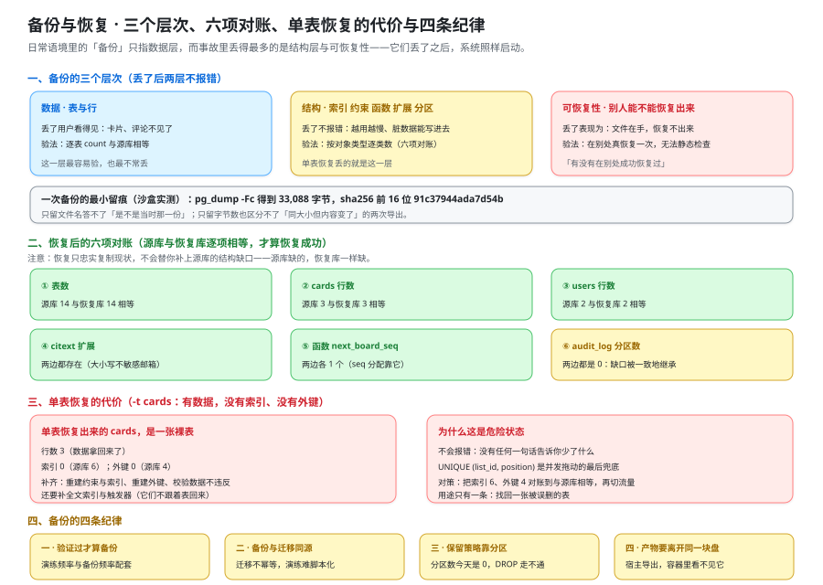

# 备份与恢复：验证过的备份才算备份

这一页回答「**数据怎么保住、怎么拿回来，以及凭什么说这份备份是有效的**」——它给出备份的三个层次、五种备份方式的取舍、`pg_dump -Fc` 与 `pg_restore` 到全新库的**实测读数与逐项对账 SQL**、单表恢复的真实代价、四条备份纪律与可执行的恢复演练步骤；它**不回答**「发布出错时版本怎么退回去」（那是 [发布与回滚手册](../ReleaseRunbook/index.md) 的事），也**不回答**「编排文件与镜像 digest 怎么写」（那是 [部署脚本](../DeployScripts/index.md) 与 [配置与密钥](../ConfigSecrets/index.md) 的事）。



::: warning 本仓库只有文档，没有代码
下面的 `pg_dump` / `pg_restore` / `psql` 命令与 `bin/restore-drill.sh`，都要在**你自己搭好的工程**里创建并执行。本仓库不存放源码、脚本与 SQL 文件（`project/` 只允许 `*.md` 与配图）；「运行 `xxx`」一律指「先按本节把该文件建出来，再执行」。
:::

::: tip 本页读数的采集方式
本页所有实测读数来自**本机沙盒 `/tmp/tb-run`**（2026-10-17 采集），与 [部署脚本](../DeployScripts/index.md) 用的是同一套栈：`postgres:18` + `redis` + `migrate` 一次性容器 + nginx 占位应用，库名与用户名均为 `teamboard`，迁移脚本从 [数据库设计](../Database/index.md) 的 `sql` 围栏里原样抽出（V1~V4）。**备份与恢复只用到容器内的 PostgreSQL**，所以本页的运行期判据是真跑过的；凡需要**本项目自己的应用**参与的判据，原因写 `BL-2`。
:::

## 一、备份的三个层次：数据、结构、可恢复性

「备份」在日常语境里只指第一层，而**事故里丢得最多的恰恰是后两层**——因为它们丢了之后，系统照样启动、页面照样打开。

| 层 | 内容 | 丢了它的表现 | 怎么验 |
| --- | --- | --- | --- |
| **数据** | 表与行 | 用户看得见：卡片不见了、评论没了 | 逐表 `count(*)` 与源库相等 |
| **结构** | 索引、约束、函数、扩展、分区 | **没有任何报错**：只是查询越用越慢、脏数据能写进去、审计插入失败 | 索引数 / 外键数 / 函数数 / 扩展数 / 分区数逐项相等 |
| **可恢复性** | 这份备份能不能在**别人的机器**上恢复出来 | 备份文件在手，恢复报错或恢复出一半 | 在一台「只有容器运行时的干净机器」上真恢复一次 |

::: tip 一句话判据
**「这份备份，我有没有在别处成功恢复过一次？」** 答不出「有」的，它叫**文件**，不叫备份。
:::

三层的验证成本差别很大：数据层一条 `count(*)` 就够；结构层要按对象类型逐类数；可恢复性必须**真做一次**——它无法被任何静态检查替代。本页第三节会把三层各验一遍，第三节的对账清单就是结构层的「验法」。

## 二、备份方式对照表

选备份方式的判据有三个：**要恢复到什么粒度**、**能不能接受丢一段时间的写入**（也就是要不要时间点恢复）、**恢复时长能不能接受**。

| 方式 | 形态与命令 | 恢复粒度 | 能做时间点恢复（PITR）？ | 适用 | 不适用 |
| --- | --- | --- | --- | --- | --- |
| **逻辑备份 · 自定义格式** | `pg_dump -Fc`，恢复用 `pg_restore` | **单表 / 单 schema / 全库**，可并行 `-j` | **不能**：只到执行 `pg_dump` 的那一刻 | **本项目的主选**：跨版本迁移、按对象恢复、恢复到全新库做演练 | 大库的全量恢复速度（要求恢复时长分钟级时不够） |
| **逻辑备份 · 纯文本** | `pg_dump -Fp`（默认） | 只能整文件按序重放，可人工裁剪 | 不能 | 小库、需要人眼检查内容、教学与排查 | 大库（单文件、单连接、无并行，且无法按对象恢复） |
| **逻辑备份 · 目录格式** | `pg_dump -Fd` | 同自定义格式，且 dump 与 restore 都能并行 `-j` | 不能 | 大库上要压榨并行度 | 单机小库（多出一堆文件，管理成本大于收益） |
| **物理备份 + WAL 归档** | 基础备份 + 连续归档 WAL | **整群集**：不能只恢复一张表 | **能**：可恢复到任意时间点（秒级 / 到某个事务） | 生产主库、要求「丢尽可能少」的场景 | 跨大版本迁移、想只捞出某张表 |
| **快照**（卷 / 存储级） | 云盘快照、LVM 快照 | 整卷 | 取决于一致性机制：**能**（若与应用及 WAL 对齐），否则不能 | 大卷、整机级回退 | 跨平台迁移；一致性没对齐时快照本身是「不一致的备份」 |

::: danger 这张表上最容易做错的三件事
1. **用物理备份去做「找回一张误删的表」。** 它的恢复粒度是整群集，你要先把整库恢复到另一个实例，再把那张表导出来。**正确做法**：单表级找回走逻辑备份（自定义格式或目录格式），物理备份负责「整机级灾难」。
2. **以为逻辑备份能做时间点恢复。** `pg_dump -Fc` 记录的是**导出那一刻的快照**，此后到事故之间的写入全丢。**正确做法**：明确写出「可接受的丢失窗口」——本项目本地开发接受「上次 dump 之后全丢」，生产必须配 WAL 归档。
3. **把快照当成天然一致的备份。** 快照在 I/O 层一致，但数据库进程缓冲区的数据还没落盘，快照里可能是**崩溃一致性**状态。**正确做法**：要么在快照前让数据库进入备份模式并对齐 WAL 位置，要么直接选「基础备份 + WAL 归档」这条路，别自己拼一套。
:::

本项目当前阶段的口径：**主选自定义格式（`-Fc`）**，理由是它同时满足三条需求——恢复粒度到单表、能恢复到全新库做演练、一份文件便于留痕与校验。PITR 留到有真实生产库时再上，**但「可接受的丢失窗口」这一列现在就要写下来**，否则它会在一句话里被默认为零。

## 三、实测：一次 `pg_dump -Fc` 与一次恢复到全新库

### 3.1 备份，并给产物留痕

```shell
# 在你自己工程的工程根目录下执行（容器名以 docker compose ps 输出为准）
mkdir -p backup
docker compose exec -T db pg_dump -U teamboard -Fc -d teamboard \
  > "backup/teamboard-$(date +%Y%m%d%H%M).dump"

ls -l backup/                       # 实测：33088 字节
shasum -a 256 backup/*.dump         # 实测：91c37944ada7d54b...（前 16 位）
```

**两个数必须一起留痕：字节数与 `sha256` 前 16 位。** 只留文件名的备份，无法回答「这一份是不是当时那一份」；只留字节数的备份，也区分不了「同大小但内容变了」的两次导出。这与 [发布与回滚手册](../ReleaseRunbook/index.md) 里「用 digest 而不是 tag」是同一条纪律：**判据要能唯一标识一个产物。**

### 3.2 恢复到全新库：文件在宿主上，容器里看不见

```shell
# ① 建一个全新库（演练必须用全新库，理由见第六节）
docker compose exec -T db psql -U teamboard -d postgres -c 'CREATE DATABASE teamboard_restore;'

# ② 从宿主把文件 pipe 进容器恢复
cat backup/teamboard-202610170001.dump \
| docker compose exec -T db pg_restore -U teamboard --no-owner --no-privileges -d teamboard_restore
```

::: danger 恢复相关的三处真实踩坑
1. **在容器里 `pg_restore` 读宿主路径。** 备份文件是 `docker compose exec ... > backup/x.dump` 写在**宿主**上的，容器的文件系统里没有它——写 `pg_restore -d teamboard_restore backup/x.dump` 得到 `No such file or directory`。**正确写法**：`cat x.dump | docker compose exec -T db pg_restore ...`（`-T` 关掉 TTY 分配，否则管道会失败）；或者先把文件 `docker compose cp` 进容器再恢复。
2. **不带 `--no-owner --no-privileges` 就恢复。** 目标环境里没有同名的角色与授权时，`pg_restore` 会在 `ALTER ... OWNER TO` 与 `GRANT` 上报错，而它**默认不因这些错退出**——结果是「恢复完了，但对象属主是错的」，权限问题在应用连上来时才炸。**正确写法**：跨环境恢复显式带这两个开关（本页命令已带）。
3. **把恢复成功当成恢复完整。** `pg_restore` 的退出码 0 只说明「它把 SQL 跑过去了」，不说明「源库与恢复库逐项相等」。**正确写法**：跑 3.3 的对账 SQL，**逐项相等**才算恢复成功。
:::

### 3.3 对账六项：源库与恢复库必须逐项相等

```sql [six-checks.sql —— 恢复后逐项对账，每一项都要与源库相等]
-- ① 表数
select count(*) from pg_tables where schemaname = 'public';                    -- 期望 14
-- ② 逐表行数（至少覆盖有数据的表）
select count(*) from cards;                                                    -- 期望 3
select count(*) from users;                                                    -- 期望 2
-- ③ 索引数（按表，按数量降序）
select tablename, count(*) from pg_indexes
 where schemaname = 'public' group by tablename order by 2 desc;               -- cards 期望 6
-- ④ 外键数（按被引用表）
select conrelid::regclass as tbl, count(*) from pg_constraint
 where contype = 'f' and connamespace = 'public'::regnamespace group by 1 order by 2 desc;
-- ⑤ 函数数（本项目应有 next_board_seq）
select p.proname from pg_proc p join pg_namespace n on n.oid = p.pronamespace
 where n.nspname = 'public';                                                   -- 期望含 next_board_seq
-- ⑥ 扩展数（本项目应有 citext）
select extname from pg_extension order by 1;                                   -- 期望含 citext
-- ⑦ 分区数（结构层最容易被漏掉的一项）
select count(*) from pg_inherits where inhparent = 'audit_log'::regclass;      -- 实测 0
```

实测对账结果（源库 `teamboard` vs 恢复到全新库 `teamboard_restore`）：

| 项 | 源库 | 恢复库 | 相等？ |
| --- | --- | --- | --- |
| 表数 | 14 | 14 | ✅ |
| `cards` 行数 | 3 | 3 | ✅ |
| `users` 行数 | 2 | 2 | ✅ |
| `citext` 扩展 | 有 | 有 | ✅ |
| 函数 `next_board_seq` | 1 个 | 1 个 | ✅ |
| `audit_log` 分区数 | **0** | **0** | ✅ |

最后一行是本页最值得记住的一条：**恢复不会替你补上结构缺口，它只忠实地复制现状。** 源库里 `audit_log` 一个分区都没有（这是 [部署脚本](../DeployScripts/index.md) 第五节登记的缺口三：插入 `audit_log` 会报 `no partition of relation "audit_log" found for row`，导致拖动整笔回滚），恢复之后**依然是 0**——也就是说，**从这份备份恢复出来的库，和源库一样写不进审计**。备份的完整性由源库的结构完整性决定。

::: warning 「六项都对上了」不等于「备份是好的」
对账证明的是**这一次恢复忠实于源库**。它不能证明两件事：① 源库本身没坏（一次「一致地复制了坏结构」的恢复照样全绿）；② 恢复出来的库**能被应用用起来**（连接串、权限、扩展版本、时区）。第二件事只能由「应用连上去读一次」回答，见第六节第 4 步。
:::

## 四、单表恢复的代价：`-t` 出来的是一张裸表

单表恢复是逻辑备份最诱人的能力，也是最容易让人误解的能力。实测：

```shell
docker compose exec -T db psql -U teamboard -d postgres -c 'CREATE DATABASE teamboard_partial;'
cat backup/teamboard-202610170001.dump \
| docker compose exec -T db pg_restore -U teamboard --no-owner -t cards -d teamboard_partial
```

| 项 | 源库 `cards` | 单表恢复后的 `teamboard_partial.cards` |
| --- | --- | --- |
| 行数 | 3 | **3**（数据在） |
| 索引数（`pg_indexes where tablename='cards'`） | **6** | **0** |
| 外键数（`pg_constraint ... contype='f'`） | **4** | **0** |

**结论：单表恢复出来的是一张裸表——有数据，没有索引、没有外键。** 它不会报错，不会告诉你少了什么；你要是不对账，就会在一个没有唯一约束的 `cards` 上继续跑——而 `UNIQUE (list_id, position)` 正是 [卡片拖动](../CardMove/index.md) 第 4.2 节里「同一对邻居之间并发插入」的最后一道兜底。

`-t` 的正确用途只有一条：**找回一张被误删的表**。它的目标是把数据拿回来，**结构必须由你补齐**：

1. **重建唯一约束与索引**：`ALTER TABLE cards ADD CONSTRAINT cards_list_position_key UNIQUE (list_id, position);`，再按 [数据库设计](../Database/index.md) 第六节的索引清单逐条补 `cards_board_idx` / `cards_assignee_idx`（部分索引）/ `cards_search_idx`（GIN）。
2. **重建外键**：`cards` 的四个外键（`board_id` / `list_id` / `assignee` / `created_by`）逐条 `ALTER TABLE cards ADD CONSTRAINT ... FOREIGN KEY ...`。
3. **校验外键数据不违反**：外键建不上就说明数据里已经有孤立引用——先用 `LEFT JOIN` 的反向查询找出违反行（期望 0 行），再逐条判「补数据还是删数据」，**最后**才建约束。
4. **重建 `search_doc` 与它的触发器**：全文索引不是约束，恢复出来的表里同样没有；不补它，搜索会对新恢复的表静默失效。

::: danger 单表恢复最容易踩的三处
1. **恢复完直接切流量过去。** 裸表没有唯一约束，并发写入会写出同列同位置的两张卡片。**正确写法**：先补齐约束与索引，再把「索引数 6 / 外键数 4」对账到与源库相等。
2. **以为触发器与函数跟着表一起回来了。** `-t` 只带表本身。**正确写法**：函数用第 3.3 节的第 ⑤ 项单独对账，触发器用 `select tgname from pg_trigger where tgrelid='cards'::regclass` 单独对账。
3. **在生产库上做恢复试验。** 单表恢复通常发生在「生产刚丢了东西」的时刻，恰恰是最想直接在生产库上操作的时刻。**正确写法**：恢复到另一个库或另一个实例，对完账再按发布流程把它切成生产对象。
:::

## 五、备份的四条纪律

### 5.1 纪律一：验证过才算备份

**频率与判据配套**，否则「定期备份」会退化成一句口号：

| 项 | 本项目口径 | 为什么是它 |
| --- | --- | --- |
| **备份频率** | 本地开发：每次涉及结构变更的提交前一次；有生产环境后：每日全量 + WAL 归档 | 结构变更才需要新备份；数据变更由 WAL 归档覆盖 |
| **恢复演练频率** | 与每个交付周期一次（本周期：第 4 周一次，见第六节） | 演练成本不低，但高于「一个周期」的频率会变成走过场 |
| **演练判据** | 全新库恢复成功 + 3.3 六项对账逐项相等 + **应用连上去读一次成功** | 三条缺一条，演练都没回答「能不能用」 |
| **留痕** | 备份字节数 + `sha256` 前 16 位 + 演练日期 + 对账读数 | 半年后要能判断「当时那份备份到底是不是好的」 |

### 5.2 纪律二：备份与迁移的关系

**备份能恢复出来的结构，等于迁移脚本能在空库上建出来的结构。** 这句话有两个方向的推论，两个方向本周期都测到了：

1. **正向：恢复演练必须能重放迁移。** 演练里「从零建库」这一步是靠迁移脚本完成的，而 [部署脚本](../DeployScripts/index.md) 第五节实测：**迁移今天不幂等**——把 V1 再跑一遍报 `psql: ERROR: relation "users" already exists`，`pg_tables` 里也**没有任何版本表**（版本表计数实测 **0**）。也就是说「哪些迁移跑过了」这件事不在数据库里。**在修掉它之前，恢复演练只能靠人工判断跑哪几份文件**，而这正是演练最容易出错的地方。
2. **反向：结构缺口会被备份原样继承。** `audit_log` 的分区在源库是 0 个，恢复库也是 0 个（3.3 表末行）。**备份不会替你补齐它。**

### 5.3 纪律三：备份与保留策略

保留策略的形态由表的**增长方式**决定，而不是由「想留多久」决定。本项目两张会无限增长的表各自的清理动作完全不同：

| 表 | 增长量级 | 清理动作 | 为什么不能用另一种 |
| --- | --- | --- | --- |
| `board_events` | 每月约 200 万行 | 按保留期 `DELETE`（或分区化后 `DROP` 分区） | 它是同步用的热数据，允许被裁剪 |
| `audit_log` | 每月约 500 万行，**按月分区** | `DROP TABLE audit_log_2026_10` | 批量 `DELETE` 会扫全表、锁大量行，还留下一堆死元组；**分区化之后清理应该是一次元数据操作** |

**但今天 `audit_log` 一个分区都没有**（实测 `pg_inherits` 计数 **0**）。这带来一个连锁结论：**「备份时排除旧分区」这条路今天走不通**——没有分区可排除，备份只能整表带走；而它一旦按月分区，备份策略就可以写成「全量 + 只保留近 N 个月的分区」，备份体积与恢复时长随之下降。**分区不只是查询优化，它是保留策略与备份体积的前置条件。**

### 5.4 纪律四：备份的存放位置

| 位置 | 挡住了什么 | 挡不住什么 | 本项目口径 |
| --- | --- | --- | --- |
| 同一块盘 | 误删表、误改数据 | 磁盘故障、机器丢失 | **不算备份** |
| 另一块盘 / 另一台机器 | 磁盘与机器故障 | 机房级故障、勒索软件横向移动 | 最低要求 |
| 对象存储（S3 兼容，本项目已有） | 机器级故障，且天然带版本与生命周期 | 账号被删（必须另存一份或开版本控制） | **本项目的推荐落点** |
| 异地 / 另一账号 | 账号与地域级故障 | —— | 有生产后按合规要求决定 |

一条与容器强相关的细节要写清：**备份文件是导出到宿主的**（`docker compose exec ... > backup/x.dump`），**容器里看不见它**。所以「把备份放进对象存储」这件事要在**宿主侧**做，而不是在容器里做；同理，恢复时也是从宿主 `cat` 进容器（3.2）。把这一条写进脚本，比写进脑子可靠。

## 六、恢复演练的可执行步骤

演练与生产的边界先写死：**演练不许在生产库上做**。演练的每一步都在一个**全新库**（更彻底的做法是全新实例）上完成，源库在整场演练里只被**读**——一次 `pg_dump`。

```shell [bin/restore-drill.sh —— 恢复演练：全新库 → 恢复 → 对账 → 应用读一次 → 留痕]
#!/usr/bin/env bash
set -euo pipefail
cd "$(dirname "$0")/.."

SRC_DB="${SRC_DB:-teamboard}"           # 源库：全程只读
DRILL_DB="teamboard_drill_$(date +%Y%m%d%H%M)"
DUMP="backup/teamboard-$(date +%Y%m%d%H%M).dump"

# ① 备份源库，并留痕（字节数 + sha256 前 16 位）
docker compose exec -T db pg_dump -U teamboard -Fc -d "$SRC_DB" > "$DUMP"
ls -l "$DUMP"; shasum -a 256 "$DUMP"

# ② 建全新库。用全新库而不是「删表再恢复」：后者证明不了「从零可恢复」
docker compose exec -T db psql -U teamboard -d postgres -c "CREATE DATABASE $DRILL_DB;"

# ③ 恢复（从宿主 pipe 进容器）
cat "$DUMP" | docker compose exec -T db pg_restore -U teamboard --no-owner --no-privileges -d "$DRILL_DB"

# ④ 对账六项：任一项与源库不等就失败（SQL 见 3.3，这里只给表数与卡片数两条示例）
for q in "select count(*) from pg_tables where schemaname='public'" "select count(*) from cards"; do
  a="$(docker compose exec -T db psql -U teamboard -d "$SRC_DB"   -tAc "$q")"
  b="$(docker compose exec -T db psql -U teamboard -d "$DRILL_DB" -tAc "$q")"
  [ "$a" = "$b" ] || { echo "对账失败：$q 源库=$a 恢复库=$b"; exit 1; }
done

# ⑤ 应用连上去读一次（这一步不能省：对账全绿也可能连不上）
SPRING_DATASOURCE_URL="jdbc:postgresql://db:5432/$DRILL_DB" docker compose up -d app
curl -sf localhost:8080/actuator/health                     # 期望 {"status":"UP"}
TOKEN=... curl -sf localhost:8080/api/v1/workspaces -H "Authorization: Bearer $TOKEN"   # 期望能读到列表

# ⑥ 留痕四项：备份读数 / 对账结果 / 应用读数 / 演练日期
echo "演练留痕：$(date -Iseconds) dump=$DUMP drill_db=$DRILL_DB 对账=通过 应用读数=通过"
```

留痕四项与 [发布与回滚手册](../ReleaseRunbook/index.md) 第七节的回滚演练同构（演练日期 / 上一版 digest / 当前迁移版本 / 读写判据读数），两处的共同纪律是：**不留痕的演练等于没练**。

::: tip 演练的第五条判据：把恢复库当成「新同事的机器」
最彻底的一次演练不是「恢复到另一个库」，而是**把备份文件拷到另一台只装了容器运行时的机器上，从零恢复**——它同时验了「文件能不能搬」「迁移能不能重放」「文档够不够照着做」。本页的六项对账与这条判据并不冲突：**前者验忠实度，后者验可搬性。**
:::

## 七、与 [发布与回滚手册](../ReleaseRunbook/index.md) 的边界

两页都在讲「出事了怎么办」，但**触发条件与可用手段完全不同**，混用会让处置动作错向：

| 维度 | 本页（备份与恢复） | [发布与回滚手册](../ReleaseRunbook/index.md) |
| --- | --- | --- |
| 回答什么 | **数据怎么保住、怎么拿回来** | **版本错了怎么退回去** |
| 触发条件 | 数据被删 / 被改坏 / 库起不来 / 迁移改坏了结构 | 新版本行为不对（`5xx`、延迟、就绪缺口） |
| 主要手段 | `pg_dump` / `pg_restore` / PITR | 切回上一版 digest、回退 `.env`、停写新列 |
| 时间尺度 | 分钟到小时（取决于备份体积与恢复方式） | 秒到分钟（拉一个镜像起来） |
| 会不会丢写入 | **会**：逻辑备份只到导出那一刻（丢失窗口要事先写明） | **不会**：回滚镜像不撤数据——写入留在库里 |
| 判据 | 恢复库与源库六项对账逐项相等 + 应用读一次成功 | 冒烟五条 + 越权一条 + 观察窗口六个量 |

::: danger 把两者搞混的两个典型
1. **用回滚镜像去修数据损坏。** 数据已经被写坏时，切回旧版本只是让旧版本去读坏数据。**正确做法**：先判损坏是**数据**还是**结构**——数据走本页的恢复，结构走 [发布与回滚手册](../ReleaseRunbook/index.md) 第二节的迁移分类。
2. **用恢复备份去处理「新版本有 bug」。** 那会把备份之后的所有正常写入一起丢掉。**正确做法**：行为不对就回滚版本（零数据代价），只有数据真的坏了才动备份。
:::

## 八、判据族声明（`BR-A` ~ `BR-H`）

八条判据分三类：六条**文档级**（验「口径是否自洽、命令是否可执行」）、一条**运行期·本机已跑**（沙盒库上真导出与真恢复过）、一条**运行期·未跑**（需要本项目自己的应用连上恢复库）。

| 判据 | 一句话声明：它回答什么 | 级别 | 状态 |
| --- | --- | --- | --- |
| **`BR-A`** | 备份的三个层次齐全（数据 / 结构 / 可恢复性），且写死「丢了后两层不报错」 | 文档级 | ✅ 本机可判 |
| **`BR-B`** | 五种备份方式的适用与不适用齐全，每种给出恢复粒度与能否 PITR | 文档级 | ✅ 本机可判 |
| **`BR-C`** | 备份与恢复命令可复制，且**实测读数留痕**（字节数 + `sha256` 前 16 位） | 文档级 | ✅ 本机可判 |
| **`BR-D`** | 对账六项 SQL 齐全（表数 / 行数 / 索引 / 外键 / 函数 / 扩展）、含分区分项 | 文档级 | ✅ 本机可判 |
| **`BR-E`** | 单表恢复的代价写清（0 索引 / 0 外键）与四步补齐动作 | 文档级 | ✅ 本机可判 |
| **`BR-F`** | 四条纪律与恢复演练步骤齐全，且「演练不许在生产库上做」写死 | 文档级 | ✅ 本机可判 |
| **`BR-G`** | 沙盒库上真做一次：`pg_dump -Fc` 得到 **33,088 字节 / `91c37944ada7d54b…`**，恢复到全新库后六项对账逐项相等 | 运行期 | ✅ 本机已跑（沙盒 `/tmp/tb-run`） |
| **`BR-H`** | 恢复库能**被应用用起来**：应用连上恢复库后 `/actuator/health` 为 `{"status":"UP"}`，且能读回工作区列表 | 运行期 | `⏳ 未跑 · 原因：本仓库无工程代码（BL-2）` |

## 九、当日做了什么

1. 产出**备份的三个层次**（数据 / 结构 / 可恢复性），逐层给出「丢了它的表现」与验法，并写死一句话判据：「这份备份，我有没有在别处成功恢复过一次？」
2. 产出**五种备份方式的对照表**（自定义格式 / 纯文本 / 目录格式 / 物理备份 + WAL / 快照），每行给出恢复粒度、能否 PITR、适用与不适用，并点出三处最易做错的取舍（用物理备份找单表 / 以为逻辑备份能 PITR / 把快照当天然一致）。
3. 完成一次**真实的备份与恢复**并留痕：`pg_dump -Fc` → **33,088 字节**、`sha256` 前 16 位 **`91c37944ada7d54b`**；`pg_restore --no-owner --no-privileges` 到**全新库**后，表 **14** / `cards` **3** 行 / `users` **2** 行 / `citext` 扩展 / 函数 `next_board_seq` **1** 个 / `audit_log` 分区 **0** 个，**逐项相等**。
4. 产出**对账六项 SQL** 与「期望全部相等」的收尾，并写清两条边界：六项对账不能证明源库没坏，也不能证明应用能用。
5. 测出并写清**单表恢复的代价**：`-t cards` 恢复出来的表有 **3 行数据**，但索引 **0**（源库 **6**）、外键 **0**（源库 **4**），并给出四步补齐动作（重建约束与索引、重建外键、校验外键数据不违反、重建全文索引与触发器）。
6. 产出**四条备份纪律**：验证过才算备份（频率与判据配套）、备份与迁移的关系（迁移今天不幂等、结构缺口被原样继承）、备份与保留策略（`audit_log` 分区化后清理靠 `DROP`，而分区今天一个都没有）、备份的存放位置（宿主导出后容器看不见）。
7. 产出**恢复演练脚本与六步流程**（备份留痕 → 建全新库 → 恢复 → 对账 → 应用读一次 → 留痕四项），写死「演练不许在生产库上做」，并补出「把备份搬到另一台机器上恢复」这条最彻底的演练判据。
8. 产出与 [发布与回滚手册](../ReleaseRunbook/index.md) 的**边界表**（数据 vs 版本、丢不丢写入、判据各自是什么）与两个典型误用，以及 **`BR-A` ~ `BR-H` 八条判据**：六条文档级、一条运行期本机已跑、一条运行期如实标 `⏳`。

## 十、如何验证

### 10.1 判据定义表（`BR-A` ~ `BR-H`）

| 判据 | 判什么 | 怎么验证 | 级别 | 状态 |
| --- | --- | --- | --- | --- |
| **`BR-A`** | 三层定义表 3 行 + 一句话判据 | 10.2 第 1 组 `grep` | 文档级 | ✅ 本机可判 |
| **`BR-B`** | 备份方式表 5 行，且 PITR 一列显式给出 | 10.2 第 2 组 | 文档级 | ✅ 本机可判 |
| **`BR-C`** | 实测读数（33,088 字节 / `sha256` 前 16 位）写进正文 | 10.2 第 3 组 | 文档级 | ✅ 本机可判 |
| **`BR-D`** | 对账六项 + 分区分项在 SQL 里都有 | 10.2 第 4 组 | 文档级 | ✅ 本机可判 |
| **`BR-E`** | 单表恢复代价读数（0 索引 / 0 外键）与补齐四步 | 10.2 第 5 组 | 文档级 | ✅ 本机可判 |
| **`BR-F`** | 四条纪律 + 演练六步 + 「不许在生产库上做」 | 10.2 第 6 组 | 文档级 | ✅ 本机可判 |
| **`BR-G`** | 沙盒库上真导出真恢复，六项对账逐项相等 | 10.3 第 1 组 | 运行期 | ✅ 本机已跑（沙盒） |
| **`BR-H`** | 恢复库能被应用用起来（健康检查 + 读回列表） | 10.3 第 2 组 | 运行期 | `⏳ 未跑 · 原因：本仓库无工程代码（BL-2）` |

### 10.2 本机可判的部分

以下命令在 `BackupRestore/` 目录内执行（也就是本页所在目录），期望值均为**本机实跑后回填**：

```shell
# 1) BR-A：三层 + 一句话判据
grep -cE '^\| \*\*(数据|结构|可恢复性)\*\* \|' index.md           # 期望 3
grep -c '它叫\*\*文件\*\*，不叫备份' index.md                      # 期望 1

# 2) BR-B：五种方式 + PITR 一列
grep -c 'PITR' index.md                                            # 期望 9
grep -cE '^\| \*\*(逻辑备份 · 自定义格式|逻辑备份 · 纯文本|逻辑备份 · 目录格式|物理备份 \+ WAL 归档|快照)' index.md   # 期望 5

# 3) BR-C：实测读数留痕（用 [x] 收尾，避免 grep 行自己命中自己）
grep -c '33,08[8]' index.md                                        # 期望 3
grep -c '91c37944ada7d54[b]' index.md                              # 期望 4
grep -c 'shasum -a 25[6]' index.md                                 # 期望 3

# 4) BR-D：对账六项 + 分区
grep -cE '^-- [①②③④⑤⑥⑦] ' index.md                              # 期望 7
grep -c 'pg_inherit[s]' index.md                                   # 期望 3

# 5) BR-E：单表恢复代价
grep -c 'pg_restore -U teamboard --no-owner -t card[s]' index.md   # 期望 1
grep -c '有数据，没有索引、没有外键' index.md                       # 期望 2

# 6) BR-F：四条纪律 + 演练边界
grep -cE '^### 5\.[1-4] ' index.md                                 # 期望 4
grep -c '演练不许在生产库上做' index.md                            # 期望 4

# 配图与判据族（声明表 8 行 + 定义表 8 行）
grep -c 'assets/tb-backup-restore.sv[g]' index.md                  # 期望 1
grep -cE '^\| \*\*`BR-[A-H]`\*\*' index.md                         # 期望 16
```

### 10.3 需要真实环境的部分

`BR-G` 的判据对象是**一个装着本项目结构的 PostgreSQL 库**——本页在沙盒库上真跑过（读数见第三节与 `BR-G` 一行）；`BR-H` 的判据对象是**本项目自己的应用连上恢复库**，本仓库按约定没有工程代码，因此如实标 `⏳`，只给命令。

```shell
# BR-G（沙盒即可复现：容器运行时 + 一份 compose.yaml + 四份迁移脚本）
docker compose up -d --wait db
docker compose exec -T db pg_dump -U teamboard -Fc -d teamboard > backup/drill.dump
ls -l backup/drill.dump                       # 期望：33088（本机实测）
shasum -a 256 backup/drill.dump               # 期望：91c37944ada7d54b…
docker compose exec -T db psql -U teamboard -d postgres -c 'CREATE DATABASE teamboard_restore;'
cat backup/drill.dump | docker compose exec -T db pg_restore -U teamboard --no-owner --no-privileges -d teamboard_restore
docker compose exec -T db psql -U teamboard -d teamboard_restore -tAc \
  "select count(*) from pg_tables where schemaname='public'"      # 期望：14

# BR-H（需要：本项目自己的 app 镜像 + 一份恢复好的库）
docker compose exec -T db psql -U teamboard -d postgres -c 'CREATE DATABASE teamboard_drill;'
cat backup/drill.dump | docker compose exec -T db pg_restore -U teamboard --no-owner --no-privileges -d teamboard_drill
SPRING_DATASOURCE_URL="jdbc:postgresql://db:5432/teamboard_drill" docker compose up -d app
curl -sf localhost:8080/actuator/health                          # 期望 {"status":"UP"}
```

原因**不是**「本机没有容器运行时」：本机 `docker` 客户端与服务端均为 **27.1.1**、`docker compose` 为 **v2.29.1-desktop.1**（2026-10-17 复验，见 [第 3 周验收结论](../Week3Acceptance/index.md) 第三节），且宿主上**运行中容器 11 个 / 全部容器 12 个 / 卷 14 个 / 镜像 15 个**。挡住 `BR-H` 的是 `BL-2`：**本仓库只有文档，没有可执行的工程**。

::: warning 状态列的读法
`BR-A` ~ `BR-F` 的期望值是**本机 `grep -c` 数出来的**，不是从模式里反推的。`BR-G` 的状态是「本机沙盒真导出、真恢复过」，`BR-H` 的状态**不是结论而是当前可执行性**，其唯一阻塞项与 [验收](../Acceptance/index.md) 的 `BL-2` 是同一条。本页特意把「六项对账全绿」与「应用能用」分成两条判据：**前者是忠实度，后者才是可用性**——把前者写成后者，正是「验证过的备份」这句话最容易被偷换的地方。
:::

## 十一、下一步

1. **`audit_log` 的分区补上，备份策略才能跟着分区走**：分区一建，「备份只带近 N 个月分区」与「清理用 `DROP TABLE`」两条同时成立；今天分区数为 **0**，两条都只是纸面口径。缺口登记在 [部署脚本](../DeployScripts/index.md) 第五节。
2. **迁移的幂等修掉，恢复演练才不依赖人记**：`schema_version`（或迁移工具的版本表）一旦有行数，演练的「从零建库」就可以完全脚本化——今天它必须靠人判断跑哪几份文件。
3. **备份产物要离开宿主**：`pg_dump` 的产物落在宿主上（容器看不见），把它推到 S3 兼容对象存储是下一步；推之前先在 `.env` 里定下 `S3_BUCKET` 与生命周期规则。
4. **演练与上线验收挂钩**：`BR-H` 要随 [上线验收](../LaunchAcceptance/index.md) 一起跑——「按文档能从零复现」这条交付判据里，恢复演练是唯一能证明「数据也复现得出来」的一步；本周期的收口写在第 4 周验收结论（[第 4 周验收结论](../Week4Acceptance/index.md)）。

## 参考资料

- [部署脚本](../DeployScripts/index.md)（迁移的三个缺口：不幂等 / 无版本记录 / `audit_log` 无分区；本页第三节末行的直接上游） · [发布与回滚手册](../ReleaseRunbook/index.md)（第七节回滚演练，本页第六节的同构物；两页的边界见本页第七节） · [数据库设计](../Database/index.md)（14 张表、索引清单、`audit_log` 的分区设计与保留策略）
- [环境与工程骨架](../Environment/index.md)（`compose.yaml` 与容器命名口径） · [配置与密钥](../ConfigSecrets/index.md)（备份产物的凭据与落点：对象存储的密钥走哪一级） · [卡片拖动](../CardMove/index.md)（`UNIQUE (list_id, position)` 为什么是并发兜底；单表恢复丢掉它的后果） · [第 3 周验收结论](../Week3Acceptance/index.md)（`BL-1` 口径更正与运行期判据状态列的读法）
- [上线验收](../LaunchAcceptance/index.md) · [交付文档](../DeliveryDocs/index.md) · [监控与告警接入](../Monitoring/index.md)（备份失败的告警接线）
- PostgreSQL 18 文档 · `pg_dump`（`-Fc` / `-Fp` / `-Fd` 三种格式的取舍）：https://www.postgresql.org/docs/18/app-pgdump.html
- PostgreSQL 18 文档 · `pg_restore`（`-t` 单表恢复、`--no-owner` / `--no-privileges` 的语义）：https://www.postgresql.org/docs/18/app-pgrestore.html
- PostgreSQL 18 文档 · 连续归档与时间点恢复（PITR）：https://www.postgresql.org/docs/18/continuous-archiving.html
- PostgreSQL 18 文档 · 表分区（`DROP` 分区做保留策略、`pg_inherits` 存在性判定）：https://www.postgresql.org/docs/18/ddl-partitioning.html
- Docker 官方文档 · Compose 的 `depends_on` 条件与 `docker compose exec -T`：https://docs.docker.com/reference/cli/docker/compose/exec/
- docker-library/postgres · PG 18 起数据目录与挂载点变更（备份/恢复脚本里容器路径的前提）：https://github.com/docker-library/postgres/issues/1259
- [灾难恢复策略](/docs/Ops/BackupDR/Strategy/index.md)（备份方式选型的方法论侧） · [应急演练](/docs/Ops/IncidentResponse/Drill/index.md)（演练不留痕等于没练） · [PostgreSQL 专题](/docs/DB/Relational/PostgreSQL/index.md)
