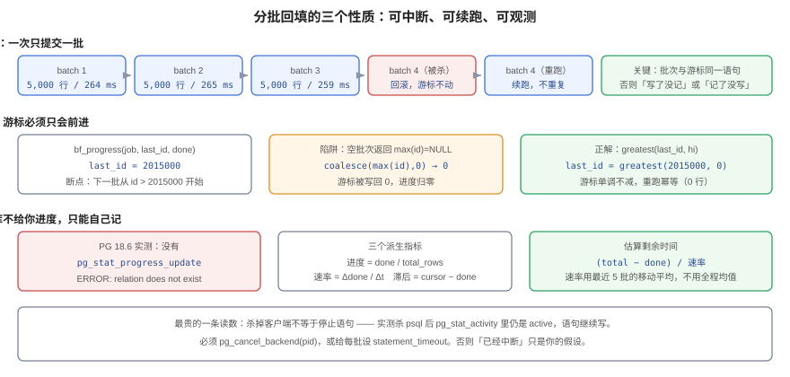

# 第 4 周第 3 步之二 · 分批回填：把一次五十万行的 UPDATE 拆成能中断的批次

[上一步](../MigrationPreflight/index.md)把「DDL 会不会锁死人」讲完了，但那一步只回答了**结构**怎么变。结构变完之后，还有一件同样在生产上发生过事故的事没讲：**旧数据怎么搬到新结构里去**。

`ALTER TABLE ... ADD COLUMN norm text` 是 0.008 s 的事，因为默认值走 `attmissingval` 不碰数据页。可一旦这列要**算出来**——把标题的小写去空格版本写进新列、把 `position` 换算成 `position_key`、把 `status` 枚举映射成新的七态——那就是一条 `UPDATE`。这条 `UPDATE` 在本机 56 MB 的测试表上跑 **6.6 秒**；同样一张表放到生产的两千万行上，就是**分钟级**。

::: tip 一句话
回填不是「把数据改对」这一件事，而是「**在一个人可以随时打断它、而业务流不能停的窗口里，把数据改对**」——所以它必须同时具备三个性质：**可中断、可续跑、可观测**。
:::

## 判据族声明

本页判据族 `BBF-A` ~ `BBF-H`，共 8 条。定义表在第八节。

## 本页不讲什么

- 不讲 DDL 的锁级别、`lock_timeout` 与体检 SQL，归 [迁移前置闸门](../MigrationPreflight/index.md)。
- 不讲迁移的三分法（加列可退 / 改名不可退 / 删列只能向前）与发布步骤表，归 [发布与回滚手册](../ReleaseRunbook/index.md)。
- 不讲备份与 PITR 演练，归 [备份与恢复](../BackupRestore/index.md)。
- 不讲「回填完怎么切读、旧列什么时候删」，归 [回滚矩阵](../RollbackMatrix/index.md) 与发布手册。
- 不讲批量位置变更的接口层纪律（按 `cardId` 排序、批上限 200），归 [看板与卡片读写接口](../BoardCardApi/index.md)——那是**业务批写**，本页是**一次性数据搬迁**，两者的失败代价不同。



## 一、先看清楚「一条 UPDATE 跑完」到底贵在哪

实验口径：PostgreSQL 18.6（容器 `teamboard-sandbox-db-1`），一张 **500,000 行 / 56 MB** 的 `bf_tpl` 表克隆出来的四份副本，回填内容完全一样（`lower(regexp_replace(description, '\s+', ' ', 'g'))`），每份只跑一次，`autovacuum_enabled=false` 让读数可复现。脚本不入库。

| 方式 | 墙钟 | 批数 | 单批 p50 | 吞吐 | WAL | 结束时的 `n_dead_tup` |
| --- | --- | --- | --- | --- | --- | --- |
| 一条 `UPDATE` 跑完 | **6,596.7 ms** | 1 | 6,596.7 | **75,794 行/s** | 239.8 MB | 500,000 |
| 每批 5,000 行 | **24,785.0 ms** | 101 | 264.6 | 20,174 行/s | 240.3 MB | 499,502 |
| 每批 20,000 行 | **13,122.9 ms** | 26 | 519.1 | 38,102 行/s | 297.4 MB | 499,802 |
| 每批 50,000 行 | **10,288.0 ms** | 11 | 1,013.8 | 48,600 行/s | 241.3 MB | 499,928 |

四条读数里有三个必须先解释清楚，否则这表会被读成「分批就是更慢」：

**① 分批一定更慢，代价就是「可中断」的保费。** 每万行成本从 **131.9 ms** 涨到 495.7 / 262.5 / 205.8 ms。批越小越贵，因为每一批都要重新定位索引位置、重新取快照、重新提交一次 WAL。**这不是优化空间，这是买保险的保费**——你付的是「崩溃时最多丢一批」的价格。

**② 固定成本可以从「空批次」的耗时里直接读出来。** 每次循环的最后一批必然返回 0 行（终止信号），它的耗时就是纯固定成本：**105.5 / 111.1 / 113.6 ms**，三档几乎一样。把它从 p50 里减掉，就是真正的边际成本：

| 批大小 | p50 | 减固定成本 | 边际成本 | 每行边际成本 |
| --- | --- | --- | --- | --- |
| 5,000 | 264.6 ms | 159.1 ms | 159.1 ms | **31.8 µs** |
| 20,000 | 519.1 ms | 408.0 ms | 408.0 ms | **20.4 µs** |
| 50,000 | 1,013.8 ms | 900.2 ms | 900.2 ms | **18.0 µs** |

一句话 `UPDATE` 的每行成本是 **13.2 µs**。所以「分批」的溢价在小批次上是 2.4 倍，在 50,000 行批次上只有 1.36 倍。

::: warning 这 105 ms 里，大头不是数据库
本实验的驱动是「每批一次 `docker exec psql`」，所以固定成本里含着进程启动 + 连接建立 + `docker exec` 本身，估计占 80 ms 以上。**生产实现不该学这个驱动**：正确形态是一条长连接循环提交，固定成本会掉到「一次 `COMMIT` 的 fsync」量级（本机约 1~3 ms）。这条读数的用途是**横向比较三档批大小**，不是拿绝对值去估生产耗时。
:::

**③ 500,000 行回填完，`n_dead_tup` 也接近 500,000。** 回填等于把整张表**重写一遍**：每行产生一个旧版本，表从 56 MB 长到接近两倍，要靠 `VACUUM` 才能回收。分批不会让这件事变轻，只会让它**分摊到多个批次之间**——所以回填收尾必须显式 `VACUUM (ANALYZE)`，别指望 autovacuum 恰好赶在磁盘告警之前跑完。

## 二、可中断：批次与游标必须在同一条语句里

「可中断」在实现上只有一个要求：**改数据与记进度，要么一起提交，要么一起回滚。** 看起来是废话，但三种最常见的写法全都违反了它：

| 写法 | 崩溃点落在哪 | 后果 |
| --- | --- | --- |
| 先 `UPDATE` 提交，再 `UPDATE bf_progress` 提交 | 两条语句之间 | 数据已改、进度没记 → 下一轮**重做**这一批（幂等的话只是浪费，不幂等就是重复计费/重复通知） |
| 先记进度，再 `UPDATE` | 两条语句之间 | 进度已记、数据没改 → 这一批**永远被跳过**，最后剩下的空洞没人知道 |
| 两个连接各干一半（一个改数、一个记数） | 任意时刻 | 上述两种都可能发生，且**无法从事务日志判断**是哪一种 |

正解是把三件事压进**一条** `WITH` 语句——选区、更新、记进度共享同一个快照与同一个事务：

```sql
SET search_path = bf, public;

WITH b AS (
  SELECT id FROM bf.card
   WHERE norm IS NULL
     AND id > (SELECT last_id FROM bf.bf_progress WHERE job = 'norm-v1')
   ORDER BY id
   LIMIT 5000
), u AS (
  UPDATE bf.card c
     SET norm = lower(regexp_replace(c.description, '\s+', ' ', 'g'))
    FROM b b
   WHERE c.id = b.id
  RETURNING c.id
), agg AS (
  SELECT count(*) AS upd,
         greatest((SELECT last_id FROM bf.bf_progress WHERE job = 'norm-v1'),
                  coalesce(max(id), 0)) AS hi
    FROM u
)
UPDATE bf.bf_progress p
   SET last_id = agg.hi,
       done    = p.done + agg.upd,
       updated_at = now()
  FROM agg
 WHERE p.job = 'norm-v1'
RETURNING (SELECT upd FROM agg) || '|' || (SELECT hi FROM agg);
```

返回 `5000|105000` 这样的 `行数|游标`，驱动只认这一个返回值：`5000` 决定要不要继续，`hi` 只用于日志核对。

### 实测：杀掉客户端不等于停下语句

这是本步最贵的一条读数。用一个 **200,000 行**的单批（够长，好杀），在它跑到 0.8 s 时把 `psql` 客户端进程杀掉：

```text
== 杀掉客户端后 0.3s，服务端还在跑什么 ==
92241 | active | - | SET search_path = bf, public; WITH b AS (
    SELECT id FROM bf.b
== 取消服务端语句 ==
t
== 取消后状态 ==
cursor=0 done=0
remaining=500000
```

三行输出各自说明一件事：

1. **杀掉客户端后，服务端后端仍是 `active`**，语句还在跑、还在写。`kill -9` 只是断开了 socket，PostgreSQL 要等到下一次往 socket 写数据（或语句结束）才会发现对端没了。
2. 只有 `pg_cancel_backend(pid)` 才真的停（返回 `t`）。
3. 停下来之后，这一批的 200,000 行**全部回滚**：`cursor=0 done=0 remaining=500000`。这正是「可中断」要的语义——**中断的代价被精确限制在一批之内**，而不是「跑了 40 分钟，全没了」或者更糟的「跑了 40 分钟，不知道跑到哪」。

::: danger 所以「已经中断了」是一个需要证明的断言
如果只杀客户端就以为停了，你会得到两种灾难：回填还在后台跑（继续吃 I/O、继续持锁），而你以为可以安全地开始下一个动作；或者它跑到一半被真正切断，事务回滚，而你基于「已经回填了一部分」的判断去切读——**切到一半有数据的列上**。

两条硬要求：每批 `SET LOCAL statement_timeout = '30s'`（把「停不下来」变成数据库自己会做的事）；中断路径上必须有一步 `pg_cancel_backend`，并在取消后回读 `pg_stat_activity` 确认 `state` 不再是 `active`。
:::

## 三、可续跑：游标只能单调前进

游标的设计比「记个位置」复杂一点点，因为**空批次会撒谎**。

### 实测：`coalesce(max(id), 0)` 会把游标写回 0

上面那条正解 SQL 在最后一次（第 101 批）返回 `0` 行时，`agg.hi = greatest(last_id, coalesce(max(id),0)) = greatest(2,515,000, 0) = 2,515,000`。但如果照抄一份**去掉 `greatest`** 的版本（很多人第一版就这么写），同一轮跑完的状态是：

```text
cursor=0 done=500000
remaining=0
total=500000
```

**游标从 2,515,000 被写回 0。** 这一次侥幸没出事，因为 `done` 已经等于 `total`、`remaining=0`，没有下一轮了。可只要中途出现过一次「空批次」——比如两个回填任务并行、另一个先把它那一段吃掉了；比如 `WHERE` 条件里带了时间窗，某一批恰好没有命中——游标就归零，**下一轮从第一行重新扫一遍**。在 2,000 万行的表上，这是一次以小时计的、静默的、没人报警的重跑。

::: tip 三条护栏，缺一条都会在某天出事
1. **游标写入用 `greatest(last_id, hi)`**——游标单调不减，`hi` 只能是 0 或更大的 id，绝不可能变小。
2. **选区用 `norm IS NULL AND id > cursor` 两个条件**——游标防「重复扫」，`IS NULL` 防「漏行」（万一游标被外部改错，`IS NULL` 仍然是真相）。
3. **终止信号只认「本批更新 0 行」**，不认「游标到了某个数」——表里可能有 id 空洞，`max(id)` 不代表结束。
:::

### 实测：同批重跑是幂等的

一切跑完之后，再对同一批调一次：

```text
{"mode": "rerun_last_batch", "returned": "0|0"}
```

返回 `0|0`——更新 0 行、游标不动。`0` 是「没有可做的了」，`0` 是 `greatest` 之后的结果。**「重跑安全」不是设计出来的美德，是这两条护栏的直接推论**：所以回填任务的失败处理可以简单到「失败就重试同一批」，不需要断点文件、不需要事务日志挖掘。

### 一个容易被忽略的口径：游标不是进度

从崩溃实验的中途状态看得很清楚：

| 量 | 值 | 怎么来的 |
| --- | --- | --- |
| `last_id`（游标） | **2,515,000** | 已处理到的最大 id |
| `done`（进度） | **15,000** | 已更新的行数 |
| `remaining`（真实剩余） | **485,000** | `count(*) WHERE norm IS NULL` |

`last_id - done = 2,500,000`，而真实剩余是 485,000——**差 25 万**。原因很朴素：克隆表的 id 从 2,500,001 起（`bigserial` 序列跟着模板走过），id 既不从 1 开始也不连续。

所以：**进度只能用 `done / total`，剩余只能用 `total - done`（或直接 `count(*) WHERE norm IS NULL`），`cursor - done` 永远不要拿来算剩余行数。** 这个口径错在监控上表现为「预计剩余 40 小时」，然后被人当成真的，去申请了一次扩容。

## 四、可观测：数据库不给你进度，你只能自己记

回填最难受的不是慢，是**没有进度**。`VACUUM` 有 `pg_stat_progress_vacuum`，`CREATE INDEX` 有 `pg_stat_progress_create_index`，`COPY` 有 `pg_stat_progress_copy`——**`UPDATE` 什么都没有**。本机实测确认：

```text
$ SELECT count(*) FROM pg_stat_progress_update;
ERROR:  relation "pg_stat_progress_update" does not exist

$ SELECT relname FROM pg_class WHERE relname LIKE 'pg_stat_progress%' ORDER BY 1;
pg_stat_progress_analyze
pg_stat_progress_basebackup
pg_stat_progress_cluster
pg_stat_progress_copy
pg_stat_progress_create_index
pg_stat_progress_vacuum
```

六个视图，没有 update。所以要观测量**只能自己记**，而记的位置必须是那条原子语句的一部分（第二节），不能是旁路的心跳。

### 进度表

```sql
CREATE TABLE bf.bf_progress (
  job         text PRIMARY KEY,
  last_id     bigint NOT NULL DEFAULT 0,
  done        bigint NOT NULL DEFAULT 0,
  total_rows  bigint NOT NULL,              -- 开工前数一次，写死
  started_at  timestamptz NOT NULL DEFAULT now(),
  updated_at  timestamptz NOT NULL DEFAULT now()
);
```

`total_rows` 在开工前数一次写死。进度用 `done / total_rows`，不用 `count(*) WHERE norm IS NULL`（那是全表扫，越到后面越慢，而且会把回填本身拖慢）。

### 三个派生指标与一条监控 SQL

| 指标 | 算法 | 用途 |
| --- | --- | --- |
| 进度 | `done / total_rows` | 给人和给图看 |
| 速率 | 最近 5 批 `Δdone / Δt` 的移动平均 | 估算剩余时间；**不要用全程均值** |
| 停滞 | 连续 N 批 `done` 没变 | 报警（比「还剩多少」重要得多） |

```sql
-- 每 30 秒采一次，单位是「行/秒」和「秒」
WITH h AS (
  SELECT done, updated_at,
         lag(done) OVER (ORDER BY updated_at) AS prev_done,
         lag(updated_at) OVER (ORDER BY updated_at) AS prev_at
    FROM bf.bf_progress_history
   WHERE job = 'norm-v1'
   ORDER BY updated_at DESC
   LIMIT 6
)
SELECT round(done::numeric / total_rows, 4)                       AS pct,
       round(avg((done - prev_done)
                 / extract(epoch FROM updated_at - prev_at)), 0)  AS rows_per_s,
       round((total_rows - done)
             / nullif(avg((done - prev_done)
                 / extract(epoch FROM updated_at - prev_at)), 0)) AS eta_s
  FROM h, bf.bf_progress p
 WHERE p.job = 'norm-v1';
```

**为什么速率一定要用移动平均。** 本实验三档的 p50 分别是 264.6 / 519.1 / 1,013.8 ms，而 `max` 是 436.5 / 561.0 / 1,070.1 ms——单批耗时的抖动在 ±60%（5,000 批那一档的 `max/p50 = 1.65`）。用单批速率去算 ETA，会得到一个每分钟跳一次的剩余时间，人看一眼就不信了。用最近 5 批的移动平均，ETA 的抖动会压到可读范围。

::: warning 「停在那不动」比「慢」更需要报警
回填最典型的两种事故形态都不是「慢」：一是**任务挂了没人知道**（进度条停着，看板上还写着 60%）；二是**两个任务同时在跑**（各自都慢一半，而且互相抢锁）。这两件事在「进度」这一个指标上都表现为「平」，所以告警要盯 `updated_at` 的新鲜度：`now() - updated_at > 5 分钟` 就该响，而不是等进度到不了 100%。
:::

## 五、批大小怎么定：从「目标批时长」倒推，不要拍

批大小不是审美问题，它由**三个约束的交集**决定：

| 约束 | 要求 | 换算 |
| --- | --- | --- |
| 锁的持有时间 | 一批持有 5,000~50,000 行的行锁，时长 = 批时长 | 批时长 ≤ 200~500 ms，否则会挡住热点行的业务写 |
| 重做代价 | 崩溃最多重做一批 | 批时长 × 崩溃概率，可接受即可 |
| 提交摊销 | 固定成本 / 批数 要可忽略 | 批数 × 固定成本 ≤ 总时长的 10% |

把本机读数代进去：固定成本约 105 ms（含 `docker exec`），边际 18~32 µs/行。若目标批时长为 300 ms：

```text
batch ≈ (300 ms - 105 ms) / 25 µs ≈ 7,800 行   → 取 5,000
```

若目标 500 ms：`(500 - 105) / 25 ≈ 15,800` → 取 15,000~20,000。**这两个数恰好落在实测表里成本曲线的拐点附近**（5,000 行溢价 2.4 倍、20,000 行溢价 1.55 倍、50,000 行溢价 1.36 倍），说明「200~500 ms 一批」这个经验值不是拍出来的。

::: tip 生产上把 105 ms 换成 2 ms 之后，结论会变
固定成本掉到「一次 commit 的 fsync」量级后，同样 300 ms 目标批时长下 `batch ≈ (300 - 2) / 13 ≈ 22,900` 行。**所以批大小必须按你自己的固定成本重算，不能抄别人的数。** 唯一的通用下限来自锁：批时长不能长到拖住热点行。
:::

## 六、索引帮不上忙（实测）

直觉是「回填要扫 `WHERE norm IS NULL`，建个部分索引就快了」。本机做了 A/B，各 6 轮 5,000 行批：

| 组 | 6 轮读数（ms） | 中位数 |
| --- | --- | --- |
| 无索引 | 280.5 / 275.0 / 254.2 / 253.1 / 259.0 / 413.4 | **267.0** |
| 部分索引 `(id) WHERE norm IS NULL`（占 10 MB） | 262.9 / 278.4 / 329.7 / 268.4 / 347.1 / 282.7 | **275.6** |

**没有显著差异**（两轮中位数差 3.2%，落在 ±60% 的单批抖动里）。原因是这条查询的形状：`id > cursor ORDER BY id LIMIT n` 本来就走主键索引顺序扫，`norm IS NULL` 只是行上的过滤条件——**部分索引省不掉的那次「按 id 往右走」正是主键已经做掉的事**，却要多付 10 MB 空间和每行一次索引维护。

它只在两种情况下才值得建：

1. **选行不是按主键顺序**（比如按 `board_id`、按 `updated_at` 分批，游标不是 id）。
2. **未回填的行极度稀疏**（回填已跑到 99%，大部分批次要跳过大量已处理页）——这时部分索引才是「跳过」而不是「再走一遍」。

::: danger 索引不是免费的：它对回填本身也是负担
部分索引让每行多一次 B-tree 插入，在 500,000 行规模上就是 10 MB 的额外 WAL 与页面。回填结束后如果要删它，`DROP INDEX` 又是一次 `ACCESS EXCLUSIVE`——回到 [迁移前置闸门](../MigrationPreflight/index.md) 的锁预算问题上了。
:::

## 七、五条生产纪律

1. **必须是长连接循环，不要每批起一个进程。** 本实验每批 105 ms 的固定成本里大头是 `docker exec`，它会让你误判「数据库慢」。生产形态是一条连接、循环执行那条 `WITH` 语句，`COMMIT` 由 `autocommit` 负责。
2. **每批 `SET LOCAL statement_timeout`。** 30 s 足够跑完 50,000 行；超时说明锁等待或 I/O 出问题，宁可让这一批失败重试，也不要让它挂着一小时。
3. **中断路径必须落到服务端。** `pg_cancel_backend(pid)` + 回读 `pg_stat_activity.state` 确认，别只 kill 客户端（第二节实测）。
4. **收尾三件事：`VACUUM (ANALYZE)`、复核 `n_dead_tup`、校验索引 `indisvalid`。** 回填把整表重写一遍（`dead ≈ 500,000`），不 `VACUUM` 就是把两倍的表留在磁盘上；`CREATE INDEX CONCURRENTLY` 失败会留下 `indisvalid = false` 的索引，它**不会被使用但仍在维护**。
5. **回填不跑在只读副本上。** 副本上的回填只改副本，主库一切照旧——这是「演练成功、上线没做」的经典翻车方式。

## 八、判据族

| 编号 | 判据 | 判定方式（可执行） |
| --- | --- | --- |
| `BBF-A` | 批次修改与游标更新在**同一条语句**里 | 回填 SQL 中 `WITH b AS` / `UPDATE`（数据）/ `UPDATE bf_progress` 三段在同一语句；驱动里不存在「先 UPDATE 再 UPDATE 进度」两次 `execute` |
| `BBF-B` | 游标写入带 `greatest`，单调不减 | `grep -c "greatest(" 回填语句` ≥ 1；构造空批次（`WHERE false` 或跑完再跑一次）后游标不回退 |
| `BBF-C` | 选行同时用 `IS NULL` 与 `id > cursor` 两个条件 | 语句里两个条件同时出现；把游标手工改小 1 后重跑，更新行数为 0 或仅 1 行 |
| `BBF-D` | 终止只认「本批 0 行」 | 驱动循环条件为 `upd == 0`；不存在「游标 ≥ max(id) 就退出」的写法 |
| `BBF-E` | 进度可算：`done / total_rows`，`total_rows` 开工前写死 | `bf_progress.total_rows > 0`；进度值单调不减；不存在 `count(*) WHERE ... IS NULL` 作为进度来源 |
| `BBF-F` | 中断可控：`statement_timeout` 存在且取消走服务端 | 语句前有 `SET LOCAL statement_timeout`；中断脚本含 `pg_cancel_backend` 且取消后回读 `pg_stat_activity` 判定 `state <> 'active'` |
| `BBF-G` | 收尾三件事都做了 | `VACUUM (ANALYZE)` 执行记录；`n_dead_tup` 回落到阈值内；`SELECT indisvalid FROM pg_index` 全为 `t` |
| `BBF-H` | 批大小有读数支撑 | 文档里能查到「固定成本 / 边际成本 / 目标批时长」三个数与由此算出的批大小；不是「凭经验 1 万」 |

## 九、本步如何验证

按顺序跑，每步都有可判定的输出：

| # | 动作 | 期望 |
| --- | --- | --- |
| `V1` | 回填 3 批后中止（`pg_cancel_backend`） | `cursor > 0`、`done = 3 × batch`、`remaining = total - done`；`pg_stat_activity` 无 `active` 的回填语句 |
| `V2` | 从 `V1` 的状态续跑到底 | 总行数 = `total`，无重复更新（`done` 恰好等于 `total`） |
| `V3` | 全部跑完后再执行一次同一批 | 返回 `0\|0`，`cursor` 不变 |
| `V4` | 手工把 `last_id` 减 5,000 后重跑一批 | 更新行数 0（`IS NULL` 条件兜住），`greatest` 把游标写回原值 |
| `V5` | `VACUUM (ANALYZE)` 后查 `n_dead_tup` | 显著下降；`pg_relation_size` 回落 |
| `V6` | 对照单条 `UPDATE` 的墙钟 | 分批总耗时在单条耗时的 1.4~2.5 倍之间（超出说明批太小或固定成本异常） |

## 十、下一步

第 4 周的八步（[镜像供应链](../ImageSupplyChain/index.md) → [环境等价](../EnvParity/index.md) → [迁移前置](../MigrationPreflight/index.md) → [优雅退出](../GracefulDrain/index.md) → [部署后冒烟](../SmokeGate/index.md) → [回滚矩阵](../RollbackMatrix/index.md) → [容量复核](../PoolCapacity/index.md) → [上线前置闸门](../PreLaunchGate/index.md)）已经全部收口。本步补的是这条链上**唯一没被覆盖的动作**：结构与代码都能退，**数据搬迁不能退**，所以它必须能被随时打断。

现在刻意不做的三件事，与不做的理由：

- **不做「回填进度接入大盘」**：需要先有稳定性数据判断「多久算异常」，本项目的回填是一次性任务，接大盘会变成一次性面板污染监控——先接告警（停滞 5 分钟），够用。
- **不做并行回填（多 worker 分段）**：并行会引入「谁负责哪段 id」的归属表，而多租户项目里已有 `tenant_route` 这类归属表，再加一张会造成两套归属口径。当前单 worker 在 50 万行上是 10 s，2,000 万行约 7 分钟，不值得为它引入归属问题。
- **不做「一键回滚旧列」**：旧列在 [回滚矩阵](../RollbackMatrix/index.md) 里已被标成 `R3`（只能向前），本步不为了「看起来可退」而去动那条口径。
