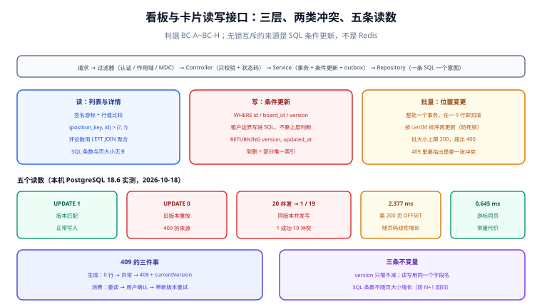

# 看板与卡片读写接口：把契约做成三层可跑的代码

第 2 周前四步解决的是「库能连、身份能认、上下文能传、信号能打」。这一步开始写**业务接口本身**：[接口契约定稿](../Contracts/index.md) 已经把路径与状态码写成了纸面，本页负责把它落到 Controller / Service / Repository 三层，并回答一个纸面契约回答不了的问题——**同一个人两次点保存、两个人同时改一张卡片，接口到底返回什么，客户端该怎么重试。**

本步的判据是「三件事同时成立」：读接口不分页错位、写接口不丢更新、冲突能被客户端正确区分。

## 判据族声明

本页判据族 `BC-A` ~ `BC-H`，共 8 条。定义表在第八节。

## 本页不讲什么

- 不讲路径与状态码的**契约文本**，归 [接口契约定稿](../Contracts/index.md)；本页只讲它怎么被实现。
- 不讲拖动的顺序键与十二步链路，归 [卡片拖动](../CardMove/index.md) 与 [拖动写入路径](../DragWritePath/index.md)。
- 不讲并发用例的组织方式，归 [并发与幂等专项](../Concurrency/index.md)。
- 不讲分布式锁与 fencing 的一般原理，归 [分布式锁与选主](/docs/Backend/DistributedLock/Overview/index.md)；本页用「条件更新」而不是锁。



## 一、本步在链路里的位置

```text
HTTP 请求
  → 过滤器：认证（令牌）→ 作用域（tenant / user）→ MDC
  → Controller：只做 DTO 校验与状态码映射，不含业务判断
  → Service：事务边界 + 条件更新 + 事件 / outbox
  → Repository：一条 SQL 一个意图，禁止「先查后写」
```

三个接口族，本步各实现一条代表：

| 族 | 代表接口 | 本步要证明的事 |
| --- | --- | --- |
| 读 | `GET /api/boards/{id}/cards?cursor=` | 游标分页不错位、不分页错行、不 N+1 |
| 写 | `PATCH /api/cards/{id}` | 条件更新不丢更新，冲突返回 409 |
| 批量 | `POST /api/boards/{id}/cards/positions` | 一批位置变更要么全成、要么全不成 |

三层里最容易写错的是 Controller：**它一旦开始判断「这个用户能不能改这张卡片」，权限就会出现两份实现**。权限判定的唯一落点是 Service（或更下层的 RLS），Controller 只负责把异常翻成状态码。

## 二、读路径：游标分页与「不错位」

卡片的排序键是 `(position_key, id)`——`position_key` 允许相等，所以必须带 `id` 做二级排序（这条在 [拖动写入路径](../DragWritePath/index.md) 已定）。

```sql
-- 第一页
SELECT id, title, position_key, version, updated_at
  FROM cards
 WHERE board_id = :boardId
 ORDER BY position_key, id
 LIMIT :limit;

-- 后续页：游标是上一页最后一行的 (position_key, id)
SELECT id, title, position_key, version, updated_at
  FROM cards
 WHERE board_id = :boardId
   AND (position_key, id) > (:lastKey, :lastId)
 ORDER BY position_key, id
 LIMIT :limit;
```

本机实测（PostgreSQL 18.6，20,000 张卡片，取第 200 页、每页 50）：

| 写法 | 耗时 | 说明 |
| --- | --- | --- |
| `OFFSET 9950 LIMIT 50` | **2.377 ms** | 要跳过 9,950 行 |
| 游标 `(position_key, id) > (9950, 'c9950')` | **0.645 ms** | 直接定位，与页码无关 |

3.7 倍的差距在 2 万行时还不算惊人，但它**随页码线性增长**：`OFFSET` 的代价是「跳过多少行就要读多少行」，而游标是常量代价。更重要的不是性能，是**正确性**：拖动会把卡片在列表里前后移动，`OFFSET` 分页在「翻页期间有人拖动」时会出现漏行与重复行，而游标不会。

::: danger 游标的三个易错点
1. **游标必须签名**：直接暴露 `(position_key, id)` 等于允许客户端任意构造游标去读别的区间——虽然仍受租户过滤，但会绕过「只能顺序翻页」的业务约束。做法是 HMAC 签名（见 [读路径隔离](../SearchIsolation/index.md)）。
2. **`(a, b) > (x, y)` 是行值比较**，要求两列同序、且索引列序一致（`board_id, position_key, id`）。写成 `position_key > x AND id > y` 是**错的**：当 `position_key` 相等时它会漏行。
3. **不要 `SELECT *`**：卡片列表只需要 5 个字段，多取的 `description`（大文本）会让每页多传几十 KB。
:::

### 2.1 不分页错行：N+1 与批量加载

列表要显示「每张卡片的评论数」时，最直观的写法是循环查一次——20 张卡片 21 次查询。正确做法是一条聚合：

```sql
SELECT c.id, c.title, c.position_key, c.version,
       COALESCE(s.comment_count, 0) AS comment_count
  FROM cards c
  LEFT JOIN (SELECT card_id, count(*) AS comment_count
               FROM comments WHERE board_id = :boardId GROUP BY card_id) s
    ON s.card_id = c.id
 WHERE c.board_id = :boardId
   AND (c.position_key, c.id) > (:lastKey, :lastId)
 ORDER BY c.position_key, c.id
 LIMIT :limit;
```

判据是**一次请求的 SQL 条数恒定**，与页大小无关。

## 三、写路径：条件更新，不先查后写

```sql
UPDATE cards
   SET title = :title,
       description = :description,
       version = version + 1,
       updated_at = now()
 WHERE id = :id
   AND board_id = :boardId        -- 租户 / 看板边界写进 SQL，不靠上层判断
   AND version = :expectedVersion -- 乐观锁：客户端读到的版本
RETURNING version, updated_at;
```

本机实测（同一张卡片）：

| 场景 | 结果 |
| --- | --- |
| `version = 0`，当前也是 0 | `UPDATE 1`，`version` 变 1 |
| 同一请求重放（`version = 0`，当前已是 1） | `UPDATE 0` |
| 20 个并发请求都带 `version = 0` | **1 个 `UPDATE 1`，19 个 `UPDATE 0`**，最终 `version = 1` |

第三条是最有价值的读数：**数据库自己就是那把锁**，不需要 Redis、不需要分布式锁、不需要「先查再判断」。20 个并发里只有一个能改成功，其余 19 个拿到的是「0 行」，必须被翻译成 409。

::: warning `WHERE` 里必须带 `board_id`
很多实现只写 `WHERE id = ?`，然后在上层用「这张卡片属于这个看板吗」做一次查询。这有两个问题：① 多了一次查询（也就多了一个窗口）；② **权限判定散落在两处**，任何一处漏写就形成越权。
把边界写进 SQL，越权与「记录不存在」会自然合并成同一个结果——这也是 [跨租户用例矩阵](../CrossTenantMatrix/index.md) 要求「越权一律 404」的实现基础。
:::

### 3.1 删除：软删 + 唯一约束的处理

```sql
UPDATE cards SET deleted_at = now(), version = version + 1
 WHERE id = :id AND board_id = :boardId AND version = :expectedVersion
   AND deleted_at IS NULL
RETURNING id;
```

软删会带来一个隐蔽问题：同一列里「已删的同名卡片」与「新建的同名卡片」会撞唯一约束。解法是把唯一索引加上 `WHERE deleted_at IS NULL` 的部分条件：

```sql
CREATE UNIQUE INDEX uq_cards_board_title
    ON cards (board_id, lower(title))
 WHERE deleted_at IS NULL;
```

## 四、409 的生成与消费

409 不是「出错了」，而是一个**协议层的指令**：*你手上的版本旧了，请重读后再决定*。它的正确用法包含三件事：

| 环节 | 做法 | 常见错误 |
| --- | --- | --- |
| 生成 | 条件更新 0 行 → 抛 `VersionConflictException` → 映射 409 + 当前版本 | 返回 500，或静默返回旧值 |
| 响应体 | 带上 `currentVersion` 与 `updatedAt`，让客户端能判断差异 | 只返回一句「冲突」 |
| 消费 | 客户端重读 → 用户确认 → 带新版本重试；或做字段级合并 | 自动无限重试（永远冲突） |

### 4.1 重试预算

```java
// 服务端不重试冲突；只在「内部重试」场景给一次机会，且必须重新读取
int attempts = 0;
while (true) {
    Card card = repo.findById(id);                 // 每次重试都重读
    try {
        return repo.update(card.id(), newTitle, card.version());
    } catch (VersionConflictException e) {
        if (++attempts >= 2) throw e;              // 最多两次，之后交给客户端
        backoffWithJitter(attempts);               // 5ms + 抖动
    }
}
```

两条纪律：

1. **重试必须重读**。用同一个 `version` 重试，结果永远是 0 行——这是「重试了但没生效」的典型。
2. **服务端最多重试一次**。再多的重试只是在替用户做决定：他可能真的要覆盖别人的修改。

## 五、错误映射：一张表定死

| 异常 | 状态码 | 响应要点 | 客户端该做什么 |
| --- | --- | --- | --- |
| `ValidationException` | 400 | 字段级错误列表 | 修正请求 |
| 未认证 / 令牌过期 | 401 | `WWW-Authenticate` | 刷新令牌 |
| 无权限（同租户内角色不足） | 403 | 需要的最小角色 | 提示无权限 |
| 不存在 / 跨租户 | 404 | 统一文案（不暴露存在性） | 当作不存在处理 |
| `VersionConflictException` | 409 | `currentVersion` + `updatedAt` | 重读并让用户确认 |
| 业务规则不满足（如列已满） | 422 | 规则名 + 当前值 | 提示并引导 |
| 锁 / 并发写占用（若用了锁） | 423 | `Retry-After` | 等待后重试 |
| 未预期异常 | 500 | 请求 ID（不返回堆栈） | 上报 |

```java
@RestControllerAdvice
public class ApiErrors {
    @ExceptionHandler(VersionConflictException.class)
    ResponseEntity<ApiError> conflict(VersionConflictException e) {
        return ResponseEntity.status(HttpStatus.CONFLICT)
            .body(new ApiError("VERSION_CONFLICT", e.currentVersion(), e.updatedAt()));
    }
}
```

**403 与 404 的分工必须写死**：同租户内角色不足 → 403；跨租户或对象不存在 → 404。混用会泄漏「这个 ID 存在」这一信息。

## 六、批量排序：一批要么全成、要么全不成

拖动一次只改一行（[卡片拖动](../CardMove/index.md) 的核心判据），但「批量整理」这类操作会一次改多行。接口形状：

```json
POST /api/boards/{boardId}/cards/positions
{
  "moves": [
    { "cardId": "c1", "positionKey": "1.5", "expectedVersion": 3 },
    { "cardId": "c2", "positionKey": "1.75", "expectedVersion": 7 }
  ]
}
```

三条实现纪律：

1. **整批一个事务**，任一 `UPDATE` 返回 0 行就整体回滚，并返回 409（附哪一张冲突）。
2. **先按 `cardId` 排序再更新**，避免两个并发批量请求以不同顺序加行锁而死锁。
3. **批大小设上限**（如 200），超过返回 400——没有上限的批量接口等于一个可以拖垮数据库的入口。

## 七、五条读数与三条不变量

| 读数 | 值（本机实测） | 用途 |
| --- | --- | --- |
| 条件更新命中 | `UPDATE 1` | 正常路径 |
| 旧版本重放 | `UPDATE 0` | 409 的来源 |
| 20 并发同版本 | 1 成功 / 19 冲突 | 证明「无锁也互斥」 |
| 第 200 页 offset | 2.377 ms | 分页基线 |
| 第 200 页游标 | 0.645 ms | 分页目标 |

三条不变量（任何实现都必须保持）：

1. **`version` 只增不减**，且每次成功写 +1。
2. **读接口返回的 `version` 与写接口要求的 `expectedVersion` 是同一个字段**，中间不允许换名或加偏移。
3. **一次请求的 SQL 条数与页大小无关**（防 N+1 回归）。

## 八、判据族定义

| 判据 | 规则 | 违反时的样子 | 验证方式 |
| --- | --- | --- | --- |
| `BC-A` | 分页用签名游标，禁止 `OFFSET` | 翻页时有人拖动 → 漏行/重复行 | 命令 1 |
| `BC-B` | 游标排序键与索引列序一致，行值比较不拆开 | `position_key` 相等时漏行 | 命令 2 |
| `BC-C` | 一次请求的 SQL 条数与页大小无关 | 20 张卡片 21 条 SQL，P99 随页大小上升 | 命令 3 |
| `BC-D` | 更新用条件更新，禁止「先查后写」 | 两人同改，后写覆盖前写且无提示 | 命令 4 |
| `BC-E` | `WHERE` 里带 `board_id`（租户边界入 SQL） | 越权与不存在返回不同码，泄漏存在性 | 命令 5 |
| `BC-F` | 冲突返回 409 且带 `currentVersion` | 客户端只能猜，用户体验成「保存失败」 | 命令 6 |
| `BC-G` | 服务端重试必须重读且最多一次 | 用旧版本反复重试，永远 409 | 命令 7 |
| `BC-H` | 批量排序整批一个事务、有大小上限、按 ID 排序 | 半批生效；两批并发互相死锁 | 命令 8 |

## 当日做了什么

1. 定下三层的职责边界：Controller 只做校验与状态码，权限与条件更新都在 Service / SQL 里；并写明「Controller 一判断权限，就会出现两份实现」。
2. 写出读路径的游标分页 SQL 与批量聚合 SQL，实测第 200 页 `OFFSET` **2.377 ms** 对游标 **0.645 ms**，并记下「真正的理由是正确性，不是性能」。
3. 写出写路径的条件更新 SQL，实测三种场景：命中 `UPDATE 1`、旧版本重放 `UPDATE 0`、20 并发同版本 **1 成功 / 19 冲突**。
4. 定下 409 的生成、响应体与消费三件事，并给出「服务端最多重试一次且必须重读」的代码骨架。
5. 定死八类异常到状态码的映射表，明确 403 与 404 的分工。
6. 给出批量排序接口的形状与三条实现纪律（整批事务、按 ID 排序、批大小上限）。
7. 记下三条不变量，作为后续重构的回归基线。

## 如何验证

```shell
# ① BC-A：分页是否用了 OFFSET
grep -rn "OFFSET" src/main/resources/mapper/*.xml src/main/java --include=*.java | grep -i card
```

**预期输出**：空。任何 `OFFSET` 都会在上万行数据与并发拖动下产生漏行/重复行。

```shell
# ② BC-B：游标条件是否用了行值比较
grep -rn "position_key, id) >" src/main/resources/mapper/*.xml
```

**预期输出**：命中一条。若写成 `position_key > ? AND id > ?`，`position_key` 相等时会漏行——这是本步最容易写错的一句 SQL。

```shell
# ③ BC-C：列表接口的 SQL 条数（开 SQL 日志后请求一次，数日志行）
grep -c "SELECT" logs/sql.log
```

**预期输出**：一次列表请求的 `SELECT` 条数恒定（如 4 条），与页大小（20 或 200）无关。随页大小增长即为 N+1。

```shell
# ④ BC-D / BC-E：条件更新与租户边界
psql "$DSN" -tAc "UPDATE tb.cards SET title='x', version=version+1 WHERE id='c900' AND board_id='b1' AND version=0;"
```

**预期输出**：`UPDATE 0`（本机 `version` 已为 1）。若返回 `UPDATE 1`，说明条件里少了 `version` 或 `board_id`。

```shell
# ⑤ BC-F：409 响应体是否带 currentVersion
curl -s -o /tmp/conflict.json -w '%{http_code}\n' -X PATCH "$API/api/cards/c900" \
  -H "If-Match: 0" -H 'Content-Type: application/json' -d '{"title":"并发写"}'
jq -r '.code, .currentVersion' /tmp/conflict.json
```

**预期输出**：`409` 与 `VERSION_CONFLICT`、一个整数版本号。只返回 `409` 而无版本号，客户端无法做字段级合并。

```shell
# ⑥ BC-G：服务端重试是否重读
grep -rn -A 6 "VersionConflictException" src/main/java/**/CardService.java | grep -c "findById\|reload"
```

**预期输出**：大于 0。重试分支里没有重读，就是用旧版本空转。

```shell
# ⑦ BC-H：批量接口是否有上限与排序
grep -rn "MAX_BATCH\|limit(200)\|sort(" src/main/java/**/PositionService.java | head
```

**预期输出**：能看到批大小上限，以及按 `cardId` 排序后再更新的代码。

```shell
# ⑧ BC-A（补充）：游标是否带签名
grep -rn "Hmac\|signature\|cursor" src/main/java/**/CursorCodec.java | head
```

**预期输出**：编码/解码两侧都有签名校验。裸 base64 的游标可被任意构造。

## 下一步

- **第 160 天**：第 2 周第 5 步——**评论与 @ 提及的写入接口**（解析口径、未读游标、outbox 与去重键），把本步的「条件更新 + 409」复用到评论的编辑与删除上。
- 待办：把本页的 `BC-A~BC-H` 接进 CI——③ 与 ⑥ 可以做成 `grep` 门禁，⑤ 做成契约测试的一条用例。
- 待办：批量排序的死锁验证（两个并发批量请求，相反顺序），放在第 3 周联调阶段与 [并发与幂等专项](../Concurrency/index.md) 一起做。

## 参考资料

- [PostgreSQL · Row-wise comparison](https://www.postgresql.org/docs/current/functions-comparisons.html#ROW-WISE-COMPARISON)——`(a, b) > (x, y)` 的语义，游标分页的正确写法
- [PostgreSQL · Partial Indexes](https://www.postgresql.org/docs/current/indexes-partial.html)——软删场景下唯一索引的加 `WHERE` 写法
- [RFC 9110 · 409 Conflict](https://www.rfc-editor.org/rfc/rfc9110#status.409)——409 的协议语义
- [RFC 9110 · If-Match](https://www.rfc-editor.org/rfc/rfc9110#field.if-match)——用 ETag 表达「基于哪个版本修改」
- [Use The Index, Luke · No Offset](https://use-the-index-luke.com/no-offset)——`OFFSET` 随页码退化的原因与游标替代
- 本站 [接口契约定稿](../Contracts/index.md) · [卡片拖动](../CardMove/index.md) · [拖动写入路径](../DragWritePath/index.md) · [并发与幂等专项](../Concurrency/index.md) · [分布式锁与选主](/docs/Backend/DistributedLock/Overview/index.md)
