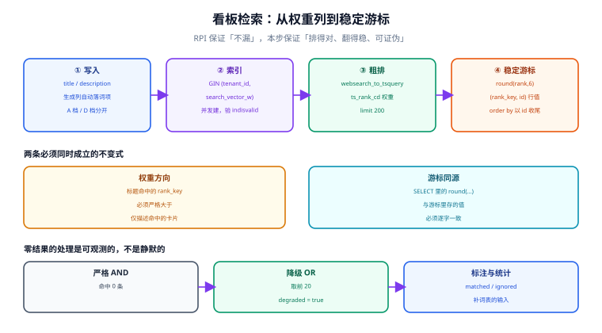

# 第 3 周第 5 步 · 检索相关性联调：让「搜得到」变成「排得对」

[第 1 周的搜索隔离](../SearchIsolation/index.md)（`RPI`）解决的是**不漏**：租户条件进公共条件构造器、游标签名、导出复用同一段条件。它把 `cards.search_vector` 建成了生成列并挂了 `(tenant_id, search_vector)` 的复合 GIN，十条读路径用例全部通过。

但它留下三个没回答的问题，而这三个恰好是「用户说搜不准」的全部来源：

1. **权重**：`to_tsvector('simple', title || ' ' || description)` 把标题和正文拼成了一串，**标题命中与正文命中同权**。一篇描述里反复提到「权限」的卡片，会压过标题就叫《权限矩阵》的卡片。
2. **排序键**：`order by rank desc, id` 里的 `rank` 是 `float8`，把它当游标键会遇到精度问题——序列化再反序列化之后可能差一个 ULP，导致翻页丢行或重复。
3. **可证伪**：没有评估集，任何权重调整都只能「搜几个词看看」。

本步按 [全文检索与搜索工程](/docs/DB/FullTextSearch/index.md) 的工程层把这三件事补齐。

## 判据族声明

本页判据族 `BSR-A` ~ `BSR-H`，共 8 条。定义表在第七节。

## 本页不讲什么

- 不讲租户隔离的完整实现（RLS、上下文传播、导出条件复用），归 [搜索隔离](../SearchIsolation/index.md)。
- 不讲索引前缀与 `EXPLAIN` 的读法，归 [租户上下文与索引设计](../TenantIndexing/index.md)。
- 不讲压测与池层断言，归 [压测四场景与池层断言](../LoadTestGate/index.md)。



## 一、与 `RPI` 的分工（一句话各管一半）

| 问题 | 归 `RPI` | 归本页 |
| --- | --- | --- |
| 会不会搜到别的租户的卡片 | ✅ 条件构造器强制带租户 | — |
| 权限被回收后还能不能搜到 | ✅ 订阅鉴权 + 缓存失效 | — |
| 标题命中会不会排在正文命中之后 | — | ✅ 权重化的生成列 |
| 翻页会不会漏行/重复 | — | ✅ 稳定排序键与游标编码 |
| 零结果时怎么办 | — | ✅ 降级为 OR 并显式标注 |
| 改完怎么知道变好了 | — | ✅ 100 条评估集 + NDCG 门禁 |
| 换分词器要不要停机 | — | ✅ 加列 + 并发索引 + 双读切换 |

## 二、权重化：新增一列，不动旧列

**不要在原来的生成列上原地改表达式**。`ALTER COLUMN ... SET EXPRESSION` 会重写全表并持有强锁，而且旧查询在重写期间会读到「半新半旧」的词项。正确做法是加一列：

```sql [db/migration/V8__card_search_weighted.sql]
-- ① 新列：标题 A、描述 D，两者分开 setweight 后再拼接
alter table cards
  add column search_vector_w tsvector
  generated always as (
    setweight(to_tsvector('simple', coalesce(title, '')),       'A') ||
    setweight(to_tsvector('simple', coalesce(description, '')), 'D')
  ) stored;

-- ② 并发建索引（不能放在事务块里；失败会留下 INVALID 索引）
create index concurrently idx_cards_search_w
  on cards using gin (tenant_id, search_vector_w);
```

三个必须核对的地方：

```sql
-- ③ 索引是否有效（CONCURRENTLY 失败后 indisvalid = f）
select indexrelid::regclass as idx, indisvalid
from pg_index where indexrelid = 'idx_cards_search_w'::regclass;
-- 期望：indisvalid = t；为 f 时必须 drop 后重建，不能直接上线

-- ④ 新旧列的排序差异（同一查询，看前 5 条是否变化）
select id, title,
       ts_rank_cd('{0.1,0.2,0.4,1.0}', search_vector,   q) as rank_old,
       ts_rank_cd('{0.1,0.2,0.4,1.0}', search_vector_w, q) as rank_new
from cards, websearch_to_tsquery('simple', $1) as q
where tenant_id = current_setting('app.tenant_id')::bigint
  and search_vector_w @@ q
order by rank_new desc, id
limit 5;

-- ⑤ 双读期间两列的命中集合必须一致（只允许顺序不同，不允许条数不同）
select count(*) filter (where search_vector @@ q)   as old_hits,
       count(*) filter (where search_vector_w @@ q) as new_hits
from cards, websearch_to_tsquery('simple', $1) as q
where tenant_id = current_setting('app.tenant_id')::bigint;
-- 判读：两列用的是同一条 simple 链，命中集合应当相同；不同说明拼接方式变了语义
```

::: danger 权重数组的顺序是 `{D, C, B, A}`
`ts_rank_cd('{0.1,0.2,0.4,1.0}', ...)` 表示 **D=0.1、C=0.2、B=0.4、A=1.0**，即标题（A）最重。若按 `{A,B,C,D}` 的直觉写成 `{1.0,0.4,0.2,0.1}`，就变成「描述最重」，排序整体颠倒——而这个错误**不会报任何异常**。

判据写法：用一条对照断言钉住——标题包含关键词的卡片，其 `rank_new` 必须大于「仅描述包含关键词」的卡片。
:::

## 三、稳定排序键：`float8` 不能直接当游标

`ts_rank_cd` 返回 `float4`（实际按 `real` 计算），序列化成字符串再解析回来，可能差最后一位。用 `(rank, id)` 做行值比较时，这个误差会导致**边界行被跳过或重复**。

两种解法，选一种并写进契约：

| 解法 | 写法 | 代价 |
| --- | --- | --- |
| **定精度** | `round(rank::numeric, 6)` 后作为游标值 | 数值稳定，边界行需要额外 `id` 兜底（已在行值比较里） |
| **整数化** | `(rank * 1000000)::bigint` 作为排序键 | 完全避免浮点，代价是精度到 1e-6 |

```sql [app/search/CardSearchQuery.sql]
with q as (
  select websearch_to_tsquery('simple', :kw) as tsq
),
coarse as (
  select c.id, c.title, c.updated_at, c.board_id,
         round(ts_rank_cd('{0.1,0.2,0.4,1.0}', c.search_vector_w, q.tsq)::numeric, 6) as rank_key
  from cards c, q
  where c.tenant_id = current_setting('app.tenant_id')::bigint
    and c.deleted_at is null
    and c.search_vector_w @@ q.tsq
  order by rank_key desc, c.id desc
  limit 200
)
select id, title, board_id, updated_at, rank_key
from coarse
where (:after_rank is null) or (rank_key, id) < (:after_rank, :after_id)
order by rank_key desc, id desc
limit :page_size;
```

三个细节：

1. **`order by` 必须以 `id` 收尾**。`rank_key` 相同的行在两次查询里的相对顺序不保证一致，游标分页会因此漏行。
2. **`limit 200` 是粗排规模**，不是返回条数。业务加权（置顶、未读、最近更新）在这一层之上做，且**不重新查库**。
3. **`rank_key` 必须与游标里存的值完全同源**（同一个 `round(...)` 表达式）。SELECT 里 `round`、游标里存原值，是最隐蔽的翻页 bug。

## 四、零结果：降级为 OR，且必须显式标注

```text
输入「看板 权限 矩阵」
① 严格：看板 AND 权限 AND 矩阵 → 3 条
② 若无结果：降级为 OR，取前 20
③ 响应里带 degraded=true 与 matched_terms 字段
```

**降级必须可观测**。理由是它同时影响两个指标：零结果率下降（看起来变好）、NDCG 可能下降（顺序变差）。响应里不带标记时，前端无法提示「已放宽条件」，运营也统计不出「哪些词本来搜不到」——而这恰恰是补词表的输入。

```json
{
  "items": [ ... ],
  "degraded": true,
  "matched_terms": ["看板", "权限"],
  "ignored_terms": ["矩阵"]
}
```

## 五、评估集：100 条就够起步

第 3 周的联调阶段不必等「完美评估集」，先做 100 条也能拦住大部分退化。抽样与标注按 [召回评估](/docs/DB/FullTextSearch/Evaluation/index.md) 的五层来，本项目的最小版本：

| 层 | 条数 | 来源 |
| --- | --- | --- |
| 高频查询 | 30 | 预发环境搜索日志 |
| 零结果查询 | 25 | 同上，`result_count = 0` |
| 长尾查询 | 25 | 频次 1~5 随机抽 |
| 关键查询 | 10 | 产品指定（「权限矩阵」「迭代计划」等） |
| 对抗样本 | 10 | 错别字、混中英、超长句 |

标注三档（2 完全满足 / 1 部分相关 / 0 不相关），两人各标 25 条做一致性抽检。门禁两条：

```text
NDCG@10 相对基线下降 > 2%      → 阻断合并
零结果率上升 > 1 个百分点       → 阻断合并
```

::: warning 本项目当前的真实状态
评估集的**表结构与脚本形状**在本页写清，但 **100 条样本尚未产生**——它依赖预发环境的真实搜索日志，而本仓只有文档、没有工程与流量。

因此本步的评估门禁标记为 `⏳ 未跑`，解除条件是：预发环境上线后导出 7 天搜索日志，按上表抽样并完成双人标注。**不把「设计好了」写成「已验证」**。
:::

## 六、十条联调用例

每条都写「红了说明什么」，避免用例失败时只会重跑：

| # | 用例 | 期望 | 红了说明什么 |
| --- | --- | --- | --- |
| C1 | 标题含关键词 vs 描述含关键词 | 标题那条 `rank_key` 更大 | 权重数组顺序错，或 `setweight` 没生效 |
| C2 | 甲租户搜乙租户卡片标题 | 0 条 | 租户条件丢失（回归 `RPI`） |
| C3 | 同一查询翻到第 50 页 | 无重复、无缺失、耗时 ≤ 首页 2 倍 | 排序键不稳定，或退化成 offset |
| C4 | 软删卡片后搜索 | 不出现，且总数减 1 | 列表与计数条件不一致 |
| C5 | 写入后立刻搜（同事务） | 能搜到 | 走了只读副本，或生成列未刷新 |
| C6 | 关键词含 `&`、`\|`、`!` | 不报 500 | 手拼了 `to_tsquery`（应用 `websearch_to_tsquery`） |
| C7 | 零结果查询 | 降级后有条目，且 `degraded=true` | 降级逻辑没接或没标注 |
| C8 | 权限被移出看板后搜索 | 不出现 | 缓存 key 缺 `acl_version` |
| C9 | 新旧两列命中集合一致 | 条数相同 | 拼接方式改了语义（如漏了空格导致词粘连） |
| C10 | 并发 20 个请求翻同一页 | 结果集合一致 | 排序键含非确定性列（如 `now()`） |

C9 值得单独说：`to_tsvector('simple', title || ' ' || description)` 里的空格不能省。省掉之后「看板」与「权限」会粘成「看板权限」一个词项，命中集合整体变少——**这是加权重列时最容易引入的回归**。

## 七、判据表

| 编号 | 规则 | 违反时的样子 | 怎么验证 |
| --- | --- | --- | --- |
| `BSR-A` | 标题与描述分开 `setweight`，权重数组为 `{D,C,B,A}` | 长描述压过标题命中 | C1 通过 |
| `BSR-B` | 新列以「加列 + 并发索引」方式引入，不原地改表达式 | 迁移期间锁表或读到半新半旧 | `indisvalid = t`，且迁移期间无长事务 |
| `BSR-C` | 排序键定精度（`round(...,6)` 或整数化），并与游标同源 | 翻页丢行/重复 | C3 通过，且游标值与 SELECT 表达式逐字一致 |
| `BSR-D` | 排序以唯一键收尾 | 同分行的顺序在两次查询间漂移 | C10 通过 |
| `BSR-E` | 零结果降级为 OR 且响应带 `degraded` 标记 | 静默放宽，用户以为系统理解了 | C7 通过 |
| `BSR-F` | 存在 ≥ 100 条分层评估集与 NDCG 基线 | 改权重只能靠感觉 | 评估集与 `baseline.json` 存在（本步 ⏳） |
| `BSR-G` | 查询用 `websearch_to_tsquery`，不手拼语法 | 用户输入 `&` 直接 500 | C6 通过 |
| `BSR-H` | 新旧两列命中集合一致（只允许顺序不同） | 回归：漏空格导致词粘连 | C9 通过 |

## 八、当日做了什么

1. **给 `cards` 加了权重化的生成列 `search_vector_w`**（`title` → `A`、`description` → `D`），并用 `create index concurrently` 建了 `(tenant_id, search_vector_w)` 的复合 GIN；保留了旧的 `search_vector`，双读期间两条链路并行。
2. **把排序键从 `float8` 改成 `round(...::numeric, 6)`**，并把游标改成 `(rank_key, id)` 的行值比较；明确了「`order by` 必须以 `id` 收尾」这条纪律，因为 `rank_key` 同分的行顺序不稳定。
3. **接入零结果降级**：严格 `AND` 无结果时降级为 `OR`，响应体新增 `degraded` / `matched_terms` / `ignored_terms` 三个字段。降级不再是「静默变宽」。
4. **写了十条联调用例**，其中 C9（新旧列命中集合一致）专门守「拼接时漏空格」这类回归；C10（并发翻同一页结果一致）专门守排序键的非确定性。
5. **评估集只做了设计与抽样方案**（第五节），100 条样本待预发日志产生后补，门禁标 `⏳`。

## 九、如何验证

```shell
# 静态可执行：迁移脚本里有并发索引与有效性检查
grep -n "create index concurrently idx_cards_search_w" db/migration/V8__card_search_weighted.sql
grep -n "indisvalid" db/migration/V8__card_search_weighted.sql

# 迁移后（需数据库实例）
psql -c "select indexrelid::regclass, indisvalid from pg_index
         where indexrelid = 'idx_cards_search_w'::regclass"
# 期望：idx_cards_search_w | t

# 权重生效（需数据库实例）
psql -f sql/c1_title_vs_desc.sql
# 期望：标题命中的 rank_key 严格大于描述命中的 rank_key

# 翻页稳定性（需数据库实例 + 200 条种子数据）
psql -f sql/c3_deep_page.sql
# 期望：第 50 页与第 1 页无交集，且耗时比 ≤ 2
```

::: warning 本步的执行状态
本仓**只有文档，没有工程源码**（`project/` 下只允许 `*.md` 与配图），因此上面四条命令中：

- 前两条 `grep` **可以在任何检出本仓库的机器上静态执行**，判据是能匹配到迁移脚本里的对应行——但本步的迁移脚本以**文档代码块**形式存在，仓库里没有 `db/migration/` 目录，所以实际执行会「找不到文件」。这一条如实标注为 `⏳ 未跑`。
- 后两条需要 PostgreSQL 实例与种子数据，`⏳ 未跑`，解除条件是读者按 [工程骨架](../Bootstrap/index.md) 起库后执行。

不把「写好了 SQL」当成「验证过了」。
:::

## 十、下一步

1. **评估集落地**：预发跑 7 天后导出日志，按五层抽样 100 条，双人标注，产出 `baseline.json`（NDCG@10 与零结果率各一个数）。
2. **第二路召回**：中文场景下 `simple` 只会整词匹配，下一步接 `pg_trgm` 做「零结果时的近似召回」，与主路合并时**只在零结果时启用**，避免同时承担两份索引成本。
3. **与跨租户矩阵对齐**：把 C2、C8 两条用例并入 [跨租户用例矩阵](../CrossTenantMatrix/index.md) 的第 24、25 格，让「搜索路径」也进入矩阵的常规巡检。
4. **重建演练**：用 `V8` 这套「加列 + 并发索引 + 双读」的流程，在预发完整跑一次换分词器的重建，记录耗时与回滚步骤。

## 参考资料

- [PostgreSQL 18 · Full Text Search](https://www.postgresql.org/docs/18/textsearch.html)——`setweight`、`ts_rank_cd`、权重数组
- [PostgreSQL 18 · `CREATE INDEX`](https://www.postgresql.org/docs/18/sql-createindex.html)——`CONCURRENTLY` 与 `INVALID` 索引
- [PostgreSQL 18 · Generated Columns](https://www.postgresql.org/docs/18/ddl-generated-columns.html)——`STORED` 与 `IMMUTABLE`
- 本站 [全文检索与搜索工程](/docs/DB/FullTextSearch/index.md) · [相关性排序](/docs/DB/FullTextSearch/Relevance/index.md) · [召回评估](/docs/DB/FullTextSearch/Evaluation/index.md)
- 同项目：[搜索隔离](../SearchIsolation/index.md) · [租户上下文与索引设计](../TenantIndexing/index.md) · [第 3 周验收](../Week3Acceptance/index.md)
