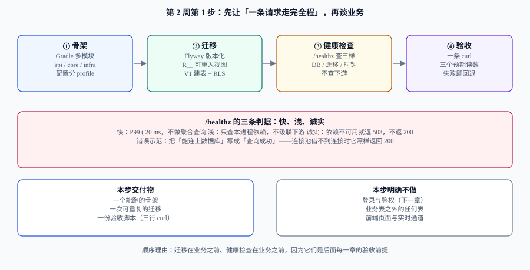

# 工程骨架与最小可跑集：从空目录到 /healthz

第 1 周把**设计和边界**全部定完了：租户模型、索引列序、事件顺序、拖动写入路径、四类角色、88 条判据。第 2 周要开始写代码——但第一步不是写业务逻辑，而是先让**一条请求能从端口走到数据库再走回来**。

这一步的产物很小：一个能编译的骨架、一次可重复的迁移、一个诚实的 `/healthz`。它的价值在于**它是后面每一章的验收前提**：没有骨架，拖动的并发实验跑不起来；没有迁移，索引与 RLS 只存在于文档里；没有健康检查，部署与灰度没有探针可用。

## 判据族声明

本页判据族 `BS-A` ~ `BS-H`，共 8 条。定义表在第十一节。

## 一、为什么第一步不是业务代码

第 1 周的所有结论都是**关于约束的**：租户条件必须进 SQL、顺序号必须全局单调、一次拖动只能改一行、越权必须返回 404。这些约束有一个共同点——**它们只有在「请求真的走到数据库」时才可能被证伪**。

在骨架之前写业务代码，会得到三种返工：

| 顺序 | 会发生什么 |
| --- | --- |
| 先写业务，后补骨架 | 事务边界与租户上下文散落在各处，`set_config` 写在了 autocommit 里（第 152 天实测：静默失效、0 行、不报错） |
| 先写业务，后补迁移 | 表结构靠手改，索引列序与文档不一致，`EXPLAIN` 读数全部作废 |
| 先写业务，后补健康检查 | 上线时探针只能指 `/`，容器「活着但用不了」，滚动更新把流量打到未就绪实例 |

所以顺序是：**骨架 → 迁移 → 健康检查 → 第一条读接口 → 业务**。

## 二、八个目录，每个都有「不做什么」



```text
team-board/
├─ settings.gradle.kts          # 多模块声明（根）
├─ build.gradle.kts             # 公共插件、版本目录、Java 25 toolchain
├─ gradle/libs.versions.toml    # 版本目录：所有依赖版本只在这里出现
├─ api/                         # 只放「入口」：Controller、DTO、过滤器、异常映射
├─ core/                        # 领域与应用服务：不依赖 Spring Web
├─ infra/                       # 持久化、缓存、消息：实现 core 定义的端口
├─ migrations/                  # Flyway SQL，唯一允许改表结构的地方
├─ contracts/                   # OpenAPI 与本项目的错误码清单
└─ deploy/                      # compose、环境变量模板、启动脚本
```

| 目录 | 放什么 | **不做什么** | 判据 |
| --- | --- | --- | --- |
| `api` | HTTP 入口、参数校验、错误码映射 | 不写业务规则、不直接操作 `JdbcTemplate` | `BS-B` |
| `core` | 聚合、应用服务、事务边界 | 不依赖 `spring-web`（靠依赖检查拦） | `BS-C` |
| `infra` | 仓储实现、`set_config` 的唯一落点、outbox 投递 | 不定义业务接口（端口在 `core`） | `BS-D` |
| `migrations` | 版本化 SQL | 不放数据修补脚本（用 `R__` 可重入脚本） | `BS-E` |
| `contracts` | OpenAPI 片段、错误码表 | 不放实现 | —— |
| `deploy` | 编排与配置模板 | 不放密钥明文 | —— |

::: warning 目录边界不靠自觉，靠构建
`core` 不依赖 Web 这件事，写成约定会在第三周被破坏（有人为了拿 `@Transactional` 的注解顺手引了 Spring）。**正确写法**：在 `core/build.gradle.kts` 里只声明 `spring-tx` 与 `spring-context`，不声明 `spring-boot-starter-web`；一旦有人引入，编译期就失败。
:::

## 三、构建文件：版本只出现一次

```kotlin
// settings.gradle.kts
rootProject.name = "team-board"
include("api", "core", "infra")
```

```kotlin
// build.gradle.kts（根）
plugins {
    java
    id("org.springframework.boot") version "4.1.0" apply false
    id("io.spring.dependency-management") version "1.1.7"
}

subprojects {
    apply(plugin = "java")
    java {
        toolchain { languageVersion = JavaLanguageVersion.of(25) }   // LTS
    }
    repositories { mavenCentral() }
    tasks.withType<JavaCompile> {
        options.encoding = "UTF-8"
        options.compilerArgs.addAll(listOf("-Xlint:all", "-Werror"))  // 警告即失败
    }
}
```

```toml
# gradle/libs.versions.toml —— 所有版本只在这里出现一次
[versions]
springBoot = "4.1.0"
flyway = "11.7.2"
postgres = "42.7.5"

[libraries]
flyway-core = { module = "org.flywaydb:flyway-core", version.ref = "flyway" }
flyway-pg   = { module = "org.flywaydb:flyway-database-postgresql", version.ref = "flyway" }
postgres    = { module = "org.postgresql:postgresql", version.ref = "postgres" }
```

三条纪律：

1. **版本目录是唯一来源**，子模块里不出现硬编码版本号（`BS-F`）。
2. **警告即失败**（`-Werror`）：`-Xlint:all` 打开的告警里，`deprecation` 与 `unchecked` 是最容易在三个月后变成 bug 的两类。
3. **Java 25 toolchain** 写死，不用 `JAVA_HOME`——否则 CI 与本机会跑出两个字节码版本。

## 四、配置三分：同一份镜像跑在三套环境

```yaml
# api/src/main/resources/application.yaml —— 只放「结构」，不放值
spring:
  datasource:
    url: ${DB_URL}
    username: ${DB_USER}
    password: ${DB_PASSWORD}
    hikari:
      maximum-pool-size: ${DB_POOL_SIZE:20}
      connection-timeout: 3000
  flyway:
    enabled: true
    locations: classpath:db/migration
    validate-on-migrate: true          # 校验和变了就启动失败，不许静默跳过
server:
  port: ${PORT:8080}
  shutdown: graceful
management:
  endpoints:
    web:
      exposure:
        include: health,info,prometheus
  endpoint:
    health:
      probes:
        enabled: true                  # 暴露 /healthz 与 /readyz
```

| 层 | 放什么 | 例子 | 谁能改 |
| --- | --- | --- | --- |
| 结构 | 有哪些配置项、默认值 | `maximum-pool-size: ${DB_POOL_SIZE:20}` | 开发 |
| 环境值 | 每套环境不同的值 | `DB_URL` | 运维（部署时注入） |
| 密钥 | 口令、令牌 | `DB_PASSWORD` | 密钥管理（见 [配置与密钥](../ConfigSecrets/index.md)） |

::: danger 三个必须避免的写法
1. **在 `application.yaml` 里写死环境值**。换环境就要改代码，最后演变成「每个环境一个分支」。**正确写法**：值一律走环境变量，yaml 里只留占位与默认值。
2. **`validate-on-migrate: false`**。它会让「迁移被改过」这件事静默通过，多人协作时必然出现两份不同的 `V1__init.sql`。**正确写法**：保持 `true`，改历史迁移的代价大，但比数据库结构不可信便宜。
3. **把 `management.endpoints.web.exposure.include` 写成 `*`**。生产环境会连带暴露 `env`、`heapdump`。**正确写法**：白名单 `health,info,prometheus` 三项。
:::

## 五、迁移：一次可重复，且只向前

迁移是本章唯一「写进数据库」的动作，纪律比内容重要：

| 纪律 | 做法 | 违反后的现象 |
| --- | --- | --- |
| 版本化 | `V1__core_schema.sql`、`V2__...`，**已提交的文件不再修改** | 校验和冲突，启动失败（这是好事） |
| 可重入脚本单独命名 | 视图/函数用 `R__views.sql`，每次启动重跑 | 用 `V` 脚本改视图 → 每次都要新建一个版本 |
| 只向前 | 回退靠「新写一个 V 脚本抵消」，不做 `undo` | 有人手改数据库，环境之间出现漂移 |
| 与代码同 PR | 表结构变更与使用它的代码在同一个提交里 | 上线顺序错，出现「代码已上线、列还不存在」 |

```sql
-- migrations/V1__core_schema.sql（本章只建三张最小表，其余在第 2 周第 2 步扩展）
create table tenant (
  id          uuid primary key default uuidv7(),
  slug        text not null unique,
  created_at  timestamptz not null default now()
);

create table board (
  id          uuid primary key default uuidv7(),
  tenant_id   uuid not null references tenant(id),
  name        text not null,
  created_at  timestamptz not null default now(),
  unique (tenant_id, id)                     -- 让子表能用 (tenant_id, board_id) 做复合外键
);

create table card (
  id          uuid primary key default uuidv7(),
  tenant_id   uuid not null,
  board_id    uuid not null,
  title       text not null,
  version     int  not null default 1,
  created_at  timestamptz not null default now(),
  foreign key (tenant_id, board_id) references board (tenant_id, id)
);

alter table board enable row level security;
alter table board force  row level security;
alter table card  enable row level security;
alter table card  force  row level security;

create policy board_tenant_isolation on board
  using      (tenant_id = nullif(current_setting('app.tenant_id', true), '')::uuid)
  with check (tenant_id = nullif(current_setting('app.tenant_id', true), '')::uuid);

create policy card_tenant_isolation on card
  using      (tenant_id = nullif(current_setting('app.tenant_id', true), '')::uuid)
  with check (tenant_id = nullif(current_setting('app.tenant_id', true), '')::uuid);

create index card_board_idx on card (tenant_id, board_id, id);
```

::: danger 迁移里最容易埋的两个雷
1. **先建策略，后 `FORCE`**。只 `enable` 不 `force`，表 owner 仍然绕过 RLS——而应用常常用表 owner 连库。**正确写法**：`enable` 与 `force` 成对出现，并把应用连接用户设成非 owner（见 [运维面守卫](../OpsGuard/index.md)）。
2. **`uuidv7()` 在低版本 PG 上不存在**。它是 PG 18 才有的内置函数；用 PG 17 及以下会直接迁移失败。**正确写法**：启动前确认 `select version()`，或改用 `gen_random_uuid()` + 应用侧生成（顺序性会变差，见 [事件表与顺序字段](../EventSequence/index.md)）。
:::

## 六、`/healthz` 的三条判据：快、浅、诚实

健康检查写错的方式只有一种：**它检查的东西比它承诺的多**。

| 判据 | 要求 | 反例 |
| --- | --- | --- |
| **快** | P99 < 20 ms，不做聚合查询 | 在健康检查里 `count(*)` 一张大表 |
| **浅** | 只查本进程的直接依赖（连接池可用、迁移版本正确） | 级联检查下游三个服务，下游抖动导致本服务被重启 |
| **诚实** | 依赖不可用返 `503`，不返 `200` | 只 `try { conn } catch { log }`，永远返回 `UP` |

```java
// api/src/main/java/.../health/TenantAwareHealthIndicator.java
@Component("db")
class DbHealthIndicator implements HealthIndicator {

    private final JdbcTemplate jdbc;
    private final DataSource ds;

    @Override
    public Health health() {
        try (Connection c = ds.getConnection()) {          // 借不到连接 → 直接失败
            String ver = jdbc.queryForObject(
                "select version from flyway_schema_history order by installed_rank desc limit 1",
                String.class);
            // 只做一次常量查询：不扫表、不聚合
            Integer one = jdbc.queryForObject("select 1", Integer.class);
            return Health.up()
                .withDetail("schemaVersion", ver)
                .withDetail("ping", one)
                .build();
        } catch (Exception e) {
            return Health.down(e).build();                 // 诚实：异常即 DOWN → HTTP 503
        }
    }
}
```

三个细节值得单独说：

1. **`getConnection()` 而不是 `queryForObject("select 1")` 起手**：连接池耗尽时前者会等到超时后抛异常，后者同样会等，但报错更模糊。先借连接，能把「池满」与「SQL 错」分开。
2. **健康检查里不要带租户上下文**。它跑在探针线程上，没有请求头；若 RLS 策略已经生效而 `app.tenant_id` 为空，`select 1` 不受影响，但一旦改成查业务表就会返回 0 行——看起来「健康」而其实什么都读不到。这属于第 152 天记录过的「静默 0 行」。
3. **`/healthz` 与 `/readyz` 分开**：`/healthz`（liveness）只回答「进程要不要重启」，`/readyz`（readiness）回答「能不能接流量」。把数据库检查放进 liveness，会让一次数据库抖动重启所有实例——这是最常见的自伤式配置。

## 七、一条请求走完全程

本章的最后一步不是「能启动」，而是**一条请求能带着租户上下文走到 SQL**。最小链路：

```text
curl -H "X-Tenant: acme" /api/boards
  → TenantFilter：解析 X-Tenant，查 tenant.id，放进作用域（ScopedValue）
  → 事务开启（REQUIRED）
  → 仓储：set_config('app.tenant_id', ?, true)   ← 必须在事务内
  → select ... from board where tenant_id = ?    ← RLS 再挡一层
  → 返回 JSON
```

两个实现要点（详细论证在 [租户上下文](../TenantContext/index.md) 与 [租户上下文与索引设计](../TenantIndexing/index.md)）：

```java
// infra：set_config 的唯一落点。第三个参数 true = 事务级，事务结束自动失效
void bindTenant(Connection c, UUID tenantId) throws SQLException {
    try (PreparedStatement ps = c.prepareStatement("select set_config('app.tenant_id', ?, true)")) {
        ps.setString(1, tenantId.toString());
        ps.execute();
    }
}
```

::: danger `set_config(..., true)` 的两个静默失效
1. **不在显式事务里**：autocommit 下事务级设置**随语句结束即失效**，表现为「一条语句 0 行、不报错」。**正确写法**：`bindTenant` 必须与业务查询在同一个 `@Transactional` 里，且在查询之前调用。
2. **在连接池里跨请求复用**：如果用了会话级（第三个参数 `false`），租户值会跟连接一起被下一个请求继承。**正确写法**：一律 `true`；需要跨语句时用同一个事务，不要靠会话变量。
:::

## 八、验收：五步，每步一个读数

| 步 | 命令 | 预期读数 |
| --- | --- | --- |
| ① 起库 | `docker compose -f deploy/compose.yaml up -d postgres` | `docker compose ps` 显示 `healthy` |
| ② 迁移 | `./gradlew :api:bootRun --args='--spring.flyway.enabled=true'` | 日志出现 `Successfully applied 1 migration`，`flyway_schema_history` 有 1 行 |
| ③ 启动 | `./gradlew :api:bootRun` | 日志出现 `Started ApiApplication in X seconds`，端口 8080 监听 |
| ④ 探针 | `curl -s -o /dev/null -w '%{http_code}' localhost:8080/actuator/health/liveness` | `200` |
| ⑤ 一条请求 | `curl -s -H 'X-Tenant: acme' localhost:8080/api/boards` | `[]`（空数组，不是 500、不是 401） |

::: tip 第 ⑤ 步的「空数组」比「有数据」更重要
新建库没有任何看板，返回 `[]` 说明**整条链路都通了**：租户解析 → 上下文绑定 → RLS 策略 → JSON 序列化。返回 `500` 说明某处炸了；返回 `403`/`404` 说明策略或过滤条件把请求挡了；返回 `{"error":...}` 说明错误映射已生效——这三种都是**有信息量的失败**，只有超时没有信息。
:::

## 九、本步明确不做

| 不做 | 为什么 | 什么时候做 |
| --- | --- | --- |
| 登录与鉴权 | 认证链路需要令牌表与刷新策略，属于第 2 周第 2 步 | 下一步 |
| 卡片拖动与事件表 | 依赖 `board_events` 的 `seq` 设计，需要先有稳定的写入路径 | 第 2 周第 3 步 |
| 前端页面 | 后端契约还没定稿，先写页面会返工 | 第 2 周第 4 步 |
| 实时通道 | WebSocket 依赖鉴权与订阅模型 | 第 2 周第 5 步 |
| 压测与容量 | 没有业务接口，压测没有意义 | 第 3 周 |

## 十、下一步

第 2 周第 2 步：**认证与租户成员关系**——`X-Tenant` 换成令牌解析出的租户，`tenant_member` 表落地角色（owner / editor / viewer / guest），并把「未登录 / 无该租户成员身份 / 有身份无权限」三种失败分别映射到 `401` / `404` / `403`。判据从「能返回空数组」升级为「跨租户访问必须 404」。

## 十一、判据定义表

| 判据 | 约定 | 定错了会怎样 | 怎么验证 |
| --- | --- | --- | --- |
| `BS-A` | 顺序固定：骨架 → 迁移 → 健康检查 → 第一条读接口 | 事务与上下文散落，后期返工 | 提交历史顺序可查 |
| `BS-B` | `api` 层不出现业务规则与直接 SQL | 规则两处实现，行为不一致 | `grep -rn "JdbcTemplate" api/` 为 0 |
| `BS-C` | `core` 不依赖 `spring-boot-starter-web` | 领域层被 Web 语义污染，无法单测 | `./gradlew :core:dependencies` 无 web starter |
| `BS-D` | `set_config` 只在 `infra` 出现一次 | 多处写法不一致，事务级别用错 | `grep -rn "set_config" --include=*.java` 计数为 1 |
| `BS-E` | 迁移只向前，已提交的 `V*.sql` 不再修改 | 校验和冲突或环境漂移 | CI 校验 `flyway_schema_history` 校验和 |
| `BS-F` | 依赖版本只出现在 `libs.versions.toml` | 多模块版本漂移，运行期冲突 | 子模块构建文件无硬编码版本 |
| `BS-G` | liveness 不检查数据库，readiness 才检查 | 数据库抖动导致全量重启 | 探针配置里两个端点分组不同 |
| `BS-H` | 健康检查依赖异常必须返回 `503` | 容器「活着但用不了」 | 停库后 `curl` 返回 `503` 而非 `200` |

## 如何验证

```shell
# ① 骨架能编译（本机需 JDK 25）
./gradlew :api:compileJava :core:compileJava :infra:compileJava
```

**预期输出**：`BUILD SUCCESSFUL`。出现 `warning:` 即失败——因为 `-Werror` 已打开，警告被提升为错误。

```shell
# ② 迁移是否真的被应用（不是「日志说成功」）
psql "$DB_URL" -c "select version, description, success from flyway_schema_history order by installed_rank;"
```

**预期输出**：1 行，`version = 1`、`success = t`。行数为 0 说明迁移没跑（常见原因：`spring.flyway.locations` 指向了不存在的路径，此时 Flyway 不报错，只是「没有可应用的迁移」）。

```shell
# ③ RLS 是否真的在拦：换一个租户查同一个看板，应为 0 行
psql "$DB_URL" -c "begin; select set_config('app.tenant_id','11111111-1111-1111-1111-111111111111',true); select count(*) from board; rollback;"
```

**预期输出**：`count = 0`。若返回非 0，说明 `FORCE ROW LEVEL SECURITY` 没生效（当前连接是表 owner）。

```shell
# ④ 探针的「诚实性」：停掉数据库后 liveness 仍 200、readiness 变 503
docker compose -f deploy/compose.yaml stop postgres
curl -s -o /dev/null -w 'live=%{http_code}\n' localhost:8080/actuator/health/liveness
curl -s -o /dev/null -w 'ready=%{http_code}\n'  localhost:8080/actuator/health/readiness
```

**预期输出**：`live=200` 与 `ready=503`。两个都是 `200` 说明 readiness 没接数据库检查；两个都是 `503` 说明数据库检查被放进了 liveness——**后者在生产里会造成重启风暴**。

## 参考资料

- [Spring Boot · Actuator Health](https://docs.spring.io/spring-boot/reference/actuator/endpoints.html)——`liveness` / `readiness` 探针的语义
- [Flyway · Migrations](https://documentation.red-gate.com/flyway/flyway-cli-and-api/concepts/migrations)——版本化迁移与校验和
- [PostgreSQL · Row Security Policies](https://www.postgresql.org/docs/current/ddl-rowsecurity.html)——`ENABLE` / `FORCE` 的差别
- [Gradle · Version Catalogs](https://docs.gradle.org/current/userguide/version_catalogs.html)——`libs.versions.toml` 的用法
- 上一站：[第 1 周施工 FAQ](../Week1FAQ/index.md) · 下一站：[租户上下文](../TenantContext/index.md) · 相关：[环境与工程骨架](../Environment/index.md)、[配置与密钥](../ConfigSecrets/index.md)
