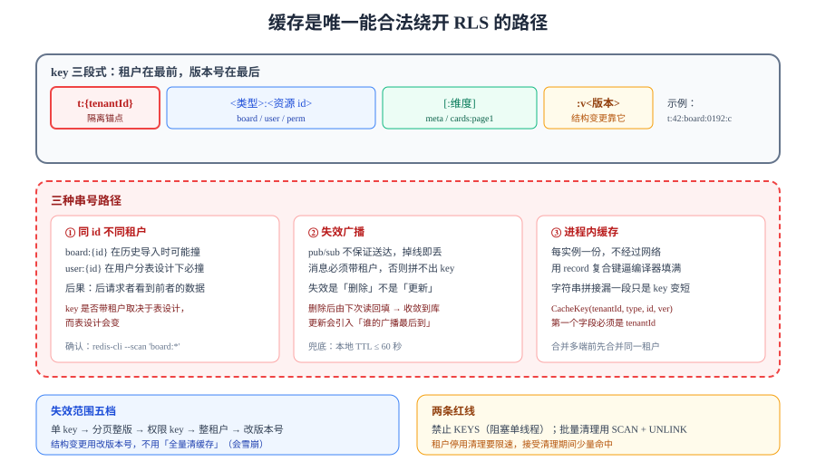

# 缓存隔离：那条绕过 RLS 的捷径

行级安全只保护**经过数据库**的读。缓存命中时数据库根本没被访问，`app.tenant_id` 也就没有被比较过——**缓存是这套系统里唯一一条能合法绕开 RLS 的路径**。本页把这条路径的三种串号方式、key 的三条纪律与失效策略写死。



::: tip 本页与第 1 周已有页面的分工
第 1 周先落了[多租户隔离](../MultiTenancy/index.md)（库级边界）、[租户上下文与索引设计](../TenantIndexing/index.md)（上下文传递与索引前缀）、[事件表与顺序字段](../EventSequence/index.md)（断线追平的游标）。这三页讲的都是**数据库里的边界**；本页补的是边界之外那一层：**缓存里没有 `where` 子句**，隔离必须由 key 结构自己承担。前几页的结论本页直接引用，不重复推导。
:::

## 判据族声明

本页判据族 `CAI-A` ~ `CAI-H`，共 8 条。定义表在第七节。

## 一、为什么缓存必须自己承担隔离责任

| 路径 | 是否经过 RLS | 隔离责任在谁 |
| --- | --- | --- |
| 直接查库 | ✅ 经过（`app.tenant_id` 参与策略） | 数据库 |
| 缓存命中 | ❌ 不经过 | **缓存 key 的设计者** |
| 缓存未命中后回填 | ✅ 回填那次经过 | 数据库 + 回填逻辑 |
| 本地缓存（Caffeine / 进程内 Map） | ❌ 不经过，且**每个实例各一份** | 同上，且多一层「实例间不一致」 |

表格第三行是关键：**同一条读请求，第一次走数据库（被 RLS 保护），第二次走缓存（不被保护）**。这意味着「第一次测通了」完全不能说明第二次是对的。

::: danger 一个真实存在的错误推理
「缓存里存的都是已经通过 RLS 过滤的数据，所以读缓存是安全的。」
——不成立。**缓存不记录「这份数据是谁的」**，它只记录「这个 key 对应的 value」。当 key 里没有租户时，A 的请求回填的数据会被 B 的请求命中。RLS 保护的是「查询」，不是「查询结果的存放位置」。
:::

## 二、key 的三段式与三条纪律

本项目统一 key 形态：

```text
t:{tenantId}:<资源类型>:<资源 id>[:<维度>]:v<版本号>
```

四个例子（同一份数据的不同视图）：

```text
t:42:board:0192f3c1-...:meta:v3          # 看板元信息
t:42:board:0192f3c1-...:cards:page1:v3   # 第一页卡片
t:42:user:1007:unread:v1                 # 未读数
t:42:perm:1007:board:0192f3c1-...:v1     # 某人在某板上的角色
```

三条纪律，每条对应一种失效：

| 纪律 | 违反后果 | 检查方式 |
| --- | --- | --- |
| **① 租户段在最前** | 按租户清理时要全库 `SCAN`；key 前缀冲突（`board:` 与 `board-meta:`） | `redis-cli --scan --pattern 't:*'` 能列出全部；`t:` 之后紧跟 tenant |
| **② 版本号进 key** | 结构变更（多一个字段）时旧 value 反序列化失败或字段缺失 | `grep -rn "v[0-9]" src/**/cache/` 每个 key 模板都带 `v` |
| **③ 不用「可推导的全局 id」当唯一维度** | `board:{id}` 这种形态在 id 重复时串号 | key 模板里必须出现 `t:` 段，且**不能**在 `t:` 之外出现资源 id 作为第一段 |

::: warning 版本号不是「发布版本」，是「缓存结构版本」
它解决的是「昨天缓存的是 5 个字段的 JSON，今天代码要读 6 个字段」。发版时把 `v3` 改成 `v4`，旧 key 自然过期，不需要写迁移。这条比「发版时全量清缓存」更安全——后者在发版瞬间会造成**缓存雪崩**（所有请求同时落到数据库）。
:::

## 三、三种串号路径

### 路径 1：同 id 不同租户

`board_id` 是 UUIDv7，碰撞概率极低，所以「两个租户有同一个 board_id」看起来不可能。但缓存 key 里**往往不是 board_id，而是业务上「看起来唯一」的字段**：

| key 形态 | 什么时候会撞 | 后果 |
| --- | --- | --- |
| `board:{id}` | 历史数据导入、测试数据复制、UUID 生成器被替换 | 后请求者看到前请求者的板 |
| `user:{id}:unread` | **跨租户的用户 id 是从同一个序列分配的**——这是最容易撞的一种 | 未读数串号（看起来只是「数字不对」，实际上是读到了别人的数据） |
| `perm:{userId}:{boardId}` | 用户 id 与看板 id 都唯一，但**权限是 (租户, 用户, 看板) 三元组** | 权限判断用错租户 |

`user:{id}:unread` 这条最值得单独说：用户表如果是**全局一张表**（本项目就是），`user_id` 全局唯一，key 不撞；但如果用户表是**按租户分表**（另一种常见设计），`user_id` 在每个租户内从 1 开始，`user:1007:unread` 立刻就会串。**所以 key 里带不带租户，取决于表的设计而不是「看起来唯不唯一」**——而表的设计会变，key 的形态不该跟着变。

### 路径 2：失效广播

多实例部署时，一次写操作要让所有实例的**本地缓存**失效。常见做法是 Redis 发布订阅：

```java [src/main/java/com/example/team/cache/InvalidationPublisher.java]
public void publish(long tenantId, String boardId) {
    // 频道名带租户：订阅方可以只订阅自己关心的租户（一般不需要，但便于排查）
    redis.convertAndSend("cache:invalidate", tenantId + ":" + boardId);
}
```

两条纪律：

1. **广播消息里必须带租户**，不能只带 `boardId`——订阅方要靠它拼出完整的本地 key；只带 `boardId` 时，订阅方只能「把所有租户下这个 boardId 的 key 都删掉」，而它并不知道有哪些租户。
2. **失效是「删除」不是「更新」**：发送新 value 会让并发写的顺序问题变成「谁的广播最后到，谁的值生效」，而删除后由下一次读回填，天然收敛到数据库的当前值。

::: danger 失效丢失是最容易被忽略的
发布订阅**不保证送达**（没有 ack、没有重投）。订阅方掉线期间的所有失效消息都丢了。所以本地缓存**必须有 TTL**——它是失效丢失时的唯一兜底。`CAI-F` 就是这条：本地缓存 TTL 必须存在且 ≤ 60 秒。
:::

### 路径 3：进程内缓存

`Caffeine` 这类进程内缓存在每个实例里各有一份，不经过网络，速度最快，也最容易串：

```java [src/main/java/com/example/team/cache/LocalCacheConfig.java]
@Bean
Cache<CacheKey, Object> localCache() {
    return Caffeine.newBuilder()
        .maximumSize(50_000)
        .expireAfterWrite(Duration.ofSeconds(30))   // TTL 是失效丢失的兜底
        .build();
}

/** key 必须是复合键，租户是其中一段。 */
public record CacheKey(long tenantId, String type, String id, int version) {}
```

用 `record` 做 key 的好处是：**编译器逼着你填满所有字段**。用字符串拼接（`tenantId + ":" + id`）时，漏一段只是「key 变短了」，运行期才会发现。

## 四、失效：按租户失效与全局失效

| 场景 | 失效范围 | 做法 | 代价 |
| --- | --- | --- | --- |
| 一张卡片改名 | 单个 key | `UNLINK t:42:board:{id}:cards:page1:v3` | 极小 |
| 一张卡片移动到另一列 | 该板的分页 key（可能多页） | 按前缀 `SCAN` + `UNLINK`，或把分页整体版本号 +1 | 中 |
| 成员角色变更 | 该用户在该板的所有权限 key | `UNLINK` 精确 key（权限 key 可枚举） | 小 |
| 租户被停用 | 该租户全部 key | `SCAN MATCH t:42:* ` + 分批 `UNLINK` | 大（要限速） |
| 缓存结构变更 | 全部 | **改版本号 `v3` → `v4`**，旧 key 自然过期 | 零（但旧 key 占内存到 TTL 到期） |

::: warning 生产环境禁止 `KEYS`，也慎用大 `SCAN`
`KEYS t:42:*` 会阻塞 Redis 单线程（本项目 Redis 是共享实例，阻塞 100 ms 就会让所有接口的 P99 抖动）。正确做法是 `SCAN` 游标循环 + 每批 `UNLINK`（异步释放内存）+ 批间 sleep。
租户停用这种「大批量清理」应当**限速**（例如每秒 500 个 key），并且接受「清理期间仍有少量命中」——因为停用本身已经在鉴权层挡住了访问。
:::

## 五、多租户把击穿与穿透都放大了

| 问题 | 单租户下的表现 | 多租户下的放大 |
| --- | --- | --- |
| **缓存击穿**（热 key 过期，大量请求同时回源） | 一个 key 被打穿 | **每个租户各一个热 key，同一时刻过期**（如果 TTL 是写入时统一设置的），于是 N 个租户同时打穿 |
| **缓存穿透**（查不存在的 id，每次都回源） | 少量无效查询 | 越权探测会**故意**查不存在的 id，穿透量与被攻击强度成正比 |
| **缓存雪崩**（大面积同时过期） | 一次 | 同上，且清理租户时若误删公共 key 会引发全局雪崩 |

三条对策（都便宜）：

1. **TTL 加抖动**：`base + random(0, base/10)`，避免同批写入的 key 同时过期。
2. **空值也缓存，但只缓存 30 秒**：不存在的 id 回填一个 `NULL` 占位，既挡住穿透，又不会让「刚创建的对象」长时间查不到。
3. **回源加单飞（single-flight）**：同一 key 的并发回源只放一个进数据库，其余等结果。这条在越权探测场景下同时是**防打穿**和**防拖库**。

::: tip 空值缓存与越权的关系
「查不存在的 id」和「查别人的 id」在缓存层看起来一样——都是「没命中 → 回源 → 0 行」。如果对两者都缓存空值，那么越权探测的响应时间与「查不存在」完全一致，**不会通过时间差泄漏存在性**。这算是空值缓存的一个副作用好处。
:::

## 六、锁的 key 也要带租户

分布式锁的 key 如果写成 `lock:board:{id}`，两个租户的同一 `boardId` 会**互相阻塞**——不是数据错，是「A 的操作让 B 排队」。这类问题在监控上表现为「偶发超时」，极难定位（锁的实现与租约详见[分布式缓存](/docs/Backend/DistributedCache/index.md)的锁章节）。

```text
lock:t:42:board:0192f3c1-...:reorder      # 正确
lock:board:0192f3c1-...:reorder           # 错误：跨租户互相阻塞
```

同理，**限流的 key**、**幂等键的去重表**、**任务队列的队列名**都要带租户段。一条通用判据：**凡是「按某个 id 做互斥/去重/排队」的地方，那个 id 前面都要有租户**。

## 七、判据表

| 编号 | 判据 | 怎么验证 | 本机读数 |
| --- | --- | --- | --- |
| `CAI-A` | 所有缓存 key 以 `t:{tenantId}:` 开头 | `redis-cli --scan --pattern 't:*'` 覆盖全部业务 key；抽样检查 key 前缀 | 待跑（无工程） |
| `CAI-B` | 每个 key 模板带结构版本号 | `grep -rn "t:" src/main/java` 每条模板以 `:v<数字>` 结尾 | 待跑（无工程） |
| `CAI-C` | 两租户并发读同一 `boardId` 得到各自数据 | 两终端并发 `curl`，比较响应体中的 `tenantId` 回显 | 待跑（无工程） |
| `CAI-D` | 进程内缓存 key 为复合键（含租户段） | `grep -rn "record CacheKey" src/` 第一个字段是 `tenantId` | 待跑（无工程） |
| `CAI-E` | 失效广播消息带租户，且是「删除」语义 | 订阅端日志打印收到的消息，形如 `42:<boardId>`；处理动作是 `UNLINK` | 待跑（无工程） |
| `CAI-F` | 本地缓存有 TTL 且 ≤ 60 秒 | `grep -rn "expireAfterWrite" src/` 参数 ≤ 60 秒 | 待跑（无工程） |
| `CAI-G` | 锁/限流/去重的 key 都带租户段 | `grep -rn "lock:" src/` 每条含 `t:`（`ratelimit:` 与 `dedup:` 同理） | 待跑（无工程） |
| `CAI-H` | 批量清理用 `SCAN` + `UNLINK`，不用 `KEYS` | `grep -rn "KEYS " src/` 期望 0 命中 | 待跑（无工程） |

## 八、当日做了什么

1. **定性**：缓存是这套系统里唯一能合法绕开 RLS 的路径，隔离责任从数据库转移到 **key 的设计者**。并驳掉一条常见错误推理（「缓存里是已过滤的数据，所以安全」）。
2. **定死 key 的三段式**：`t:{tenantId}:<类型>:<id>[:维度]:v<版本>`，配三条纪律（租户在最前、版本号进 key、不用全局 id 当唯一维度），每条给出失效后果与检查方式。
3. **列出三种串号路径**：同 id 不同租户（重点是 `user:{id}:unread`——用户表分表与否决定它撞不撞）、失效广播（消息必须带租户、失效是删除不是更新）、进程内缓存（用 `record` 复合键让编译器逼着填满字段）。
4. **给出五类失效场景的对照表**（单 key、分页、权限、整租户、结构变更），并写明「结构变更用改版本号」比「全量清缓存」安全——后者会造成雪崩。
5. **补两条运维红线**：禁止 `KEYS`、批量清理要限速；并说明 Redis 是共享实例时阻塞 100 ms 的连带影响。
6. **把击穿/穿透/雪崩在多租户下的放大讲清**，给出三条便宜对策（TTL 抖动、空值短缓存、单飞回源），并指出空值缓存顺带消除了时间差泄漏。
7. **把「凡是互斥/去重/排队的地方，id 前面都要有租户」写成一条通用判据**，覆盖锁、限流、幂等键、队列名。
8. **定稿 `CAI-A~CAI-H` 八条判据**，全部写成可执行的 `redis-cli` / `grep` 形式。

## 九、如何验证

```shell
# 1) key 形态：抽查 20 个业务 key，期望全部以 t:<数字>: 开头
redis-cli --scan --pattern 't:*' | head -20

# 2) 是否有漏租户的 key（最常见的两种错误形态）
redis-cli --scan --pattern 'board:*' | head     # 期望空
redis-cli --scan --pattern 'user:*'  | head     # 期望空（业务 key 必须带 t: 段）

# 3) 两租户并发读同一 boardId：期望两次响应的 tenant 回显不同
for t in "$TOKEN_A" "$TOKEN_B"; do
  curl -s -H "Authorization: Bearer $t" http://localhost:8080/api/boards/$BOARD_ID | head -c 200; echo
done

# 4) 失效广播的可观测：改一次标题，看订阅端是否收到带租户的消息
redis-cli subscribe cache:invalidate &
curl -s -X PATCH -H "Authorization: Bearer $TOKEN_A" \
  -H "Content-Type: application/json" \
  -d '{"title":"renamed"}' http://localhost:8080/api/cards/$CARD_ID
```

判读：第 2 步若出现输出，说明存在「不带租户段」的 key 家族——先别急着删，因为**它可能正在被线上请求读写**，正确顺序是先改代码、发版、再清理旧 key（靠 TTL 自然过期）。

## 十、下一步

- 缓存之外，还有一条不经过 SQL 的读路径：**检索与导出**，见[读路径隔离](../SearchIsolation/index.md)。
- 事件推送的「主题命名空间」与本页的 key 前缀是同一个问题的两种形态：见[事件与推送隔离](../EventIsolation/index.md)。
- 缓存与数据库谁先写的取舍，通用部分见[分布式缓存](/docs/Backend/DistributedCache/index.md)；本页只补「租户段」这一维。
- 第 1 周全部收口：[第 1 周验收](../Week1Acceptance/index.md)。

## 参考资料

- [Redis 文档 · SCAN](https://redis.io/docs/latest/commands/scan/)——游标语义、`MATCH` 与 `COUNT`、为什么不能用 `KEYS`。
- [Redis 文档 · Cluster specification（hash tags）](https://redis.io/docs/latest/operate/oss_and_stack/reference/cluster-spec/)——`{...}` 只影响槽计算；同租户共槽的代价见本节第三条纪律的取舍。
- [Caffeine · Policy](https://github.com/ben-manes/caffeine/wiki/Policy)——`expireAfterWrite` 与 `maximumSize` 的语义。
- 项目内：[租户上下文](../TenantContext/index.md) · [跨租户用例矩阵](../CrossTenantMatrix/index.md)（缓存键漏租户那一格）
- 技术专题：[分布式缓存](/docs/Backend/DistributedCache/index.md) · [Redis 高级用法](/docs/DB/NoRelational/Redis/Advanced/index.md)
