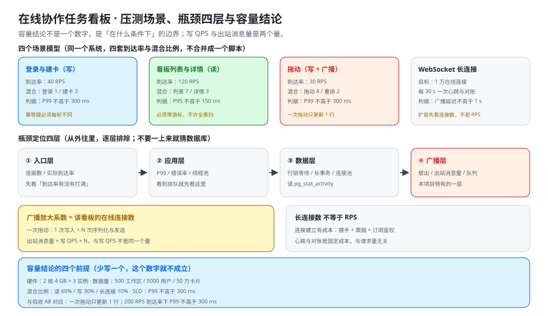

# 压测与容量验收：把「能扛多少」变成有前提的结论

这一页回答「怎么量、量出什么才叫结论、量出来的数字在什么前提下才成立」——它把四个场景模型、瓶颈定位四层、广播放大系数与容量结论的四个前提写成可执行的口径，并把它们和 [验收](../Acceptance/index.md) 的 `A8` 逐条对上；它**不回答**「并发下的正确性怎么验」（那是 [并发与幂等专项](../Concurrency/index.md) 的事），也**不回答**「一层的功能怎么测」（那是 [端到端测试](../E2ETest/index.md) 的事）。**压测与功能测试必须分开跑**，理由在第一节。



::: warning 本仓库只有文档，没有代码
下面的 k6 脚本、`psql` 对账查询与容器命令，都要在**你自己搭好的工程**里执行。本仓库不存放源码、脚本与压测数据；「运行 `k6 run`」一律指「先按本节把脚本建出来，再执行」。
:::

## 一、为什么压测与端到端不能合并

两者要的东西正好相反：

| 维度 | 端到端测试 | 压测 |
| --- | --- | --- |
| 目标 | 一条操作的**完整时序正确** | 目标到达率下的**分位数达标** |
| 请求量 | 个位数 | 每秒几十到几百 |
| 断言 | 每一步的状态与顺序 | `P95` / `P99` / 错误率 / 出站消息量 |
| 失败时的信息 | 哪一步不符合预期 | 哪**一层**先饱和 |
| 可否重跑 | 可，且应当稳定复现 | 只能比较，不能复现（机器状态会变） |

把两者合并的后果是双向的：**压测会因为「时序断言」而红（那不是容量问题），端到端会因为「并发量」而不稳（那不是产品问题）。** 所以本项目的口径是：`E2E-*` 只跑一次拖动、`CAP-*` 只跑到达率。

::: tip 一句话判据
**「这条断言需要多少请求才成立？」** 需要 1 条 → 它属于端到端；需要成百上千条 → 它属于压测。
:::

## 二、四个场景模型

同一个系统要有**四套**压测脚本，**不要合并成一个**。理由是四者的瓶颈位置不同：合并后你只能得到一个混合分位数，而它既不能指导扩容，也不能定位瓶颈。

| 场景 | 到达率 | 混合比例 | 判据 | 必须注意的一处 |
| --- | --- | --- | --- | --- |
| **登录与建卡（写）** | 40 RPS | 登录 1 / 建卡 3 | `P99` 不高于 300 ms | **幂等键必须每轮不同**，否则第二次开始全部被幂等短路，测的是「查重」不是「写」 |
| **看板列表与详情（读）** | 120 RPS | 列表 7 / 详情 3 | `P95` 不高于 150 ms | **必须带游标**，不许退化成全表扫 |
| **拖动（写 + 广播）** | 30 RPS | 拖动 8 / 重排 2 | `P99` 不高于 300 ms | **一次拖动只更新 1 行**（成本判据，见下） |
| **WebSocket 长连接** | —— | 目标 **1 万**在线连接 | 广播延迟不高于 1 s | 每 30 s 一次心跳与对账；**扩容先看连接数，不是 RPS** |

```javascript [k6/move.js]
import http from "k6/http";
import { check } from "k6";
import { Trend } from "k6/metrics";

export const moveDuration = new Trend("move_duration", true);

export const options = {
  scenarios: {
    move: {
      executor: "constant-arrival-rate",   // 开环：到达率固定，不被被测系统拖慢
      rate: 30,                            // 30 RPS
      timeUnit: "1s",
      duration: "5m",
      preAllocatedVUs: 60,
      maxVUs: 300,
    },
  },
  thresholds: {
    http_req_duration: ["p(99)<300"],
    http_req_failed: ["rate<0.001"],
  },
};

export default function () {
  const boardId = __ENV.BOARD_ID;
  const res = http.post(
    `http://localhost:8080/api/v1/boards/${boardId}/cards/${__VU}-${__ITER}/move`,
    JSON.stringify({
      targetColumnId: "doing",
      version: Number(__ENV.CARD_VERSION),
      clientOpId: crypto.randomUUID(),      // 每轮必须新：否则测的是幂等查重
    }),
    { headers: { "Content-Type": "application/json", Authorization: `Bearer ${__ENV.TOKEN}` } },
  );
  moveDuration.add(res.timings.duration);
  check(res, { "status is 200 or 409": (r) => r.status === 200 || r.status === 409 });
}
```

::: danger 三处会让压测数字失去意义的写法
1. **幂等键写死。** 第二次请求开始全部命中幂等短路，`P99` 会好看得离谱——而它测的是查重路径。
2. **用闭环（固定 VU）测容量。** `constant-vus` 测的是「给定并发下的服务时间」；系统变慢时它会自动少发请求，于是**永远压不垮**。容量结论必须用开环（`constant-arrival-rate`）。
3. **把 `409` 当成失败。** 拖动场景里 `409` 是**合法结果**（并发冲突）；把它计入错误率，压测就变成了「并发冲突率测试」。
:::

## 三、瓶颈定位四层

**从外往里，逐层排除**——不要一上来就猜数据库。

| 层 | 看什么 | 现象 | 第一处要读的读数 |
| --- | --- | --- | --- |
| **① 入口层** | 连接数 / 实际到达率 | 到达率打不满目标 | 「**到达率有没有打满**」——没打满就先解决生成器与网络，别往下看 |
| **② 应用层** | `P99` / 错误率 / 线程池 | 队列积压、`P99` 抬升 | 看到排队就先看这里（线程池活跃数、队列长度） |
| **③ 数据层** | 行锁等待 / 长事务 / 连接池 | 写入变慢、超时 | `pg_stat_activity`（见下） |
| **④ 广播层** | 扇出 / 出站消息量 / 队列 | 写没问题、另一端慢 | **本项目特有的一层**，见第四节 |

```shell
# ③ 数据层：先看有没有等锁的会话（期望：没有 long wait、没有 idle in transaction 超过 5s 的会话）
docker compose exec -T db psql -U app -d board -c \
"select pid, state, wait_event_type, wait_event, now()-xact_start as xact_age
   from pg_stat_activity
  where datname='board' and (wait_event_type='Lock' or state like 'idle in transaction%')
  order by xact_age desc nulls last limit 10;"

# ④ 广播层：扇出与出站队列（期望：队列深度不随时间单调上升）
curl -s localhost:8080/actuator/metrics/ws.outbound.queue.depth | jq '.measurements'
```

**四层的顺序不能跳。** 跳过①直接看③，最常见的误判是「把生成器打不满当成数据库慢」：`P99` 看着很差，其实是因为到达率只有目标的三成、样本太少而抖动被放大。

## 四、广播放大系数（本项目特有）

内容型系统的出站流量约等于「响应体大小 × QPS」；协作看板不是：

```text
一次拖动 = 1 次写入 + N 次序列化与发送       （N = 该看板当前的在线连接数）
出站消息量 = 写 QPS × N                       （与写 QPS 不是同一个量）
广播放大系数 = 该看板的在线连接数
```

三个由此推出的结论，**部署与扩容时必须按它们来做**：

1. **长连接数 不等于 RPS。** 1 万在线连接、每次广播延迟 1 s，意味着出站是 **1 万条 / 秒**；而写 QPS 可能只有 30。按 RPS 扩容会严重低估这一层。
2. **连接建立有成本**：握手 + 票据校验 + 订阅鉴权，三件事都要查库或验签。所以**新建连接的速率**（而不是连接总数）是扩容的第一判据。
3. **心跳与对账是固定成本**，与请求量无关：1 万个连接 × 每 30 s 一次心跳 ≈ 333 次 / 秒的固定出站。**这部分成本不会因为业务空闲而消失。**

::: danger 最容易漏的一个量
容量结论里只写 `QPS` 是不完整的。**必须同时给出两个量：写 QPS 与出站消息量 / 秒。** 前者决定应用层能扛多少，后者决定广播层能扛多少——本项目里**先饱和的通常是后者**。
:::

## 五、容量结论的四个前提

**容量结论不是一个数字，是「在什么条件下」的边界。** 少写一个前提，这个数字就不成立。

| 前提 | 本项目的取值 | 少了它会发生什么 |
| --- | --- | --- |
| **硬件** | 2 核 4 GB × 3 实例 | 别人拿 8 核机器复跑，得出「你说少了」 |
| **数据量** | 500 工作区 / 5000 用户 / 50 万卡片 | 索引选择性完全变了，`P99` 没有可比性 |
| **混合比例** | 读 60% / 写 30% / 长连接 10% | 纯写与纯读的容量差好几倍 |
| **SLO** | `P99` 不高于 300 ms | 「达标」这个词没有定义 |

与 [验收](../Acceptance/index.md) `A8` 的对应关系写死：**A8 = 「一次拖动只更新 1 行」+ 「200 RPS 到达率下 `P99` ≤ 300 ms」**，本页负责给出这两条的**方法、前提与读数口径**，不重复 A8 的清单本身。

## 六、压测结果怎么读：三个读数与一个反例

| 读数 | 期望形状 | 反例（看起来正常） |
| --- | --- | --- |
| **到达率** | 与目标一致（±5%） | 只有目标的三成：**样本不足导致 `P99` 抖动很大**，而此时结论通常是「还行」——假绿 |
| **分位数** | `P95` 与 `P99` 的差距在 3 倍以内 | `P99` 是 `P95` 的 20 倍：存在少量**极慢请求**（通常是锁或 GC），必须查而不是忽略 |
| **错误率** | `< 0.1%`（`409` 不计入） | 错误率 `0` 且吞吐只有目标的一半：多半是**被限流或到达率没打满** |

::: tip 压测工具的版本必须留痕
压测结论的**可复算性**取决于工具版本。本项目口径：**Grafana k6 2.3.0（2026-09-21 发布；2.0 于 2026-05-11 GA）**，开环执行器 `constant-arrival-rate`（口径日期：2026-10-17）。跑完把 `k6 version` 与压测脚本的 `sha256` 一并留档——否则半年后没人能判断那次结论是哪个版本跑出来的。
:::

## 七、当日做了什么

1. 论证**压测与端到端不能合并**（五维对照表 + 一句话判据「这条断言需要多少请求才成立」），并写死本项目口径：`E2E-*` 只跑一次拖动、`CAP-*` 只跑到达率。
2. 产出**四个场景模型**（写 40 RPS / 读 120 RPS / 拖动 30 RPS / 长连接 1 万），逐场景给出到达率、混合比例、判据与「必须注意的一处」，并附可运行的 k6 开环脚本骨架。
3. 记录**三处会让数字失去意义的写法**（幂等键写死 / 闭环测容量 / 把 `409` 当失败），其中「闭环压不垮系统」是本页最容易被忽略的一条。
4. 产出**瓶颈定位四层**（入口 / 应用 / 数据 / 广播）与逐层的第一个读数，写死「到达率没打满就先别往下看」，并给出 `pg_stat_activity` 与出站队列的可执行查询。
5. 论证**广播放大系数**（一次拖动 = 1 次写入 + N 次发送；出站消息量 = 写 QPS × N），给出三个部署结论：长连接数 ≠ RPS、新建连接速率是第一判据、心跳是固定成本。
6. 产出**容量结论的四个前提**（硬件 / 数据量 / 混合比例 / SLO）与「少了它会怎样」，并把与验收 `A8` 的对应写死。
7. 产出**读数三表一反例**（到达率 / 分位数 / 错误率）与工具版本留痕口径（k6 **2.3.0**，2026-09-21）。
8. 产出 **`CAP-A ~ CAP-H` 八条判据**：七条文档级、本机可判，一条运行期如实标 `⏳`。

## 八、如何验证

### 8.1 判据表（`CAP-A ~ CAP-H`）

| 判据 | 判什么 | 级别 | 状态 |
| --- | --- | --- | --- |
| **`CAP-A`** | 压测与端到端的分工写死（五维对照 + 一句话判据） | 文档级 | ✅ 本机可判 |
| **`CAP-B`** | 四个场景模型齐全，每个都有到达率、混合比例与判据 | 文档级 | ✅ 本机可判 |
| **`CAP-C`** | 三处失效写法写死（幂等键 / 闭环 / `409` 计错误率） | 文档级 | ✅ 本机可判 |
| **`CAP-D`** | 瓶颈四层与逐层第一个读数齐全，且「到达率没打满不往下看」写死 | 文档级 | ✅ 本机可判 |
| **`CAP-E`** | 广播放大系数写死，且三个部署结论齐全（长连接 ≠ RPS / 连接速率 / 心跳固定成本） | 文档级 | ✅ 本机可判 |
| **`CAP-F`** | 容量结论四个前提齐全，且与 `A8` 的对应写死 | 文档级 | ✅ 本机可判 |
| **`CAP-G`** | 读数三表 + 反例齐全，工具版本与日期口径留痕 | 文档级 | ✅ 本机可判 |
| **`CAP-H`** | 四个场景各真跑一次：到达率打满、分位数达标、成本判据「一次拖动只更新 1 行」读数恰好 `+1` | 运行期 | `⏳ 未跑`（原因：本仓库只有文档，没有可执行的工程与前端） |

### 8.2 本机可判的部分

```shell
# CAP-A：五维对照表 + 一句话判据
grep -c '^| 断言 ' index.md                                            # 期望 1
grep -c '这条断言需要多少请求才成立' index.md                           # 期望 3

# CAP-B：四个场景表四行
grep -cE '^\| \*\*(登录与建卡（写）|看板列表与详情（读）|拖动（写 \+ 广播）|WebSocket 长连接)\*\* \|' index.md  # 期望 4
grep -c '^### 2\.' index.md                                            # 期望 0（四场景用表，不拆小节）

# CAP-C：三处失效写法
grep -c '幂等键必须每轮不同' index.md                                   # 期望 2
grep -c '永远压不垮' index.md                                          # 期望 2

# CAP-D：四层 + 逐层读数列
grep -cE '^\| \*\*[①②③④] ' index.md                                   # 期望 4
grep -c 'pg_stat_activity' index.md                                    # 期望 4

# CAP-E：放大系数与三个结论
grep -c '广播放大系数' index.md                                        # 期望 7
grep -c '长连接数 不等于 RPS' index.md                                  # 期望 2

# CAP-F：四个前提 + A8 对应
grep -cE '^\| \*\*(硬件|数据量|混合比例|SLO)\*\* \|' index.md           # 期望 4
grep -c 'A8' index.md                                                  # 期望 7

# CAP-G：版本与日期口径留痕
grep -c 'k6 2\.3\.0' index.md                                          # 期望 3
grep -c '2026-09-2[1]' index.md                                        # 期望 3
grep -c '口径日期：2026-10-1[7]' index.md                              # 期望 1

# 配图与判据条数
grep -c 'assets/tb-capacity.sv[g]' index.md                            # 期望 1
grep -cE '^\| \*\*`CAP-[A-H]`\*\*' index.md                            # 期望 8
```

### 8.3 需要真实环境的部分

`CAP-H` 的判据对象是**真跑起来的全栈 + 一个能施压的生成器**，本仓库按约定只有文档，因此如实标 `⏳ 未跑`，只给命令：

```shell
# CAP-H（需要：容器运行时 + 工程代码 + k6 2.3.0 + 一份 50 万卡片的种子数据）
k6 version                                     # 期望：k6 v2.3.0（2026-09-21）
cd /tmp/k6 && k6 run move.js                   # 写场景：30 RPS，P99 < 300 ms
k6 run list.js && k6 run login-card.js && k6 run ws-conn.js
# 成本判据的读数（拖动前后各数一次，期望恰好 +1）
docker compose exec -T db psql -U app -d board -tAc \
  "select count(*) from cards where updated_at > now() - interval '5 seconds'"
```

::: warning 状态列的读法
`CAP-A` ~ `CAP-G` 的结论是**逐条 `grep` 数出来的**，不是推断的。`CAP-H` 的状态不是「结论」而是「当前可执行性」，其唯一阻塞项是**本仓库没有可执行的工程、也没有 50 万卡片的种子数据**——**不是容器运行时**：本机实测 `docker info` 输出 `27.1.1`、且有常驻容器在运行（2026-10-17 复验），这处口径的更正见 [第 3 周验收结论](../Week3Acceptance/index.md) 第三节。**不把「跑过了」写成「通过了」，也不把期望值抄进状态列。**
:::

## 九、下一步

1. **把四个场景脚本收进一份目录并共用一份参数文件**（`BOARD_ID` / `TOKEN` / 目标到达率），否则第 4 周 [部署与交付](../index.md) 的复现步骤会因为参数散落而无法一次跑完。
2. **广播层的读数要在第 4 周接进监控**：出站队列深度与新建连接速率两条曲线，是本项目**唯一**能在事故前给出预兆的两个量。
3. **容量结论的四个前提要写进上线验收清单**：任何一条前提在真实部署里不成立（例如实例数从 3 变成 1），容量结论必须重新测，**不许沿用**。

## 参考资料

- [并发与幂等专项：让「偶发」变成可以复现的读数](../Concurrency/index.md)（并发**正确性**怎么验；与本章的「容量」分工写死） · [端到端测试](../E2ETest/index.md)（为什么一条操作只跑一次）
- [验收：把「做完了」变成可执行的步骤](../Acceptance/index.md)（`A8` 一键部署与成本判据、`TB-H`） · [卡片拖动：一次拖动只更新一行](../CardMove/index.md)（成本判据的服务端形状与 `update ... where id = ?`）
- [前后端联调](../Integration/index.md)（压测前置的三段环境） · [覆盖率门禁](../CoverageGate/index.md)（测试的「够不够」由门禁回答，不由压测回答）
- [性能与容量工程](/docs/Ops/PerformanceEngineering/index.md)（开环与闭环、`P95` 与 `P99` 的口径来源） · [压测方法论](/docs/Ops/PerformanceEngineering/LoadTesting/index.md)（k6 2.3.0 的脚本组织与阈值判定） · [容量规划与弹性](/docs/Ops/PerformanceEngineering/Capacity/index.md)
- [测试工具：JMeter 与接口自动化](/docs/Tools/TestingTools/JMeter/index.md)（另一条工具路线的取舍）
