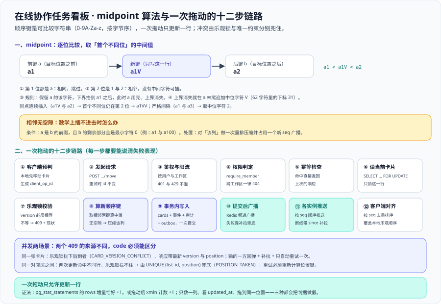

# 卡片拖动：一次拖动只更新一行

拖动是**全项目最难的写操作**：它同时踩到重排（顺序字段）、并发（两个人拖同一张卡片或同一对邻居之间）、实时（改动要在 1 秒内出现在别人屏幕上）与成本（一次拖动只能更新一行）四件事。这一页把 [领域核心](../DomainCore/index.md) 的乐观锁与 [架构设计](../Architecture/index.md) 第三节的十二步链路，全部落到「方法与 SQL 粒度」上，并给出一个可执行的判据——**一次拖动只允许更新一行**。



::: warning 本项目只有文档，没有代码
下面出现的 SQL、命令与请求体都是**读者在自己工程里要创建的**；本仓库不存放源码、SQL 与可执行副本，「运行 `xxx`」一律指「先按本节创建好该文件，再执行」。
:::

## 一、为什么整数 `position` 会引发「一次拖动写整列」

如果列里用 `position = 1, 2, 3, ..., n` 表示顺序，把第 5 张卡片拖到第 2 位就必须**更新它后面所有行**：

```sql [整数 position 的代价（不要这样做）]
-- 插入到第 2 位：一行拖动 → 全列更新
UPDATE cards SET position = position + 1
 WHERE list_id = 'l_todo' AND position >= 2;
```

三重代价同时出现，且只有第一重是「看得见的慢」：

| 代价 | 表现 | 为什么它是设计缺陷而不是性能问题 |
| --- | --- | --- |
| **写放大** | 一次拖动产生 N 次行更新（N = 该列卡片数） | 符合 [需求拆分](../Requirements/index.md) 4.1 的「一次拖动只更新 1 行」直接冲突；列有 500 张卡就是 500 次行更新 + 500 次索引维护 |
| **锁竞争** | 同列任意两次并发拖动互相阻塞 | 拖动之间本可并行（改的是不同行），整数方案把它们强制串行化——**吞吐被结构性地限死** |
| **顺序不稳定** | 顺序最终正确，中间状态混乱 | 两个请求各自算出的偏移量基于读到的旧快照，交错执行时后写覆盖先写，用户看到「拖完又跳回去」 |

::: danger 三个一定会出现的判断错误
1. **「加一个 `ORDER BY position, id` 就能稳住」**：这只解决「同一位置的相对顺序」，不解决写放大与锁竞争。正确做法是**换掉顺序字段的表示**（第二节），而不是在查询上加条件。
2. **「用 `position` 的浮点数（1.5、1.25）来夹中间」**：浮点数很快就会在同一个间隙里耗尽精度（`1.5` 与 `1.25` 之间反复插入），并且**浮点相等比较与排序在不同平台上不保证一致**。正确做法是**可比较字符串**：位数可以无限延长，且按字节序比较与平台无关。
3. **「把整列重排成 1..n 就行了」**：重排本身要更新整列，还要占一个 `seq` 广播给所有人。正确做法是**把重排降级为低频兜底路径**（2.4），它是异常处理，不是日常路径。
:::

## 二、分数排序键与 midpoint 算法

### 2.1 键的构成与比较口径

顺序键是一个**按字节序比较的字符串**，字符集固定为 `0-9A-Za-z`（62 个），记 `0` 为最小字符、`z` 为最大字符、`V`（下标 31）为**中位字符**。实际存储的键带一个桶前缀与结束符（例如 `0|a1V:`），本节为了手算方便只写有效位。

| 纪律 | 做法 | 反面写法 |
| --- | --- | --- |
| **比较与数据库排序规则无关** | 列声明 `text COLLATE "C"` | 依赖库默认 collation → 换环境后顺序变了 |
| **每列内唯一** | `UNIQUE (list_id, position)` | 同列两张卡片拿到同一个键，顺序变成「看运气」 |
| **只允许更新一行** | 取相邻两键算中间值 | `UPDATE ... SET position = position + 1` 全列后移 |

**为什么 62 个字符的顺序恰好等于字节序**：`0`-`9`（ASCII 48–57）、`A`-`Z`（65–90）、`a`-`z`（97–122）三段的码点本身就连续递增，所以「字符集内的序号大小」与「`COLLATE "C"` 的字节序大小」完全一致——这是选这 62 个字符而不是「任意可打印字符」的原因。

### 2.2 三种插入位置的取值

key 的生成是**纯函数**：输入相邻两键，输出新键。三种位置共用一套规则，只是边界不同：

| 插入位置 | 前键 a | 后键 b | 规则 | 结果 |
| --- | --- | --- | --- | --- |
| 首位 | 无 | 有 | 取「b 的前一个键」：把 b 的首位降到 **a 档**并对齐 | 见 2.3 的示例 |
| 中间 | 有 | 有 | 逐位比较，取**首个不同位**的中间字符 | 见 2.3 |
| 末位 | 有 | 无 | 在 a 的**末尾追加中位字符** | `a` → `aV`（永远大于 a） |

三个位置都不需要特殊分支：把「无前键」当作「全 `0` 的下界」、把「无后键」当作「无上界」，中间那一条规则即可覆盖全部情形。

### 2.3 手算：在 `a1` 与 `a2` 之间插入

逐位比较 `a1` 与 `a2`：

1. 第 1 位都是 `a`，**相同**，跳过。
2. 第 2 位是 `1` 与 `2`——**相邻字符**，中间没有可用字符。
3. 规则：**保留 a 的该字符**（`1`），把下界抬到 `a1` 之后，继续向后比较；此时 a 已经用完，**上界消失**。
4. 上界消失时，在 a 的末尾**追加中位字符 `V`**。

结果 `a1V`。**这个结果必须能手工验证**：`a1` 是 `a1V` 的前缀（短串小于长串），而 `a1V` 与 `a2` 在第 2 位上是 `1` 与 `2`，所以 `a1 < a1V < a2` ✓。

| 场景 | a | b | 比较过程 | 新键 |
| --- | --- | --- | --- | --- |
| 中间插入（次位相邻） | `a1` | `a2` | 首位相同；次位 `1` 与 `2` 相邻 → 保 `1` 后上界消失 → 追加 `V` | `a1V` |
| 严格间隔 | `a1` | `a3` | 次位 `1` 与 `3` 之间还有 `2` | `a2` |
| 同点连续插入 | `a1V` | `a2` | **首个不同位仍是次位**（`1` 小于 `2`），与上次同一情形 | `a1VV` |
| 前缀区间 | `a1` | `a1V` | `a1` 是 `a1V` 的前缀，剩余部分 `V` 有空间 → 取 `0` 与 `V` 的中位 `F` | `a1F` |

注意第 4 行：**不能拿第 3 位去比**（`a1V` 的第 3 位是 `V`、`a2` 的第 3 位不存在，直接比会得出错误的「无空隙」）。判据是**首个不同位**——`a1V` 与 `a2` 的首个不同位是第 2 位。

### 2.4 相邻无空隙：什么时候真的插不进去，怎么办

有一种区间**数学上不存在**介于两者之间的字符串：`a` 是 `b` 的前缀，且 `b` 的剩余部分**全部由最小字符 `0` 组成**。例如 `a1` 与 `a100`：任何大于 `a1` 的串都必须是 `a1` 加一个非空后缀，而这个后缀要小于 `00` ——不可能。

| 触发条件 | 兜底动作 | 注意 |
| --- | --- | --- |
| `midpoint(a, b)` 返回 `null`（无空隙可插） | 对**该列**做一次重排压缩，重新生成等间距键 | 必须在一个事务里完成，并占用一个新 `seq` 广播 `list.reordered`（否则客户端手里的旧键会对不上） |
| 键长超过上限（例如 255） | 同上 | 同点连续插入每次让键长 +1，绝大多数列十年也到不了 255；到了就必须压缩 |

::: tip 压缩是异常路径，它的执行次数本身就是一个判据
日常拖动的路径上**不应该出现压缩**：一旦出现，说明客户端在同一个位置反复插入（例如「总是拖到第 2 位」），或者键生成实现有偏差。
因此「压缩执行次数」要作为一个指标暴露出来：**它应当接近 0**；如果持续增长，要查的是拖动位置分布与键生成算法，而不是把压缩调快。
:::

## 三、一次拖动的服务端十二步链路

把卡片从「待办」第 3 位拖到「进行中」第 2 位，服务端走十二步（与 [架构设计](../Architecture/index.md) 第三节一致）。这里把每一步落到**方法与数据粒度**，并写清失败表现——**没有失败表现的步骤等于没被测过**：

| 步骤 | 落到哪个动作 | 方法 / SQL 粒度 | 失败时的表现 |
| --- | --- | --- | --- |
| ① 客户端预判 | 本地先移动卡片（乐观更新） | 纯前端状态；生成一个 `client_op_id` | 无（不写库） |
| ② 发起请求 | `POST /api/v1/boards/{id}/cards/{cardId}/move` | body 带 `targetListId` / `beforeCardId` / `version` / `client_op_id` | 网络失败 → 进重试队列，`client_op_id` 不变 |
| ③ 鉴权与限流 | 校验令牌、解析 `userId` | 按用户与工作区两个维度限流（`429`） | `401`（身份未证实）/ `429`（限流），两者不混淆 |
| ④ 权限判定 | `require_member(workspaceId, userId)` | 角色须为 `owner` 或 `editor` | `403`；**跨工作区一律 `404`**（不暴露存在性） |
| ⑤ 幂等检查 | 查 `idempotency_keys` | `(scope, client_op_id)` 主键，命中则**直接返回上次响应** | 重试不产生第二次移动 |
| ⑥ 读当前卡片 | 同一事务内 `SELECT ... FOR UPDATE` | 读 `version` / `list_id` / `position`，**只锁这一行** | 并发删除 → `409` 且带原因（见 [领域核心](../DomainCore/index.md) 4.2） |
| ⑦ 乐观锁校验 | 请求里的 `version` 必须等于库里的 | `WHERE id = ? AND board_id = ? AND version = ?` | 不等 → `409`，响应带**最新 `version` 与最新 `position`** |
| ⑧ 计算新顺序键 | 取目标位置相邻两键算中间值 | `ranking.between(afterPos, beforePos)`；返回 `null` 触发压缩 | 无空隙 → 走 2.4 的压缩路径，或直接 `409` 让客户端重拉 |
| ⑨ 事务内写入 | 一次 `UPDATE` + 三笔附带写入 | `cards`（`list_id` / `position` / `version + 1`）+ `audit_log` + `board_events`（`seq + 1`）+ outbox | 任一步失败 → 整个事务回滚，**不会「动了但没记」** |
| ⑩ 提交后广播 | 事件投到 Redis 频道 `board:{boardId}` | 只在 `afterCommit` 钩子里发 | 广播失败 → 数据已落库，靠客户端补拉兜底 |
| ⑪ 各实例推送 | 每个持有该看板连接的实例订阅频道 | 按 `seq` 顺序推给本机连接 | 连接断开 → 客户端带 `since=seq` 重连补拉 |
| ⑫ 客户端对齐 | 按 `seq` 去重排序 | 用服务端下发的顺序键**覆盖**本地乐观顺序 | 不一致 → 以服务端为准，界面短暂回弹 |

::: danger 第 ⑧ 步与第 ⑨ 步的三处易错点
1. **把「算新键」放在读库之前**：`beforeCardId` 对应的位置键必须**在同一事务、同一次读里**取到，否则并发插入会让算出的键落在错误区间。正确做法是 ⑥ 与 ⑧ 之间不释放读锁。
2. **「更新 `position` 失败就退化成全列重排」**：这条兜底会把一次廉价操作变成 N 行更新，而且发生在最不该变慢的时刻。正确做法是**先返回 `409` 让客户端重拉重算**，压缩只留给 2.4 那一种无空隙情形。
3. **把 `version + 1` 写成 `version = :newVersion`**：应用层一旦能赋值版本号，乐观锁就不再是单调的（[数据库设计](../Database/index.md) INV-6）。正确写法是**只允许 `version = version + 1`**。
:::

## 四、并发两场景：同一张卡片 vs 同一对邻居之间

### 4.1 场景一：两个人拖**同一张卡片**

A 与 B 同时拖 `c_9d21`，都读到 `version = 7`：

| 时刻 | A | B | 数据库里的 `version` |
| --- | --- | --- | --- |
| T1 | 读到 `version = 7` | 读到 `version = 7` | 7 |
| T2 | `UPDATE ... AND version = 7` → 1 行 | —— | 8 |
| T3 | 提交成功，返回 `200` | `UPDATE ... AND version = 7` → **0 行** | 8 |
| T4 | —— | 二次判定读到 `version = 8` → **`409`** + 最新位置 | 8 |

**谁赢**：先提交的那个（T2 的 1 行更新）。**输的一方看到什么**：`409`，且响应体带 `latestVersion: 8` 与 `latestPosition`——**不是**一句「冲突了」。

### 4.2 场景二：两个人拖**同一对邻居之间**的不同卡片

A 拖 `c_a` 到 `x` 与 `y` 之间、B 拖 `c_b` 到同一对邻居之间。两张卡片是**不同的行**，所以：

1. **乐观锁不会拦住任何一方**——两次 `UPDATE` 命中不同 `id`，各自返回 1 行。
2. 但两次算出的新键**可能相同**（中间没有更多空间时，两条路径都会得到同一个值）。
3. 于是 `UNIQUE (list_id, position)` 拦下后提交的那一个：`409`，`code = POSITION_TAKEN`。

::: danger 两个 `409` 的来源不同，绝不能用同一个 `code` 混在一起
1. **来源一：`version` 不匹配**（4.1）→ `code = CARD_VERSION_CONFLICT`，客户端动作是「刷新本地卡片状态」。
2. **来源二：唯一键冲突**（4.2）→ `code = POSITION_TAKEN`，客户端动作是「重算目标位置后重试」，此时**卡片状态没有变，不需要回滚本地卡片信息**。
3. 混在一起的后果：客户端按「版本冲突」处理唯一键冲突，会去刷新一张根本没变的卡片，然后**用同一个（已占用的）`position` 再发一次**，得到第二次 `409`——用户看到的是「怎么拖都失败」。正确写法是**两个来源两个 `code`**，且第二个 `code` 的重试必须**重新计算位置键**。
:::

### 4.3 输的一方前端看到什么（写死的三件事）

| 环节 | 动作 | 判据 |
| --- | --- | --- |
| 立即可见 | 卡片**回弹**到服务端下发的 `latestPosition` | 不回弹而是停在用户拖到的位置 = 本地状态没有以服务端为准 |
| 自动补拉 | 用响应体里的现状更新本地，并向服务端拉一次该列的最新顺序 | 不许「猜」中间发生了什么 |
| 重试 | **自动重试一次**，带上新的 `version` 与重新计算的位置键 | 重试仍 `409` → **停止自动重试**，提示「卡片已被他人移动」，停在服务端状态 |

**为什么只重试一次**：第二次冲突意味着「在这一秒内又有别人改了同一张卡片」。继续自动重试会形成**活锁**（两个客户端互相把对方的版本顶掉，谁都不成功），而用户看到的是「转圈不停」。一次重试 + 明确的提示，把「系统在忙」与「你被人抢先了」区分开。

## 五、索引与 SQL

### 5.1 索引只留一条，且它必须服务于「渲染一列」

```sql [migrations/V3__board.sql（cards 上的顺序键约束）]
-- 这条唯一约束本身就是一条 (list_id, position) 索引：
-- 它同时服务「同列同位置不允许重复」与「按 position 渲染一列」两个目的
ALTER TABLE cards ADD CONSTRAINT cards_list_position_key UNIQUE (list_id, position);
```

[数据库设计](../Database/index.md) 的索引清单里另列了 `cards_list_order_idx (list_id, position)`。**列顺序与唯一约束完全相同时，这两条索引是重复的**——按该页自己写下的纪律「说不出来源的索引一律不加」，落地时应**只保留一条**，并在这里写清它的两个来源：唯一性约束 + 渲染一列。

### 5.2 `ORDER BY position` 的代价

渲染一列是 `WHERE list_id = ? ORDER BY position LIMIT ?`。代价有三条，每条都要有对策：

| 代价 | 对策 | 判据 |
| --- | --- | --- |
| 全列扫描（每列 ≤ 500 张） | 走 `(list_id, position)` 索引；**必须带 `LIMIT`** | `EXPLAIN (ANALYZE, BUFFERS)` 出现 `Index Scan`，`rows` 不超过 `LIMIT` |
| 每次拖动维护索引 | 接受：一次拖动 = 索引删一条 + 插一条，**这是必要的写放大** | 拖动前后被改动的行数仍为 1（第七节） |
| 前缀扫描退化 | 键变长后比较成本上升；到键长上限就压缩 | 压缩执行次数接近 0（2.4） |

```sql [渲染一列：索引扫描 + 必须带 LIMIT]
EXPLAIN (ANALYZE, BUFFERS)
SELECT id, title, position FROM cards
 WHERE list_id = 'l_todo' ORDER BY position LIMIT 200;
```

```text [期望的执行计划形态（关键行）]
Index Scan using cards_list_position_key on cards
  Index Cond: (list_id = '...'::uuid)
  Buffers: shared hit=12
Planning Time: 0.3 ms
Execution Time: 0.6 ms
```

### 5.3 一次拖动的完整写入语句

```sql [一次拖动：一条 UPDATE + 三笔附带写入，全在一个事务里]
-- ① 只更新一行：位置与版本一起写，版本严格自增
UPDATE cards SET list_id = :targetListId, position = :newPosition,
                 version = version + 1, updated_at = now()
 WHERE id = :cardId AND board_id = :boardId AND version = :expectedVersion;

-- ② 看板事件：与 cards 同一事务，seq 与 board_events 一起推进
SELECT next_board_seq(:boardId);            -- 见 数据库设计 3.3 的函数
INSERT INTO board_events (board_id, seq, type, actor_id, payload)
VALUES (:boardId, :seq, 'card.moved', :actorId, :payload);

-- ③ 审计与出站事件：同样在同一事务内
INSERT INTO audit_log (workspace_id, actor_id, action, target_type, target_id, diff)
VALUES (:workspaceId, :actorId, 'card.move', 'card', :cardId, :diff);
-- outbox 的写入见 评论、@ 提及与通知 页
```

## 六、拖动请求的幂等口径

::: danger 拖动**不是**幂等的——这一点必须先写死
1. **把拖动当幂等操作来写重试逻辑**：同一个请求体（同样的 `cardId`、`targetListId`、`position`、`version`）发第二次，**不可能**得到与第一次相同的结果——第一次已经把 `version` 增到 8，第二次带着 `version = 7` 会被乐观锁拒绝（`409`），而不是返回上次结果。正确写法是把重复提交交给 `Idempotency-Key` + `client_op_id` 那三层收敛机制，而不是靠「重放同一条请求」。
2. **把「重试」与「重新发起」混为一谈**：网络失败后的重试必须**沿用同一个 `client_op_id`**；用户松手后再拖一次是**新的手势**，必须换新的 id。正确写法是在客户端把「手势」与「请求」分成两层：一个手势生成一个 id，该手势下的所有重试共用它。
3. **只在客户端做幂等**：客户端内存里的重试队列刷新一次页面就没了，而用户可能已经刷新过。正确写法是**幂等键落库**（`idempotency_keys`），让服务端成为唯一判据。
:::

那重复提交靠什么收敛？三层，缺一不可：

| 层 | 机制 | 收敛什么 |
| --- | --- | --- |
| 接入层 | `Idempotency-Key` 头 + `idempotency_keys` 表（[领域核心](../DomainCore/index.md) 第五节） | 同一个 `client_op_id` 的网络重试**直接返回上次响应**，不产生第二次移动 |
| 客户端 | 重试队列里的请求**保留同一个 `client_op_id`** | 手势只发生一次，重试不改变它的身份 |
| 补拉 | 断线重连后检查事件流里是否已有自己的这次操作 | 若事件已存在（别的路径成功了），**丢弃队列里那一条**，不再发 |

写死一条口径：**「用户一次拖动手势 = 一个 `client_op_id`」**。手势从按下到松手只生成一次；松手之后再拖一次是**新的手势**，必须换新的 `client_op_id`——否则第二次拖动会被当成第一次的重试而被吞掉，用户看到「拖了没反应」。

## 七、可验证判据：一次拖动只允许更新一行

这条判据测的**不是功能**，而是**实现口径**：一个「全列后移」的实现能让所有功能测试通过，只有比对被改动的行数才能分辨。三种证法，任选其一，但必须有一条进验收：

| 证法 | 命令 | 期望 |
| --- | --- | --- |
| `pg_stat_statements` 累计行数 | 拖动前后各查一次该语句的 `rows` | 增量**恰好 1** |
| `xmin` 比对 | 拖动后统计事务号大于某个基准的行数 | **恰好 1** |
| 自增列 | 给 `cards` 加一列 `updated_seq`（由触发器写序列），拖动后统计变化行数 | **恰好 1** |

```sql [证法一：pg_stat_statements 的 rows 增量（需先 CREATE EXTENSION）]
SELECT calls, rows, left(query, 60) FROM pg_stat_statements
 WHERE query LIKE '%SET list_id%' AND query LIKE '%position%';
-- 拖动一张卡片 → 再查一次：calls +1，rows +1（不是 +500，也不是 +该列长度）
```

```sql [证法二：xmin 比对（不需要任何扩展）]
-- 拖动前记录当前事务号
SELECT pg_current_xact_id();
-- 拖动一张卡片 → 再数「事务号大于基准」的行
SELECT count(*) FROM cards WHERE xmin::text::bigint > :xactIdBefore;
-- 期望：1
```

::: danger 三个会把这条判据做假的写法
1. **只数「被拖动的那张卡片所在列」**：如果实现顺手也更新了别的列（例如把源列与目标列都重排一遍），只数一列就会漏掉。正确写法是**对 `cards` 全表统计被改动的行数**。
2. **在 `updated_at` 上判**：`updated_at` 是应用写的时间戳，全列后移的实现完全可以只给目标行写 `updated_at` 而给其他行保留原值——判据立刻失真。正确写法是用**数据库自己的痕迹**（`xmin` / 统计行数 / 序列列）。
3. **把判据跑在「拖动到同一位置」的输入上**：这种输入本来就没必要改任何行的位置，得到 1 行不能说明问题。正确写法是**拖到一个真正需要新位置键的目标**（例如插入到相邻两张卡片之间）。
:::

## 八、判据族 `MV-A ~ MV-H`

| 判据 | 判什么 | 级别 | 状态 |
| --- | --- | --- | --- |
| **`MV-A`** | 整数 `position` 的三重代价写清（写放大 / 锁竞争 / 顺序不稳），并给出三个易错点的正确写法 | 文档级 | ✅ 本机可判 |
| **`MV-B`** | midpoint 算法可手算：`a1` / `a2` → `a1V`，且写出「相邻无空隙 → `null` → 压缩该列」的兜底 | 文档级 | ✅ 本机可判 |
| **`MV-C`** | 十二步链路每步有方法、SQL 粒度与失败表现 | 文档级 | ✅ 本机可判 |
| **`MV-D`** | 两个并发场景写清谁赢、输的一方看到什么（`409` + 补拉 + 重试一次），且两个 `409` 的 `code` 不同 | 文档级 | ✅ 本机可判 |
| **`MV-E`** | `(list_id, position)` 索引与 `ORDER BY position` 的代价各有对策，并给出 `EXPLAIN` 判据 | 文档级 | ✅ 本机可判 |
| **`MV-F`** | 拖动**不是**幂等这条口径写死，三层收敛机制齐全 | 文档级 | ✅ 本机可判 |
| **`MV-G`** | 一次拖动只更新一行：`pg_stat_statements` 的 `rows` 增量或 `xmin` 计数**恰好 +1** | 运行期 | ⏳ 未跑 · 本仓无工程代码（`BL-2`） |
| **`MV-H`** | 并发实测：同卡片 → 一个 `200` 一个 `409` 且带最新 `version`；同邻居 → 唯一键冲突 `409` 后重试成功 | 运行期 | ⏳ 未跑 · 本仓无工程代码（`BL-2`） |

## 九、当日做了什么

1. 用一条 `UPDATE ... SET position = position + 1` 写清整数 `position` 的**三重代价**（写放大、锁竞争、顺序不稳定），并点出三个易错的补救思路（加 `ORDER BY position, id` / 用浮点数夹中间 / 把整列重排当日常路径）与各自的正确写法。
2. 定下**分数排序键**的字符集与比较口径（`0-9A-Za-z` 共 62 字符、`COLLATE "C"`、字节序与字符序号一致的三个原因），产出三种插入位置共用一套规则的取值表。
3. 给出**可手算的 midpoint 例子**：在 `a1` 与 `a2` 之间插入得到 `a1V`，并用「`a1` 是前缀、`a1V` 与 `a2` 在次位比较」手工验证；补严格间隔（`a1`/`a3` → `a2`）、同点连续插入（→ `a1VV`）与前缀区间（`a1`/`a1V` → `a1F`）三种情形，并指出**不能用第 3 位去比**。
4. 写清**相邻无空隙**的精确条件（a 是 b 的前缀且 b 的剩余部分全是最小字符）与兜底动作（该列重排压缩 + 占用新 `seq` 广播 `list.reordered`），并把「压缩执行次数接近 0」定成一个指标。
5. 把十二步链路落到**方法与 SQL 粒度**，每步补一列「失败时的表现」，并点出第 ⑧ 与第 ⑨ 步的三处易错点。
6. 逐时刻写出**两个并发场景**：同一张卡片 → 乐观锁拦下后到者（`409` + 最新版本与位置）；同一对邻居之间 → 乐观锁**拦不住**（不同行），由 `UNIQUE (list_id, position)` 兜底；并写死两个 `409` 的 `code` 必须不同，否则客户端会「怎么拖都失败」。
7. 写死输的一方前端的三个动作（回弹 / 补拉 / **自动重试一次**），并解释「只重试一次」是为了避免两个客户端互相顶版本的活锁。
8. 定下**索引只留一条**（唯一约束即索引，两个来源都要能说出来），给出 `ORDER BY position` 的三条代价与对策、`EXPLAIN` 期望形态，以及一次拖动的完整写入语句。
9. 写死**拖动不是幂等**这条口径，并给出三层收敛机制（`Idempotency-Key` / 客户端保留同一 `client_op_id` / 补拉后丢弃已生效的那条），把「一次拖动手势 = 一个 `client_op_id`」定为契约。
10. 给出「一次拖动只允许更新一行」的三种证法与三个会把判据做假的写法（只数一列 / 用 `updated_at` / 拖到同一位置），并把它拆成运行期判据 `MV-G`。

## 十、如何验证

前八条是本页的**文档级自查**（`grep -c`，本机已跑，括注为实测值）；第 9 条是运行期判据，只给命令、**不给通过结论**。

```shell
grep -c '^### 2\.' index.md                                # 1) midpoint 四小节齐全（2.1 ~ 2.4）：期望 4
grep -cE '^\| [①②③④⑤⑥⑦⑧⑨⑩⑪⑫]' index.md                  # 2) 十二步链路一行不落：期望 12
grep -c '^### 4\.' index.md                                # 3) 并发两场景 + 前端三个动作：期望 3
grep -c 'a1[V]' index.md                                  # 4) 手算的「中间插入」例子被写进正文：期望 8
grep -c 'UNIQUE (list_id, positio[n])' index.md             # 5) 唯一约束兜底：期望 4
grep -c 'client_op_i[d]' index.md                          # 6) 幂等收敛三层都写了：期望 9
grep -cE '(CARD_VERSION_CONFLIC[T]|POSITION_TAKE[N])' index.md   # 7) 两个 409 来源两个 code：期望 3
grep -c 'assets/tb-card-move.sv[g]' index.md               # 8) 配图被本页引用：期望 1
```

第 9 条要在真库上跑（**本仓没有可执行的工程，未跑**）：

```shell
docker compose up -d db cache app
docker compose exec db psql -U teamboard -d teamboard -c \
  "SELECT calls, rows FROM pg_stat_statements WHERE query LIKE '%SET list_id%';"
```

::: warning 这一页的运行期判据一条都没跑
第 9 条只给命令、**不给「期望通过」的结论**。未跑的原因**不是容器**：实测本机 `docker compose version` 输出 `v2.29.1-desktop.1`、`docker info` 输出 `27.1.1`，[验收](../Acceptance/index.md) 里的 `BL-1` 在本机已解除；挡住它的是 `BL-2`——`pg_stat_statements` 要在**一个装起来的库**里查，而本仓库按 [AGENTS.md](/AGENTS.md) 第 9 节只存放 Markdown 与配图，没有 `compose.yaml`、`app/` 与迁移脚本。
第 1 ~ 8 条的期望值是**本机实跑 `grep -c` 读出来的**——它们验的是「这份设计是否自洽、是否可执行」，不是「这个实现在成本上是否达标」。**`MV-G` 与 `MV-H` 仍是未跑状态。**
:::

## 十一、下一步

1. **[评论、@ 提及与通知：outbox 的落地](../Comments/index.md)**：把第 ⑨ 步里那一笔「写 outbox」展开成完整的状态机、去重与对账。
2. **第 148 天**：进入**联调与测试**——把 `MV-G`（一次拖动只更新一行）与 `MV-H`（两场景并发）接进并发与容量验证，并在 200 RPS 到达率下测写接口 P99 ≤ 300 ms。

## 与「部署与交付」八页的分工（第 149 天补充）

**本页回答什么**：一次拖动要写几行、写哪几行，以及「分数排序键 + 唯一约束 + 乐观锁」三件事各自负责什么。
**本页不回答什么**：索引在真库里**实际建成了几条**、两条重复索引该怎么收；也不回答备份能不能把它一起搬走——前者归 [部署脚本](../DeployScripts/index.md) 与 [发布手册](../ReleaseRunbook/index.md) 的实测清单，后者归 [备份与恢复](../BackupRestore/index.md)。

第 149 天在一次性沙盒里把 `V1__identity.sql` ~ `V4__collab.sql` 原样跑完（`docker compose up -d --wait`，**11.8 s**，3 个容器 `healthy`、`migrate` 退出码 0，共 **14 张表**），然后用**权威口径**复核了第 5.1 节那句话，得到一条**设计与落地不一致**的读数：

| 项 | 本页当时写的 | 第 149 天实测口径与读数 |
| --- | --- | --- |
| `cards` 上的索引条数 | 「落地时应**只保留一条**」 | `SELECT count(*) FROM pg_index WHERE indrelid = 'cards'::regclass;` → **6**（与 DDL 里 `CREATE INDEX` 的条数一致） |
| 其中键完全相同的 | 预期为 0（重复的那条应被删掉） | 同上取 `indkey` 后按 `indkey` 分组 → **2 条同键**：唯一约束 `cards_list_position_key` 与 `cards_list_order_idx` 都是 `(list_id, position)` |
| 排序键的单调性 | `uuidv7()` 时间有序 | `SELECT uuidv7() < uuidv7();` → **t** |
| 乐观锁「没抢到」的形状 | `UPDATE 0` | 命令标签：命中 **`UPDATE 1`**、未命中 **`UPDATE 0`** |

于是第 5.1 节那句「落地时应只保留一条」要分成两句来读：**结论仍然成立**（两条同键索引里只有一条在服务查询，另一条只增加写放大与磁盘占用），但**它是建议、不是既成事实**——迁移脚本照 [数据库设计](../Database/index.md) 的索引清单原样建了两条。第 149 天把这处不一致**如实登记**（索引清单要不要删掉那一行，留给下一轮决定），**没有在交付期顺手改 DDL**：交付期改表结构会让已经跑过的验收读数全部作废。

**口径名 + 获取方式**：「索引条数」这一类数字的唯一权威口径是 `pg_index`，不是 DDL 里的语句条数。两处这次恰好都等于 6，但只要有「建失败也不中断迁移」的写法，两者立刻分叉——而构建、页面、其余巡检全绿。

## 参考资料

- [架构设计：模块边界与实时链路](../Architecture/index.md)（十二步链路、`seq` 机制与「一次拖动只允许更新一行」的原始判据） · [数据库设计：表、约束与顺序字段](../Database/index.md)（`position` 三条纪律、INV-1~INV-6 与索引清单）
- [领域核心：工作区、看板、列表与卡片的读写服务](../DomainCore/index.md)（乐观锁与幂等键的通用落地） · [需求拆分](../Requirements/index.md)（US-03 与非功能口径「一次拖动只更新 1 行」） · [验收](../Acceptance/index.md)（`TB-H` 成本判据）
- [PostgreSQL 专题](/docs/DB/Relational/PostgreSQL/index.md)（`COLLATE "C"`、`xmin` 与 `pg_stat_statements` 的原理侧） · [数据建模](/docs/DB/DataModeling/index.md)
- [性能与容量工程 · 压测方法论](/docs/Ops/PerformanceEngineering/LoadTesting/index.md)（写放大与「到达率」的度量口径） · [完整项目交付 · 接口契约](/docs/Others/ProjectDelivery/Contract/index.md)
