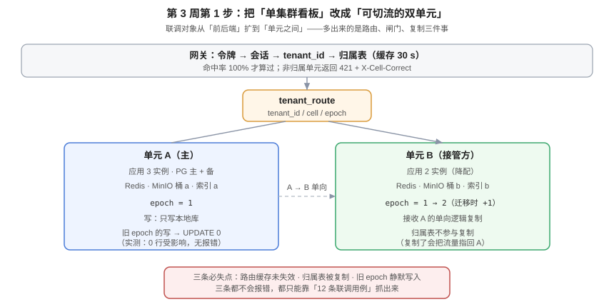

# 单元路由与切流闸门：把单集群看板改成可切流的双单元

第 2 周结束时，这个看板「服务能启动、接口能调、页面能访问」——但它只有一套库、一个桶、一份缓存。这一页做第 3 周的第一件事：**把它改成两个单元，并把「切得动」变成 12 条可执行的联调用例**。联调的对象因此从「前后端之间」扩展到「单元之间」，多出来的是三件事：路由、闸门、复制。



::: tip 本页与第 1 周 [跨租户用例矩阵](../CrossTenantMatrix/index.md) 的分工
那一页回答「A 租户的人去动 B 租户的数据，期望什么」——它证明**租户边界**有效。本页回答另一个问题：**同一租户的请求，会不会被两个单元同时服务**——它证明**单元归属**有效。前者是「人与数据」的边界，后者是「请求与单元」的边界，两者互不替代。
:::

## 判据族声明

本页判据族 `CR-A` ~ `CR-H`，共 8 条，定义表在第九节。

## 一、改造清单：从单集群到双单元

| 层 | 改造前 | 改造后 | 不动就会怎样 |
| --- | --- | --- | --- |
| 网关 | 直接转发到唯一上游 | 解析 `tenant_id` → 查归属表 → 转发 | 全部请求仍打向 A，B 形同虚设 |
| 归属表 | 无 | `tenant_route`（含 `epoch`） | 无从判断「该由谁服务」 |
| 缓存 key | `board:{id}` | `t:{tenant}:board:{id}` | 两单元共用一个 Redis 会串号 |
| 附件桶 | 单桶 | 每单元独立桶，key 带单元段 | 切到 B 后上传的图在 A 上 404 |
| 搜索索引 | 单索引 | 每单元独立索引 | 切到 B 后搜索返回空 |
| 数据库 | 1 主 1 备 | A/B 各一套，A → B 单向逻辑复制 | B 上没有 A 的数据，接管即空 |
| 写路径 | 无条件更新 | 条件更新 + `epoch` 校验 | 迁移窗口内旧写静默丢失 |
| 事件主题 | `board.{id}` | `t.{tenant}.board.{id}` | 广播串租户、跨单元收不到 |

::: danger 改造清单里最容易被划掉的两行是「附件桶」和「搜索索引」
它们不在主链路上，改起来又要动配置又要迁数据，评审时最容易被判定为「后续再说」。结果是：库切过去了、接口通了、页面能打开，**但用户上传的图片 404、搜索是空的**。这两条必须进联调用例（用例 7、8）。
:::

## 二、归属表：三列定生死

```sql
CREATE TABLE tenant_route (
  tenant_id  bigint PRIMARY KEY,
  cell       text   NOT NULL,
  epoch      bigint NOT NULL DEFAULT 1,
  moved_at   timestamptz,
  CONSTRAINT tenant_route_cell_chk CHECK (cell IN ('cell-a','cell-b'))
);

CREATE TABLE tenant_route_log (
  id         bigint GENERATED ALWAYS AS IDENTITY PRIMARY KEY,
  tenant_id  bigint NOT NULL,
  from_cell  text,
  to_cell    text NOT NULL,
  epoch      bigint NOT NULL,
  operator   text NOT NULL,
  created_at timestamptz NOT NULL DEFAULT now()
);
```

三列各自的职责不能混：

| 列 | 职责 | 被谁读 | 误用的后果 |
| --- | --- | --- | --- |
| `cell` | 该租户由谁服务 | 网关（每请求） | 读旧缓存 → 请求打到旧单元 |
| `epoch` | 该归属的第几版 | 业务写 SQL（条件里） | 不给 → 迁移期旧写静默丢失 |
| `moved_at` | 上次迁移时刻 | 排障、审计 | 只用于排查，不参与判定 |

## 三、`epoch` 闸门：一次实跑

闸门的写法只有一句：**把 `epoch` 放进写语句的 `WHERE` 里**。

```sql
-- ① 正常写：客户端的 epoch 与库里一致
UPDATE card_t SET title='v2', version=version+1
 WHERE id=42 AND tenant_id=1001 AND version=1
   AND (SELECT epoch FROM tenant_route_demo WHERE tenant_id=1001) = 1;
-- UPDATE 1

-- ② 迁移：归属改到 B，epoch 加一
UPDATE tenant_route_demo SET cell='cell-b', epoch=epoch+1 WHERE tenant_id=1001;
-- UPDATE 1

-- ③ 客户端还拿着旧 epoch=1 的写
UPDATE card_t SET title='v3-ghost', version=version+1
 WHERE id=42 AND tenant_id=1001 AND version=2
   AND (SELECT epoch FROM tenant_route_demo WHERE tenant_id=1001) = 1;
-- UPDATE 0
```

实测（PostgreSQL 18.6）最终状态：

```text
 title | version
-------+---------
 v2    |       2
```

那笔 `v3-ghost` 没有落库。**注意它是 `UPDATE 0` 而不是报错**——这意味着应用层必须把「影响行数为 0」显式翻译成 `409`/`421`，否则它就变成一次静默失败。

::: danger 只加条件不判返回值，等于没加
`UPDATE 0` 在 JDBC 里是一个正常返回值，不会抛异常。常见的错误写法是 `jdbc.update(sql, args)` 之后什么都不检查——于是「迁移期的写被拒绝」变成了「用户点了保存、界面提示成功、数据没变」。
**正确写法：`if (updated == 0) throw new StaleCellEpochException(tenantId, epoch);`**，再由异常映射成 `421`。
:::

## 四、路由：三条不变式

```text
① 令牌里没有单元 → 单元只能来自归属表
② 归属表是唯一权威副本 → 绝不参与复制
③ 查不到归属 → 拒绝（503），不默认落到任何单元
```

第 ② 条最反直觉，所以单独解释：

::: warning 为什么归属表不能进复制通道
如果 `tenant_route` 被 A→B 的逻辑复制带走，那么 B 会收到「租户 1001 归属 cell-a」这条记录。等 B 接管 1001 之后，**B 本地的归属表会把流量又指回 A**——而 A 此时可能根本没恢复。这类故障的现象是「切过去了，但一半用户的请求在 A 和 B 之间来回弹」，排查时几乎不会想到是「复制把路由带过去了」。

正确做法：`CREATE PUBLICATION` 只列出业务表，归属表由各单元通过**只读接口**或**独立的配置通道**获取。
:::

## 五、12 条联调用例

前 8 条验证「单元归属」，后 4 条验证「切流」。**每条都必须能红**——写出「期望失败的样子」，它才不会永远绿。

| # | 用例 | 动作 | 期望 | 红了说明 |
| --- | --- | --- | --- | --- |
| 1 | 路由命中 | 用 1001 的令牌连打 100 次 | 100 次都落 A | 有请求落到 B |
| 2 | 令牌无单元 | 解出令牌 payload | 无 `cell` 字段 | 令牌里写死了单元 |
| 3 | 非归属写被拒 | 1001 的令牌打 B | `421` + `X-Cell-Correct: cell-a` | 双写口子 |
| 4 | 归属表未复制 | 改 A 的归属，60 s 后查 B | B 上仍是旧值 | 归属表被复制 |
| 5 | 缓存不串号 | A/B 各有租户写同名 key | 两值独立 | 缓存 key 缺租户前缀 |
| 6 | 附件桶闭环 | 在 A 上传后取 URL | host 指向桶 a | 桶未分单元 |
| 7 | 搜索索引闭环 | 在 A 建卡片后搜索 | 能搜到 | 索引未分单元 |
| 8 | 通知主题闭环 | 在 A 触发 @ | 只有 A 的订阅者收到 | 主题未带租户/单元 |
| 9 | 复制延迟 | A 写一行，等 3 s 查 B | 能查到；心跳 < 3 s | 复制通道断 |
| 10 | 摘除 A 时明确失败 | 拒绝 A 的入站后请求 | `503` + `Retry-After` | 兜底逻辑把它转给了 B（返回 200 空列表） |
| 11 | 迁移闸门 | 迁移后立即用旧 epoch 写 | `UPDATE 0` → `421` | 闸门没进 SQL |
| 12 | 切流后可读写 | 改归属 + `epoch+1`，再走一遍 1~8 | 全部通过（针对 B） | 切流只切了读 |

::: tip 用例 10 是整个表里最值钱的一条
「失败要明确」比「成功要正确」更容易被漏掉。用一个 `curl` 就能验证：

```shell
curl -s -o /dev/null -w '%{http_code}\n' https://cell-a.api.example.com/api/boards/42
# 期望：503（A 已被隔离）
# 若返回 200，立刻查响应体——多半是 {"data": []}，那是最糟的一种「成功」
```
:::

## 六、三条必失点与它们的验证

| 必失点 | 为什么不会报错 | 怎么抓 |
| --- | --- | --- |
| **路由缓存未失效** | 网关缓存 30 s，期间仍打旧单元 | 用例 11：迁移后立刻用旧地址写，看落库位置 |
| **归属表被复制** | 复制是「正常的」，只是带错了数据 | 用例 4：改 A 的归属后查 B |
| **旧 epoch 静默写入** | `UPDATE 0` 不是异常 | 用例 11 + 应用层「影响行数为 0 即抛异常」 |

## 七、验证方式

```shell
# ① 路由命中率（用例 1）
for i in $(seq 100); do curl -s -o /dev/null -w '%{header_json}' \
  https://api.example.com/api/boards -H "Authorization: Bearer $TOKEN" \
  | grep -o 'x-cell-resolved[^,]*'; done | sort | uniq -c
# 期望：只有一行 cell-a，计数 100

# ② 非归属写（用例 3）
curl -s -o /dev/null -w '%{http_code}\n' -X POST https://cell-b.api.example.com/api/boards/42/cards \
  -H "Authorization: Bearer $TOKEN"
# 期望：421

# ③ 归属表未被复制（用例 4）
psql "$DSN_A" -c "UPDATE tenant_route SET cell='cell-b', epoch=epoch+1 WHERE tenant_id=1001;"
sleep 60 && psql "$DSN_B" -c "SELECT cell, epoch FROM tenant_route WHERE tenant_id=1001;"
# 期望：B 上仍是 cell-a / 1（未被复制）

# ④ 迁移闸门（用例 11）
psql "$DSN_B" -c "UPDATE card_t SET title='ghost', version=version+1
  WHERE id=42 AND tenant_id=1001 AND version=2
    AND (SELECT epoch FROM tenant_route WHERE tenant_id=1001)=1;"
# 期望：UPDATE 0

# ⑤ 摘除 A 的明确失败（用例 10）
kubectl apply -f - <<'YAML'
apiVersion: networking.k8s.io/v1
kind: NetworkPolicy
metadata: { name: deny-ingress, namespace: cell-a }
spec: { podSelector: {}, policyTypes: [Ingress], ingress: [] }
YAML
curl -s -o /dev/null -w '%{http_code}\n' https://cell-a.api.example.com/api/boards/42
# 期望：503（不是 200）
kubectl delete networkpolicy deny-ingress -n cell-a
```

## 八、这一页之后还剩什么

| 剩余项 | 什么时候做 | 为什么现在不做 |
| --- | --- | --- |
| 压测四场景（写 40 / 读 120 / 拖动 30 RPS / 长连接 1 万） | 第 3 周第 2~3 步 | 单元化改造会改变连接分布，先改再压 |
| 连接池串租户复现 | 第 3 周第 2 步 | 双单元后连接数翻倍，串租户概率上升，值得单独一页 |
| 切流的完整灰度（1% → 10% → 50% → 100%） | 第 3 周第 4 步 | 需要压测结论先给出容量前提 |
| 降级演练进 CI | 第 4 周 | 依赖本页的 `503` 口径 |

## 九、判据族 `CR`

| 判据 | 内容 | 怎么验证 |
| --- | --- | --- |
| `CR-A` | 令牌中不得含单元；单元只能来自归属表 | 解一次令牌 payload，无 `cell` 字段（用例 2） |
| `CR-B` | 非归属单元的写必须返回 `421` 且带 `X-Cell-Correct` | 用 A 的令牌打 B，检查状态码与响应头（用例 3） |
| `CR-C` | 归属表不得进入复制通道 | 改 A 的归属后 60 s 查 B，值不变（用例 4） |
| `CR-D` | 写 SQL 必须带 `epoch` 校验，且影响行数为 0 时抛业务异常 | `grep -n "epoch"` 命中写入语句；异常映射里有 421 分支 |
| `CR-E` | 缓存 key / 桶 / 索引 / 主题四者都必须带租户（或单元）前缀 | 四处各一条 `grep`，均有前缀 |
| `CR-F` | 隔离单元时必须 fail closed（`503`），不得返回 200 空数据 | 注入 NetworkPolicy 后检查状态码（用例 10） |
| `CR-G` | 复制必须有心跳表口径，延迟 < 3 s 且纳监控 | `SELECT extract(epoch FROM (now()-max(beat_at)))` < 3 |
| `CR-H` | 12 条用例必须全部可红，且每条都有「红了说明什么」 | 用例表第五列无空白；随意破坏一处配置能至少让一条变红 |

## 十、下一步

第 3 周第 2 步：**连接池串租户复现**——双单元之后连接数翻倍，`SET LOCAL` 一旦漏写成 `SET`，串租户会从「理论风险」变成「每天必现」。那一步要给出可复现的 20 连接 × 200 并发读数，以及「为什么必须在事务内」的三种写法对照。

## 参考资料

- PostgreSQL 18 文档：[Logical Replication](https://www.postgresql.org/docs/current/logical-replication.html)（`CREATE PUBLICATION` 只列业务表）
- RFC 9110 §15.5.20：`421 Misdirected Request`
- 本站：[多活与单元化](../../../../docs/Ops/MultiActive/index.md)、[实战：双单元 + 切流](../../../../docs/Ops/MultiActive/Practice/index.md)
