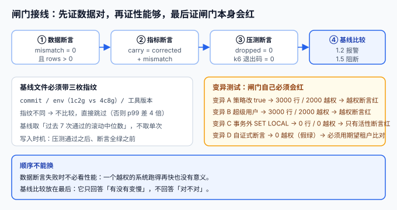

# 第 3 周第 6 步 · 质量闸门接线：四条断言、基线比较与变异测试

第 3 周前五步各自造了一件工具：[池层计数器](../PoolTenantLeak/index.md)（`PLP`）、[四条压测断言](../LoadTestGate/index.md)（`LPG`）、[降级演练](../DegradeDrill/index.md)（`DGD`）、[跨租户矩阵](../CellRouting/index.md)（`CR`）、[检索相关性联调](../BoardSearch/index.md)（`BSR`）。工具造出来了，但它们**还没有连成一条线**——今天要回答的问题是：**这五件东西怎么排进一条流水线，以及怎么证明这条流水线本身是有效的。**

「证明闸门有效」比「写闸门」更难。一条永远返回绿的闸门，和没有闸门在结果上完全一样，但在心理上更糟——因为它会让人以为有人在守。所以这一页的重点不是再加一条断言，而是给闸门加**变异测试**：故意把系统改坏，看它会不会红。

## 判据族声明

本页判据族 `QG-A` ~ `QG-H`，共 8 条。定义表在第六节。



## 一、四条断言的执行顺序不能换

流水线里的顺序不是审美问题，而是**失败成本**问题：越早失败，越省时间，也越不容易被「反正后面也会挂」掩盖。

| 顺序 | 断言 | 耗时 | 失败说明什么 | 失败后是否继续 |
| --- | --- | --- | --- | --- |
| ① | **数据侧**：`mismatch = 0` 且 `rows > 0` | 秒级 | 租户隔离被破坏，或上下文丢失 | **立即终止** |
| ② | **指标侧**：`carry = corrected + mismatch` | 秒级 | 计数器本身算错了，后面的读数不可信 | 立即终止 |
| ③ | **压测侧**：`dropped_iterations = 0`、k6 退出码 0 | 分钟级 | 压出来的 RPS 是假的，或阈值不达标 | 终止 |
| ④ | **基线比较**：p99 ≤ 基线 × 1.2 报警 / × 1.5 阻断 | 秒级 | 性能退化，但不一定影响正确性 | 报警可继续，阻断终止 |

::: danger 两个常见错误顺序
1. **先跑压测再跑数据断言**：压测跑了 6 分钟，最后发现是越权，6 分钟白花；更糟的是压测流量本身污染了数据。
2. **把基线比较放在数据断言之前**：一个越权的系统可能「更快」（少查了数据），基线比较会给出「性能提升」的假结论。
:::

## 二、基线文件：写入时机与三枚指纹

`perf-baseline.json` 不是「跑完就写」，写入时机决定了它有没有意义：

| 时机 | 问题 |
| --- | --- |
| 每次压测后都写 | 一次抖动就把基线抬高，退化被「合法化」 |
| 只在主干合并后写 | 分支上的退化永远进不了基线（这是对的），但主干上的抖动会污染 |
| **7 次滚动中位数 + 仅在全绿时写** | 推荐：抗单次抖动，且不把失败样本写进去 |

```json
{
  "commit": "9e0fc01",
  "env": "local-1c2g",
  "tool": "k6/1.2.3",
  "window": "7-runs-median",
  "scenarios": {
    "list_page":  { "p99_ms": 180, "rps": 120 },
    "drag_write": { "p99_ms": 95,  "rps": 30 },
    "comment":    { "p99_ms": 110, "rps": 20 },
    "upload":     { "p99_ms": 240, "rps": 10 }
  }
}
```

```python
# 比较逻辑：指纹不同直接跳过，绝不跨环境比较
def verdict(cur_ms: int, base: dict, env: str, tool: str) -> str:
    if base["env"] != env or base["tool"] != tool:
        return "跳过（指纹不同，基线不可比）"
    ratio = cur_ms / base["p99_ms"]
    if ratio > 1.5:
        return f"阻断（×{ratio:.2f}）"
    if ratio > 1.2:
        return f"报警（×{ratio:.2f}）"
    return f"通过（×{ratio:.2f}）"
```

三枚指纹的必要性来自实测：1c2g 与 4c8g 的 p99 差约 **4 倍**，把两者混在一个基线里，任何阈值都失去意义。

## 三、变异测试：四个变异，四种不同的红

这一段是本页的核心。环境是本机 `postgres:18`（`teamboard-sandbox-db-1`），`gate_docs` 表 3 个租户各 1,000 行，普通角色 `gate_user`，策略：

```sql
CREATE POLICY p_tenant ON gate_docs
  USING (tenant_id = current_setting('app.tenant', true));
```

断言有两条，**必须同时存在**：

- **越权断言**：`count(*) FILTER (WHERE tenant_id <> :expected) = 0`
- **活性断言**：`count(*) > 0`（证明「确实查到了这个租户的数据」，而不是「什么都没查到」）

| 变异 | 做法 | 返回行数 | 越权数（对期望租户） | 哪条断言会红 |
| --- | --- | --- | --- | --- |
| **基线（正确）** | `BEGIN; SET LOCAL ROLE gate_user; SET LOCAL app.tenant='a';` | **1,000** | **0** | 都不红（应保持绿） |
| **A：策略被改宽** | `ALTER POLICY ... USING (true)` | **3,000** | **2,000** | 越权断言 |
| **B：超级用户绕过** | 不 `SET ROLE`，直接用属主/超管连接 | **3,000** | **2,000** | 越权断言 |
| **C：事务外 `SET LOCAL`** | 自动提交下执行 `SET LOCAL app.tenant='a'` | **0** | **0** | **只有活性断言** |
| **D：自证式断言** | 断言写成 `tenant_id <> current_setting('app.tenant', true)`，且上下文继承了旧租户 | 1,000 | **0（自证）/ 1,000（对期望 'b'）** | 只有「用期望值比对」的断言 |

逐条解释：

### 变异 A：策略被改宽

一条 `ALTER POLICY` 就能让隔离失效，而且**应用代码一行没改**、日志里没有任何异常。如果没有数据断言，这类改动只会在安全评审时被发现——而安全评审往往不在发布路径上。

### 变异 B：超级用户绕过

`FORCE ROW LEVEL SECURITY` 只约束表属主，**对超级用户无效**。本机实测：同一个策略、同一张表，用超管连接查出 3,000 行。这解释了为什么「认证与租户成员」那一章要求**认证查询必须使用独立角色**——用业务连接做认证，RLS 会静默返回 0 行；用超管连接做业务，RLS 会静默返回全部。

### 变异 C：事务外 `SET LOCAL`（最危险的一个）

```sql
-- 逐条提交（模拟连接池上的两次独立请求）
SET ROLE gate_user;      -- SET
RESET app.tenant;        -- RESET
SET LOCAL app.tenant='a';-- WARNING: SET LOCAL can only be used in transaction blocks
SELECT current_setting('app.tenant', true), count(*),
       count(*) FILTER (WHERE tenant_id <> 'a') FROM gate_docs;
--  guc | count | mismatch
--  ----+-------+----------
--      |     0 |        0
```

**返回 0 行，越权数为 0**。越权断言完全通过，而系统实际上什么都没查到。这就是「自证式断言」的第二个变种：**没有活性断言时，「什么都没查到」和「隔离完美」长得一模一样**。

### 变异 D：断言与被测对象用同一个来源

如果断言写成「返回行的租户 = `current_setting`」，那么在上下文被继承成旧租户时，**断言会用旧租户来校验旧租户**，结果永远是 0。本机实测：请求期望 `b`、上下文却是 `a`，返回 1,000 行，自证式越权数 **0**，而按期望值 `b` 比对是 **1,000**。

::: danger 三条从变异测试里长出来的纪律
1. **断言必须用请求携带的期望值，不能用系统当前状态反推**：`tenant_id <> :expected_tenant`，`:expected_tenant` 来自请求参数，不来自 `current_setting`。
2. **每个隔离断言必须配一条活性断言**：否则「0 行」会被当成「干净」。
3. **变异测试要进 CI 的每日任务**：不是每次提交都跑（成本高），但必须定期跑，否则闸门腐化无人知。
:::

## 四、矩阵第 24 格：跨单元的对象存储签名

第 3 周第 4 步补了第 23 格（用甲的会话签发、乙的凭证下载，期望 403）。第 24 格是它的跨单元版本：

| 项 | 内容 |
| --- | --- |
| **场景** | 用户在单元 A 拿到的预签名 URL，被复制到单元 B 使用 |
| **期望** | 403（签名里绑定了单元/租户，跨单元不匹配） |
| **常见错误结果** | 200 —— 对象存储只校验签名有效性，不校验请求来源 |
| **正解** | `object_key` 前缀含 `cell/tenant`，且 policy condition 绑定同一个值；**不要**在下载时再查权限（那条路不经你的应用） |
| **判据** | 用单元 B 的网络出口打单元 A 的 URL，返回 403 且审计日志有记录 |

## 五、`@Async` 的上下文透传：两个可选实现

C3（异步线程池丢上下文）的根治不是「在异步方法里再 `set` 一次」（容易漏），而是**让上下文跟着任务走**：

```java
// 方案 A：TaskDecorator（Spring，JDK 17+ 即可）
@Bean
public TaskDecorator tenantContextDecorator() {
    return runnable -> {
        TenantContext ctx = TenantContext.current();   // 提交线程抓取
        return () -> {
            try (TenantContext.Scope ignored = TenantContext.open(ctx)) {  // 工作线程恢复
                runnable.run();
            }
        };
    };
}
```

```java
// 方案 B：JDK 25 的 ScopedValue（无传递开销，且不可被子线程继承）
static final ScopedValue<Tenant> TENANT = ScopedValue.newInstance();

ScopedValue.where(TENANT, tenant).run(() -> service.handle(request));
```

| 方案 | 优点 | 缺点 | 适用 |
| --- | --- | --- | --- |
| `TaskDecorator` | 兼容现有线程池，改动小 | 依赖「所有异步入口都用了这个池」 | 存量系统 |
| `ScopedValue` | 语义清晰、不可变、不会串 | 需要 JDK 25+，且要求代码结构配合 | 新代码 |

::: warning 透传不等于安全
上下文透传只保证「异步任务能读到正确的租户」，**不保证**「读不到时 fail closed」。两者要一起做：透传解决「读得到」，严格模式（无 `missing_ok`）解决「读不到就报错」。少任何一个，C3 都还会以另一种形式回来。
:::

## 六、判据定义表

| 判据 | 约定 | 定错了会怎样 | 怎么验证 |
| --- | --- | --- | --- |
| `QG-A` | 四条断言按「数据 → 指标 → 压测 → 基线」排序 | 压测跑完才发现越权，或基线把「越权更快」当提升 | 流水线配置里的 stage 顺序 |
| `QG-B` | 隔离断言必须用请求期望值比对，不得用 `current_setting` 自证 | 上下文继承时断言恒为 0（假绿） | 变异 D：期望 `b`、上下文 `a`，应报 1,000 |
| `QG-C` | 每个隔离断言必须配一条活性断言（`rows > 0`） | 「0 行」被当成「干净」 | 变异 C：事务外 `SET LOCAL` 必须让活性断言红 |
| `QG-D` | 基线文件必须含 `commit` / `env` / `tool` 三枚指纹 | 跨环境比较得出假结论 | 指纹不同时比较函数返回「跳过」 |
| `QG-E` | 基线只在全绿时写入，且取滚动中位数 | 单次抖动抬高基线，退化被合法化 | 检查写入条件与窗口配置 |
| `QG-F` | 变异测试必须覆盖「策略改宽 / 超管绕过 / 上下文丢失」三类 | 闸门长期全绿但已失效 | 每日任务跑四个变异，至少三个必须红 |
| `QG-G` | 跨单元签名必须绑定单元与租户 | 复制 URL 即可跨单元下载 | 第 24 格用例：期望 403 |
| `QG-H` | 异步入口必须透传上下文且读不到时 fail closed | 静默返回空结果，或读到别人的数据 | 两个入口（`@Async`、手动跑批）各一条用例 |

## 如何验证

```shell
# ① 基线（正确形态）：应返回 1000 行、0 越权
docker exec teamboard-sandbox-db-1 psql -U teamboard -d fts_lab -X -c "
BEGIN; SET LOCAL ROLE gate_user; SET LOCAL app.tenant='a';
SELECT count(*) AS rows_returned,
       count(*) FILTER (WHERE tenant_id <> 'a') AS mismatch
FROM gate_docs; COMMIT;"
```

**预期输出**：`rows_returned = 1000`、`mismatch = 0`。判读：这是唯一应该保持绿的形态，其余三个变异必须让它变红。

```shell
# ② 变异 C：事务外 SET LOCAL，越权断言仍为 0，只有活性断言能抓
docker exec teamboard-sandbox-db-1 psql -U teamboard -d fts_lab -X \
  -c "SET ROLE gate_user" -c "RESET app.tenant" \
  -c "SET LOCAL app.tenant='a'" \
  -c "SELECT current_setting('app.tenant', true) AS guc, count(*) AS rows_returned,
             count(*) FILTER (WHERE tenant_id <> 'a') AS mismatch FROM gate_docs;"
```

**预期输出**：`WARNING: SET LOCAL can only be used in transaction blocks`，随后 `guc` 为空、`rows_returned = 0`、`mismatch = 0`。判读：**越权断言通过、活性断言失败**——这正是「只写一条断言就不够」的实证。

```shell
# ③ 变异 B：超级用户绕过 RLS
docker exec teamboard-sandbox-db-1 psql -U teamboard -d fts_lab -X -c "
BEGIN; SET LOCAL app.tenant='a';
SELECT count(*) AS rows_returned,
       count(*) FILTER (WHERE tenant_id <> 'a') AS mismatch
FROM gate_docs; COMMIT;"
```

**预期输出**：`rows_returned = 3000`、`mismatch = 2000`。判读：超管连接下策略不生效，越权断言必须红。

```shell
# ④ 基线比较：指纹不同必须跳过
python3 - <<'PY'
base = {"env": "local-1c2g", "tool": "k6/1.2.3", "p99_ms": 180}
for cur, env, tool in [(196, "local-1c2g", "k6/1.2.3"), (252, "local-1c2g", "k6/1.2.3"), (196, "4c8g", "k6/1.2.3")]:
    if env != base["env"] or tool != base["tool"]:
        print(cur, "-> 跳过（指纹不同）"); continue
    r = cur / base["p99_ms"]
    print(cur, f"-> {'阻断' if r > 1.5 else ('报警' if r > 1.2 else '通过')} (x{r:.2f})")
PY
```

**预期输出**：`196 -> 通过 (x1.09)`、`252 -> 报警 (x1.40)`、`196 -> 跳过（指纹不同）`。

## 下一步

- **第 3 周第 7 步（第 168 天）**：闸门的自检与收口——把四个变异做成每日任务、基线改成 7 次滚动中位数、矩阵补到第 25 格（跨单元检索签名的读路径），并给第 3 周验收表补一栏「闸门自检最近一次通过时间」。
- **待补**：`@Async` 与手动跑批两个入口的上下文透传（`TaskDecorator` 或 `ScopedValue`），并与严格模式一起发布。
- **口径提醒**：本页所有读数来自 `postgres:18` 容器内的 `gate_docs`（3,000 行、单条策略），**迁移到真实表结构时行数不同但结论不变**；可迁移的是「三类变异各自会让哪条断言变红」这张对照表。

## 参考资料

- [JUnit 5 · Assumptions](https://junit.org/junit5/docs/current/user-guide/#writing-tests-assumptions)——`assumeTrue` 的三态（通过 / 跳过 / 失败），本页「指纹不同则跳过而不是变红」的依据
- [GitHub Actions · Workflow syntax](https://docs.github.com/en/actions/reference/workflow-syntax-for-github-actions)——`needs`、`if`、`continue-on-error` 与 artifact 传递，决定断言失败后流水线停在哪一步
- [PostgreSQL 18 · Row Security Policies](https://www.postgresql.org/docs/18/ddl-rowsecurity.html)——`USING (true)` 为什么是一条「看起来在守、实际不守」的策略
- 同项目：[压测四场景与池层断言](../LoadTestGate/index.md) · [降级演练进 CI](../DegradeDrill/index.md) · [检索相关性联调](../BoardSearch/index.md) · [池层串租户](../PoolTenantLeak/index.md) · [第 3 周验收](../Week3Acceptance/index.md)
