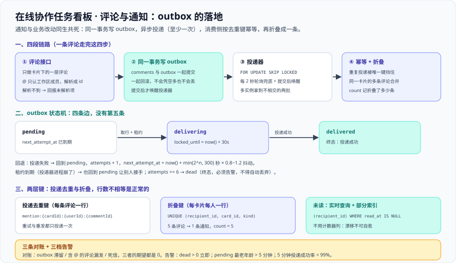

# 评论、@ 提及与通知：outbox 的落地

这一页把「评论成功但通知丢了」这类不一致关掉：评论只做**卡片下的一层**、`@` 提及**只认看板所属工作区的成员**、通知走**与业务同事务的 outbox** 再加异步投递与去重折叠。它是 [领域核心](../DomainCore/index.md) 第 ⑨ 步里「写 outbox」那一笔的展开，也是 [架构设计](../Architecture/index.md) 第六节「事务内写 outbox」的落地版本——那边给三方案对照，这里给状态机、退避公式、对账 SQL 与告警口径。



::: warning 本项目只有文档，没有代码
下面出现的表结构、SQL、迁移脚本与轮询配置都是**读者在自己工程里要创建的**；本仓库不存放源码、SQL 与可执行副本，「运行 `xxx`」一律指「先按本节创建好该文件，再执行」。
:::

## 一、评论模型：只做卡片下的一层评论

### 1.1 三个理由（都是一层带来的）

| 理由 | 一层评论的表现 | 无限层级会变成什么 |
| --- | --- | --- |
| **顺序问题退化** | 按 `(created_at, id)` 排即可，**不需要分数排序键** | 每个父评论下都要维护自己的顺序键，等于把「一次拖动只更新一行」的整套复杂度复制到评论树上 |
| **通知收件人确定** | 收件人 = 卡片关注者 ∪ 被提及者，**不需要沿父链上溯作者** | 「回复了某个回复」要通知谁？上溯链长决定了规则，而规则会长到没人能说清 |
| **折叠与未读有唯一键** | 折叠键是 `(recipient_id, card_id, kind)`，**一个卡片一个键** | 折叠键要带上父评论，同一条讨论会被拆成十几条通知，折叠失去意义 |

### 1.2 表与明确不做的三件事

```sql [migrations/V4__collab.sql（comments 部分，与 数据库设计 一致）]
CREATE TABLE comments (
  id         uuid PRIMARY KEY DEFAULT uuidv7(),
  card_id    uuid NOT NULL REFERENCES cards(id) ON DELETE CASCADE,
  author_id  uuid NOT NULL REFERENCES users(id),
  body       text NOT NULL CHECK (length(body) BETWEEN 1 AND 4000),
  mentions   uuid[] NOT NULL DEFAULT '{}',   -- 解析后的被提及用户（见第二节）
  created_at timestamptz NOT NULL DEFAULT now()
);
CREATE INDEX comments_card_idx ON comments (card_id, created_at);
```

明确不做的三件事，**每一条都要写进接口契约的「不做什么」里**：

1. **不做评论的评论**：要表达「回复某条评论」只能靠 `@` 提及。代价是讨论会变成扁平的一条时间线；换来的是顺序、通知与折叠三件事各只有一个键。
2. **不做评论的编辑**：编辑会让「通知里引用的内容」与「现存内容」不一致，而通知是**事后无法回改**的。代价是写错只能再发一条；换来的是评论可以当作不可变的证据。
3. **不做单条评论删除**：删卡会通过外键 `ON DELETE CASCADE` 连带清掉评论（[需求拆分](../Requirements/index.md) US-12），但**评论本身不提供删除**——否则未读计数与折叠计数都要支持「减一」，而这个减法很容易与折叠的加法互相冲掉。代价是「说错话」不能撤回；本期接受。

::: tip 为什么「不做」也必须写下来
上表三条都属于「实现起来一点都不难」，所以它们**一定会被顺手做出来**——而做出来之后，1.1 的三条理由会同时失效（顺序键、通知规则、折叠键都要重做）。
判据：**一个功能的代价如果落在别的不变量上，第一次就不该做。** 评论的层级正是这种情况。
:::

## 二、`@` 提及只认看板成员

### 2.1 解析口径

请求体只带一段文本（`body`），`mentions` 由**服务端解析**生成。口径写死为四条：

| 项 | 口径 | 为什么 |
| --- | --- | --- |
| 匹配对象 | `@` 后跟的 token 当作**显示名**，在**该卡片所属看板的工作区成员集合**里精确匹配 | 本项目的看板**没有自己的成员表**，成员关系只有 `memberships` 一份数据源（[架构设计](../Architecture/index.md) 第七节） |
| 唯一性 | 匹配到**恰好一个**成员才写进 `mentions` | 显示名允许重复；重复时「通知谁」没有正确答案，宁可解析不出 |
| 匹配不到 | 不写进 `mentions`，不产生通知 | 见 2.2 的处置口径 |
| 顺序 | `mentions` 数组按用户 id 排序去重 | 同一段文本里出现两次 `@某人` 时，只产生一条通知（否则去重键相同、插入时会撞唯一约束） |

### 2.2 提及非成员时的处置：**不拒绝、只降级**，但必须回报

写死一个选择：**整条评论照常保存（`200`），被提及的人收不到通知，响应体里返回未解析的 token**：

```json [评论成功的响应（含未解析的提及）]
{
  "id": "cmt_31",
  "cardId": "c_9d21",
  "mentions": ["u_1024"],
  "unresolvedMentions": ["张三"],
  "createdAt": "2026-10-15T02:11:07.412Z"
}
```

| 备选方案 | 代价 | 为什么不选 |
| --- | --- | --- |
| **`422` 拒绝整条评论** | 用户要把整段文字重打一遍，而问题只是一个 `@` 打错了 | 不选：把「一个字符的错误」放大成「一段工作的丢失」 |
| **静默忽略**（不回 `unresolvedMentions`） | 用户以为通知已经发了，被提及的人在半小时后才被口头告知 | **绝对不选**：这是一条会持续产生「明明 @ 了他却说没收到」的不一致 |
| **选定的方案**：保存 + 回报未解析项 | 客户端**必须**处理这个字段，否则退化成「静默忽略」 | 选它：把「可观察」这件事交给一个**必填的响应字段**，而不是交给客户端自觉 |

前端据此在评论旁显示一行「`@张三` 没有被通知（不是本工作区成员）」。**判据是：这个字段为空数组时，前端不显示任何提示；非空时必须显示。**

::: danger 处理 `@` 提及的三个易错点
1. **只在「文本里出现了 `@`」时才查成员表**：一旦这样写，`@` 后面接一个不存在的名字就会走到「查不到 → 异常 → `500`」。正确写法是**把「匹配不到」当成正常返回值**（放进 `unresolvedMentions`），异常只留给真正的故障。
2. **按 email 匹配**：email 是账号标识、也是隐私，把它暴露在评论正文里等于把「谁在这个工作区」公开给所有成员。正确写法是**只认显示名**，重复时视为未解析。
3. **把 `mentions` 当成「文本里的字符串数组」直接入库**：那样 `mentions` 里会出现一串显示名，而通知的收件人需要**用户 id**。正确写法是**解析阶段就落成 `uuid[]`**，之后的投递、去重、鉴权全部只用 id。
:::

## 三、outbox：与业务改动同一事务

### 3.1 为什么必须同事务

| 方案 | 后果 |
| --- | --- |
| 事务内**直接**发通知 | 通知成功但事务回滚 → **凭空多一条**；通知失败但事务成功 → **永久丢一条** |
| 定时全量扫描「最近改动」 | 无法区分「没发过」与「发过但失败」，重复与遗漏同时存在 |
| **事务内写 `notifications_outbox` + 异步投递 + 消费侧去重** | 通知与业务改动**同生共死**；代价是「通知最多延迟一个扫描周期」 |

代价这一句要写进契约：**通知的实时性目标是「秒级」，不是「事务提交即送达」。** 想同时要「同生共死」与「零延迟」需要分布式事务，而本项目明确不做。

### 3.2 投递器：轮询 + 唤醒，且必须 `SKIP LOCKED`

```sql [投递器取一批待投递行（多实例安全）]
SELECT id, dedup_key, recipient_id, channel, payload, attempts
  FROM notifications_outbox
 WHERE status = 'pending' AND next_attempt_at <= now()
 ORDER BY created_at
 LIMIT 100
 FOR UPDATE SKIP LOCKED;        -- 关键：两个投递器实例拿到的是不相交的两批
```

| 机制 | 取值 | 不这样做会怎样 |
| --- | --- | --- |
| 轮询兜底 | 每 2 秒一次 | 只靠唤醒：一次唤醒丢失（Redis 抖动）就让通知卡到下一次人工干预 |
| 唤醒 | 业务事务提交后 `pg_notify`（或往 Redis 频道发一个信号） | 只靠轮询：通知延迟由轮询周期决定，用户觉得「慢半拍」 |
| `FOR UPDATE SKIP LOCKED` | 必须 | 两个实例互相阻塞在同一批行上，吞吐不增反降；退化成「加了实例但更慢」 |
| 批量上限 | 每批 100 行 | 一次捞太多会长时间持锁，且失败时重试的代价按批放大 |

### 3.3 `status` 状态机与重试退避

[数据库设计](../Database/index.md) 的 `notifications_outbox` 只有 `delivered_at` 与 `attempts` 两列。要落地状态机，用**三分法**加三列（[数据库设计](../Database/index.md) 第九节的纪律，顺序不可换）：

```sql [migrations/V5__outbox_status.sql（三分法：加列给存量语义 → 回填 → 改默认值）]
-- 第一步：加列。默认值取「存量语义」——已投递过的是 delivered，其余是 pending
ALTER TABLE notifications_outbox
  ADD COLUMN status          text        NOT NULL DEFAULT 'pending',
  ADD COLUMN next_attempt_at timestamptz NOT NULL DEFAULT now(),
  ADD COLUMN last_error      text,
  ADD COLUMN locked_until    timestamptz;

-- 第二步：回填存量行（老行按 delivered_at 判定真实状态）
UPDATE notifications_outbox
   SET status = CASE WHEN delivered_at IS NULL THEN 'pending' ELSE 'delivered' END;

-- 第三步：把默认值改成「新数据的语义」，并加上取值约束
ALTER TABLE notifications_outbox ALTER COLUMN status DROP DEFAULT;
ALTER TABLE notifications_outbox
  ADD CONSTRAINT outbox_status_chk
  CHECK (status IN ('pending', 'delivering', 'delivered', 'dead'));
CREATE INDEX outbox_due_idx ON notifications_outbox (next_attempt_at)
  WHERE status = 'pending';
```

状态机只有四条边，**每条边都要能说清「谁触发」**：

| 迁移 | 触发者 | 条件 |
| --- | --- | --- |
| `pending` → `delivering` | 投递器（同一事务内 `UPDATE`） | 取到该行并写 `locked_until = now() + 30 秒` |
| `delivering` → `delivered` | 投递器 | 投递成功 |
| `delivering` → `pending` | 投递器（失败）或**租约到期扫描** | 失败：`attempts + 1`、`last_error` 落库、`next_attempt_at = now() + backoff(attempts)`；租约到期：说明投递器进程崩了，回到 `pending` 让别人接手 |
| `pending` → `dead` | 投递器 | `attempts >= 6`：进死信，**必须告警**（见第六节） |

退避公式写死：`backoff(n) = min(2^n, 300) 秒`，再乘一个 0.8~1.2 的随机抖动。**为什么要抖动**：一批同时失败的通知如果按同一个时刻重试，会把压力整齐地压回下游；抖动把重试摊开。**为什么上限是 300 秒**：退避到「明天再试」等于让用户永远看不到那条通知。

### 3.4 至少一次投递 + 消费侧幂等

投递器存在一个**无法消除**的窗口：投递成功、但标记 `delivered` 之前进程崩了。重启后这一行仍是 `pending`，于是**它会被再投一次**。

因此语义写死为：

1. **投递是至少一次（at-least-once）**——这不是缺陷，是选择了「宁可重复，不可丢失」。
2. **消费侧必须幂等**：写通知表时按 `UNIQUE (recipient_id, dedup_key)` 去重，重复投递只会命中冲突而不新增行。
3. **「至少一次 + 幂等 = 事实上的恰好一次」**，不需要两阶段提交，也不需要分布式事务。

```sql [消费侧幂等：重复投递不新增行]
INSERT INTO notifications (recipient_id, card_id, kind, dedup_key, count, first_at, last_at, latest_comment_id)
VALUES (:recipient, :card, 'mention', :dedupKey, 1, now(), now(), :commentId)
ON CONFLICT (recipient_id, dedup_key) DO NOTHING;   -- 重复投递：什么都不做
```

## 四、通知去重与折叠

### 4.1 两层键，且**行数不相等是正常的**

| 层 | 键 | 解决什么 | 行数 |
| --- | --- | --- | --- |
| outbox（投递队列） | `dedup_key = mention:{cardId}:{userId}:{commentId}` | 同一条评论的提及**只投递一次**（网络重试、投递器重发都挡住） | 每条「评论 × 收件人」一行 |
| 通知表（面向用户的 read model） | `(recipient_id, card_id, kind)` | **同一张卡片上的多条评论折叠成一条**通知，用 `count` 记数 | 每张卡片每人一行 |

**两层不能合并**：合并成一层时，「折叠」会把 outbox 的行改掉——于是「这条评论的投递到底成功没有」再也查不出来，重试与对账同时失效。

### 4.2 折叠的实现：一次 upsert 同时做「插入」与「累加」

```sql [折叠：同一卡片第 5 条评论只把 count 加到 5]
INSERT INTO notifications (recipient_id, card_id, kind, count, first_at, last_at, latest_comment_id, read_at)
VALUES (:recipient, :card, 'mention', 1, now(), now(), :commentId, NULL)
ON CONFLICT (recipient_id, card_id, kind) DO UPDATE
   SET count             = notifications.count + 1,
       last_at           = now(),
       latest_comment_id = EXCLUDED.latest_comment_id,
       read_at           = NULL;    -- 已读之后又来新评论：重新变未读
```

**口径写死三句**：

1. 折叠的粒度是**「每人 × 每卡片 × 每类型」**，不是「每人 × 每工作区」——后者会把不相关的卡片混成一条，用户点进去不知道在说哪张卡。
2. 展示文案用 `count`：`张三 等 5 条评论`。**`count` 是「折叠了多少条」，不是「有多少个未读」**；未读由第五节的查询单独算。
3. **折叠不重置已读**：`count` 增加时才把 `read_at` 置空（`ON CONFLICT` 里的那一行）。反过来（一折叠就把未读清零）会出现「用户刚看过，数字又跳回来」——因为折叠与已读是两件独立的事。

### 4.3 已读与折叠的交互

| 动作 | `read_at` | `count` | 用户看到 |
| --- | --- | --- | --- |
| 第 1 条评论 | `NULL`（未读） | 1 | 未读 1 |
| 用户点开通知 | 写入时间戳 | 1 | 已读，仍显示「1 条」 |
| 第 2~5 条评论 | **`NULL`（重新变未读）** | 5 | 未读 1，点开是「5 条」 |

**「未读条数」与「折叠条数」是两个数**：未读按第六节的查询算（每人一个数），折叠条数是通知行自己的 `count`。把两者混成一个数，就会出现「红点显示 5，点进去只有 1 条通知」——用户会认为这是 bug。

## 五、未读计数：计数器列 vs 实时查询

### 5.1 两方案对照

| 维度 | 实时查询（选它） | 计数器列 / Redis 计数器（不选） |
| --- | --- | --- |
| 一致性 | **无漂移**：每次都是真值 | 折叠（+1）、已读（清零）、删除（-1）三条写路径都要维护它，**漏一处就永久漂移** |
| 读代价 | 一次 `count(*)` + 部分索引，本项目量级下是毫秒级 | O(1)，但换来的漂移**不可自愈** |
| 写代价 | 0（不额外写） | 每次折叠与已读都要多一次写；多实例下还要处理并发累加 |
| 排障 | 数字不对 = 数据不对，可直接查表核对 | 数字不对 = 计数器与表不一致，只能写一条对账任务去修 |

```sql [未读数：一条查询 + 一条部分索引]
SELECT count(*) FROM notifications
 WHERE recipient_id = :userId AND read_at IS NULL;

CREATE INDEX notifications_unread_idx ON notifications (recipient_id) WHERE read_at IS NULL;
```

### 5.2 选型结论与「什么时候必须换」

**选实时查询**。判据是量级：本项目每人每天的通知量是「几条到几十条」，未读行数是**几十到几百**（[需求拆分](../Requirements/index.md) 4.1 的规模：5000 用户 / 50 万卡片）。在这个量级下，「维护一个会漂移的计数器」是**用不可自愈的风险换一个感知不到的延迟改进**。

写死切换条件：出现下面任意一条时，改成计数器列，**并且必须同时配一条定时对账 SQL**（第六节第 3 条）——

1. 单个用户的未读行数进入**上万量级**（例如长期不点开通知的账号）；
2. 未读查询成为**最热的读路径**（例如每 2 秒轮询一次的角标）；
3. 通知表行数进入**千万级**，且 `read_at IS NULL` 的部分索引不再能被缓存住。

::: danger 未读计数上的三个易错点
1. **红点（角标）与列表页用两个不同的查询**：一个数「行数」、一个数「`count` 之和」，于是出现「红点 3、列表 5」。正确写法是**两者共用同一个查询**，并且把「未读条数」与「折叠条数」在接口里用两个字段名分开返回。
2. **在通知表上不加 `read_at IS NULL` 的部分索引**：全表扫描在通知量上来之后会变成最慢的查询，而它的调用频率最高。正确写法是建**部分索引**，因为「未读」永远只是表中很小的一部分。
3. **已读用「整表更新成已读」而不是按卡片**：那会把用户没看过的通知一起标记已读。正确写法是**按具体通知行更新 `read_at`**（或按卡片更新属于该卡片的那一行）。
:::

## 六、通知失败的对账与补偿

### 6.1 三条对账 SQL

```sql [对账 1：outbox 滞留（是否卡住了）]
SELECT count(*) AS stuck,
       COALESCE(max(now() - created_at), interval '0') AS oldest_age
  FROM notifications_outbox
 WHERE status <> 'delivered' AND created_at < now() - interval '5 minutes';
-- 期望：stuck = 0
```

```sql [对账 2：含 @ 的评论是否都有对应通知（是否漏了）]
SELECT c.id, c.card_id FROM comments c
 WHERE c.mentions <> '{}'
   AND NOT EXISTS (SELECT 1 FROM notifications n WHERE n.source_comment_id = c.id);
-- 期望：0 行
```

```sql [对账 3：死信（是否需要人工介入）]
SELECT count(*) FROM notifications_outbox WHERE status = 'dead';
-- 期望：0
```

对账 2 需要一列**溯源**：`notifications.source_comment_id`（从 outbox 的 `payload` 落到通知表）。这一列同时是「这条通知为什么存在」的唯一答案——**没有溯源列，就写不出这条对账**。

### 6.2 告警口径（三档，都必须有阈值）

| 档 | 条件 | 含义 | 处置 |
| --- | --- | --- | --- |
| 立即 | `dead` 行数 **> 0** | 有通知彻底投不出去 | 值班人员按 6.3 处理；这类通常是对端配置错误或数据问题 |
| 5 分钟内 | `pending` 的最老年龄 **> 5 分钟** | 投递器卡住或下游不可用 | 先看投递器日志与下游可用性，再看退避是否被打满 |
| 5 分钟窗口 | 投递成功率 **< 99%** | 失败开始变成常态 | 看 `last_error` 的分布，按错误类型分桶再决定动作 |

**为什么「最老年龄」比「积压行数」更重要**：积压 1000 行如果都在 1 秒内完成，用户毫无感知；积压 3 行但最老的一行等了 20 分钟，那 3 个用户会明确投诉。**协作系统的通知要用年龄度量，不用队列长度度量。**

### 6.3 死信的补偿流程（重放必须安全）

```sql [补偿：把死信放回待投递，并保留原有 dedup_key]
UPDATE notifications_outbox
   SET status = 'pending', attempts = 0, next_attempt_at = now(), last_error = NULL
 WHERE id = :outboxId AND status = 'dead';
```

**重放为什么安全**：`dedup_key` 不变，消费侧的 `UNIQUE (recipient_id, dedup_key)` 会把重复投递挡在插入这一步——用户**不会**因为一次人工补偿而收到第二条通知。

::: danger 三个会把补偿做成事故的写法
1. **补偿时重新生成 `dedup_key`**：去重在消费侧失效，用户会收到重复通知。正确写法是**沿用原 `dedup_key`**。
2. **把 `dead` 的行直接删掉**：通知永久丢失，且「发生过什么」也没有痕迹。正确写法是**保留行并改为 `pending`**，或至少先把行内容写进审计。
3. **没有死信告警，只靠「定期查一下」**：死信是「确定性丢失」，它不会自愈。正确写法是**`dead > 0` 立即告警**，且在项目总览的验收里有一条对应用例。
:::

## 七、判据族 `NT-A ~ NT-H`

| 判据 | 判什么 | 级别 | 状态 |
| --- | --- | --- | --- |
| **`NT-A`** | 评论只做一层，三个理由（顺序 / 通知收件人 / 折叠键）与三条「不做」的代价写清 | 文档级 | ✅ 本机可判 |
| **`NT-B`** | `@` 只认看板所属工作区的成员；提及非成员的处置写死（保存 + 回报未解析项）并给出被否掉方案的代价 | 文档级 | ✅ 本机可判 |
| **`NT-C`** | outbox 与业务同事务；投递器含 `SKIP LOCKED`、轮询兜底与唤醒 | 文档级 | ✅ 本机可判 |
| **`NT-D`** | `status` 状态机四条边齐全，含租约超时、退避公式（含抖动与上限）与 `dead` 阈值；加列走三分法 | 文档级 | ✅ 本机可判 |
| **`NT-E`** | 至少一次投递 + 消费侧幂等写清；两层键不同，并说明「行数不相等是正常的」 | 文档级 | ✅ 本机可判 |
| **`NT-F`** | 未读计数选型（实时查询 + 部分索引）与三个「必须换成计数器」的条件 | 文档级 | ✅ 本机可判 |
| **`NT-G`** | 同一卡片 5 条评论 → **恰好 1 条**通知且 `count = 5`；投递重试不产生第 2 条 | 运行期 | ⏳ 未跑 · 本仓无工程代码（`BL-2`） |
| **`NT-H`** | 三条对账 SQL 全部返回 0 行 / 0；杀掉投递器再重启后不产生重复通知 | 运行期 | ⏳ 未跑 · 本仓无工程代码（`BL-2`） |

## 八、当日做了什么

1. 定下**评论只做一层**，并把它拆成三个理由（顺序问题退化成 `(created_at, id)`、通知收件人不需要沿父链上溯、折叠与未读只有一个键），同时写死三条「不做」及其代价（不做评论的评论、不做编辑、不做单条删除）。
2. 写死 **`@` 提及的四条解析口径**（匹配对象是显示名、必须唯一匹配、匹配不到不写数组、数组按 id 排序去重），并选定「**不拒绝、只降级**」的处置：整条评论照常保存，未解析的 token 放进响应体的 `unresolvedMentions`；对照 `422` 拒绝与静默忽略两种被否掉的方案给出代价。
3. 用三方案对照说明**为什么 outbox 必须与业务同事务**，并把「通知的实时性目标是秒级」写进契约。
4. 给出**投递器**的取值口径：`ORDER BY created_at LIMIT 100 FOR UPDATE SKIP LOCKED`、每 2 秒轮询兜底、提交后 `pg_notify` 唤醒，并逐条说明「不做会怎样」。
5. 用**三分法**写出 `V5__outbox_status.sql`：加 `status` / `next_attempt_at` / `last_error` / `locked_until` 四列并回填存量、再改默认值加约束；产出状态机的**四条边**（含租约到期回到 `pending`）、退避公式 `min(2^n, 300) 秒 × 抖动` 与「为什么上限定在 300 秒」。
6. 写死投递语义为**至少一次**，并说明「投递成功但标记失败」的窗口无法消除；消费侧用 `UNIQUE (recipient_id, dedup_key)` 幂等，得到「至少一次 + 幂等 = 事实上的恰好一次」。
7. 产出**两层键**（投递去重键 `mention:{cardId}:{userId}:{commentId}` 与折叠键 `(recipient_id, card_id, kind)`），说明为什么不能合并，给出折叠的 upsert SQL 与三句口径（粒度、`count` 的含义、折叠不重置已读）。
8. 给出**未读计数**的两方案对照与选型结论（实时查询 + `(recipient_id) WHERE read_at IS NULL` 部分索引），并把切换条件写成三条可判定的条件。
9. 产出**三条对账 SQL**（滞留 / 漏发 / 死信）、**三档告警口径**（其中「最老年龄比积压行数更重要」）、以及死信的补偿流程与「重放为什么安全」，并点出三个会把补偿做成事故的写法。

## 九、如何验证

前八条是本页的**文档级自查**（`grep -c`，本机已跑，括注为实测值）；第 9 条是运行期判据，只给命令、**不给通过结论**。

```shell
grep -c '^### 3\.' index.md                                # 1) outbox 四小节齐全（3.1 ~ 3.4）：期望 4
grep -c '^### 4\.' index.md                                # 2) 去重与折叠三小节：期望 3
grep -c '^[0-9]\. \*\*不[做]' index.md                        # 3) 三条「不做」逐条写清并给代价：期望 3
grep -c 'unresolvedMention[s]' index.md                     # 4) 提及非成员必须回报：期望 4
grep -c 'SKIP LOCKE[D]' index.md                            # 5) 投递器多实例安全：期望 6
grep -cE "'(pending|delivering|delivered|dead)'" index.md   # 6) 状态机四态逐字出现：期望 10
grep -c 'dedup_ke[y]' index.md                              # 7) 两层键都写了：期望 10
grep -c 'assets/tb-comments.sv[g]' index.md                  # 8) 配图被本页引用：期望 1
```

第 9 条要在真库上跑（**本仓没有可执行的工程，未跑**）：

```shell
docker compose up -d db cache app
docker compose exec db psql -U teamboard -d teamboard -c \
  "SELECT count(*) FROM notifications_outbox WHERE status = 'dead';"
```

::: warning 这一页的运行期判据一条都没跑
第 9 条只给命令、**不给「期望通过」的结论**。未跑的原因**不是容器**：实测本机 `docker compose version` 输出 `v2.29.1-desktop.1`、`docker info` 输出 `27.1.1`，[验收](../Acceptance/index.md) 里的 `BL-1` 在本机已解除；挡住它的是 `BL-2`——这条对账要查**一个装起来的库里真实的 outbox 行**，而本仓库按 [AGENTS.md](/AGENTS.md) 第 9 节只存放 Markdown 与配图，没有 `compose.yaml`、`app/` 与迁移脚本。
第 1 ~ 8 条的期望值是**本机实跑 `grep -c` 读出来的**——它们验的是「这份设计是否自洽、是否可执行」，不是「通知是否真的不丢不重」。**`NT-G` 与 `NT-H` 仍是未跑状态。**
:::

## 十、下一步

1. **第 148 天**：进入**联调与测试**——把 `NT-G`（5 条评论折叠成 1 条）与 `NT-H`（三条对账归零、投递器重启不重复）接进联调用例；权限矩阵里 `评论` 这一格的 `viewer` 必须为 `403`。
2. **第 149 天**：**部署与交付**——把 outbox 滞留年龄、死信行数与投递成功率三个指标接进周期 5 那套采集与告警链路，告警阈值直接取第六节的三档。

## 参考资料

- [架构设计：模块边界与实时链路](../Architecture/index.md)（第六节「事务内写 outbox」的三方案对照与「通知最多延迟一个扫描周期」） · [数据库设计](../Database/index.md)（`comments` / `notifications_outbox` 的 DDL、`dedup_key` 与第九节迁移三分法）
- [领域核心：工作区、看板、列表与卡片的读写服务](../DomainCore/index.md)（事务边界与幂等键的通用落地） · [卡片拖动：一次拖动只更新一行](../CardMove/index.md)（同一套 outbox 的另一条使用方）
- [需求拆分：角色、故事与验收条件](../Requirements/index.md)（US-04 / US-05 / US-08 的 Given/When/Then，非功能需求 4.2 的幂等与冲突口径） · [验收](../Acceptance/index.md)（`TB-D` 与 18 格权限矩阵里的「评论」一格）
- [完整项目交付 · 接口契约](/docs/Others/ProjectDelivery/Contract/index.md)（契约三问与「不做什么」该写在哪里）
- [PostgreSQL 专题](/docs/DB/Relational/PostgreSQL/index.md)（`SKIP LOCKED`、`ON CONFLICT`、部分索引与 `LISTEN/NOTIFY` 的原理侧） · [分布式缓存](/docs/Backend/DistributedCache/index.md)
- [实时监控大盘](../../MonitoringDashboard/index.md)（指标与告警接线的既有做法，本页第六节的三个指标直接复用）
