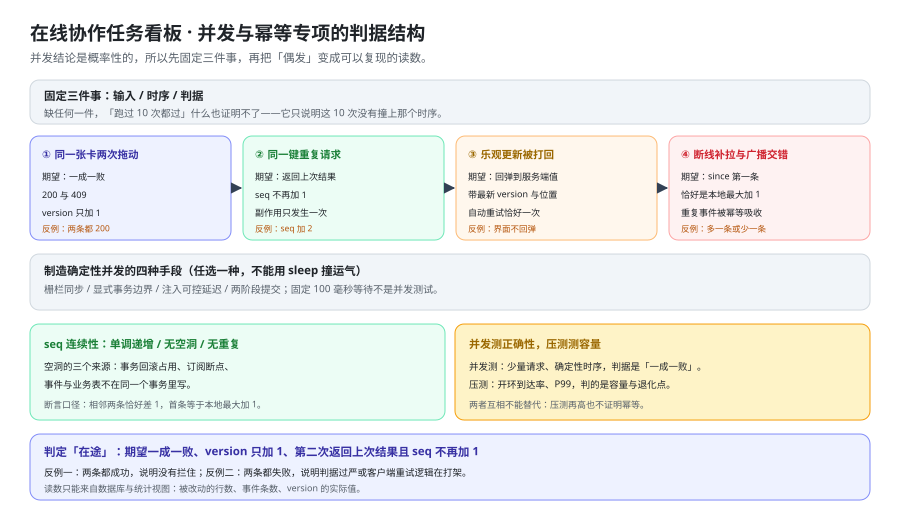

# 并发与幂等专项：让「偶发」变成可以复现的读数

上一页把权限矩阵的 18 格变成了会失败的用例，这一页处理另一类问题：**它的结论天生是概率性的**。同一份代码、同样的请求，「跑过 10 次都过」什么也证明不了——它只说明这 10 次没有撞上那个时序。本页只回答一个问题：**并发与幂等的结论，怎么变成可以复现的读数？** 它接着 [可运行验证](../Verification/index.md) 第四节的并发验证往下走，把「一成一败」从一句期望拆成判定表、栅栏写法与三条成本读数。



::: warning 本仓库只有文档，没有代码
下面的 Java 栅栏骨架、`curl` 串行/并行序列与 `psql` 对账查询，都要在**你自己搭好的工程**里执行。本仓库不存放源码与可执行副本；「运行 `xxx`」一律指「先按本节创建好该文件，再执行」。
:::

## 一、并发测试与普通测试的根本差别

普通测试的结论是**确定性**的：给定输入，输出只有一个，跑一百次都是同一个结论。并发测试的结论是**概率性**的：同样的输入，两次运行可能得到不同结果，因为**并发的顺序不由输入决定**。

| 类别 | 结论的性质 | 「跑过了」是什么意思 | 「跑过了」不说明什么 |
| --- | --- | --- | --- |
| 普通测试 | 确定性 | 这条路径在这个输入下是对的 | —— |
| 并发测试 | 概率性 | 这次运行**恰好**落进了期望的那个时序 | 换一次运行时序会不会变、时序是怎么形成的 |

这个差别推出本页的第一条纪律：**并发测试必须固定三件事**，缺任何一件，读数就不可复现。

| 要固定的事 | 固定在哪 | 不固定会怎样 |
| --- | --- | --- |
| **输入** | 两个请求用同一个 `version`（冲突场景）或同一个 `client_op_id`（幂等场景） | 两次请求的输入不同，得到「两个都成功」也说明不了乐观锁有问题 |
| **时序** | 用栅栏或注入延迟制造一个确定的同步点 | 靠 `sleep` 撞运气，同一份代码两次运行读数不同 |
| **判据** | 写死「一成一败」、`version` 只 `+1`、`seq` 不再 `+1` 这三条读数 | 判据写成「不报错」，删掉并发控制它也是绿的 |

::: danger 并发测试里最容易犯的三个判断错误
1. **把「跑过 10 次都过」当成结论**：它只是一个置信度很低的观测。可复现的读数是「在**这个固定时序**下，`cards.version` 从 7 变成 8、`409` 那一次一行都没写」——这句话换谁跑都一样。
2. **把偶发失败当成环境抖动**：并发用例偶红偶绿，往往说明它**没有固定时序**，而不是环境不稳定。正确做法是先固定时序，再看它是否每次都红。
3. **用「没有出现 `500`」当判据**：`500` 是缺陷，不是判据。一条只断言「没有 `500`」的用例，在一个完全没有并发控制的实现上依然全绿。
:::

## 二、四类场景与它们的可证伪结论

四类场景覆盖了「并发」与「幂等」两条链路上的全部关键点。每类都写清**期望的可证伪结论**——一句话，错一个字就是错：

| 场景 | 怎么制造 | 期望的可证伪结论 | 反例（怎样才能失败） |
| --- | --- | --- | --- |
| **① 同一张卡片两次拖动** | 两个请求用**同一个** `version`、**不同**的 `client_op_id`，用栅栏同时发出 | 一个 `200`、一个 `409`；`cards.version` **恰好 `+1`**；`board_events` 里 `card.moved` **恰好 `+1`** | 两条都 `200` 且 `version` `+2`：`version` 校验没有生效 |
| **② 同一个 `client_op_id` 重复请求** | 同一个 key 连发两次，**第二次在第一次提交之后**发出 | 两次都 `200` 且**返回同一份响应体**；`version` 恰好 `+1`；第二次 `seq` **不再 `+1`** | 第二次 `200` 但 `seq` `+2`：幂等键查得太晚（在业务写入之后才查） |
| **③ 乐观更新被 `409` 打回** | 客户端先用旧 `version` 做本地移动，再发请求 | 客户端**回弹**到服务端下发的 `latestPosition`；用响应体里的现状补拉；**自动重试恰好一次** | 界面停在用户拖到的位置：本地状态没有以服务端为准 |
| **④ 断线重连期间的补拉与广播交错** | 断开一个订阅端 → 期间发生两次改动 → 带 `since` 重连补拉，同时另一次广播到达 | 补拉的第一条恰好是 `本地最大 seq + 1`；广播到达的那条若已在补拉结果里，**被幂等丢弃**（不重复应用） | 补拉多一条（重复应用）或少一条（丢改动） |

第 ④ 类的关键在于**两个来源同时到达**：补拉是「拉历史」，广播是「推新事件」，两者的重叠部分必须被客户端的 `seq` 去重吸收。只测其中一个来源，就测不到这个重叠。

### 2.1 四类场景与两条既有判据的对应

| 本页场景 | 既有判据 | 补的是哪一半 |
| --- | --- | --- |
| ① 同卡片两次拖动 | `MV-H`（并发实测） | `MV-H` 要求实证，本页给出**确定性的制造方式**（栅栏 + 同 `version`） |
| ② 同 key 重复请求 | `TB-D`（幂等） · `MV-F`（拖动不是幂等） | 两者都要求「第二次返回上次结果」，本页补上**「在途」这一种时序**的判定 |
| ③ `409` 打回 | `MV-D`（输的一方看到什么） | `MV-D` 定义回弹三件事，本页把它变成一个**可断言的用例** |
| ④ 补拉与广播交错 | `RT-*`（断线追平） · `VF-E`（`seq` 缺口检测） | 两者各自单测一个来源，本页测**两者交错** |

## 三、如何制造确定性并发

四种手段，任选一种，但它们共同的目的是**制造一个确定的同步点**：

| 手段 | 怎么做 | 适合测什么 | 代价 |
| --- | --- | --- | --- |
| **栅栏同步** | 两个线程各自跑到栅栏后**同时释放**（Java 的 `CyclicBarrier`、测试框架的 barrier） | 同卡片两次拖动、同 key 两次请求 | 需要在测试代码里控制发起时刻 |
| **显式事务边界** | 测试自己开事务，先写、再在服务端观察点处暂停、再提交或回滚 | 事务回滚、`xmin` 计数、`seq` 空洞 | 需要能拿到连接并控制事务 |
| **注入可控延迟** | 在数据库层（`pg_sleep`）或服务端拦截器里插入一个**可关闭**的延迟 | 「在途」时序：第二次请求在第一次提交前到达 | 延迟点要能被测试单独打开，不能进生产路径 |
| **两阶段提交** | 把一次操作拆成「准备」与「提交」两次显式调用 | 提交前后的可见性、广播与提交的顺序 | 只在测试用；业务路径不暴露准备态 |

```java [app/src/test/java/…/ConcurrentMoveTest.java（栅栏的最小骨架）]
var barrier = new CyclicBarrier(2);            // 两个线程在此对齐，再同时发出
var pool = Executors.newFixedThreadPool(2);
var futures = IntStream.range(0, 2).mapToObj(i -> pool.submit(() -> {
    barrier.await();                            // ① 同步点：先到齐，再一起走
    return move(cardId, version, "op-race-" + i);   // ② 同一个 version，不同的 client_op_id
})).toList();
var codes = futures.stream().map(f -> status(f)).sorted().toList();
assertEquals(List.of(200, 409), codes);         // ③ 判据写死，不含「之一」
```

::: danger 为什么「`Thread.sleep` 100ms」不是并发测试
1. **它不产生同步点。** 睡 100 毫秒只是把「同时」变成「大概同时」：两个请求的提交顺序仍由调度与网络决定，同一份代码两次运行会得到不同读数——**结论不可复现**，这正是并发测试最不该有的性质。
2. **它可能根本没有制造重叠。** 如果服务端处理一次拖动只要 5 毫秒，那么睡 100 毫秒之后两个请求是**先后**跑的，测的是串行路径——而它照样会绿，于是你以为验过了乐观锁。
3. **它把测试变慢，却不增加覆盖率。** 正确做法是**栅栏**（两个线程在同一时刻释放）：重叠是构造出来的，时序是可复现的，耗时可忽略。
4. **一个例外要如实说清**：`pg_sleep` 用在**被注入的延迟点**上（第二节「注入可控延迟」），目的是把「在途」这个时序**稳定复现**出来——它是被测代码里的一个可关闭开关，不是测试里的一次盲目等待。两者形式相似，目的相反。
:::

## 四、`409` 与幂等「在途」的判定

### 4.1 判定表：两种时序，两套读数

同一个接口，两种时序的期望读数完全不同。**先把这两行分清楚，再去看代码**：

| 观察项 | ① 同卡片、不同 `client_op_id` | ② 同 `client_op_id`、重复请求 |
| --- | --- | --- |
| 状态码 | 一个 `200`、一个 `409` | 两次都 `200` |
| 响应体 | `409` 带最新 `version` 与最新位置 | 第二次返回**上次的响应体** |
| `cards.version` | 恰好 `+1` | 恰好 `+1` |
| `boards.seq` | 恰好 `+1` | 第一次 `+1`，**第二次不变** |
| `board_events` 里 `card.moved` | 恰好 `+1` | 恰好 `+1` |
| 副作用（卡片真的动了） | 只发生一次 | 只发生一次 |

### 4.2 「在途」是第三种时序

「在途」指的是：**第二次请求到达时，第一次还没有提交**。这一种时序下有两种合法口径，二者都行，但必须**选一种并写死**：

| 口径 | 行为 | 客户端看到什么 | 适用 |
| --- | --- | --- | --- |
| **等待并复用** | 第二次阻塞，等第一次提交后返回同一份响应 | 两次都是 `200` 且响应体相同 | 首选手径：客户端无需额外分支 |
| **显式 `409`** | 第二次立刻返回 `409`，`code = IDEMPOTENCY_IN_FLIGHT` | 客户端据 `code` 稍后重试 | 需要限制请求占用的场景 |

**不允许的第三种行为**：第二次也执行一次业务写入。它的读数与场景 ② 几乎一样（都 `200`），但 `version` 会 `+2`、`seq` 会 `+2`——所以判定第 ② 类与「在途」的唯一可靠读数是**`version` 与 `seq` 的增量，而不是状态码**。

### 4.3 反例：三种看起来对、其实错的读数

| 观察到的现象 | 它其实说明什么 | 正确的读数应该是什么 |
| --- | --- | --- |
| 两条都 `200`，`version` `+2` | 乐观锁没有生效，两次写入都落了库 | 一个 `200` 一个 `409`，`version` `+1` |
| 两条都 `409` | 判据过严（例如两个请求都被幂等键或唯一键先拦下），或客户端在互相顶版本 | 至少一条必须成功；`version` 必须 `+1` |
| 第二次 `200` 但 `seq` `+2` | 幂等键在**业务写入之后**才查，第二次也走了一遍写入 | 第二次命中幂等键，`seq` 不再变化 |

::: tip 为什么「两条都失败」也要当缺陷
它看起来比「两条都成功」安全，但它把一条**合法操作**变成了失败：用户拖了一次卡片，界面回弹，再拖一次又失败。这类「互相顶版本」的活锁在两端自动重试时最容易发生——所以 [卡片拖动](../CardMove/index.md) 4.3 才写死「**只自动重试一次**」。**并发用例的判据必须同时排除「都成功」与「都失败」两种形态。**
:::

## 五、`seq` 连续性断言

三条断言写死，一条不能少：

| 断言 | 口径 | 违反它的现象 |
| --- | --- | --- |
| **单调递增** | 事件流按 `seq` 排序后，后一条严格大于前一条 | 出现了更小的 `seq`：序列被回退，或客户端按到达顺序而非 `seq` 应用 |
| **无空洞** | 服务端的 `board_events.seq` 在 `[1, max]` 上连续 | 对账查询出现缺口：某号从未有事件 |
| **无重复** | 同一个 `board_id` 下 `seq` 唯一 | 两条事件共用一号：广播与补拉被重复应用时会看到同一号两次 |

```sql [对账查询：一次查出空洞与重复（在真库上跑）]
SELECT seq, count(*) FROM board_events WHERE board_id = :boardId
GROUP BY seq HAVING count(*) > 1;                       -- 有重复：必须为空

SELECT g AS missing FROM generate_series(1, (SELECT max(seq) FROM board_events
                                            WHERE board_id = :boardId)) g
WHERE NOT EXISTS (SELECT 1 FROM board_events
                   WHERE board_id = :boardId AND seq = g);   -- 有空洞：必须为空
```

并发下出现空洞的三个来源，**它们的性质完全不同，处置也完全不同**：

| 来源 | 是服务端真空洞吗 | 现象与成因 | 处置 |
| --- | --- | --- | --- |
| **事务回滚占用** | **是** | `seq` 从计数器分配后，事务因冲突回滚，号已经被烧掉 | 让 `boards.seq` 的推进与 `board_events` 的插入在**同一事务**内完成，回滚时一起回滚（[数据库设计](../Database/index.md) INV-3） |
| **订阅断点** | **不是**（服务端连续） | 客户端掉线期间的事件没收到，本地视角出现缺口 | 客户端带 `since=本地最大 seq` 补拉；**不要**把它当服务端空洞去修 |
| **事件与业务表不在同一事务** | **是** | 业务改了但事件没写（或反之），对账时既看到数据不一致、又看到空洞 | 一次写操作里业务改动、`board_events`、`audit_log`、outbox **四笔同事务** |

**区分前两类的唯一办法是对账**：直接查 `board_events` 的 `seq` 序列。服务端连续而客户端有缺口 → 是订阅断点，补拉能补齐；服务端本身有缺口 → 是事务问题，补拉**永远补不上**（那个号从来没有事件）。

## 六、成本判据的并发版

[卡片拖动](../CardMove/index.md) 第七节给出了「一次拖动只允许更新一行」的三条证法。**并发下这三条都要改口径**——否则会把「另一个并发请求写的那一行」也算进来：

| 证法 | 单次判据（`MV-G`） | 并发下怎么改，才仍然可判 |
| --- | --- | --- |
| `pg_stat_statements` 的 `rows` 增量 | 增量**恰好 `1`** | 增量**恰好等于成功请求数**（`200` 的条数），**不是请求总数**——被 `409` 拦下的那次一行都没写 |
| `xmin` 对比 | 事务号大于基准的行数**恰好 `1`** | 基准取「**所有并发请求发起之前**」的事务号；计数应等于成功请求数。且必须在**隔离的工作区**上跑，否则邻居用例的写入会污染读数 |
| 每卡 `version` 单调 | `+1` | 每张被拖动的卡片各自**恰好 `+1`**；没有任何一张增加超过 1（超过 1 说明同一张卡被写了两次） |

```sql [并发版的成本读数：三个数必须自洽（在真库上跑）]
-- ① 成功请求数（先记下来）
SELECT count(*) AS ok FROM ...             -- 期望：等于并发数减 1（一次冲突）
-- ② 被改动的行数（拖动前后各查一次，取增量）
SELECT calls, rows FROM pg_stat_statements WHERE query LIKE '%SET list_id%';
-- ③ 每张卡的版本增量（并发结束后）
SELECT id, version FROM cards WHERE id = ANY(:cardIds);   -- 每张都恰好 +1
```

::: danger 三个会把并发版判据做假的写法
1. **用请求总数当分母**：并发 2 次里有 1 次冲突（`409`），期望的 `rows` 增量是 **1** 而不是 2。写成「等于请求数」会让这条判据在**正确实现上恒红**，然后被人当成噪声关掉。
2. **在共享数据上跑**：种子数据是三个工作区共用，别的用例也在写。读数必须在**这一组并发独占**的工作区上取，否则「被改了 3 行」可能来自隔壁用例。
3. **只看总行数，不看单调性**：总行数正确、但某张卡的 `version` `+2`，说明「一次拖动更新了一行，但那一行被更新了两次」——它同样是缺陷，只有逐卡比版本才看得出来。
:::

## 七、并发测试与压测的分工，与判据表

### 7.1 两列对照表

两者常被混为一谈，因为都涉及「很多请求」。**它们测的是完全不同的东西，互相不能替代**：

| 维度 | 并发测试 | 压测 |
| --- | --- | --- |
| **测什么** | **正确性**：并发下是否一成一败、幂等是否成立、`seq` 是否连续 | **容量**：在给定到达率下 P99 是否达标、退化点在哪里 |
| 请求量 | 少量（2 ~ 10），每一个都可解释 | 大量，开环到达率（[可运行验证](../Verification/index.md) 第六节的 200 RPS） |
| 时序 | **固定、可控**（栅栏 / 注入延迟） | **不受控**，就是真实负载的样子 |
| 判据 | 状态码组合、`version` 增量、`seq` 连续性 | 到达率、P99、错误率阈值 |
| 失败的样子 | 断言失败，**可以复现** | 阈值不达标，读数**随环境波动** |
| 失败说明什么 | 实现错了 | 容量不够或某处退化（例如全列后移的写放大） |
| 依赖 | 栅栏、可控延迟、对账查询 | k6 **v2.2.0**（2026-08-10，口径日期：2026-10-16）与真实容量 |

**互相不能替代的两句话**：压测把 200 RPS 打到全绿，**不证明**幂等键生效（每个 VU 用的是不同的 `client_op_id`）；并发测试一成一败，**不证明**容量够（两次请求离容量上限很远）。

### 7.2 判据表（`CC-A ~ CC-H`）

前六条是**文档级、本机可判**（命令与实测值见第九节）；后两条是**运行期**，如实标注状态。

| 判据 | 判什么 | 级别 | 状态 |
| --- | --- | --- | --- |
| **`CC-A`** | 并发测试与普通测试的差别写清（概率性结论），且固定了输入 / 时序 / 判据三件事 | 文档级 | ✅ 本机可判 |
| **`CC-B`** | 四类场景每类都有「期望的可证伪结论」与反例，并写清与 `MV-H` / `TB-D` / `MV-D` / `VF-E` 的对应 | 文档级 | ✅ 本机可判 |
| **`CC-C`** | 确定性并发的四种手段齐全，且写清「`Thread.sleep` 不是并发测试」的四条理由与一个例外 | 文档级 | ✅ 本机可判 |
| **`CC-D`** | `409` 与幂等的判定表覆盖三种时序（冲突 / 重放 / 在途），并给出三个「看起来对、其实错」的读数 | 文档级 | ✅ 本机可判 |
| **`CC-E`** | `seq` 三条断言齐全，三个空洞来源按「是不是服务端真空洞」分开，并给出对账查询 | 文档级 | ✅ 本机可判 |
| **`CC-F`** | 成本判据的并发版口径写清（`rows` 增量 = 成功请求数），且并发测与压测的分工不可互相替代 | 文档级 | ✅ 本机可判 |
| **`CC-G`** | 四类场景在真库上跑过：①`200`+`409` 且 `version` `+1`；② 两 `200` 且 `seq` 不再 `+1`；③ 回弹；④ 补拉不重不漏 | 运行期 | `⏳ 未跑`（原因：**本仓库只有文档，没有可执行的工程与前端**；容器运行时本机可用，复验见 [第 3 周验收结论](../Week3Acceptance/index.md) 第三节） |
| **`CC-H`** | 并发下的成本读数自洽：`rows` 增量 = 成功请求数，且每张卡 `version` 恰好 `+1` | 运行期 | `⏳ 未跑`（原因：**本仓库只有文档，没有可执行的工程与前端**） |

::: warning 状态列的读法
`CC-A ~ CC-F` 验的是**「这份并发口径是否自洽、是否可被执行」**，不是「这套实现并发下对不对」——后者归 `CC-G` / `CC-H`，它需要的是**能跑起来的工程与前端**（对照 [第 3 周验收结论](../Week3Acceptance/index.md) 第五节的 B 类残余）。**不把期望值抄进状态列，也不把「跑过了」写成「通过了」。**
:::

## 八、当日做了什么

1. 定下**并发测试与普通测试的根本差别**（结论是概率性的），据此把要固定的事写成三件：**输入 / 时序 / 判据**，并逐条给出「不固定会怎样」。
2. 产出**四类场景**（同一张卡片两次拖动、同一个 `client_op_id` 重复请求、乐观更新被 `409` 打回、断线重连期间补拉与广播交错），每类给「期望的可证伪结论」与反例，并逐条对应到既有判据 `MV-H` / `TB-D` / `MV-D` / `VF-E`——说明每类**补的是哪一半**。
3. 产出**制造确定性并发的四种手段**（栅栏同步 / 显式事务边界 / 注入可控延迟 / 两阶段提交）与一段栅栏的最小骨架，并把「`Thread.sleep` 100ms 不是并发测试」写成四条理由，另点出 `pg_sleep` 作为**被注入延迟点**的合法例外。
4. 产出 **`409` 与幂等的判定表**，把「在途」确立为第**三种**时序，给出两种合法口径（等待并复用 / 显式 `409` `IDEMPOTENCY_IN_FLIGHT`）与一种不允许的行为（第二次也写库），并给出三个「看起来对、其实错」的读数。
5. 产出 **`seq` 三条断言**（单调递增 / 无空洞 / 无重复）与**对账查询**，把并发下空洞的三个来源按「**是不是服务端真空洞**」分成两类——订阅断点补拉能补齐，事务问题补拉永远补不上。
6. 把 [卡片拖动](../CardMove/index.md) 的**成本判据改成并发版**：读数从「恰好 `1` 行」改成「**恰好等于成功请求数**」，并给出三个会把判据做假的写法（用请求总数当分母 / 在共享数据上跑 / 只看总行数不看单调性）。
7. 产出**并发测试与压测的两列对照表**，写死两句「互相不能替代」：压测全绿不证明幂等生效，并发一成一败不证明容量够。

## 九、如何验证

前八条是本页可跑的自查（**本机已跑**，括注为实测值）；第 9、10 条需要容器运行时与工程代码，只给命令、**不给通过结论**。

```shell
# 1) 四类场景齐全（① ~ ④，写在第二节那张表里）
grep -cE '^\| \*\*[①②③④]' index.md                        # 实测 4

# 2) 八条判据齐全（CC-A ~ CC-H，从 A 连续到 H）
grep -cE '^\| \*\*`CC-[A-H]`\*\*' index.md                  # 实测 8

# 3) 确定性并发的四种手段都写了（模式串用 [x] 打断自匹配）
grep -cE '(栅栏同[步]|显式事务边[界]|注入可控延[迟]|两阶段提[交])' index.md   # 实测 6

# 4) 「sleep 不是并发测试」这条口径写死
grep -c '不是并发测[试]' index.md                            # 实测 4

# 5) seq 三条断言都在（单调递增 / 无空洞 / 无重复）
grep -cE '(单调递[增]|无空[洞]|无重[复])' index.md              # 实测 6

# 6) 成本判据的并发口径写清（rows 增量等于成功请求数）
grep -c '恰好等于成功请求[数]' index.md                        # 实测 2

# 7) 并发测与压测的分工写死（互相不能替代）
grep -c '互相不能替[代]' index.md                            # 实测 4

# 8) 配图被本页引用（只此一处，且是 ../assets/ 相对路径）
grep -c '../assets/tb-concurrency.sv[g]' index.md           # 实测 1

# 9) 四类场景在真库上各跑一次（需要容器运行时 + 工程代码；本机未跑）
#    期望：① 一个 200 一个 409 且 cards.version 恰好 +1
#          ② 两次都 200 且 boards.seq 第二次不再 +1
#          ③ 409 响应体带 latestVersion 与 latestPosition，客户端回弹
#          ④ 补拉第一条 = 本地最大 seq + 1，且无重复应用

# 10) 并发下的成本读数自洽（需要容器运行时 + 工程代码；本机未跑）
#     期望：pg_stat_statements 的 rows 增量 = 成功请求数；每张卡 version 恰好 +1
```

::: warning 这八条命令的期望值是怎么来的
第 1 ~ 8 条的期望值**全部是本机实跑 `grep -c` 读出来的**——其中第 3、5、7 条是多词择一的计数（分别落在正文多处），数出来的值比「概念个数」大，这是模式串的口径，不是概念重复。
它们验的是「这一页是否自洽、是否按约定成形」，**不是「这套实现并发下对不对」**——后者归 `CC-G` / `CC-H`。**不把期望值抄进状态列，也不把「跑过了」写成「通过了」。**
:::

## 十、下一步

1. **补齐 A 类残余**：第九节第 9、10 条的命令序列还缺两处参数（并发度与对账时间窗），补完它们本机即可复核——这类残余属于「文档内可解」，不该留给读者（见 [第 3 周验收结论](../Week3Acceptance/index.md) 第五节）。
2. **成本读数（`rows` 增量与 `version` 增量）接进监控**：它们与 [压测与容量验收](../CapacityTest/index.md) 的出站消息量是同一层的读数，两条曲线放在同一张大盘上才看得出「写入放大了还是广播放大了」。
3. **写死一条分工**：「并发**正确性**不随容量变化」——改变到达率不会让一成一败变成两成或两败，只会让**撞上时序的概率**变高。所以本页的结论不能被压测的吞吐数字取代，反之亦然。

## 参考资料

- 同项目章节：[可运行验证](../Verification/index.md)（第四节并发验证、第五节实时验证的 `seq` 缺口检测：本页把它们从「一成一败」拆成判定表与栅栏） · [卡片拖动：一次拖动只更新一行](../CardMove/index.md)（`MV-G` 成本判据、两个 `409` 来源两个 `code`、只重试一次） · [领域核心](../DomainCore/index.md)（乐观锁 `409`、幂等键与游标分页）
- 同项目章节：[数据库设计：表、约束与顺序字段](../Database/index.md)（`board_events` 单调序号与 INV-1~INV-6） · [实时网关](../RealtimeGateway/index.md)（`seq` 分配、提交之后再广播、断线追平） · [验收：把「做完了」变成可执行的步骤](../Acceptance/index.md)（`TB-D` / `TB-F` 与阻塞项台账）
- 方法论：[性能与容量工程 · 压测方法论](/docs/Ops/PerformanceEngineering/LoadTesting/index.md)（开环到达率与 P99 的口径） · [性能与容量工程 · 容量规划](/docs/Ops/PerformanceEngineering/Capacity/index.md)（压测测容量、不测正确性）
- 原理侧：[高并发 · 隔离级别](/docs/Backend/HighConcurrency/Isolation/index.md)（事务可见性与 `xmin` 的读法） · [PostgreSQL 专题](/docs/DB/Relational/PostgreSQL/index.md)（`pg_stat_statements` 与对账查询） · [高并发 · 常见问题](/docs/Backend/HighConcurrency/FAQ/index.md)
- 同类资产的对照写法：[实时监控大盘 · 容量基线](../../MonitoringDashboard/CapacityBaseline/index.md) · [实时监控大盘 · 容量测试](../../MonitoringDashboard/CapacityTest/index.md) · [项目总览](../index.md)
