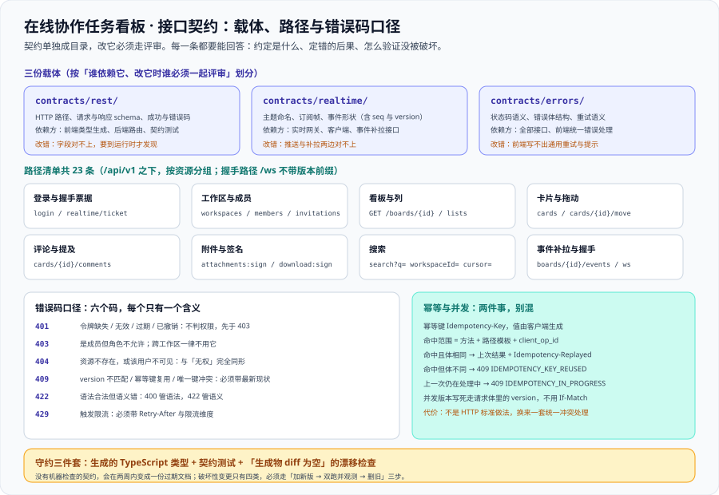

# 接口契约定稿：路径、错误码与幂等

这一页把 [架构设计](../Architecture/index.md) 第三节的十二步链路与 [需求拆分](../Requirements/index.md) 的 US-01~US-12 收成一份**能逐行对照的契约**：每一条路径的方法、请求体要点、成功码与主要错误码，四类形状口径（分页游标 / `version` / 时间戳 / ID），六个状态码各自的适用边界，幂等键与并发头的取舍，以及**怎么用机器守住它**。它是 [实时网关](../RealtimeGateway/index.md) 的对侧——那一页管**长连接怎么推**，这一页管**请求怎么问**。



::: warning 本项目只有文档，没有代码
本页出现的 `contracts/` 目录、OpenAPI 片段、契约测试命名与校验命令，都是**读者在自己工程里要建立的东西**。本仓库不存放源码、脚本与配置文件；「运行 `xxx`」一律指「先按本节创建好该文件，再执行」。
:::

## 一、契约的三份载体

契约单独成目录，且分成三份——划分依据不是「文件大小」，而是**谁依赖它、改它时谁必须一起评审**。

| 载体 | 放什么 | 谁依赖它 | 改错的后果 |
| --- | --- | --- | --- |
| `contracts/rest/` | HTTP 路径、请求体与响应体 schema、成功码与错误码 | 前端类型生成、后端路由、契约测试 | 前端不重新生成 → 字段对不上要等到运行时才发现 |
| `contracts/realtime/` | WebSocket 主题命名、订阅帧、事件形状（含 `seq` 与 `version`） | 实时网关、客户端、补拉接口 | 事件形状改了而补拉接口没改 → 推送与补拉互换数据时对不上 |
| `contracts/errors/` | 状态码语义、错误体结构、重试语义 | 全部接口与前端统一错误处理 | 各接口各自解释 4xx → 前端写不出通用的重试与提示逻辑 |

::: tip 为什么契约要单独成目录
理由与 [环境与工程骨架](../Environment/index.md) 第三节一致，也和 [实时监控大盘的契约页](../../MonitoringDashboard/Contracts/index.md) 同源：**它的变更节奏与责任人跟业务代码不一样**。
放在 `app/` 或 `web/` 里的契约会退化成「顺手改一下」——改的人不知道有谁在依赖它，而被依赖方也看不到这次改动。单独成目录 + 独立评审，是让「这是跨边界约定」这件事**在目录结构上就写出来**。
:::

三份契约里的每一条，都必须能回答同样三句话：**约定是什么、定错的后果是什么、怎么验证它没被破坏**。下面各节按这三问组织。

## 二、完整路径清单

`/api/v1` 之下的全部路径如下。**这张表就是契约的索引**：任何一条路径没有出现在这里，就不算定稿。

| 方法 | 路径 | 请求体要点 | 成功码 | 主要错误码 |
| --- | --- | --- | --- | --- |
| **POST** | `/api/v1/auth/login` | `email`、`password` | `200` | `401` `429` |
| **POST** | `/api/v1/realtime/ticket` | 无体（令牌即身份） | `201` | `401` |
| **GET** | `/api/v1/workspaces` | 无体；`cursor` / `limit` 在查询串 | `200` | `401` |
| **POST** | `/api/v1/workspaces` | `name`（1~60 字符） | `201` | `401` `422` |
| **PATCH** | `/api/v1/workspaces/{id}` | `name`、`version` | `200` | `403` `404` `409` |
| **POST** | `/api/v1/workspaces/{id}/invitations` | `email`、`role`（只允许 `editor` / `viewer`） | `201` | `403` `404` `409` `422` |
| **PATCH** | `/api/v1/workspaces/{id}/members/{userId}` | `role` | `200` | `403` `404` |
| **DELETE** | `/api/v1/workspaces/{id}/members/{userId}` | 无体 | `204` | `403` `404` |
| **GET** | `/api/v1/workspaces/{id}/boards` | 无体 | `200` | `403` `404` |
| **POST** | `/api/v1/workspaces/{id}/boards` | `name` | `201` | `403` `404` `422` |
| **GET** | `/api/v1/boards/{id}` | 无体；全量读（列 + 分页卡片） | `200` | `403` `404` |
| **POST** | `/api/v1/boards/{id}/lists` | `name`、`beforeListId` | `201` | `403` `404` `409` |
| **POST** | `/api/v1/boards/{id}/cards` | `listId`、`title`、`beforeCardId`、`Idempotency-Key` | `201` | `403` `404` `409` `422` |
| **POST** | `/api/v1/boards/{id}/cards/{cardId}/move` | `targetListId`、`beforeCardId`、`version`、`client_op_id` | `200` | `403` `404` `409` `422` |
| **PATCH** | `/api/v1/cards/{cardId}` | `title`、`body`、`assignee`、`due_at`、`version` | `200` | `403` `404` `409` `422` |
| **DELETE** | `/api/v1/cards/{cardId}` | 无体 | `204` | `403` `404` |
| **POST** | `/api/v1/cards/{cardId}/comments` | `body`（可含 `@` 提及）、`Idempotency-Key` | `201` | `403` `404` `422` |
| **POST** | `/api/v1/cards/{cardId}/attachments:sign` | `fileName`、`contentType`、`byteSize` | `200` | `403` `404` `413` |
| **POST** | `/api/v1/cards/{cardId}/attachments` | `objectKey`、`checksum`、`byteSize` | `201` | `403` `404` `409` |
| **GET** | `/api/v1/attachments/{id}/download:sign` | 无体 | `200` | `403` `404` |
| **GET** | `/api/v1/search` | `q`、`workspaceId`、`cursor` | `200` | `401` `403` `404` |
| **GET** | `/api/v1/boards/{id}/events` | `since`、`limit` | `200` | `403` `404` `409` |
| **GET** | `/ws` | 握手：`ticket` 在查询串 | `101` | `401` |

三条读表纪律：

1. **写接口必带 `version`**（除 `POST` 创建类）。表里凡是 `PATCH` / `move` 的请求体要点都写了 `version`，漏了就是漏了。
2. **写接口必带幂等键**（`Idempotency-Key` 头或请求体里的 `client_op_id`）。表里只在创建类与 `move` 上显式标出，是因为它们的重试概率最高。
3. **握手路径不带 `/api/v1` 前缀**：`/ws` 不是一个 REST 资源，它是协议升级入口。把它塞进版本前缀会诱导别人以为「升级一个 WebSocket 要写 URL」。

::: danger 路径设计上四个会长期疼的决定
1. **`attachments:sign` 用冒号动作后缀，而不是 `/attachments/sign`。** 后者会与「`id = sign` 的附件」这条路径**歧义**。动作后缀（`资源:动作`）是 REST 之外的一种明确语法，一眼可辨。
2. **下载签名放在附件维度（`/attachments/{id}/download:sign`），不放卡片维度。** 一个附件只属于一张卡片，权限判定需要的是附件 → 卡片 → 看板 → 工作区这条链；放在卡片维度会让「同一个附件出现两个签名入口」。
3. **补拉事件挂在看板维度（`/boards/{id}/events`）。** `seq` 的粒度是每块看板，补拉也必须按看板问，否则客户端要跨看板自己合并。
4. **不要给「搜索」单开一个带 `workspaceId` 的路径段**，而是把它做成查询参数并强制必填。理由：搜索天生要跨看板，路径段会诱导「`/workspaces/{id}/search` 之外还有别的入口」。
:::

## 三、请求与响应形状口径

四类形状口径**全项目统一**，任何一条路径都不得例外：

| 口径 | 取值 | 为什么定死 |
| --- | --- | --- |
| **分页游标** | 不透明的 `cursor` 字符串；响应体 `{ "items": [...], "nextCursor": "…" }` | 用 `offset` 时，并发写入会让同一页「跳过」或「重复」；游标编码的是「上一页最后一行的位置」，天然免疫 |
| **并发版本** | 请求体里的 `version`；响应体里的可变资源都必须回传 `version` | 只在一侧出现就会漏：请求里没有 → 无法检测冲突；响应里没有 → 前端拿不到下一次要发的值 |
| **时间戳** | RFC 3339 / ISO 8601，**UTC，带 `Z`，毫秒精度**；库里是 `timestamptz` | 只要有一个接口返回本地时间，前端就要开始猜时区；「哪一端做时区转换」必须只有一个答案：**只在呈现层** |
| **ID 形态** | `uuidv7` 的 36 字符带连字符形式，不透明 | 与 [数据库设计](../Database/index.md) 的 `uuidv7()` 一致；不透明意味着客户端不得从 ID 里推断任何业务信息 |

::: warning 文档里的短 ID 是示意，不是契约
[架构设计](../Architecture/index.md) 与 [数据库设计](../Database/index.md) 的正文里出现过 `b_7f3a`、`c_9d21` 这类**可读性缩写**，它们的作用是让链路图好读。**对外契约一律 `uuidv7` 字符串**，不允许出现「前缀 + 短码」的形态——一旦引入，就会有人按前缀做路由判断。
:::

分页的边界要说清：

| 参数 | 默认 | 上限 | 越界的处置 |
| --- | --- | --- | --- |
| `limit` | 50 | 200 | 超过上限时**按上限截断并在响应里回显实际值**，不报错、不静默 |
| `cursor` | 无（从头开始） | —— | 无法解析的游标 → `422`（它一定是客户端拼错了，不能当成「从头开始」） |
| `nextCursor` | 无（已到末尾时返回 `null`） | —— | 返回空字符串会让「空串」与「没有下一页」两种含义混淆 |

统一响应体结构：

```json [成功：直接返回资源或列表，不包一层业务码]
{
  "id": "0191f2c4-2222-7000-8000-000000000002",
  "listId": "0191f2c4-3333-7000-8000-000000000003",
  "position": "0|b/003",
  "version": 8
}
```

```json [失败：错误体结构固定]
{
  "error": {
    "code": "VERSION_CONFLICT",
    "message": "卡片已被其他人修改",
    "details": { "currentVersion": 9, "currentPosition": "0|c/001" },
    "traceId": "0191f2c4-9999-7000-8000-0000000000ff"
  }
}
```

::: danger 形状上两个一定会被问到的决定
1. **不包 `{ "code": 0, "data": … }` 这层壳。** 壳会让 HTTP 状态码与业务码变成**两个真相源**：401 与「HTTP 200 + `code: 401`」让所有网关、日志、重试策略同时失效。
2. **失败时 `details` 必须是结构化对象，不是拼好的文本。** 「卡片已被其他人修改」这句话对用户没用，`currentVersion` 才有用——客户端要拿它把本地乐观更新回滚到服务端状态。
:::

## 四、错误码口径

六个状态码，各自只有一个含义。**这张表本身就是契约**：客户端按它写重试与提示，服务端按它选状态码。

| 状态码 | 什么情况用它 | 客户端应该做什么 | 边界（什么时候**不**用它） |
| --- | --- | --- | --- |
| **401** | 令牌缺失 / 无效 / 过期 / 已撤销 | 刷新令牌后重试一次，仍失败则回登录页 | **不判权限**：`401` 必须先于 `403` 判定，未认证的请求不告诉它「你缺的是权限」 |
| **403** | 身份已证实，但角色不允许该动作 | 禁用按钮并给出提示，**不重试** | 跨工作区**不用**它（那会泄漏资源存在性） |
| **404** | 资源不存在，**或**该用户不可见（含跨工作区） | 回列表页，不重试 | 不用于「资源存在但状态不对」（那是 `409`） |
| **409** | `version` 不匹配 / 幂等键复用 / 唯一键冲突 / 目标资源已被删 | 拉最新状态后由用户决定 | 不用于「请求本身写错了」（那是 `422`） |
| **422** | 语法合法但语义错误：`due_at` 早于创建时间、目标列与卡片不属于同一看板 | 展示字段级错误，不重试 | 不用于「JSON 语法错 / 缺必填字段 / 类型错」（那是 `400`） |
| **429** | 触发限流（用户 / 工作区 / IP 三个维度任一） | 按 `Retry-After` 秒数退避后重试 | 不用于「服务端过载」（那是 `503`，且不该让客户端立刻重试） |

三条写死的口径：

1. **`401` 先于 `403`。** 判定顺序是「先身份、后权限」。反过来写会让未认证请求得到「你没有权限」这种更具体的回答，等于免费告诉攻击者「这个资源存在、你只差一张令牌」。
2. **跨工作区一律 `404`。** `403` 会告诉对方「资源存在、只是你不够格」。写成一个 `404` 之后，「无权」与「不存在」在客户端**完全同形**——这既是安全要求，也是 [验收](../Acceptance/index.md) 权限矩阵里那条贯穿全表的边界。
3. **`409` 的四种触发条件都要带可用的现状。** 乐观锁冲突带 `details.currentVersion` 与 `details.currentPosition`；幂等键复用带 `details.reason`；唯一键冲突带冲突的那一列；资源已删带 `details.deletedAt`。**只回一句「冲突了」等于逼客户端去猜。**

`400` 与 `422` 的边界一句话记：**语法错是 `400`，语义错是 `422`。** 前者是「服务器读不懂你的请求」，后者是「读懂了，但这件事本身不成立」。把它们混成一个码，前端就永远无法区分「我的代码有 bug」与「用户填错了」——而这两种情况的处置完全相反。

```shell
# 契约测试里最容易被漏的一条：把所有 4xx 用例跑一遍，状态码必须落在 4xx
# 出现 200 + 错误体，或 500 + 业务原因，都说明状态码口径被绕过了
curl -s -o /dev/null -w '%{http_code}\n' \
  -X POST "http://localhost:8080/api/v1/boards/$BOARD_ID/cards/$CARD_ID/move" \
  -H "Authorization: Bearer $TOKEN" -H 'Content-Type: application/json' \
  -d '{"targetListId":"'$LIST_ID'","beforeCardId":null,"version":1,"client_op_id":"op-old"}'
```

```text
409
```

## 五、幂等键与并发头：两件事，别混

[架构设计](../Architecture/index.md) 第五节已经点明：**幂等键解决「同一次操作重发两次」，并发版本解决「两个人改同一张卡片」。** 两者都要，缺一不可。这一节定它们的**形状**。

### 5.1 幂等键

| 项 | 定稿取值 |
| --- | --- |
| 载体 | `Idempotency-Key` 请求头（值由客户端生成，建议 UUID） |
| 命中范围 | `(scope, client_op_id)`，其中 `scope = 方法 + 路径模板`，例如 `POST /api/v1/boards/{id}/cards/{cardId}/move` |
| 保留期 | 24~48 小时（与 [数据库设计](../Database/index.md) 的 `idempotency_keys` 一致） |

`scope` 用**路径模板**而不是带实际 id 的路径，理由是：模板的基数只有几十条，能被枚举、能被统计、也能被清理；用实路径会让 `scope` 变成无界集合，这个表会退化成一张业务表。

三种命中结果**必须区分**，因为它们的正确处置完全不同：

| 情形 | 响应 | 为什么 |
| --- | --- | --- |
| 命中，且请求体与上次一致 | 返回**上次的状态码与响应体**（逐字节相同），另加 `Idempotency-Replayed: true` 头 | 这就是幂等想要的效果；响应逐字节相同，客户端无法区分「第一次」与「重放」以外的任何事 |
| 命中，但请求体与上次**不同** | `409` + `details.reason = "IDEMPOTENCY_KEY_REUSED"` | 静默返回上次结果会让「客户端复用了 key 却改了内容」变成一次**无声的数据丢失** |
| 上一次仍在处理中（未提交） | `409` + `details.reason = "IDEMPOTENCY_IN_PROGRESS"` | 让客户端稍后重试，而不是开第二份副作用 |

### 5.2 并发版本：写死走请求体，不走 `If-Match`

这一处是**真取舍**，因为两条路都成立。定稿选**请求体里的 `version` 字段**：

| 方案 | 语义 | 冲突码 | 是否进类型生成 | 定稿 |
| --- | --- | --- | --- | --- |
| `If-Match: version` 请求头 | 借用了 ETag 的语义（内容哈希） | `412` | 不进 | ✗ |
| **请求体里的 `version`** | 行版本号 | `409` | 进 | ✓ |

三条理由：

1. **`If-Match` 的语义是 ETag，即「资源内容的哈希」，而我们的 `version` 是行版本号。** 混用会让系统里出现两个版本概念：HTTP 层以为在比对内容，业务层在比对行版本。改一个字段却没动版本、或动了版本却没改内容，两边就会打架。
2. **HTTP 头不参与请求体 schema 的生成。** 选了 `If-Match` 就意味着前端要手写这个头、契约测试要单独断言它、类型生成覆盖不到它——一处「约定外」的字段，长期必然漂移。
3. **`412` 与 `409` 的语义对本项目是分裂的。** 客户端已经有一套 `409` 的处理（拉最新状态、回滚乐观更新），再引入 `412` 就要写两套，且两套的逻辑必须保持一致。

**代价写在明面上**：请求体里的 `version` 不是 HTTP 的「标准做法」，`curl`、Postman、各种 HTTP 客户端与中间缓存都不会自动处理它；换成统一冲突处理这条收益，是本项目愿意付的代价。

::: danger 幂等与并发上四个会静默出错的写法
1. **只做幂等不做并发。** 网络重试被挡住了，但两个人各自的「第一次」请求照样会互相覆盖，而且没有任何痕迹。
2. **只做并发不做幂等。** 一次网络抖动就让用户看到「冲突」提示——用户会以为是别人动了，实际是自己重发。
3. **`client_op_id` 由服务端生成。** 幂等键的作用是「识别出这是同一次操作」，只有**发起方**知道这件事；服务端生成的 key 每次都不同，等于没有幂等。
4. **冲突响应不带最新状态。** 「冲突了，请重试」会让客户端立刻用同一个过期版本再发一次——它必然再冲突，然后无限循环。
:::

## 六、契约怎么守：三件套

契约定完就完了吗？不。**没有机器检查的契约，会在两周内变成一份过期文档。** 守约由三件事组成，缺任何一件都会漏：

### 6.1 生成的 TypeScript 类型

前端**不手写**接口类型，全部从 `contracts/rest/` 生成：

```shell
# 契约改了之后重新生成前端类型（生成物进仓库，便于 diff）
pnpm dlx openapi-typescript contracts/rest/openapi.yaml -o web/src/types/api.ts
```

```text
🚀 contracts/rest/openapi.yaml → web/src/types/api.ts [82ms]
```

生成物进仓库（而不是 `.gitignore` 掉），理由只有一个：**只有进仓库才能做「生成物 diff 为空」这条检查**。文件头必须带 `// Code generated by openapi-typescript. DO NOT EDIT.`，禁止手改。

### 6.2 契约测试

每个路径至少两条用例：**一条成功 + 一条主要错误**；错误码用例按第四节的六个状态码逐条覆盖。测试类名与被测路径**一一对应**（`MoveCardContractTest` 对应 `POST …/move`），否则「加了接口忘了加测试」这件事不可检测。

```java [app/src/test/java/…/contract/MoveCardContractTest.java（骨架）]
// 1) 成功：200，version 恰好 +1，响应体回传新的 version
// 2) 冲突：过期 version → 409，且 details 里必须有 currentVersion 与 currentPosition
// 3) 失效令牌 → 401（必须早于 403），跨工作区 → 404（不是 403）
// 4) 幂等：同一个 Idempotency-Key 连发两次，第二次带 Idempotency-Replayed: true
```

### 6.3 「生成物 diff 为空」的漂移检查

```shell
# CI 里的漂移检查：契约改了却没重新生成 → 这一步会失败
pnpm dlx openapi-typescript contracts/rest/openapi.yaml -o web/src/types/api.ts
git diff --exit-code -- web/src/types/api.ts
```

```text
# 生成物与仓库内一致时：无输出、退出码 0
# 契约改了但没重新生成时：diff 里出现新增或删除的字段，退出码 1
```

::: tip 为什么这条检查比「记得同步更新」有效
「改了契约要记得同步生成物」是一条**靠人记住的规定**；`git diff --exit-code` 是一条**自己会失败的判据**。
它拦住的是一类最难发现的缺陷：契约改了、前端编译通过（因为字段是可选或用了 `any`）、运行时字段对不上。这类问题在本地往往复现不出来，上了预发才会以「接口返回 undefined」的形式出现。
:::

第二条漂移检查是**路径与测试的双向对账**：契约里的每条路径必须有同名契约测试，反之亦然。

```shell
# 契约路径集合 vs 契约测试类集合（两个集合应当一一对应）
grep -oE '^  /[a-z0-9/{}:_-]+' contracts/rest/openapi.yaml | sort -u | wc -l
ls app/src/test/java/**/contract/*ContractTest.java | sed 's/.*\///' | sort -u | wc -l
```

```text
# 两个数字相等时才算对齐；差一个就说明「加了路径没加测试」或「删了路径留了测试」
```

## 七、契约变更纪律

**破坏性变更只有四类**，清单之外的变动都是兼容变更。

| # | 破坏性变更 | 为什么它是破坏性的 |
| --- | --- | --- |
| 1 | 删除或重命名字段 / 路径 | 调用方的代码直接编译失败或字段变 `undefined` |
| 2 | 改字段类型或语义 | `position` 从字符串改成数组、`version` 从整数改成字符串，编译期未必报错但行为全变 |
| 3 | 收紧取值域 | 服务端加新枚举值对服务端是「加法」，对客户端却是破坏——它的 `switch` 没有 `default` 分支 |
| 4 | 改错误码语义 | `404` 改 `403`、`409` 改 `422`，调用方的重试与提示逻辑全部失效 |

兼容变更（可以随时做）：新增可选字段、新增路径、放宽取值域、新增枚举值 **且** 客户端已按「未知值走默认分支」实现。

破坏性变更**必须走三步走，顺序不可换**：

1. **加新版**：同时提供旧形态与新形态（例如新增 `position_v2`，旧字段继续返回），旧形态的语义一字不改。
2. **双跑并观测**：埋点统计旧字段 / 旧路径的调用量，跑满一个观察窗口（本项目定为 7 天）；**调用量归零**才允许进入第 3 步。
3. **删旧**：删掉旧字段 / 旧路径，同时更新契约版本号与变更日志。

::: danger 顺序反着做会发生什么
1. **先删再补**：调用方在第一时间就崩了，而「补」是后来的事——第 2 步的观测数据根本不存在，你无法知道还有谁在用。
2. **跳过第 2 步直接删**：某条低频路径可能一周才被调用一次（例如月度报表），7 天窗口内调用量为零看起来「没人在用」，实际是没到调用的时候。观察窗口本身就是判据的一部分。
3. **在同一路径内偷偷改语义**：字段名没变、类型没变，含义变了。这是最糟的一类变更——它不会被任何静态检查发现，也不会被编译期发现，只会以「数据看起来不对」的形式迟到出现。**语义变更必须走「加新字段」而不是「改老字段」。**
:::

关于版本前缀：本项目对外**只维护 `/api/v1` 一个版本**，30 天周期内不引入 `/api/v2` 并存。破坏性变更通过「加新版字段 → 双跑 → 删旧」在同一路径内完成；只有当某次变更**无法用加法表达**时，才引入新版本前缀，并在项目总览的迭代记录里写明原因。

## 八、当日做了什么

1. 定稿契约的**三份载体**（`contracts/rest` / `contracts/realtime` / `contracts/errors`），按「谁依赖它、改它谁必须评审」划分，并复述「契约单独成目录」的理由。
2. 产出**完整路径清单表**（23 行），覆盖登录、握手票据、工作区、成员与邀请、看板、列、卡片（含 `move`）、评论、附件签名与确认、附件下载签名、搜索、事件补拉与 WebSocket 握手；每行给出方法、路径、请求体要点、成功码与主要错误码，并补上四条路径设计上的长期决定（动作后缀、下载签名挂附件维度、补拉挂看板维度、搜索用查询参数）。
3. 定稿**四类形状口径**：分页游标（含 `limit` / `cursor` / `nextCursor` 的边界）、并发版本必须回传、时间戳一律 UTC 带 `Z`、ID 一律 `uuidv7`；并写明「文档里的短 ID 是示意，不是契约」。
4. 定稿**错误码口径表**（六行），写死三条口径：**`401` 先于 `403`**、**跨工作区一律 `404` 而不是 `403`**、**`409` 的四种触发条件都必须带可用现状**；并给出 `400` 与 `422` 的一句话边界。
5. 定稿**幂等键**（载体、命中范围用路径模板、保留期）与**三种命中结果**，以及**并发头的取舍**——写死选请求体里的 `version` + `409`（三条理由 + 一条明面上的代价：不是 HTTP 标准做法）。
6. 定稿**守约三件套**：生成的 TypeScript 类型（生成物进仓库、禁止手改）、契约测试（每路径至少一条成功 + 一条主要错误）、「生成物 diff 为空」的漂移检查与路径 ↔ 测试的双向对账。
7. 定稿**破坏性变更四类清单**与**三步走顺序**（加新版 → 双跑并观测 → 删旧），并逐条说明顺序反着做的后果；写明本项目**只维护 `/api/v1` 一个版本**。

## 九、如何验证

`IC-A` ~ `IC-H` 八条判据。前六条是**文档级、本机可判**（下面的命令已实跑，括注为实测值）；后两条是**运行期**，如实标注状态。

| 判据 | 判什么 | 命令 | 期望 | 是否已跑 |
| --- | --- | --- | --- | --- |
| **`IC-A`** | 路径清单完整（每条路径一行，方法列加粗） | 第 1 条 | `23` | ✅ 本机已跑 |
| **`IC-B`** | 错误码口径表六行齐全 | 第 2 条 | `6` | ✅ 本机已跑 |
| **`IC-C`** | 跨工作区用 `404`、`401` 先于 `403` 两条口径写死 | 第 3 条（两条 `grep`） | `2` 与 `3` | ✅ 本机已跑 |
| **`IC-D`** | 幂等键冲突码与并发头（走请求体）的取舍写死 | 第 4 条（两条 `grep`） | `1` 与 `4` | ✅ 本机已跑 |
| **`IC-E`** | 守约三件套：漂移检查命令与三个小节都在页内 | 第 5 条（两条 `grep`） | `2` 与 `3` | ✅ 本机已跑 |
| **`IC-F`** | 三份载体与「契约单独成目录」的理由写死 | 第 6 条（两条 `grep`） | `8` 与 `4` | ✅ 本机已跑 |
| **`IC-G`** | 生成物与契约一致（漂移检查无 diff、退出码 0） | 第 7 条 | 无输出、退出码 `0` | ⏳ 未跑 · 本仓库无工程代码，也没有 Node 工具链 |
| **`IC-H`** | 契约测试逐路径覆盖（路径数 == 测试类数） | 第 8 条 | 两个数字相等 | ⏳ 未跑 · 本仓库无工程代码，也没有 JDK |

```shell
# IC-A：路径清单完整（每条路径一行，方法列加粗）
grep -cE '^\| \*\*(GET|POST|PATCH|DELETE)\*\* \|' index.md        # 期望 23

# IC-B：错误码口径表六行齐全
grep -cE '^\| \*\*(401|403|404|409|422|429)\*\* \|' index.md      # 期望 6

# IC-C：两条贯穿全表的口径写死（模式里的反引号是口径原文的一部分）
grep -c '跨工作区一律 `40[4]' index.md                            # 期望 2
grep -c '`401` 先于 `40[3]' index.md                              # 期望 3

# IC-D：幂等键与并发版本的取舍写死（`If-Matc[h]` 是防自匹配的写法）
grep -c 'IDEMPOTENCY_KEY_REUSE[D]' index.md                       # 期望 1
grep -c 'If-Matc[h]' index.md                                     # 期望 4

# IC-E：守约三件套：漂移检查命令与三个小节都在页内
grep -c 'git diff --exit-code -- web/src/types/api.t[s]' index.md # 期望 2
grep -c '^### 6\.[1-3] ' index.md                                 # 期望 3

# IC-F：契约三份载体与「单独成目录」的理由写死
grep -c 'contracts/res[t]' index.md                               # 期望 8
grep -c '契约单独成目[录]' index.md                                # 期望 4

# IC-G：生成物与契约一致（需要工程代码 + Node 工具链）
#    期望：无输出、退出码 0；有 diff 即说明契约改了没重新生成
pnpm dlx openapi-typescript contracts/rest/openapi.yaml -o web/src/types/api.ts
git diff --exit-code -- web/src/types/api.ts

# IC-H：契约测试逐路径覆盖（需要工程代码 + JDK）
#    期望：契约路径数 == 契约测试类数（第 6.3 节的两条计数命令相等）
ls app/src/test/java/**/contract/*ContractTest.java | wc -l
```

::: warning 后两条为什么只给命令
`IC-G` / `IC-H` 的判据对象是**真实工程与工具链**，而本机既没有工程代码、也没有跑过类型生成。按本项目一贯纪律：**不把设计完成写成运行期验证完成**，这两条如实标 `⏳ 未跑`。
另说明边界：`IC-*` 只登记「契约自身是否自洽、是否可被机器守住」这一类，与 [验收](../Acceptance/index.md) 页的 `TB-*`（回答「这条验收怎么跑」）**互不替代**；与 [实时监控大盘的契约页](../../MonitoringDashboard/Contracts/index.md) 的 `W1-*` 更是两个项目各自的约定，编号不复用。
:::

## 参考资料

- [架构设计：模块边界与实时链路](../Architecture/index.md)（十二步链路、三处权限判定点、乐观锁与幂等的分工） · [数据库设计](../Database/index.md)（`idempotency_keys`、`cards.version`、`uuidv7()`）
- [实时网关](../RealtimeGateway/index.md)（长连接侧的契约：订阅帧、事件形状、`seq`） · [需求拆分](../Requirements/index.md)（US-01~US-12 是路径清单的来源） · [验收](../Acceptance/index.md)
- [环境与工程骨架](../Environment/index.md)（`contracts/` 在目录结构里的位置与「契约单独成目录」的原始理由）
- [实时监控大盘 · 接口契约与工程骨架](../../MonitoringDashboard/Contracts/index.md)（同一套「约定 / 定错的后果 / 可执行验证」三问的另一种实例，本项目不照抄其内容）
- [完整项目交付 · 接口契约](/docs/Others/ProjectDelivery/Contract/index.md)（契约该产出什么的通用口径）
