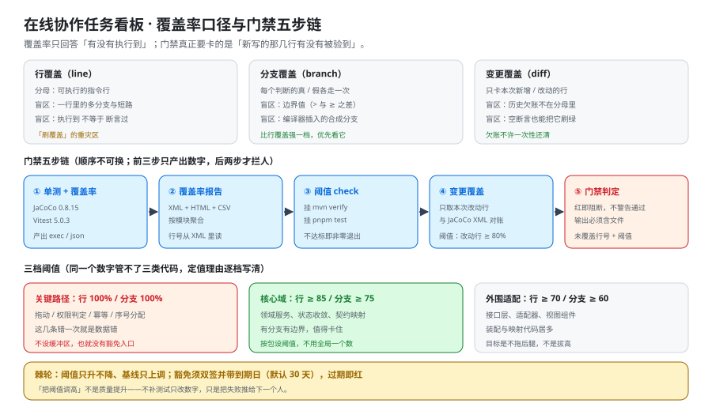

# 覆盖率门禁：只卡「新写的那几行有没有被验到」

这一页回答「覆盖率这个数怎么取、取哪几个、超过多少才拦人、拦不住的时候怎么办」——它把三种口径的盲区、门禁五步链的顺序、三档阈值的定值理由与棘轮机制写成可执行的口径；它**不回答**「测试该写在哪一层」（那是 [自动化测试分层](../TestStrategy/index.md) 的事），也**不重复**「每层断言什么」（那是 [端到端测试](../E2ETest/index.md) 与 [权限矩阵验证](../PermissionMatrix/index.md) 的事）。**门禁是这套测试的收口**：它不产生新测试，只回答「已有的测试有没有覆盖到刚改的那几行」。



::: warning 本仓库只有文档，没有代码
下面的 `pom.xml` / `vitest.config.ts` 片段、`diff` 对账脚本与 CI 步骤，都要在**你自己搭好的工程**里创建后执行。本仓库不存放源码与可执行脚本；「运行 `mvn verify`」一律指「先按本节把配置加进去，再执行」。
:::

## 一、三条口径各自回答什么

覆盖率不是一个数，至少是三个数。**它们的分母不同，因此不能互相替代**——同一个工程里行覆盖 `92%` 与变更覆盖 `61%` 可以同时成立，且后者才是门禁该看的那个。

| 口径 | 分母是什么 | 它回答的问题 | 它答不了的问题 |
| --- | --- | --- | --- |
| **行覆盖（line）** | 可执行的指令行 | 「这些代码有没有被执行到」 | 一行里的多个分支、短路求值；**执行到 ≠ 断言过** |
| **分支覆盖（branch）** | 每个判断的真 / 假两条边 | 「每个判断的两边都走过了吗」 | 边界值（`>` 与 `>=` 之差）；编译器插入的合成分支 |
| **变更覆盖（diff / changed-line）** | **本次改动**新增或修改的行 | 「刚改的那几行有没有被验到」 | 历史欠账（不在分母里）；空断言也能把它刷绿 |

三条口径的分工可以一句话讲清：**行覆盖用来看面积，分支覆盖用来判断质量，变更覆盖用来拦人。**

::: danger 三条口径各自的「假绿」
1. **行覆盖的假绿**：`if (a > 0 && b > 0)` 里只走了「两个都真」的一支，行覆盖显示这一行**已覆盖**。短路求值让「已覆盖」不等于「都验过」。
2. **分支覆盖的假绿**：`if (count >= 3)` 只测了 `count = 3` 与 `count = 5`，两条边都走到了，但 `count = 2` 永远没测——**边界值不是分支**。
3. **变更覆盖的假绿**：新写的三行被一条**只有 `expect(true).toBe(true)` 的空断言**「执行到」，diff 覆盖率 `100%`。这条假绿最危险，因为它恰好出现在「本次改动」这个最该被拦住的位置。
:::

::: tip 为什么本项目把变更覆盖排在第一位
本项目的核心不变量集中在三处（拖动一次只更新一行、权限矩阵 18 格、`seq` 单调 +1）。这三处的代码**只在被改动时才可能被破坏**——历史欠账再多，今天也不会让已经上线的行为出错。所以门禁的主口径是**变更覆盖**：它把「本次改动」限定成一个可判定的集合，**欠账不许一次性还清，也不许用欠账掩盖本次的空洞**。
:::

## 二、门禁五步链（顺序不可换）

```text
① 单测 + 覆盖率采集   →   ② 报告聚合   →   ③ 阈值 check   →   ④ 变更覆盖对账   →   ⑤ 门禁判定
   （产出原始数据）        （产出可读报告）      （产出数字）       （产出结论）        （产出红 / 绿）
```

**前三步只产出数字，后两步才拦人。** 这个划分不是为了好看：把「采集」与「判定」分开，才能在门禁红了之后回答「是采集没跑全，还是数字真的没到」。

### 2.1 ① 单测 + 覆盖率采集

```xml [pom.xml]
<!-- JaCoCo 0.8.15（2026-06 发布；0.8.x 维护线仍在收补丁） -->
<plugin>
  <groupId>org.jacoco</groupId>
  <artifactId>jacoco-maven-plugin</artifactId>
  <version>0.8.15</version>
  <executions>
    <execution>
      <id>prepare-agent</id>
      <goals><goal>prepare-agent</goal></goals>
    </execution>
    <execution>
      <id>report</id>
      <phase>verify</phase>
      <goals><goal>report</goal></goals>
      <configuration>
        <formats><format>XML</format><format>HTML</format></formats>
      </configuration>
    </execution>
  </executions>
</plugin>
```

```typescript [vitest.config.ts]
import { defineConfig } from "vitest/config";

export default defineConfig({
  test: {
    coverage: {
      provider: "v8",
      reporter: ["text", "json", "lcov", "html"],   // json 是给脚本对账用的那一份
      include: ["src/**"],
      exclude: ["src/**/*.d.ts", "src/generated/**"],   // 生成代码不计入分母
    },
  },
});
```

**采集阶段最容易出错的不是配置，是分母。** 一个不设 `exclude` 的工程，`src/generated/**` 会把整体覆盖率拉低十个点，于是团队去补生成代码的测试——**这是在为不该测的东西写测试**。

### 2.2 ② 报告聚合

产三份：`XML`（脚本读行号用）/ `HTML`（人看）/ `CSV`（趋势用）。**按模块聚合，不要只留一个全局数**——全局数会掩盖「核心域很干净、适配层一片空」这种结构性问题。

```shell
# 期望：每个模块一行，形如 core=0.88 adapter=0.71 web=0.64
mvn -q verify && mvn -q jacoco:report-aggregate
ls target/site/jacoco-aggregate/jacoco.xml && echo "聚合报告已生成"
```

### 2.3 ③ 阈值 check

```xml [pom.xml]
<execution>
  <id>check</id>
  <goals><goal>check</goal></goals>
  <configuration>
    <rules>
      <rule>
        <element>BUNDLE</element>
        <limits>
          <limit><counter>LINE</counter><value>COVEREDRATIO</value><minimum>0.70</minimum></limit>
        </limits>
      </rule>
    </rules>
  </configuration>
</execution>
```

挂的位置写死：**后端挂 `mvn verify`、前端挂 `pnpm test --coverage`**。挂进 `test` 阶段是常见错误——`test` 会在 IDE 里被频繁触发，而门禁只该在提交 / CI 时说话。

### 2.4 ④ 变更覆盖对账

这是整条链上唯一一个**必须自己写**的步骤：JaCoCo 只告诉你「哪些行被覆盖了」，不告诉你「哪些行是本次改的」。两者要做交集。

```shell
# 思路（在你自己工程里实现后运行）：
#   1) git diff --unified=0 <base>...HEAD 取出本次改动的「文件 + 行号区间」
#   2) 从 jacoco.xml / coverage-final.json 里取出「已覆盖行」
#   3) 求交集，得到「本次改动中被覆盖的行数 / 本次改动行数」
git diff --unified=0 "$BASE"...HEAD -- 'src/**' > /tmp/diff.patch
pnpm exec diff-cover coverage/coverage-final.json --compare-branch="$BASE" \
  --fail-under=80 --html-report coverage/diff.html
# 期望：输出形如「Changed lines covered: 87.5% (35/40)」，并按 80 判红绿
```

当前端的覆盖率数据格式与 `diff-cover` 不匹配时（`v8` 的 `coverage-final.json` 与 `istanbul` 的 `json` 字段不同），**换 provider 而不是换工具**：`provider: "istanbul"` 一行就能对上，比手写解析器可靠得多。

### 2.5 ⑤ 门禁判定

判定的三条硬要求：

1. **红即阻断，不「警告通过」。** 一条只会打印警告的门禁，两周之后就没有人看了。
2. **输出必须含三样东西**：文件名、未覆盖的行号、本档阈值。缺任何一样，开发者都得自己去翻报告——而翻报告的成本高于「先合进去再说」。
3. **不通过时的退出码必须非零**，且 CI 步骤**不许**写 `|| true`。

## 三、三档阈值与逐档定值理由

同一个数字管不了三类代码：核心不变量值得 100%，视图组件的 `70%` 已经够用。**按包设阈值**，不用全局一个数。

| 档位 | 适用范围 | 阈值 | 定值理由 |
| --- | --- | --- | --- |
| **关键路径** | 拖动 / 权限判定 / 幂等 / 序号分配 | 行 **100%** / 分支 **100%** | 这几条错一次就是**数据错**，不是体验差；**不设缓冲区，也就没有豁免入口** |
| **核心域** | 领域服务、状态收敛、契约映射 | 行 ≥ **85%** / 分支 ≥ **75%** | 有分支有边界，值得卡住；但存在少量纯装配代码，留 15 个点 |
| **外围适配** | 接口层、适配器、视图组件 | 行 ≥ **70%** / 分支 ≥ **60%** | 装配与映射代码居多；**目标是不拖后腿，不是拔高** |

::: danger 三处最容易设错的阈值
1. **把关键路径设成 `95%`。** 留的 5% 会被用在「哪一行实在写不出来」上，而关键路径里「写不出来测的那一行」恰恰是最该被盯的那一行。
2. **给核心域设一个全局数而不是按包设。** `core` 包 96%、`adapter` 包 62%，加权后 `85%`——门禁通过，而适配层其实是空的。**按包设，让每个包自己达标。**
3. **在门禁里对 `main` 与 PR 用同一个阈值。** PR 上应当额外启用**变更覆盖**（`≥ 80%`），因为历史欠账不该由一次 PR 来还。
:::

## 四、棘轮机制与豁免

### 4.1 棘轮：阈值只升不降，基线只上调

「棘轮（ratchet）」是一条防退化的规则：**今天的达标线只能成为明天的下限**。

```text
现行阈值            测得值              下一步
行 ≥ 85%      →     实际 88.4%     →    阈值上调到 88%（向下取整，不追平到 88.4%）
行 ≥ 85%      →     实际 84.1%     →    阈值不动，红；先在本地补齐
```

**为什么向下取整、不追平**：追平到小数会把门禁变成一个「每次提交都要重调」的东西，而它需要的是**稳定**。取整到 1 个百分点，既吃掉了进步又留了缓冲。

### 4.2 豁免：双签 + 到期日

例外一定存在（第三方 SDK 的回调、需要真实设备的代码）。所以规则不是「不许豁免」，而是**豁免必须有形状**：

| 要素 | 要求 | 为什么 |
| --- | --- | --- |
| **谁批** | 双签：模块 owner + 质量负责人 | 单人可批等于没有约束 |
| **多久** | 默认 **30 天**，最长 90 天 | 长于 90 天的豁免会活到「没人记得为什么批」 |
| **写在哪** | 门禁配置里的 `excludes` 条目 + 一条 `TODO(到期日)` 注释 | 配置改动会进 code review，附件不会 |
| **过期后** | 自动变红，**不是自动续期** | 自动续期的豁免等于永久豁免 |

```xml [pom.xml]
<!-- 豁免必须与 TODO 同处一行或紧邻上方，且带到期日 -->
<!-- TODO(2026-11-16)：ObjectStorageCallback 需要真实 S3 环境；到期自动移出 excludes -->
<exclude>**/ObjectStorageCallback.class</exclude>
```

::: danger 一句话写死
**「把阈值调高」不是质量提升。** 不补测试只改数字，只是把失败推给下一个人——而下一个人的选择通常是再调一次。棘轮要防的正是这个闭环。
:::

## 五、当日做了什么

1. 定下**三条口径**（行 / 分支 / 变更）及各自的分母与**各自的假绿形态**，并写死一句话分工：「行覆盖看面积、分支覆盖判质量、变更覆盖拦人」。
2. 论证**为什么本项目的门禁以变更覆盖为主口径**：核心不变量只在被改动时才可能被破坏，历史欠账不构成今天的风险。
3. 产出**门禁五步链**（采集 → 聚合 → 阈值 → 变更覆盖 → 判定），写死「前三步只产出数字、后两步才拦人」的顺序不可换，并为前三步各给出可运行配置（JaCoCo **0.8.15** / Vitest **5.0.3**）。
4. 给出**变更覆盖的实现路径**（`git diff` 取改动行 ∩ 覆盖率报告取已覆盖行），并登记一处工程口径：前端数据格式不匹配时**换 provider 而不是换工具**。
5. 产出**三档阈值表**（关键路径 100/100 · 核心域 85/75 · 外围适配 70/60）与**逐档定值理由**，并列出三处最容易设错的阈值。
6. 产出**棘轮规则**（只升不降、向下取整不追平）与**豁免的四个要素**（双签 / 到期日 / 写在门禁配置里 / 过期自动红）。
7. 产出判定阶段的**三条硬要求**（红即阻断 / 输出含文件名 + 行号 + 阈值 / 非零退出且不许 `|| true`）。
8. 产出 **`CV-A ~ CV-H` 八条判据**，全部为**文档级、本机可判**——门禁的产物是「一份门禁口径」，它自己必须先能被判定。

## 六、如何验证

### 6.1 判据表（`CV-A ~ CV-H`）

| 判据 | 判什么 | 级别 | 状态 |
| --- | --- | --- | --- |
| **`CV-A`** | 三条口径齐全，且每一档都写出了**自己的假绿形态** | 文档级 | ✅ 本机可判 |
| **`CV-B`** | 「以变更覆盖为主口径」的理由写死（核心不变量只在改动时才可能被破坏） | 文档级 | ✅ 本机可判 |
| **`CV-C`** | 门禁五步链齐全，且「前三步产数字 / 后两步拦人」写死 | 文档级 | ✅ 本机可判 |
| **`CV-D`** | 后端与前端采集配置齐备（JaCoCo 0.8.15 / Vitest 5.0.3），且分母 exclude 口径写死 | 文档级 | ✅ 本机可判 |
| **`CV-E`** | 变更覆盖的实现路径可执行（`git diff` ∩ 覆盖率报告，阈值 80%），并写明「换 provider 不换工具」 | 文档级 | ✅ 本机可判 |
| **`CV-F`** | 三档阈值与逐档定值理由齐全，三处易错阈值写死 | 文档级 | ✅ 本机可判 |
| **`CV-G`** | 棘轮规则（只升不降、向下取整）与豁免四要素齐全，含「过期自动红、不自动续期」 | 文档级 | ✅ 本机可判 |
| **`CV-H`** | 判定阶段三条硬要求齐全（含「不许 `\|\| true`」） | 文档级 | ✅ 本机可判 |

### 6.2 本机可判的部分

八条**全部是文档级、本机可判**——下面的命令已在仓库根实跑，括注为实测值。

```shell
# CV-A：三条口径表三行 + 三处假绿都在
grep -cE '^\| \*\*(行覆盖（line）|分支覆盖（branch）|变更覆盖（diff / changed-line）)\*\* \|' index.md  # 期望 3
grep -c '的假绿' index.md                                                    # 期望 6

# CV-B：主口径理由写死
grep -c '只在被改动时才可能被破坏' index.md                                  # 期望 3

# CV-C：五步链 + 前三 / 后二的划分
grep -c '前三步只产出数字，后两步才拦人' index.md                            # 期望 2
grep -c '^### 2\.[1-5] ' index.md                                            # 期望 5

# CV-D：两端版本与分母口径
grep -c 'JaCoCo 0\.8\.1[5]' index.md                                         # 期望 2
grep -c 'Vitest \*\*5\.0\.3\*\*' index.md                                     # 期望 1
grep -c 'exclude' index.md                                                    # 期望 7

# CV-E：变更覆盖路径 + 「换 provider 不换工具」
grep -c 'diff-cover' index.md                                                 # 期望 3
grep -c '换 provider 而不是换工具' index.md                                   # 期望 3

# CV-F：三档阈值表 + 三处易错
grep -cE '^\| \*\*(关键路径|核心域|外围适配)\*\* \|' index.md                 # 期望 3
grep -c '不设缓冲区，也就没有豁免入口' index.md                                # 期望 2

# CV-G：棘轮与豁免
grep -c '棘轮' index.md                                                       # 期望 10
grep -c '不是自动续期' index.md                                               # 期望 2

# CV-H：三条硬要求
grep -c '红即阻断，不「警告通过」' index.md                                   # 期望 2

# 配图与判据条数
grep -c 'assets/tb-coverage-gate.sv[g]' index.md                              # 期望 1
grep -cE '^\| \*\*`CV-[A-H]`\*\*' index.md                                    # 期望 8
```

::: warning 期望值是跑出来填的，不是推出来填的
上面每一条的期望值都在本仓实际 `grep` 过一遍后回填。**如果某一条对不上，先怀疑期望值本身**——本库纪律：判据的期望值必须来自实跑，不许从模式里反推。
:::

## 七、下一步

1. **把三档阈值落成配置文件**（`jacoco` 的 `<rule>` × N + 前端 `thresholds` × N），而不是留在文档里；第 4 周 [部署与交付](../index.md) 的 CI 步骤要直接引用这份配置。
2. **变更覆盖的门禁先在「核心域」这一个包上启用**，跑两周稳定之后再扩到其余包——一次性全开会让第一次 PR 的红点数量失去参考价值。
3. 豁免台账要与 [上线验收清单](../../MonitoringDashboard/DeliveryPackage/Acceptance/index.md) 的验收项挂钩：**带未到期豁免的模块不许进上线清单的「全通过」列**。

## 参考资料

- [自动化测试分层：四层金字塔与测试数据的隔离](../TestStrategy/index.md)（覆盖率的分母来自哪一层） · [端到端测试](../E2ETest/index.md)（端到端用例的墙钟成本为什么让它不进覆盖率门禁）
- [权限矩阵验证](../PermissionMatrix/index.md)（关键路径 100% 这一档的具体承载：18 格逐格用例） · [并发与幂等专项](../Concurrency/index.md)（幂等与 `409` 的确定性并发用例）
- [接口契约定稿](../Contracts/index.md)（契约层用例与覆盖率的口径交叉处） · [验收：把「做完了」变成可执行的步骤](../Acceptance/index.md)（`A7` 权限矩阵与 `TB-*` 判据）
- [代码质量平台](/docs/Tools/CodeQuality/index.md)（SonarQube 侧的质量门禁与规则定制） · [CI/CD · 测试与质量门禁](/docs/Tools/CICD/Testing/index.md)（门禁挂在流水线的哪一步）
- [前端测试 · 覆盖率](/docs/Frontend/Testing/Coverage/index.md)（前端侧覆盖率统计的口径差异） · [项目测试策略](/docs/Others/ProjectDelivery/Testing/index.md)
