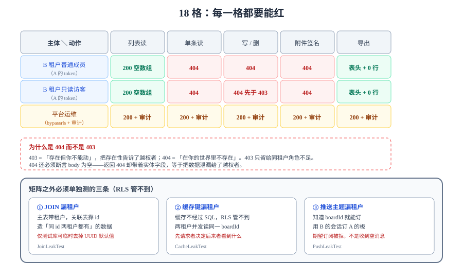

# 跨租户用例矩阵：18 格都要能红

上一页证明「上下文能正确落地」，这一页证明「落错了会被挡住」。做法只有一条：把「A 租户的人去动 B 租户的数据」拆成 18 个具体用例，每格都写出**期望的状态码或行数**，任何一格没有按期望失败，就是越权口子。



::: tip 本页与第 1 周已有页面的分工
第 1 周先落了[多租户隔离](../MultiTenancy/index.md)（`tenant_id` 进主键、`FORCE ROW LEVEL SECURITY` 的完整 DDL）与[权限矩阵联调](../PermissionMatrix/index.md)（同租户内 3 角色 × 6 动作的 18 格）。本页只回答另一个问题：**换成「另一个租户的人」来敲门，期望值是什么、凭什么说它一定是 404**——边界怎么建见前者，同租户的角色不足见后者，三页的判断对象互不重叠。
:::

## 判据族声明

本页判据族 `XTM-A` ~ `XTM-H`，共 8 条。定义表在第九节。

## 一、矩阵的两个维度

越权不是一种行为，而是「一类主体 × 一类动作」的组合。两个维度都要**穷举**，不能只测「读别人的看板」——写、删、签名、导出这四种动作的防线各不相同：

| 维度 | 取值 | 为什么是这几个 |
| --- | --- | --- |
| **主体** | ① B 租户的普通成员（合法用户、错租户）<br/>② B 租户的只读访客（合法用户、错租户、低角色）<br/>③ 平台运维角色（`bypassrls`，见[运维面守卫](../OpsGuard/index.md)） | ①验证「租户维度」单独生效；②验证「租户 + 角色」两个维度叠加时不会互相掩盖；③验证「有越权能力的人也被审计」 |
| **动作** | ① 列表读<br/>② 单条读<br/>③ 写（拖动/改名）<br/>④ 删<br/>⑤ 附件下载签名<br/>⑥ 导出 | 前四个走 SQL（RLS 兜底），后两个**不经过表**：签名走对象存储、导出走流式查询，它们的防线在应用层 |

::: tip 18 是怎么算出来的
3 类主体 × 6 类动作 = 18 格。平台运维那一行的期望与另外两行**不同**（它应当**成功**，但必须留下审计记录），所以它不是「重复测三遍」——它测的是「有能力的人有没有留痕」。
:::

## 二、18 格与期望值

下表是矩阵本体。**「期望」列写的是可比较的读数**，不是形容词。A 租户的 token 去访问 B 租户的资源，全部使用同一条 `board_id`（属于 B）。

| 主体 | 动作 | 期望（A 的 token 访问 B 的资源） | 兜底层 |
| --- | --- | --- | --- |
| B 普通成员 | 列表读 | `200` + 空数组（**不是** `403`） | RLS + 应用过滤 |
| B 普通成员 | 单条读 | `404` | RLS 返回 0 行 → 应用转 404 |
| B 普通成员 | 写 | `404`（不是 `409`，不暴露版本号） | `UPDATE` 影响 0 行 |
| B 普通成员 | 删 | `404` | 同上 |
| B 普通成员 | 附件签名 | `404` | 对象 key 前缀校验 |
| B 普通成员 | 导出 | `200` + 表头一行（0 条数据） | 查询条件含租户 |
| B 只读访客 | 列表读 | `200` + 空数组 | RLS |
| B 只读访客 | 单条读 | `404` | RLS |
| B 只读访客 | 写 | `404`（**不是** `403`，租户维度先于角色维度） | RLS 先行 |
| B 只读访客 | 删 | `404` | RLS |
| B 只读访客 | 附件签名 | `404` | 对象 key 前缀 |
| B 只读访客 | 导出 | `200` + 表头一行 | 查询条件含租户 |
| 平台运维 | 列表读 | `200` + **B 的真实数据** + 审计表新增 1 行 | 显式角色 + 审计 |
| 平台运维 | 单条读 | `200` + 审计 1 行 | 同上 |
| 平台运维 | 写 | `200` + 审计 1 行（含变更前后值） | 同上 |
| 平台运维 | 删 | `200`（软删）+ 审计 1 行 | 同上 |
| 平台运维 | 附件签名 | `200` + 审计 1 行 | 同上 |
| 平台运维 | 导出 | `200` + 审计 1 行（含导出行数） | 同上 |

::: danger 「404 而不是 403」不是风格问题
`403` 的含义是「**这个资源存在，但你不能动**」——它把「存在性」告诉了越权者。对跨租户访问，正确的回答是 `404`：**在你的世界里，这个 ID 根本不存在**。
`403` 保留给「同租户、角色不足」：那里泄漏存在性是可接受的，因为资源本来就在他能看见的范围内。
这两条混用会让矩阵判据失去意义：一个返回 `403` 的实现看起来「挡住了」，但它同时证明了「B 的 board 确实存在」。
:::

## 三、先验数据库层：不依赖应用代码的四条 SQL

如果应用层写错了（比如某条查询漏了 `tenant_id`），RLS 仍然应该挡住。所以**第一轮验证必须绕过应用**，直接在数据库里跑：

```sql [db/verify/cross_tenant.sql]
-- 以应用角色连接（不是表 owner，owner 默认绕过 RLS 除非 FORCE）
set role app_user;

-- ① 跨租户读：期望 0
begin;
  select set_config('app.tenant_id', '1', true);   -- A 租户
  select count(*) as should_be_zero from cards where tenant_id = 2;
commit;

-- ② 跨租户写：期望 "UPDATE 0"
begin;
  select set_config('app.tenant_id', '1', true);
  update cards set title = 'hacked' where tenant_id = 2;
commit;

-- ③ 跨租户插：期望报错 new row violates row-level security policy
begin;
  select set_config('app.tenant_id', '1', true);
  insert into cards (tenant_id, board_id, list_id, title, position_key)
  values (2, gen_random_uuid(), gen_random_uuid(), 'x', 'a0');
commit;

-- ④ 上下文为空：期望 0 行（不是全表）
begin;
  select set_config('app.tenant_id', '', true);
  select count(*) as should_also_be_zero from cards;
commit;
```

四条读数的含义：

| 语句 | 期望 | 拿到了别的读数意味着 |
| --- | --- | --- |
| ① | `0` | RLS 没开、或连接用的是 owner 角色、或策略写成了 `USING (true)` |
| ② | `UPDATE 0` | `USING` 有了但 `WITH CHECK` 缺，写路径能改别人的行 |
| ③ | 报错 `violates row-level security` | 同上：缺 `WITH CHECK` 时插入会成功 |
| ④ | `0` | 上下文为空时策略退化成了「不限租户」——通常是 `coalesce(current_setting(...)::bigint, 0)` 之类的兜底写法 |

::: warning 第 ④ 条最容易被写成「全表」
如果策略写成 `tenant_id = coalesce(nullif(current_setting('app.tenant_id', true), '')::bigint, tenant_id)`，上下文为空时等式右边变成 `tenant_id` 自己，条件恒真——**RLS 形同虚设，而且看起来还在**。
正确写法只比较，不兜底：`tenant_id = nullif(current_setting('app.tenant_id', true), '')::bigint`。为空时右边是 `NULL`，比较结果为 `NULL`，行被过滤掉。
:::

## 四、再验应用层：把矩阵做成参数化用例

数据库层过了，说明「兜底」有效；应用层要验的是「不该走到兜底的地方也别走错」。矩阵用参数化用例表达，18 格就是 18 行数据：

```java [src/test/java/com/example/team/tenant/CrossTenantMatrixTest.java]
@ParameterizedTest(name = "[{index}] {0} 对 B 的 {1} → {2}")
@MethodSource("matrix")
void crossTenantMustFail(TenantRole role, Action action, int expectedStatus) {
    var token = tokenFor(role, TENANT_A);          // 注意：A 的 token
    var resp  = call(action, token, RESOURCE_OF_B); // 资源属于 B

    assertThat(resp.statusCode()).isEqualTo(expectedStatus);
    if (expectedStatus == 404) {
        assertThat(resp.body()).isEmpty();          // 不返回任何实体字段
    }
}

static Stream<Arguments> matrix() {
    return Stream.of(
        // ... 18 行，与第二节表格逐行对应
        Arguments.of(TenantRole.MEMBER, Action.LIST,   200),
        Arguments.of(TenantRole.MEMBER, Action.READ,   404),
        Arguments.of(TenantRole.MEMBER, Action.WRITE,  404)
        // 其余 15 行同表
    );
}
```

三条写法纪律：

1. **token 用错租户的**：用例名里写清「A 的 token 访问 B 的资源」，避免后人「顺手改成同租户」让用例变成恒绿。
2. **`404` 的用例必须断言 body 为空**：很多实现返回 `404` 但 body 里带着 `{"id": "...", "title": "..."}`，等于把数据泄漏给了越权者。
3. **平台运维那一组要断言审计**：不是断言 `200`，而是断言「`200` + 审计表多一行」。只测 `200` 的用例，等于给越权开了绿灯还测不出来。

## 五、三条必失点：矩阵之外还要单独测的东西

矩阵测的是「主路径」。下面三处是**统计上一定会漏**的地方，必须单独构造用例：

| 必失点 | 为什么一定漏 | 怎么单独测 |
| --- | --- | --- |
| **JOIN 漏租户** | 主表带了 `tenant_id`，关联表靠 `board_id` 关联；`board_id` 全局唯一，所以 JOIN 看起来「自然正确」 | 造一条「同一 `board_id` 在两个租户下都存在」的数据（仅在测试库允许），期望仍只返回本租户的行 |
| **缓存键漏租户** | 缓存层不经过 SQL，RLS 管不到；key 用 `board:{id}` 时，先请求者决定后来者看到什么 | 两个租户并发请求同一 `board_id`，断言两次响应不同（见[缓存隔离](../CacheIsolation/index.md)） |
| **推送漏租户** | 广播主题按 `boardId` 命名时，订阅者只要知道 ID 就能收到别人板上的事件 | 用 B 的会话订阅 A 的 `boardId`，期望订阅被拒（见[事件与推送隔离](../EventIsolation/index.md)） |

::: danger 「数据造不出来所以不测」
JOIN 漏租户的用例需要「同一 ID 在两个租户下都存在」这种非常规数据。如果因为「真实环境不可能出现」就跳过，那么这条判据永远没有人验过——而 `board_id` 用 UUIDv7 时确实几乎不可能碰撞，**但 `list_id`、`card_id` 在导入历史数据时就可能重复**。
造数据的方式：在测试库临时去掉 UUID 默认值，显式插入同一个 ID。这条操作只允许在测试库执行。
:::

## 六、矩阵进 CI：三条门禁

矩阵的价值在于**每次提交都跑**。三条门禁，按成本从低到高：

```shell
# 门禁 1：SQL 层四条（秒级，不需要起应用）
psql "$DATABASE_URL_TEST" -v ON_ERROR_STOP=1 -f db/verify/cross_tenant.sql

# 门禁 2：应用层 18 格（分钟级，需要起服务与两个租户的种子数据）
./mvnw -q test -Dtest=CrossTenantMatrixTest

# 门禁 3：三条必失点（分钟级，需要 Redis 与两个 WebSocket 会话）
./mvnw -q test -Dtest=JoinLeakTest,CacheLeakTest,PushLeakTest
```

三条都要在**合并前**跑，不能只留在 nightly：越权缺陷的修复成本随时间是**指数**上升的（发现得越晚，数据已经被读过或写过）。

## 七、矩阵的维护：什么时候要加一格

| 触发条件 | 要加什么 | 例子 |
| --- | --- | --- |
| 新增一个「按 ID 直接访问」的接口 | 该接口的 5 格（读、写、删、签名、导出） | 新增「卡片附件预览」 |
| 新增一类主体 | 整行 6 格 | 新增「外部协作方」角色 |
| 新增一条不经过 SQL 的读路径 | 该路径的 2 格（跨租户 + 上下文为空） | 新增 Elasticsearch 检索（见[读路径隔离](../SearchIsolation/index.md)） |
| 新增按租户分区的缓存 | 缓存键的 2 格（跨租户 + 键冲突） | 新增「看板成员列表」缓存 |

::: tip 一格都不许「先空着」
新增接口时最常见的做法是「矩阵以后再补」。可行做法是**先写一格会红的用例**：接口写完、用例还是红的，说明防线没做；用例绿了，说明防线做了。顺序反过来（先写实现、再补用例）时，用例往往被写成「照着实现的当前行为断言」——那是**记录现状**，不是**验证要求**。
:::

## 八、与既有权限矩阵的分工

项目里已经有一份[权限矩阵联调](../PermissionMatrix/index.md)（18 格，`PM-A~PM-H`），它和本页不是同一件事：

| | [权限矩阵联调](../PermissionMatrix/index.md) | 本页（跨租户用例矩阵） |
| --- | --- | --- |
| 主体范围 | **同一租户内**的三种角色（所有者 / 成员 / 访客） | **跨租户**的成员、访客，加平台运维 |
| 核心问题 | 「这个角色能不能做这件事」 | 「这个租户的人能不能碰到那个租户的数据」 |
| 失败形态 | `403`（存在但无权） | `404`（在你的世界里不存在） |
| 兜底层 | 应用层角色判定 | 数据库 RLS + 对象 key 前缀 + 主题命名空间 |

两者叠加才是完整的：`PM` 管「同租户的角色边界」，本页管「租户边界」。**任何一页单独通过都不能说明权限是对的**——`PM` 全绿时，一个漏了 `tenant_id` 的查询仍然能把 B 的数据返回给 A。

## 九、判据表

| 编号 | 判据 | 怎么验证 | 本机读数 |
| --- | --- | --- | --- |
| `XTM-A` | 矩阵有 18 格，行是三类主体、列是六类动作，无空格 | 数表格行数 = 18；每格有明确期望值 | 待跑（无工程） |
| `XTM-B` | 跨租户访问一律 `404`，且 body 为空 | 12 格 `404` 用例断言 `body` 为空 | 待跑（无工程） |
| `XTM-C` | 同租户角色不足返回 `403`，不与 `404` 混用 | `grep -c "FORBIDDEN"` 与用例期望一致 | 待跑（无工程） |
| `XTM-D` | SQL 层四条读数独立于应用代码可复跑 | 执行 `db/verify/cross_tenant.sql`，四条读数符合第三节表 | 待跑（无工程） |
| `XTM-E` | 上下文为空时 RLS 返回 0 行（策略不兜底） | 第三节第 ④ 条语句，期望 `0` | 待跑（无工程） |
| `XTM-F` | 平台运维的六格都留审计，审计含变更前后值 | 六格跑完后 `select count(*) from audit_log` 增加 6 | 待跑（无工程） |
| `XTM-G` | 三条必失点各有独立用例，不只靠矩阵 | `JoinLeakTest` / `CacheLeakTest` / `PushLeakTest` 三个类存在且能红 | 待跑（无工程） |
| `XTM-H` | 矩阵进 CI 门禁，合并前必跑 | CI 配置文件里三条门禁均为 `required` | 待跑（无工程） |

## 十、当日做了什么

1. **把「越权」拆成两个维度并穷举**：三类主体（跨租户成员、跨租户访客、平台运维）× 六类动作（列表读、单条读、写、删、附件签名、导出）= 18 格，逐格写出期望读数。
2. **定死 `404` 与 `403` 的分工**：跨租户一律 `404` 且 body 为空（不泄漏存在性），同租户角色不足才 `403`。这条分工写进了 `XTM-B` 与 `XTM-C`，并写明混用会让矩阵失去意义。
3. **写出四条不依赖应用代码的 SQL 验证**（跨租户读、跨租户写、跨租户插、上下文为空），并逐条给出「拿到别的读数意味着什么」。
4. **指出第四条最阴的写法**：策略里用 `coalesce` 兜底时，上下文为空会让条件恒真，RLS 形同虚设且看起来还在。
5. **把矩阵做成参数化用例**，并给出三条写法纪律（token 用错租户、`404` 断言 body 为空、平台运维断言审计而不是只断言 `200`）。
6. **补三条矩阵测不到的必失点**：JOIN 漏租户、缓存键漏租户、推送主题漏租户，各自给出独立用例与造数据方式。
7. **定稿 `XTM-A~XTM-H` 八条判据**，并划清与[权限矩阵联调](../PermissionMatrix/index.md)的分工：那份管同租户角色，本页管租户边界。

## 十一、如何验证

三步，从数据库到接口：

```shell
# 第一步：SQL 层四条（期望依次为 0 / UPDATE 0 / 报错 / 0）
psql "$DATABASE_URL_TEST" -v ON_ERROR_STOP=1 -f db/verify/cross_tenant.sql

# 第二步：接口层抽查两格（期望 404 且 body 为空）
curl -s -w "\n%{http_code}\n" -H "Authorization: Bearer $TOKEN_A" \
  http://localhost:8080/api/boards/$BOARD_ID_OF_B
# 期望输出：空行 + 404

# 第三步：平台运维的一格（期望 200，且审计表 +1）
curl -s -o /dev/null -w "%{http_code}\n" -H "Authorization: Bearer $TOKEN_OPS" \
  -H "X-Ops-Reason: incident-1234" \
  http://localhost:8080/api/boards/$BOARD_ID_OF_B
psql "$DATABASE_URL_TEST" -c "select count(*) from audit_log where target_id = '$BOARD_ID_OF_B'"
```

判读：第二步若返回 `403`，说明代码把「跨租户」判成了「同租户角色不足」；若返回 `404` 但 body 里有字段，说明错误响应直接序列化了实体。第三步若 `200` 但审计表没增加，说明越权路径没有留痕——这比「被挡住」更严重，因为它意味着**没有人会知道数据被谁看过**。

## 十二、下一步

- 矩阵里有两格（附件签名、导出）不走 SQL，它们的防线在**读路径**上：见[读路径隔离](../SearchIsolation/index.md)。
- 「上下文为空时 RLS 返回 0 行」依赖 `set_config` 写在事务内：见[租户上下文](../TenantContext/index.md)第九节。
- 平台运维那一行的角色与审计表：见[运维面守卫](../OpsGuard/index.md)。
- 第 1 周全部收口：[第 1 周验收](../Week1Acceptance/index.md)。

## 参考资料

- [PostgreSQL 18 文档 · Row Security Policies](https://www.postgresql.org/docs/18/ddl-rowsecurity.html)——`USING` 与 `WITH CHECK` 的分工、表 owner 默认绕过、`FORCE` 的语义。
- [PostgreSQL 18 文档 · `SET` / `set_config`](https://www.postgresql.org/docs/18/sql-set.html)——`LOCAL` 与会话级的差别。
- 项目内：[多租户隔离](../MultiTenancy/index.md)（`FORCE RLS` 的完整 DDL）· [权限矩阵联调](../PermissionMatrix/index.md)（同租户 18 格）
- 技术专题：[认证与授权](/docs/Backend/Auth/Authorization/index.md) · [OWASP Authorization Cheat Sheet](https://cheatsheetseries.owasp.org/cheatsheets/Authorization_Cheat_Sheet.html)
