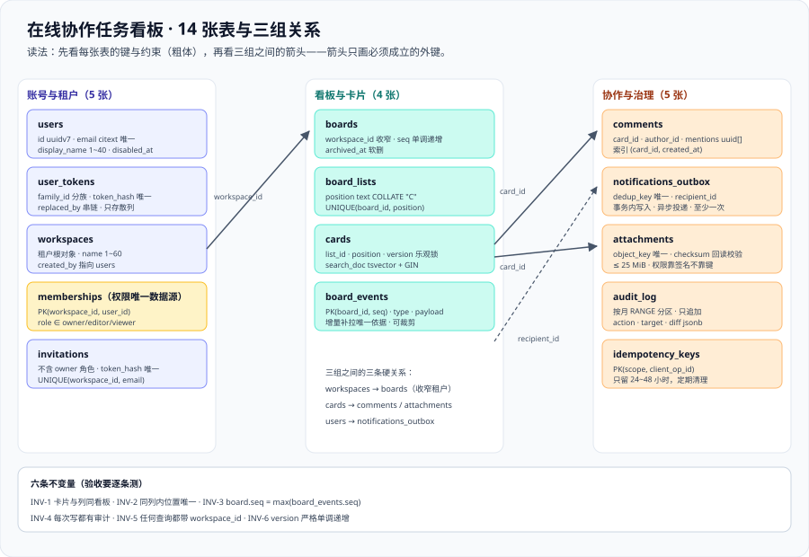

# 数据库设计：表、约束与顺序字段

这一页给出可执行的数据模型：**14 张表的完整 DDL、六条必须成立的不变量、顺序字段（fractional ranking）的具体做法，以及迁移的三分法。** 它是 [架构设计](../Architecture/index.md) 第五节「并发与顺序」的落地版本——架构说「顺序字段用字符串」，这里说清「字符串怎么生成、怎么索引、什么时候要压缩」。



## 一、四条设计原则

| 原则 | 含义 | 违反它的代价 |
| --- | --- | --- |
| **一个库解决三件事** | 关系、并发控制、全文搜索都在 PostgreSQL 18 里做 | 30 天周期内引入第二套存储，运维面与一致性面同时翻倍 |
| **顺序用可比较字符串** | 拖动只更新一行，不重排整列 | 一次拖动 N 行更新，且并发拖动互相覆盖 |
| **每条可并发写的表都有 `version`** | 乐观锁是默认动作，不是例外 | 后写覆盖先写，且没有痕迹 |
| **迁移必须三分法** | 加列给存量语义 → 回填 → 再改默认值 | 一次迁移把存量数据判成错误状态（周期 4 已经踩过） |

## 二、表清单

| # | 表 | 归属模块 | 一句话职责 |
| --- | --- | --- | --- |
| 1 | `users` | `identity` | 账号本身（邮箱、显示名、密码散列） |
| 2 | `user_tokens` | `identity` | 刷新令牌，按 `family_id` 分族，支持「复用即整族撤销」 |
| 3 | `workspaces` | `workspace` | 工作区（租户）根对象 |
| 4 | `memberships` | `workspace` | 用户与工作区的角色关系，**权限判定的唯一数据源** |
| 5 | `invitations` | `workspace` | 邀请（含一次性令牌与有效期） |
| 6 | `boards` | `board` | 看板，并持有一个单调递增的 `seq` |
| 7 | `board_lists` | `board` | 列（待办 / 进行中 / 已完成） |
| 8 | `cards` | `card` | 卡片：`list_id` + `position` + `version` |
| 9 | `comments` | `comment` | 评论与 `@` 提及的原始文本 |
| 10 | `notifications_outbox` | `notification` | 事务内落地的待投递通知（含 `dedup_key`） |
| 11 | `attachments` | `attachment` | 附件元数据（对象键、大小、校验和） |
| 12 | `audit_log` | `audit` | 不可变审计日志（谁、何时、对什么做了什么） |
| 13 | `idempotency_keys` | 接入层 | 写接口的幂等键与上次响应 |
| 14 | `board_events` | `board` | 看板事件流，`seq` 就在这里分配 |

::: tip 为什么 `board_events` 与 `audit_log` 是两张表
它们看起来都在「记录发生的事」，但**用途与寿命完全不同**：

- `board_events` 服务于**实时同步**：客户端要按 `seq` 增量补拉，所以它是**热的、可裁剪的**（例如只保留 30 天），并且要能被高频写入。
- `audit_log` 服务于**追责与合规**：它必须**不可变、只追加、不能因为「客户端不需要了」而被删**。

把两者合成一张表，通常的结果是：为了审计不能删，于是同步用的表无限膨胀；或者为了清理同步数据，审计出现了空洞。
:::

## 三、完整 DDL

以下 DDL 按模块分块给出。**读的时候先看约束与索引**，它们是这一节真正的设计内容。

### 3.1 账号与令牌

```sql [migrations/V1__identity.sql]
CREATE TABLE users (
  id            uuid PRIMARY KEY DEFAULT uuidv7(),
  email         citext NOT NULL UNIQUE,
  display_name  text NOT NULL CHECK (length(display_name) BETWEEN 1 AND 40),
  password_hash text NOT NULL,
  created_at    timestamptz NOT NULL DEFAULT now(),
  disabled_at   timestamptz
);

CREATE TABLE user_tokens (
  id           uuid PRIMARY KEY DEFAULT uuidv7(),
  user_id      uuid NOT NULL REFERENCES users(id) ON DELETE CASCADE,
  family_id    uuid NOT NULL,               -- 同一族的令牌共享它，复用检测时整族撤销
  token_hash   text NOT NULL UNIQUE,        -- 只存散列，不存明文
  issued_at    timestamptz NOT NULL DEFAULT now(),
  expires_at   timestamptz NOT NULL,
  replaced_by  uuid REFERENCES user_tokens(id),
  revoked_at   timestamptz
);
CREATE INDEX user_tokens_family_idx ON user_tokens (family_id, issued_at DESC);
```

::: warning `uuidv7()` 是 PostgreSQL 18 才有的
PG 18 提供 `uuidv7()`，生成的是**按时间有序**的 UUID，B-tree 插入局部性好；PG 17 及以前只有随机的 `gen_random_uuid()`。
选它的理由与「不要用随机 UUID 做主键」是同一条：**随机主键会让大索引的局部性变差，写入越久越慢。**
若你的环境是 PG 17，用 `gen_random_uuid()` 也能跑，但主键应当改为「时间戳 + 随机后缀」的复合形态。
:::

### 3.2 工作区与成员

```sql [migrations/V2__workspace.sql]
CREATE TABLE workspaces (
  id         uuid PRIMARY KEY DEFAULT uuidv7(),
  name       text NOT NULL CHECK (length(name) BETWEEN 1 AND 60),
  created_by uuid NOT NULL REFERENCES users(id),
  created_at timestamptz NOT NULL DEFAULT now()
);

CREATE TABLE memberships (
  workspace_id uuid NOT NULL REFERENCES workspaces(id) ON DELETE CASCADE,
  user_id      uuid NOT NULL REFERENCES users(id) ON DELETE CASCADE,
  role         text NOT NULL CHECK (role IN ('owner', 'editor', 'viewer')),
  joined_at    timestamptz NOT NULL DEFAULT now(),
  PRIMARY KEY (workspace_id, user_id)
);
CREATE INDEX memberships_user_idx ON memberships (user_id);

CREATE TABLE invitations (
  id           uuid PRIMARY KEY DEFAULT uuidv7(),
  workspace_id uuid NOT NULL REFERENCES workspaces(id) ON DELETE CASCADE,
  email        citext NOT NULL,
  role         text NOT NULL CHECK (role IN ('editor', 'viewer')),  -- 不允许直接邀请成 owner
  token_hash   text NOT NULL UNIQUE,
  expires_at   timestamptz NOT NULL,
  accepted_at  timestamptz,
  UNIQUE (workspace_id, email)
);
```

::: danger 三个权限表上的典型错误
1. **角色用整数枚举**（`1 = owner`）：加一个角色就要改代码里的所有映射。用 `text` + `CHECK`，语义直接可读，代价是多几个字节。
2. **允许通过邀请把人变成 `owner`**：结果是「谁的邀请链接被转发，谁就能拿到最高权限」。`owner` 的变更必须是工作区内已有 `owner` 的显式动作。
3. **`memberships` 上没有 `PRIMARY KEY (workspace_id, user_id)`**：同一个人会在同一个工作区里出现两行，权限判定取到哪一行取决于查询计划——**这是一种会随数据量变化的随机行为**。
:::

### 3.3 看板、列、卡片与事件

```sql [migrations/V3__board.sql]
CREATE TABLE boards (
  id           uuid PRIMARY KEY DEFAULT uuidv7(),
  workspace_id uuid NOT NULL REFERENCES workspaces(id) ON DELETE CASCADE,
  name         text NOT NULL CHECK (length(name) BETWEEN 1 AND 60),
  seq          bigint NOT NULL DEFAULT 0,   -- 单调递增；事件序号从这里分配
  archived_at  timestamptz,
  created_at   timestamptz NOT NULL DEFAULT now()
);
CREATE INDEX boards_workspace_idx ON boards (workspace_id) WHERE archived_at IS NULL;

CREATE TABLE board_lists (
  id       uuid PRIMARY KEY DEFAULT uuidv7(),
  board_id uuid NOT NULL REFERENCES boards(id) ON DELETE CASCADE,
  name     text NOT NULL,
  position text COLLATE "C" NOT NULL,
  UNIQUE (board_id, position)
);
CREATE INDEX board_lists_order_idx ON board_lists (board_id, position);

CREATE TABLE cards (
  id         uuid PRIMARY KEY DEFAULT uuidv7(),
  board_id   uuid NOT NULL REFERENCES boards(id) ON DELETE CASCADE,
  list_id    uuid NOT NULL REFERENCES board_lists(id) ON DELETE CASCADE,
  title      text NOT NULL CHECK (length(title) BETWEEN 1 AND 200),
  body       text NOT NULL DEFAULT '',
  position   text COLLATE "C" NOT NULL,
  assignee   uuid REFERENCES users(id),
  due_at     timestamptz,
  version    bigint NOT NULL DEFAULT 1,     -- 乐观锁
  created_by uuid NOT NULL REFERENCES users(id),
  created_at timestamptz NOT NULL DEFAULT now(),
  updated_at timestamptz NOT NULL DEFAULT now(),
  UNIQUE (list_id, position),
  search_doc tsvector
);
CREATE INDEX cards_list_order_idx ON cards (list_id, position);
CREATE INDEX cards_board_idx ON cards (board_id, updated_at DESC);
CREATE INDEX cards_assignee_idx ON cards (assignee) WHERE assignee IS NOT NULL;
CREATE INDEX cards_search_idx ON cards USING gin (search_doc);
```

::: danger 卡片表上两个必须想清楚的地方
1. **`UNIQUE (list_id, position)` 是必要的，但会让「同位置并发插入」报唯一键冲突**——两个请求同时插到同一个位置，只有一个能成功。这是**正确的**行为（冲突被显式暴露），但接口必须把它翻译成 `409` 并提示重试，而不是 `500`。
2. **`board_id` 与 `list_id` 之间存在冗余**（`list_id` 已经蕴含 `board_id`）：保留它是因为**几乎所有查询都按看板收窄**。代价是必须用触发器或约束保证两者一致，否则会出现「卡片挂在这块看板下、却属于另一块看板的列」——这类脏数据会让权限判定出现漏洞。
:::

```sql [migrations/V3__board.sql（续）]
CREATE TABLE board_events (
  board_id   uuid NOT NULL REFERENCES boards(id) ON DELETE CASCADE,
  seq        bigint NOT NULL,
  type       text NOT NULL,                 -- card.moved / comment.added / ...
  actor_id   uuid NOT NULL REFERENCES users(id),
  payload    jsonb NOT NULL,
  created_at timestamptz NOT NULL DEFAULT now(),
  PRIMARY KEY (board_id, seq)
);
CREATE INDEX board_events_recent_idx ON board_events (board_id, created_at DESC);

-- 事件序号必须与看板上的 seq 在同一事务里推进
CREATE OR REPLACE FUNCTION next_board_seq(p_board uuid) RETURNS bigint AS $$
  UPDATE boards SET seq = seq + 1 WHERE id = p_board RETURNING seq;
$$ LANGUAGE sql;
```

### 3.4 评论、通知、附件、审计、幂等

```sql [migrations/V4__collab.sql]
CREATE TABLE comments (
  id         uuid PRIMARY KEY DEFAULT uuidv7(),
  card_id    uuid NOT NULL REFERENCES cards(id) ON DELETE CASCADE,
  author_id  uuid NOT NULL REFERENCES users(id),
  body       text NOT NULL CHECK (length(body) BETWEEN 1 AND 4000),
  mentions   uuid[] NOT NULL DEFAULT '{}',   -- 解析后的被提及用户
  created_at timestamptz NOT NULL DEFAULT now()
);
CREATE INDEX comments_card_idx ON comments (card_id, created_at);

CREATE TABLE notifications_outbox (
  id           uuid PRIMARY KEY DEFAULT uuidv7(),
  dedup_key    text NOT NULL UNIQUE,          -- 例：mention:c_9d21:u_1024:cmt_31
  recipient_id uuid NOT NULL REFERENCES users(id),
  channel      text NOT NULL CHECK (channel IN ('inapp', 'email')),
  payload      jsonb NOT NULL,
  created_at   timestamptz NOT NULL DEFAULT now(),
  delivered_at timestamptz,
  attempts     int NOT NULL DEFAULT 0
);
CREATE INDEX outbox_pending_idx ON notifications_outbox (created_at) WHERE delivered_at IS NULL;

CREATE TABLE attachments (
  id           uuid PRIMARY KEY DEFAULT uuidv7(),
  card_id      uuid NOT NULL REFERENCES cards(id) ON DELETE CASCADE,
  object_key   text NOT NULL UNIQUE,          -- 对象存储里的键，不含任何权限信息
  file_name    text NOT NULL,
  byte_size    bigint NOT NULL CHECK (byte_size > 0 AND byte_size <= 26214400),
  content_type text NOT NULL,
  checksum     text NOT NULL,                 -- 上传完成后由服务端回读校验
  uploaded_by  uuid NOT NULL REFERENCES users(id),
  created_at   timestamptz NOT NULL DEFAULT now()
);
CREATE INDEX attachments_card_idx ON attachments (card_id);

CREATE TABLE audit_log (
  id           bigint GENERATED ALWAYS AS IDENTITY,
  workspace_id uuid NOT NULL,
  actor_id     uuid NOT NULL,
  action       text NOT NULL,                 -- card.move / card.delete / member.role_change ...
  target_type  text NOT NULL,
  target_id    text NOT NULL,
  diff         jsonb NOT NULL,
  at           timestamptz NOT NULL DEFAULT now(),
  PRIMARY KEY (id, at)
) PARTITION BY RANGE (at);

CREATE TABLE idempotency_keys (
  scope         text NOT NULL,                -- 例：POST /boards/{id}/cards/{id}/move
  client_op_id  text NOT NULL,
  actor_id      uuid NOT NULL,
  response_code int NOT NULL,
  response_body jsonb NOT NULL,
  created_at    timestamptz NOT NULL DEFAULT now(),
  PRIMARY KEY (scope, client_op_id)
);
CREATE INDEX idempotency_expiry_idx ON idempotency_keys (created_at);
```

::: tip `audit_log` 与 `idempotency_keys` 的寿命是相反的
- `audit_log` **按月分区**、长期保留：分区不是为了查询快，而是为了让「保留策略」变成一句可执行的 `DROP TABLE audit_log_2026_10`，而不是一条会锁表的批量删除。
- `idempotency_keys` **只保留 24~48 小时**：它的作用是拦住网络层的重试，不是业务记录。留着不删，它会变成一张比业务表还大的表。
:::

## 四、顺序字段：`position` 的三条纪律

| 纪律 | 做法 | 反面写法 |
| --- | --- | --- |
| **比较必须与数据库排序规则无关** | 列声明 `text COLLATE "C"` | 依赖库默认 collation → 换环境后顺序变了 |
| **只允许更新一行** | 取相邻两键算中间值 | `UPDATE ... SET position = position + 1` 全列后移 |
| **退化必须可处理** | 相邻键无空隙时压缩该列，并占用一个新 `seq` 广播 | 直接报错，或悄悄把两张卡片排成同一个位置 |

生成中间值的可执行口径（三段，覆盖三种插入位置）：

```text [position 取值的三种情况]
插到首位：前键 = null，后键 = "0|hzzzzz:"  → 新值 = "0|" + (后键去掉前缀后的一半) 
插到中间：前键 = "0|hzzzzz:"，后键 = "0|i00000:" → 新值 = "0|hzzzzz:V"
插到末位：前键 = "0|hzzzzz:"，后键 = null → 新值 = 前键 + "V"（末尾追加）
```

::: danger 压缩列顺序时最容易丢掉的两件事
1. **忘记广播**：客户端手里还留着旧的顺序键，压缩之后它们的乐观更新会对不上，表现是「拖完之后偶尔跳回去」。压缩必须产生一条 `list.reordered` 事件。
2. **在压缩的同时删掉并发写入**：压缩是一个「读全列 → 重算 → 批量更新」的过程，期间其他人的拖动会落在被重算的范围里。做法是**压缩开始时给该列加一个短事务锁**（`SELECT ... FOR UPDATE` 锁 `board_lists` 那一行），而不是锁全部卡片。
:::

## 五、六条不变量

不变量是**必须恒为真的断言**，它们既是数据库约束的目标，也是验收时要逐条测的东西：

| # | 不变量 | 怎么保证 / 怎么测 |
| --- | --- | --- |
| INV-1 | 卡片所属的 `list_id` 必须属于同一块 `board_id` | 复合外键或触发器；用一条 `LEFT JOIN` 的反向查询应返回 0 行 |
| INV-2 | 同一列内不存在两张位置相同的卡片 | `UNIQUE (list_id, position)` |
| INV-3 | 一块看板的 `seq` 与 `board_events` 的最大 `seq` 相等 | 同一事务内推进；对账 SQL 见第十节 |
| INV-4 | 每一次可见的写操作都有一条 `audit_log` | 写路径不允许绕过审计；抽样比对写接口调用量与审计行数 |
| INV-5 | 任何查询都带 `workspace_id` 收窄 | 代码层强制（Repository 只暴露带租户参数的方法），测试用「换租户 ID 查同一个资源应为 404」覆盖 |
| INV-6 | `cards.version` 严格单调递增 | 每次写入 `version = version + 1`，不允许显式赋值 |

::: warning INV-5 是最容易被绕过的一条
它不是一个数据库约束，而是一个**代码层约定**：只要有一个地方的 SQL 忘了带 `workspace_id`，跨租户泄漏就成立了。
所以正确做法不是「写的时候小心一点」，而是**让「不带租户的查询」在代码结构上写不出来**——Repository 的每个方法签名里都必须有租户参数。
:::

## 六、索引清单与取舍

| 表 | 索引 | 服务于 | 代价 |
| --- | --- | --- | --- |
| `cards` | `(list_id, position)` | 渲染一列 | 拖动会更新它，属于必要的写放大 |
| `cards` | `(board_id, updated_at DESC)` | 「最近更新的卡片」 | 无 |
| `cards` | `(assignee) WHERE assignee IS NOT NULL` | 「指派给我的」 | 部分索引体积小 |
| `cards` | `GIN (search_doc)` | 全文搜索 | 写卡片时多维护一个倒排 |
| `board_events` | `PRIMARY KEY (board_id, seq)` | 增量补拉 `since=seq` | 无（这就是它存在的意义） |
| `notifications_outbox` | `(created_at) WHERE delivered_at IS NULL` | 投递循环扫描 | 无 |
| `memberships` | `(user_id)` | 「我参与的工作区」 | 无 |
| `audit_log` | 主键 + 按月分区 | 审计查询与清理 | 分区管理成本 |

::: tip 索引不在多，在于「每条都能说清服务于哪个查询」
本表八条索引对应六个真实查询。**说不出来源的索引一律不加**：它不会让系统更快，只会让每一次写入都多做一份功。
PostgreSQL 18 的 **skip scan** 让「跳过复合索引的前导列」成为可能（最有用的一种情形是前导列只有很少几个不同值），但这**不能替代把索引列顺序写对**。
:::

## 七、全文搜索：先用数据库，再谈换引擎

搜索的范围限定在用户可见的工作区内，做三件事：

```sql [搜索：先收窄租户与可见范围，再按相关度排序]
SELECT c.id, c.title,
       ts_rank(c.search_doc, q) AS rank
FROM cards c
JOIN board_lists l ON l.id = c.list_id
JOIN boards b      ON b.id = l.board_id
CROSS JOIN to_tsquery('simple', $1) AS q
WHERE b.workspace_id = ANY($2)          -- ① 先按可见工作区收窄（权限前置）
  AND c.search_doc @@ q                 -- ② 再用倒排匹配
ORDER BY rank DESC, c.updated_at DESC
LIMIT 50;                               -- ③ 必须有上限
```

`search_doc` 用触发器在写入时更新（标题 + 正文 + 评论摘要）。中文场景下 `simple` 配置不做词干化，实际可用性取决于分词扩展（`pg_jieba` / `zhparser`）——**这一步必须在第 2 周之前实测决定**，而不是等到「搜不出来」才发现。

| 什么时候继续用 PostgreSQL | 什么时候该换搜索引擎 |
| --- | --- |
| 单表语料在百万级以内，排序规则简单 | 需要跨表、跨类型统一打分与高亮 |
| 能接受「先收窄租户再匹配」的两段式查询 | 需要聚合、同义词、拼音、拼写纠错 |
| 搜索 QPS 远低于写入 QPS | 搜索本身成为主要流量 |

## 八、容量与增长（首年估算）

按 [需求拆分](../Requirements/index.md) 定的目标规模（500 工作区 / 5000 用户 / 50 万卡片）算：

| 对象 | 规模 | 单行量级 | 合计 | 说明 |
| --- | --- | --- | --- | --- |
| `cards` | 50 万 | ~0.6 KB（含 `tsvector`） | ~300 MB | 索引另算，约占表的 40%~60% |
| `board_events` | 每月 ~200 万 | ~0.3 KB | 每月 ~600 MB | 必须设保留期（默认 30 天） |
| `audit_log` | 每月 ~500 万 | ~0.2 KB | 每月 ~1 GB | 按月分区、冷数据可归档 |
| `notifications_outbox` | 每月 ~300 万 | ~0.4 KB | 投递成功后**可立即清理** | 不清理会超过业务表 |

::: tip 一条可执行的纪律
**「先算增长，再定保留期」**。上表里唯一会无限增长的是 `board_events` 与 `audit_log`；它们各自需要一个明确的保留策略，且策略要写成**可执行的清理动作**（`DROP` 分区 / 定时删除），而不是写在文档里的一句「定期清理」。
:::

## 九、迁移三分法

任何「给存量数据加一个新语义字段」的迁移，都必须拆成三步，**顺序不能换**：

```sql [migrations/V5__card_due_date.sql]
-- 第一步：加列，默认值取「存量语义」——即「老数据在这一列上应该是什么」
ALTER TABLE cards ADD COLUMN due_reminded_at timestamptz DEFAULT NULL;

-- 第二步：回填存量行（本例存量的语义就是「提醒过」= 已处理，避免上线后对历史卡片补发一轮提醒）
UPDATE cards SET due_reminded_at = updated_at WHERE due_at IS NOT NULL AND due_at < now();

-- 第三步：把默认值改成「新数据的语义」
ALTER TABLE cards ALTER COLUMN due_reminded_at DROP DEFAULT;
```

::: danger 三分法反着写的后果
如果第一步就把默认值写成「新数据的语义」（例如 `DEFAULT now()`），存量卡片会被判成「刚刚提醒过」——**没有人会立刻发现**，直到有人问「为什么三年前的卡片一条提醒都没发」。
判据：迁移脚本里凡是出现 `ADD COLUMN ... DEFAULT <值>`，都要能回答「这个默认值代表存量数据还是新数据」。**答不上来就不要合并。**
:::

## 十、验证方式

```shell
# 1. 表数量与关键约束存在性（预期：14 张业务表 + 分区子表）
psql -h localhost -U teamboard -d teamboard -c "\dt" | wc -l

# 2. INV-1：卡片与列不属于同一看板（预期：0 行）
psql -h localhost -U teamboard -d teamboard -c "
SELECT c.id FROM cards c
JOIN board_lists l ON l.id = c.list_id
WHERE l.board_id <> c.board_id;"

# 3. INV-3：看板 seq 必须等于事件表的最大 seq（预期：0 行）
psql -h localhost -U teamboard -d teamboard -c "
SELECT b.id, b.seq, COALESCE(max(e.seq), 0) AS max_seq
FROM boards b LEFT JOIN board_events e ON e.board_id = b.id
GROUP BY b.id, b.seq HAVING b.seq <> COALESCE(max(e.seq), 0);"

# 4. INV-2：同列同位置（预期：0 行；约束存在时这条查询只是回归确认）
psql -h localhost -U teamboard -d teamboard -c "
SELECT list_id, position, count(*) FROM cards
GROUP BY list_id, position HAVING count(*) > 1;"

# 5. 「一次拖动只更新一行」的成本判据
psql -h localhost -U teamboard -d teamboard -c "
SELECT count(*) FROM cards WHERE xmin::text::bigint > $TXID_GTE;"
# 预期：拖动一张卡片后，该计数恰好 +1
```

::: warning 第 5 条的读法
它和第 3 条一样，测的不是「功能对不对」而是「实现是不是按约定的成本口径做的」。
在一个「全列后移」的实现上，第 1~4 条全部通过，只有第 5 条会露出问题。
:::

## 与「部署与交付」八页的分工（第 149 天补充）

**本页回答什么**：表结构、顺序字段的三条纪律、六条不变量、索引清单与迁移三分法。
**本页不回答什么**：这些 DDL 在真库上**跑出来是什么样**（条数、分区、恢复行为），以及「交付期能不能改它」。前者归 [部署脚本](../DeployScripts/index.md)，后者归 [发布手册](../ReleaseRunbook/index.md)。

第 149 天的三处实测与本页直接相关，逐条落在对应小节上：

| 本页小节 | 第 149 天读数（口径 + 获取方式） | 结论 |
| --- | --- | --- |
| 六、索引清单与取舍 | `pg_index` 上 `cards` 共 **6** 条索引、按 `indkey` 分组后 **2 条键完全相同** | 清单里那两条同键索引**真的都建出来了**，与 [拖动链路](../CardMove/index.md) 第 5.1 节「只保留一条」的建议不一致——**如实记录，不在交付期改 DDL** |
| 三、完整 DDL（`audit_log`） | `pg_inherits` 计数 = **0**；`INSERT` 报 `no partition of relation "audit_log" found for row` | 迁移只建了分区**父表**，没建任何分区；后果是拖动的整笔事务回滚（详见 [环境与工程骨架](../Environment/index.md) 的第 149 天更正） |
| 九、迁移三分法 | 四份迁移**重跑**报 `relation "users" already exists`，且库中**没有版本表** | 迁移脚本**不可重入**、也**不记录已应用版本**；交付期「重跑一次」这条路是断的 |

**为什么特别点出第三条**：一个「跑过一次就成功」的迁移脚本，在交付期会遇到三种真实场景——换机器重放、扩容时对新库重放、失败后**从中间重跑**。第三种场景下前两条成功、第三条报 `already exists`，人很容易误判成「环境脏了」而手工插手，最后留下一个既不是旧状态也不是新状态的库。**「迁移能不能重跑」不是洁癖，而是交付期唯一能被机器判的运维判据。**

## 参考资料

- [架构设计：模块边界与实时链路](../Architecture/index.md) · [需求拆分](../Requirements/index.md) · [验收](../Acceptance/index.md)
- PostgreSQL 18 文档 · UUID 函数（`uuidv7()` 与随机 UUID 的写入代价差异）：https://www.postgresql.org/docs/18/functions-uuid.html
- PostgreSQL 18 文档 · 全文检索与 `tsvector` / `GIN` 索引：https://www.postgresql.org/docs/18/textsearch.html
- PostgreSQL 18 文档 · 表分区（保留策略的分区化落地）：https://www.postgresql.org/docs/18/ddl-partitioning.html
- PostgreSQL 发行说明（当前稳定主版本 18、补丁 18.6）：https://www.postgresql.org/docs/release/
- [完整项目交付 · 数据模型](/docs/Others/ProjectDelivery/DataModel/index.md)（数据模型文档该产出什么的通用口径）
- [数据建模](/docs/DB/DataModeling/index.md) · [PostgreSQL 专题](/docs/DB/Relational/PostgreSQL/index.md)（范式、索引与并发控制的原理侧）
