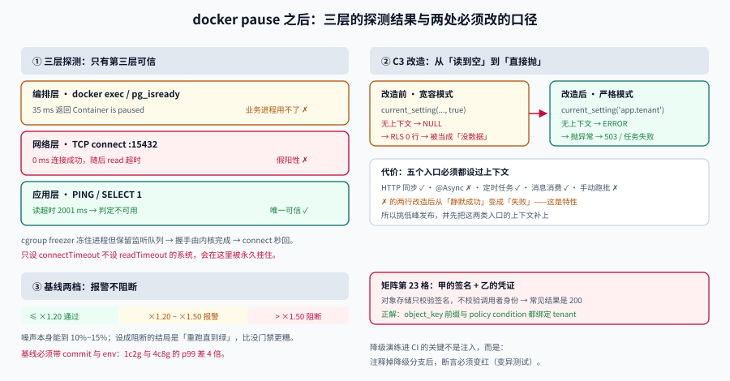

# 降级演练进 CI：把「手工 pause 一次」变成每次发布都跑的闸门

第 3 周第 3 步已经证明「池层能扛住并发」，第 4 步要回答的是**反过来**的问题：**依赖真的挂了，系统是什么样子，这个「样子」有没有被自动化守住？**

[依赖降级](../DegradePath/index.md) 给出了 9 功能 × 3 依赖的降级矩阵，但它的验证方式是**手工** `docker pause` 一次、看一眼、写结论。手工演练的两个致命问题：**跑不进 CI**，以及**结论会过期**——三个月后有人给降级路径加了一行 `catch`，没有任何东西会变红。

这一页把手工演练拆成三件事：一次可复现的注入、一条 fail-closed 的改造、一条进 CI 的断言。

## 判据族声明

本页判据族 `DGD-A` ~ `DGD-H`，共 8 条。定义表在第六节。



## 一、先看一次真实注入：三层探测，两层是假阳性

本机 `postgres:18` 容器（`teamboard-sandbox-db-1`，端口映射 `15432`），执行 `docker pause` 之后，分别用三种方式探测：

| 探测层 | 手段 | 实测结果 | 判定 |
| --- | --- | --- | --- |
| **编排层** | `docker exec ... pg_isready` | 35 ms 返回 `Container ... is paused, unpause the container before exec` | ✅ 立刻失败，但**业务进程用不了这个信号** |
| **网络层** | TCP `connect(127.0.0.1, 15432)` | **0 ms 连接成功**，随后 `recv` 读到超时 | ❌ **假阳性**：连接是通的，数据库是死的 |
| **应用层** | 真实命令（`PING` / `SELECT 1`） | 读到超时 **2001 ms** | ✅ 唯一可信 |

`docker unpause` 之后立即复测：`connect` 仍为 **0 ms**，`PING` 恢复正常。

::: danger 「能连上」不等于「能用」
`docker pause` 用的是 cgroup freezer：进程被冻住，但**内核的 socket 监听队列还在**，所以 TCP 三次握手由内核完成，`connect()` 秒回成功。此后你写进去的请求永远等不到响应。

这直接推翻了两种常见写法：

1. **用「端口是否可连」做健康检查** → pause 期间它一直报健康，流量继续打进来，全部在应用层超时；
2. **只设 `connectTimeout` 不设 `readTimeout`** → 连接 0 ms 成功，然后**永远挂着**，线程池被占满，故障从「依赖挂了」升级成「自己也不响应」。
:::

所以第一组判据是硬性的：**所有外部调用必须同时设连接超时与读超时**，且健康检查必须发一条真实命令（`PING`、`SELECT 1`、`HEAD /healthz` 且校验响应体），不能只看端口。

## 二、注入怎么进 CI：三件套

`docker pause` 不能直接进 CI 的原因不是技术，而是**它需要宿主机的 Docker 权限**，而 CI runner 通常把构建跑在容器里。三种可落地的替换：

| 方式 | 做法 | 优点 | 缺点 |
| --- | --- | --- | --- |
| **依赖替身**（推荐） | 起一个 `toxiproxy` / 一个「只接受连接不响应」的假服务 | 不需要特权，可精确控制「连得上但不响应」 | 需要维护替身镜像 |
| **网络策略** | 用 `iptables` / `tc` 丢包 | 最接近真实 | 需要 NET_ADMIN |
| **应用内开关** | 一个只对测试 profile 生效的「黑洞开关」 | 零基础设施 | 测不到「连接层」的失败形态 |

第二种最真实但最难落地；第三种最省事但**测不到本页第一节的那个假阳性**——因为它绕过了 socket 层。所以本项目的选择是**第一种（替身）+ 第三种（开关）组合**：替身测连接与读超时，开关测业务降级分支。

::: tip 替身的最小实现
一个「接受连接、读完请求、永不响应」的 TCP 服务，20 行就够。它的价值在于**精确复现 pause 的失败形态**：`connect` 成功、`read` 超时。用「直接拒绝连接」的替身会测出另一套行为（快速失败），降级路径根本不会被触发。
:::

## 三、C3 的 fail-closed 改造：从「读到空」到「直接抛」

第 3 周第 2 步留下的欠账是 C3（异步线程池丢上下文）。当时的现象是：**异步任务里 `current_setting('app.tenant')` 读不到值，于是 RLS 一条也不匹配，返回 0 行**——看起来像「这个租户没有数据」，实际是「上下文丢了」。

两种读取方式的行为完全不同（本机实测）：

```sql
-- ① 宽容模式：参数不存在时返回 NULL，不报错
SELECT current_setting('app.tenant', true) IS NULL;   -- t

-- ② 严格模式：参数不存在时直接报错
SELECT current_setting('app.tenant');
-- ERROR:  unrecognized configuration parameter "app.tenant"
```

宽容模式**把「上下文丢失」伪装成「空值」**，这是所有静默错误的源头。所以改造只有一句话：**业务代码一律用严格模式，读不到就抛。**

```java
// 改造前：宽容读取 → 空租户 → 0 行 → 被当成「没数据」
String tenant = jdbc.queryForObject("SELECT current_setting('app.tenant', true)", String.class);

// 改造后：严格读取 → 抛 TenantContextMissingException → 上层 503
String tenant = jdbc.queryForObject("SELECT current_setting('app.tenant')", String.class);
```

代价是**必须保证每一条进入数据库的路径都设过上下文**，否则原本「静默返回 0 行」的地方会变成 500。所以这个改造要配一张清单：

| 入口 | 是否设置上下文 | 改造后行为 |
| --- | --- | --- |
| HTTP 请求（同步） | ✅ 过滤器设置 | 正常 |
| `@Async` 任务 | ❌ 线程池不继承 | **抛异常 → 任务失败 → 重试/告警** |
| 定时任务 | ✅ 按租户遍历时显式设置 | 正常 |
| 消息消费 | ✅ 从消息头取 | 正常 |
| 手动跑批脚本 | ❌ 未设置 | **抛异常 → 脚本退出**（这正是想要的） |

::: warning fail-closed 会让「原本能跑」的东西跑不了
上表里 `@Async` 与手动脚本两行，改造前是「静默返回 0 行」（看起来成功），改造后是「失败」。**这是特性，不是回归**——但那两天一定会有告警，所以要挑低峰发布，并提前把这两类入口的上下文补上。
:::

## 四、矩阵第 23 格：用甲的签名下载乙的对象

跨租户矩阵在第 165 天补到 22 格，全部落在连接层。第 23 格是一个**应用层**的洞，而且是最经典的一类：**预签名 URL 的权限校验发生在签发时，下载时不校验**。

| 格 | 场景 | 期望 | 为什么 HTTP 层测不出来 |
| --- | --- | --- | --- |
| 19 | 甲的会话上下文 + 乙的 `card_id` | 404 | 已覆盖 |
| 20 | 甲的 `tenant` + 乙的 `board_id` | 404 | 已覆盖 |
| 21 | 甲的消息头 + 乙的 `attachment_id` | 404 | 已覆盖 |
| 22 | 甲连接 + 乙的 `SET LOCAL` | 0 行 | 已覆盖（连接层） |
| **23** | **甲的预签名 URL 被乙使用** | **403** | 下载请求**根本不带甲的会话**，只带签名 |

第 23 格的正确实现是**签名里绑定租户**，而不是「下载时再查一次权限」（那要多一次数据库往返，而且对象存储是直连的，没有你的应用在中间）：

```text
object_key = t/{tenant}/card/{card_id}/{attachment_id}
签名策略  = 只签 t/{tenant}/... 前缀，且 required_tenant 写进 policy condition
```

验收方式（不需要应用代码，直接打对象存储）：

```shell
# 用甲的会话签发（应用）
URL=$(curl -s -H "Authorization: Bearer $A_TOKEN" \
  "http://localhost:8080/api/v1/attachments/$A_ATT/download-url" | jq -r .url)

# 用乙的会话去下载（对象存储直连，中间没有你的应用）
curl -s -o /dev/null -w '%{http_code}\n' -H "Authorization: Bearer $B_TOKEN" "$URL"
# 期望：403；若为 200，说明签名没有绑定租户
```

::: danger 200 是这一格最容易出现的结果
因为对象存储只校验**签名**，不校验**调用者身份**。签名一旦泄漏（日志、Referer、截图），任何拿到 URL 的人都能下载——这与「知道密码就能登录」是同一类问题，但它的暴露面大得多：URL 会出现在浏览器历史、代理日志、CDN 缓存键里。
:::

## 五、压测基线化：从「这次 p99 是 180ms」到「超 20% 报警」

第 165 天的四条断言里，`p99` 只被记录、没有被比较——每次压测都是「看一眼，觉得还行」。基线化做三件事：

```json
// perf-baseline.json（进仓库，随发布更新）
{
  "scenario": "board-list",
  "captured_at": "2026-10-19",
  "commit": "9e0fc01",
  "env": "local-1c2g",
  "metrics": { "p50_ms": 42, "p95_ms": 138, "p99_ms": 180, "rps": 118 }
}
```

| 规则 | 阈值 | 动作 |
| --- | --- | --- |
| p99 劣化 | > 基线 × 1.20 | **报警**（不阻断） |
| p99 劣化 | > 基线 × 1.50 | 阻断发布 |
| 吞吐下降 | > 基线 × 0.85 | 报警 |
| 错误率上升 | > 0.1% | 阻断 |

**为什么 20% 只报警不阻断**：压测环境的噪声（宿主负载、GC 时机）本身就能造成 10%~15% 的波动。把它设成阻断，结局是团队学会「重跑一次直到绿」——那比没有门禁更糟。

::: warning 基线必须带环境指纹
`env` 与 `commit` 两个字段不能省。同一份代码在 1 核 2G 与 8 核 16G 上的 p99 差 4 倍；不同 commit 的基线不可比。缺这两个字段的基线，三个月后一定会被拿去比出一个假结论。
:::

## 六、判据定义表

| 判据 | 约定 | 定错了会怎样 | 怎么验证 |
| --- | --- | --- | --- |
| `DGD-A` | 所有外部调用同时设连接超时与读超时 | 连接秒成功、永远挂着、线程池耗尽 | 配置里有 `connectTimeout` 与 `readTimeout` 两个值 |
| `DGD-B` | 健康检查必须发真实命令并校验响应内容 | pause 期间仍报健康，流量继续涌入 | 检查返回体而非只看端口 |
| `DGD-C` | 注入用「接受连接不响应」的替身，而非「拒绝连接」 | 测出快速失败，降级路径不被触发 | 替身行为与 pause 一致 |
| `DGD-D` | 业务读租户上下文一律用严格模式（无 `missing_ok`） | 上下文丢失被伪装成「0 行」 | 全库 `current_setting(..., true)` 在业务路径为 0 处 |
| `DGD-E` | fail-closed 改造前先补齐所有入口的上下文设置 | 原本静默成功的地方变成 500 | 五个入口各有设置点与用例 |
| `DGD-F` | 预签名 URL 必须把租户写进签名策略 | 拿到 URL 即可跨租户下载（403 缺失） | 用乙的凭证打甲的 URL，期望 403 |
| `DGD-G` | 降级演练必须进 CI，且能在「降级分支被删掉」时变红 | 三个月后降级路径悄悄失效 | 变异测试：注释掉降级分支，断言失败 |
| `DGD-H` | 压测基线含 `commit` 与 `env` 指纹，20% 报警 / 50% 阻断 | 用不可比的基线得出假结论 | 基线文件有指纹字段，阈值分两档 |

## 如何验证

```shell
# ① 复现「连接成功但读超时」：pause 之后三层探测的读数
docker pause <db-container> && \
/Users/cuifendemac/.workbuddy/binaries/python/envs/default/bin/python3 - <<'PY'
import socket, time
def probe(port):
    t0 = time.time(); s = socket.socket(); s.settimeout(2)
    try:
        s.connect(("127.0.0.1", port))
        dt = round((time.time() - t0) * 1000)
        try:
            s.recv(1); return dt, "connected, read ok"
        except socket.timeout:
            return dt, "connected, **read timeout**"
    except Exception as e:
        return round((time.time() - t0) * 1000), f"connect fail {type(e).__name__}"
    finally:
        s.close()
print("probe:", probe(15432))
PY
docker unpause <db-container>
```

**预期输出**：`probe: (0, 'connected, **read timeout**')`。判读：**连接耗时 0 ms**——任何只看「端口通不通」的健康检查都会在这 2 秒里持续报健康。

```shell
# ② C3：严格模式读不到上下文时必须报错，而不是返回空
docker exec <db-container> psql -U <user> -d <db> \
  -c "SELECT current_setting('app.tenant', true) IS NULL AS tolerant;"
docker exec <db-container> psql -U <user> -d <db> \
  -c "SELECT current_setting('app.tenant');"
```

**预期输出**：第一条 `t`（宽容模式返回 NULL）；第二条 `ERROR: unrecognized configuration parameter "app.tenant"`。判读：**两种写法只差一个 `true`，行为从「静默空值」变成「显式失败」**——这正是 fail-closed 的全部分量。

```shell
# ③ 压测基线比较：20% 报警、50% 阻断
python3 - <<'PY'
base = {"p99_ms": 180, "env": "local-1c2g", "commit": "9e0fc01"}
for cur, cur_env, cur_commit in [(196, "local-1c2g", "new"), (252, "local-1c2g", "new"), (196, "4c8g", "new")]:
    if cur_env != base["env"]:
        print(f"{cur} ms -> 环境指纹不同，基线不可比（跳过）"); continue
    ratio = cur / base["p99_ms"]
    verdict = "阻断" if ratio > 1.5 else ("报警" if ratio > 1.2 else "通过")
    print(f"{cur} ms = 基线 × {ratio:.2f} -> {verdict}")
PY
```

**预期输出**：`196 ms = 基线 × 1.09 -> 通过`、`252 ms = 基线 × 1.40 -> 报警`、第三行因环境指纹不同被跳过。判读：**第二条 1.40 落在「报警不阻断」区间**——这是刻意留出的噪声容忍带，不是阈值太松。

## 下一步

- **第 3 周第 5 步（第 167 天）**：把四条断言与基线比较接进流水线（`perf-baseline.json` 的写入时机、`dropped_iterations` 的门槛），并给降级演练加一条「变异测试」用例——注释掉降级分支，断言必须变红。
- **待补**：矩阵第 24 格（跨单元的对象存储签名），以及 `@Async` 入口的上下文透传（`TaskDecorator` 或 JDK 25 的 `ScopedValue`）。
- **口径提醒**：本页所有读数来自 `postgres:18` 容器与宿主机 socket 探测，**CI runner 上的绝对值会不同**；可迁移的是「连接成功但读超时」这个失败形态与三个超时参数的设置纪律。
