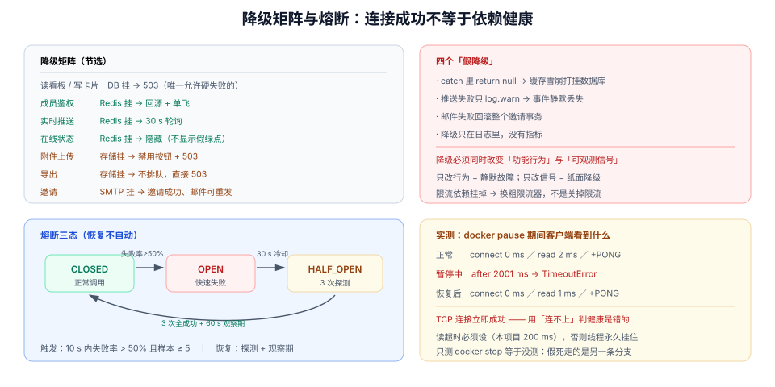

# 依赖降级：Redis 挂掉之后，这个看板还剩多少功能

第 2 周第 13 步：实时推送、缓存、限流、在线状态全部压在 Redis 上，附件压在对象存储上，邀请邮件压在 SMTP 上。这一步回答一个运营问题：**当其中一个外部依赖不可用时，产品应该表现成什么样**——不是「尽量不崩」，而是**每个功能有明确的降级形态，并且降级这件事本身是可观测的**。

## 当日做了什么

| 项 | 产出 |
| --- | --- |
| 降级矩阵 | 9 个功能 × 3 个依赖，逐格给出「可用 / 只读 / 禁用 / 硬失败」 |
| 四个误降级 | `catch → 返回空`、缓存穿透放大、静默丢事件、把降级藏起来 |
| Redis 兜底 | 本地扇出、30 s 轮询、关闭 presence、本地令牌桶四条 |
| 熔断 | 三态机 + 探测窗口 + **恢复不自动**的理由 |
| 演练 | `docker pause` 注入，实测连接与读超时的读数 |
| 判据 | `DGR-A` ~ `DGR-H` 八条 |



::: tip 本步的位置
第 12 步的导出依赖对象存储，第 10 步的推送依赖 Redis。在没有降级设计之前，这两处依赖的失败会表现为**接口 500 / 页面转圈**——用户不知道发生了什么，运维也看不出是哪个依赖挂了。
:::

## 一、三条依赖，三种失败模式

| 依赖 | 承担什么 | 典型失败 | 失败时的默认表现（没有降级设计） |
| --- | --- | --- | --- |
| Redis | 推送扇出、成员缓存、限流计数、在线状态 | 超时、连接拒绝、主从切换 | 接口 RT 从 20 ms 涨到 2 s（线程池打满） |
| 对象存储 | 附件、导出文件 | 5xx、签名失败、区域故障 | 上传 500，导出任务永远 `running` |
| SMTP | 邀请、通知邮件 | 550 拒信、限流、域名信誉下降 | 邀请接口 500（**其实站内已经建好了**） |

::: danger 数据库不在降级清单里
PostgreSQL 挂了没有「降级形态」——这个产品离开数据库没有意义。强行「降级成只读缓存」等于给用户一个**看似能用、数据全是旧的**界面，比直接 503 更糟。
所以：**能降级的只有外部依赖，主存储只能硬失败。**
:::

## 二、四个「看起来像降级」的错误

| 写法 | 为什么错 |
| --- | --- |
| `try { cache.get(k) } catch { return null }` | 缓存失效 → 全部打到数据库 → **数据库被打挂**（雪崩），这不是降级是放大 |
| 推送失败时 `log.warn` 后继续 | 事件静默丢失，用户永远不知道少了一条（要靠 `seq` 补拉兜底，见第 10 步） |
| 邮件发送失败导致整个邀请事务回滚 | 站内邀请已经建好，却因为邮件失败而全部失败 |
| 降级状态只在日志里 | 值班的人不知道系统正在降级，只有用户投诉 |

判断标准只有一句：**降级必须改变「功能行为」，并且改变「可观测信号」**。只做前者是静默故障，只做后者是纸面降级。

## 三、降级矩阵

| 功能 | 依赖 | 依赖不可用时 | 用户看到 |
| --- | --- | --- | --- |
| 读看板 / 读卡片 | 数据库 | 503 | 「服务暂时不可用」 |
| 拖动 / 编辑卡片 | 数据库 | 503 | 同上 |
| 成员鉴权 | Redis（缓存） | **回源数据库**（限流保护，见第四节） | 正常，只是慢 |
| 实时推送 | Redis | **降级为 30 s 轮询** | 右上角「实时更新已暂停」 |
| 在线状态 | Redis | **隐藏在线列表** | 成员头像不显示绿点 |
| 新建评论 / 提及 | 数据库 + outbox | 正常（不依赖 Redis） | 正常 |
| 附件上传 | 对象存储 | **禁用上传按钮** | 「附件服务暂不可用」 |
| 导出 | 对象存储 | 任务失败（`503`），不排进队列 | 「导出暂不可用」 |
| 邀请 | SMTP | **邀请成功，邮件失败**（可重发） | 「邀请已创建，邮件发送失败，可复制链接」 |

这张表的价值在于**它必须先被写下来，代码才可能对**。逐条实现的顺序建议：先做「降级为轮询」与「禁用上传」，这两条最容易验证。

## 四、Redis 不可用时的四条兜底

### 1. 推送：降级为轮询

```java
// 伪代码：推送通道的选择
if (redisHealthy.get()) {
    subscribe(topic);                       // 正常路径
} else {
    poller.schedule(boardId, Duration.ofSeconds(30));   // 只拉 seq > lastSeq
}
```

轮询的代价是**每 30 s 一次 `GET /events?after=`**。1,000 人在线时是 33 QPS 的额外读——可以接受，但要给这个接口单独限流，否则降级期间它会把数据库打满。

### 2. 缓存：回源 + 单飞

```java
// 缓存不可用时：直接查库，但同一 key 的并发回源只允许一个
return singleFlight.compute(key, k -> memberRepo.find(tenantId, workspaceId, userId));
```

没有单飞（single-flight）时，1,000 个并发请求会在缓存失效的瞬间产生 1,000 次相同的数据库查询——**这就是「降级把数据库打挂」的具体路径**。

### 3. 限流：从 Redis 计数退化为本地令牌桶

| 方案 | 多实例下的准确性 | 降级后的风险 |
| --- | --- | --- |
| Redis 计数（`INCR` + `EXPIRE`） | 全局准确 | 依赖不可用时全部失败 |
| 本地令牌桶 | 每个实例各自计数，实际额度 = 单实例额度 × 实例数 | 额度被放大 N 倍，但**不会完全放开** |

::: warning 降级时不要「关闭限流」
「限流依赖挂了就关掉限流」是最常见的错误：依赖挂掉的那一刻正是流量最大、最需要保护的时候。正确做法是**换一个更粗的限流器**，而不是没有限流器。
:::

### 4. 在线状态：直接隐藏

presence 的数据本来就在 Redis 里，没有本地副本可降级。**隐藏比显示错的更好**——一个「所有人都在线」的假列表会让协作判断失效。

## 五、熔断：三态，且恢复不自动

```text
CLOSED ──(连续 5 次失败 / 10 s 内失败率 > 50%)──▶ OPEN
  ▲                                                │
  │                                     (30 s 冷却)
  │                                                ▼
  └────(探测 3 次全成功，且持续 60 s)──── HALF_OPEN
```

| 参数 | 取值 | 依据 |
| --- | --- | --- |
| 触发阈值 | 10 s 内失败率 > 50% 且样本 ≥ 5 | 单次抖动不该触发 |
| 冷却时间 | 30 s | 给对端重启 / 主从切换的时间 |
| 半开探测 | 3 次，全部成功才回到 `CLOSED` | 一次成功可能是巧合 |
| 恢复后观察期 | 60 s 内仍标记 `degraded` | 避免「刚恢复又挂」的抖动被用户看到 |

**恢复为什么不自动**：Redis 恢复的瞬间，积压的轮询请求与重连会同时到达，容易二次打挂。所以恢复后先保持降级状态 60 s，让流量平缓爬升。

## 六、实测：Redis 被暂停时，客户端到底看到什么

本机实测（Redis 7.4.0 容器，`docker pause` 模拟进程假死，客户读超时设为 2 s）：

```text
正常：   connect=0ms    read=2ms    reply=b'+PONG\r\n'
暂停中： after 2001ms → TimeoutError: timed out
恢复后： connect=0ms    read=1ms    reply=b'+PONG\r\n'
```

**这三个读数里最重要的一条是「connect 不报错」**：

| 现象 | 推论 |
| --- | --- |
| TCP 连接**立即成功**（内核仍完成握手） | 只靠「连接失败」判断依赖健康是**错的** |
| 读超时 2,001 ms（正好等于客户端超时） | 没有设置读超时的客户端会**永远挂住**，线程池被占满 |
| 恢复后 1 ms 内正常 | 降级状态必须能被快速撤销，不能等 5 分钟健康检查 |

::: danger 由此得到的两条硬要求
1. **所有 Redis 调用必须设读超时**（本项目 200 ms）与连接超时（100 ms）。默认无超时 = 依赖假死时整个服务假死。
2. **健康判定必须基于真实请求**（`PING` 或一次小 `GET`），不能基于「连接是否建立」——连接永远建得上。
:::

## 七、演练：四条预期

```shell
# 注入：暂停 Redis（进程假死，比 kill 更接近真实故障）
docker pause teamboard-cache-1

# ① 读接口仍然可用（缓存回源），RT 上升但不应超过 500ms
curl -s -o /dev/null -w '%{time_total}\n' "http://localhost:8080/api/v1/boards/$BOARD" -H "Authorization: Bearer $TOKEN"
# 期望：200；time_total < 0.5

# ② 推送降级为轮询：前端角标变成「实时更新已暂停」
# 期望：30s 内页面仍能收到别人的改动（最多晚 30s）

# ③ 上传按钮禁用：presign 返回 503 且错误码明确
curl -s -o /dev/null -w '%{http_code}\n' -X POST "http://localhost:8080/api/v1/cards/$CARD/attachments/presign" \
  -H "Authorization: Bearer $TOKEN" -H 'Content-Type: application/json' -d '{"filename":"a.png","size":1024,"contentType":"image/png"}'
# 期望：503 DEPENDENCY_UNAVAILABLE（不是 500，也不是超时 30s）

# ④ 指标里能看到降级状态
curl -s http://localhost:8080/actuator/prometheus | grep 'degrade_state'
# 期望：degrade_state{dep="redis"} 1

# 恢复
docker unpause teamboard-cache-1
# 期望：60s 内 degrade_state 回到 0，推送恢复，轮询停止
```

::: warning 演练要注入「假死」而不只是「宕机」
`docker stop` 会让连接直接拒绝（快速失败），而真实故障更常见的是**丢包、进程假死、主从切换**——表现是「连得上但不回应」。这两种注入的代码路径完全不同：前者测的是「连接异常处理」，后者测的是「读超时 + 熔断」。**只测 stop 的降级方案，在生产上等于没测。**
:::

## 八、判据族 `DGR-A` ~ `DGR-H`

| 判据 | 规则 | 违反时的样子 | 验证方式 |
| --- | --- | --- | --- |
| `DGR-A` | 每个依赖有明确的降级形态，且写进降级矩阵 | 依赖挂了全部 500 | 对照第三节表格逐格验 |
| `DGR-B` | 所有外部调用都有连接超时与读超时 | 依赖假死时线程池被打满 | 命令 ①，`time_total` 必须有界 |
| `DGR-C` | 缓存不可用时回源，且有单飞/限流保护 | 缓存失效瞬间数据库 QPS 翻 1000 倍 | 暂停 Redis 后观察数据库 QPS |
| `DGR-D` | 推送降级为轮询，且轮询接口单独限流 | 降级期间把数据库打满 | 命令 ② |
| `DGR-E` | 依赖不可用时返回 `503 DEPENDENCY_UNAVAILABLE`，不是 500 | 客户端无法区分「依赖挂」与「代码 bug」 | 命令 ③ |
| `DGR-F` | 降级状态有指标（`degrade_state`），且进入告警 | 值班靠用户投诉才知道 | 命令 ④ |
| `DGR-G` | 熔断恢复需探测 + 观察期，不自动全量放开 | 恢复瞬间二次打挂 | 观察恢复后 60 s 的 RT 曲线 |
| `DGR-H` | 降级演练覆盖「假死」而不只是「宕机」 | 只测过 `docker stop` | 用 `docker pause` 复跑一遍 |

## 九、下一步

1. **第 2 周验收**：把这 14 步串成一条可执行的验收序列（下一步就是收口）。
2. **降级的自动化恢复**：当前 60 s 观察期靠人盯着，应该由指标驱动。
3. **多依赖同时降级**：Redis 与对象存储同时不可用时的行为还没定义（矩阵里是「逐格」的）。
4. **降级页文案**：四个降级形态各自需要一句面向用户的话，现在只有错误码。

## 十、参考资料

- [Martin Fowler · CircuitBreaker](https://martinfowler.com/bliki/CircuitBreaker.html)（三态机与半开探测的原始描述）
- [Resilience4j · 文档](https://resilience4j.readme.io/docs/circuitbreaker)（阈值与滑动窗口的工程口径）
- [Google SRE Book · Handling Overload](https://sre.google/sre-book/handling-overload/)（降级与限流的关系）
- [项目章节 · 缓存隔离：那条绕过 RLS 的捷径](../CacheIsolation/index.md)（缓存 key 与租户边界）
- [分布式缓存 · 可用性](/docs/Backend/DistributedCache/Availability/index.md)（缓存层自身的降级与击穿防护）
