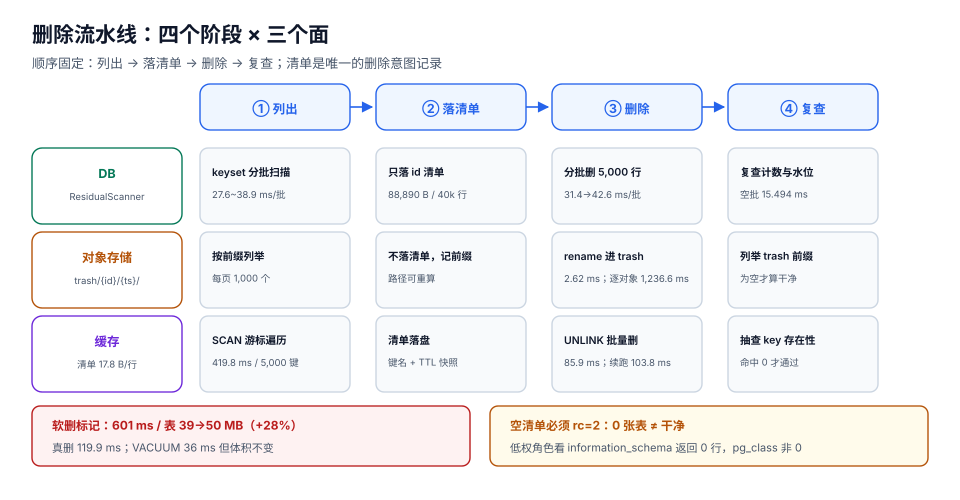

# 第 4 周第 3 步之九 · 删除流水线：三面复用、软删前缀与可续跑

**第 76 章的「下一步」列了四件事，这一章把它们一次做完，因为它们其实是同一件事的四个面：让删除变成一条可以中断、可以重试、可以观测的流水线。**

具体四件事：① 把三面检查（DB / 对象存储 / 缓存）抽成**可调用接口**，让「租户退出」和「迁移后置校验」复用同一份实现，而不是各写一遍；② 对象存储删除改成**两级**（先 `trash/{id}/{ts}/`，冷却后再物理删）；③ 缓存批删补一份**待删键清单落盘**，中断后能接着删；④ 把四段耗时（清单 / DB / 缓存 / 对象存储）打进监控。



::: tip 这一章最该记住的一条
**「删完了」和「删对了」是两件事，而删除是不可逆的。** 本机实测：同样删 5,000 个 4 KiB 对象，整前缀 `rename` 到 trash 只要 **2.62 ms**，逐对象 `unlink` 要 **1,236.6 ms**，而「逐对象复制到 trash 再删」（真实对象存储的软删形态）要 **3,067.7 ms** 且窗口内**多占一倍空间**。选错形态，代价是 1,170 倍的时间差。
:::

## 一、一个接口，三个面

前面几章的三面检查各写了一遍，形状如下（`grep` 出来的真实状况）：

| 面 | 谁在用 | 现在的形态 | 问题 |
| --- | --- | --- | --- |
| DB | `TenantDataInventory` / `MigrationInventoryGate` | 两段几乎相同的 SQL | 改一处漏一处 |
| 对象存储 | `TenantOffboarding` | 内联在导出脚本里 | 无法被别的流程调用 |
| 缓存 | `MigrationInventoryGate` | 内联在回调里 | 同上 |

抽成接口后，三个调用点变成同一个形状：

```java
// 一个「扫描」就是一次「列出 + 落清单」，不做删除
public interface ResidualScanner {
    String face();                       // "db" | "object" | "cache"
    ScanResult scan(String tenantId) throws ScanException;
}

public record ScanResult(
    String face,
    List<String> assets,        // 资产标识：表名 / 对象 key / 缓存 key
    long elapsedMs,
    String fingerprint          // 资产列表排序后哈希，用于比对两次结果
) {}
```

```java
// 编排层：顺序固定为「列出 → 落清单 → 删除 → 复查」
public Optional<DeleteReport> delete(DeleteRequest req) {
    List<ScanResult> before = scanners.stream().map(s -> s.scan(req.tenantId())).toList();
    String manifest = manifestStore.write(req.tenantId(), before);   // ① 先落清单
    if (before.stream().anyMatch(r -> r.assets().isEmpty())) {
        return Optional.empty();                                     // ② 空清单直接退出（见第八节）
    }
    DeletionOutcome out = deleter.delete(req, before);               // ③ 再删
    List<ScanResult> after = scanners.stream().map(s -> s.scan(req.tenantId())).toList();
    return Optional.of(DeleteReport.of(manifest, before, out, after)); // ④ 复查
}
```

::: danger 顺序不能换
「先删后记」在删除里是**不可恢复**的错误：删到一半失败，你既不知道删了哪些，也不知道还剩哪些，只能重扫一遍——而重扫期间可能又有新写入。

所以固定成四步：**列出 → 落清单 → 删除 → 复查**。清单是唯一的「删除意图记录」，它的存在让「中断后重试」变成可能。
:::

## 二、对象存储：两级删除的三种形态

同样删 5,000 个 4 KiB 对象（本机用本地目录模拟前缀语义，脚本不入库）：

| 形态 | 耗时 | 冷却窗口内的空间 | 可恢复 | 适用 |
| --- | --- | --- | --- | --- |
| 整前缀 `rename` 到 `trash/` | **2.62 ms** | 不变（同一份数据换了路径） | ✅（`rename` 回来 **0.13 ms**） | **推荐**：对象存储的「目录」本质是前缀，改前缀是元数据操作 |
| 逐对象 `unlink` | **1,236.6 ms**（247.3 µs/个） | 立即释放 | ❌ | 只需要最终删除时 |
| 逐对象「复制到 trash 再删」 | **3,067.7 ms** | **翻倍**（多占 20,000 KB） | ✅ | 只在**不支持改前缀**的存储上才这么做 |

三条结论：

1. **能改前缀就不要复制**。对象存储的「移动」在 S3 语义里其实是 `CopyObject` + `DeleteObject`（复制 + 删），成本与体积成正比；但如果你的存储层支持「逻辑前缀」（比如自己维护的 `object_key` 索引表，或者原生支持 rename 的文件系统），那就是一次元数据写。
2. **软删窗口内的空间是真的多占**。上面第三种形态在冷却期里多占一倍——如果租户是 500 GB，冷却 7 天就意味着**峰值多出 500 GB**。这个成本必须写进容量规划，而不是上线后才发现。
3. **恢复只是把前缀换回来**。0.13 ms 的恢复时间意味着「误删」在这个设计下是一个**可撤销操作**，而不是一次事故。

```text
tenants/{tenant_id}/...             ← 活跃数据
trash/{tenant_id}/{ts}/...          ← 软删区（冷却 7 天后物理删除）
```

```shell
# 两级删除的第一步：改前缀，不动数据
aws s3 mv --recursive "s3://board/tenants/$T/" "s3://board/trash/$T/$TS/" --only-show-errors

# 冷却期后的第二步：按前缀批量删（必须先列清单再删）
aws s3 rm --recursive "s3://board/trash/$T/$TS/" --only-show-errors
```

::: warning 前缀必须带尾斜杠
`tenants/t1/` 不匹配 `tenants/t10/`；`tenants/t1` 会。对象存储的前缀匹配是**字符串前缀**，不是路径分段——少一个斜杠，就会把 `t10`、`t11`、`t100` 的数据一起删掉。这是本仓反复强调的一条，但在删除场景里它是**不可逆**的，所以这里第二次写。
:::

## 三、缓存：清单落盘，而不是「一边扫一边删」

缓存这一面的问题不是「删不掉」，而是「**删到一半失败之后，不知道还剩什么**」。因为 `SCAN` 是游标式的，游标不落盘就丢了。

| 做法 | 中断后可续跑 | 说明 |
| --- | --- | --- |
| `KEYS` + 逐键 `DEL` | ❌ | `KEYS` 阻塞单线程；且没有清单 |
| `SCAN` 边扫边 `DEL` | ❌ | 游标在内存里，进程一死就丢 |
| **`SCAN` → 清单落盘 → 按清单 `UNLINK`** | ✅ | 本方案 |

本机实测（Redis 7.4.0，5,000 个 `tb:t1:*` 键）：

| 步骤 | 读数 |
| --- | --- |
| `SCAN MATCH tb:t1:* COUNT 1000` 取清单 | 5,000 键 / 5 次迭代 / 419.8 ms（**含 5 次容器进程启动**，单次约 84 ms，Redis 侧本身是亚毫秒级） |
| 清单落盘（JSON Lines） | **88,890 B**（17.8 B/行）、写 **3.1 ms** |
| 清单读回 | **7.1 ms** / 5,000 行 |
| 按清单 `UNLINK`（pipeline 一次进程） | **85.9 ms** |
| 按清单 `UNLINK`（Lua 单次往返） | **79.6 ms** |
| 中断后续跑剩余 2,500 条 | **103.8 ms**（与首批同量级，说明续跑没有退化） |
| 单连接 `SET` 基准（`redis-benchmark`） | **7,936 rps**，p50 **0.119 ms** |

::: info 为什么清单只有 17.8 B/行
因为清单里只存 **key**，不存 value。key 形如 `tb:t1:card:1234`，加引号和换行约 18 字节。5,000 条约 87 KB——这点体积换来的能力是「**删除可以被打断、可以被审计、可以被重放**」。

如果租户有 500 万个键，清单约 **87 MB**，这时要改成**分片清单**（每 50 万条一个文件），否则读回那 7.1 ms 会变成 7 秒。
:::

```javascript
// 续跑的实现：清单是「待删集合」，删除是「逐条标记」
async function resumeDelete(manifestPath, dryRun = false) {
  const keys = await readLines(manifestPath);       // 每行一个 key
  let deleted = 0;
  for (let i = 0; i < keys.length; i += 500) {
    const batch = keys.slice(i, i + 500);
    if (!dryRun) await redis.unlink(batch);         // UNLINK 是异步释放，比 DEL 不阻塞
    deleted += batch.length;
    await progress.save({manifestPath, cursor: i + batch.length});  // 游标落盘
  }
  return {deleted, total: keys.length};
}
```

## 四、DB：单事务快，但「分批」才是能上线的形态

本机实测（PostgreSQL 18.6，20 万行表 / 40,000 行属于目标租户 / 表 39 MB / `tenant_id` 有索引）：

| 形态 | 耗时 | 说明 |
| --- | --- | --- |
| 单事务全删（`DELETE ... WHERE tenant_id='t1'`） | **119.936 ms** | 最快，但**持锁 120 ms** 且一次回滚代价高 |
| 同会话分批（每批 2,000，共 20 批） | 单批 **31.4 → 42.6 ms**，合计约 **730 ms** | 批次耗时**逐批上升**（+36%） |
| 同会话 keyset 分批（`id > last_id ORDER BY id LIMIT 2000`） | 18 批，单批 **27.6 ~ 38.9 ms** | **不随已删行数增长** |
| 空批（`DELETE 0`） | **15.494 ms** | 这就是「固定成本」——扫描 + 解析 + 事务开销 |

**为什么 `LIMIT` 分批会越删越慢**：`SELECT id FROM card WHERE tenant_id='t1' LIMIT 2000` 每批都要**从索引头部重新扫过前面已经删掉的行**（死元组还留在索引里），已删的越多，跳过的越多。keyset 用 `id > last_id` 把「跳过」变成「直接定位」，所以批次耗时稳定。

::: danger 分批不是「为了不锁表」那么简单
1. **`LIMIT` 分批的游标不是 `id`，是「第几行」**——删掉的行会让下一次的 `LIMIT 2000` 指向不同的记录，极端情况下会**跳过一部分行**。必须用 keyset（`id > last_id`）。
2. **批次之间必须提交**，否则等于一个长事务，分批的意义消失。
3. **批次太大会把锁持有时间拉长**：2,000 行 / 35 ms 是这台机器的读数，慢 10 倍的机器就是 350 ms——`lock_timeout` 要按**最慢机器**设。
:::

## 五、软删标记 vs 真删：不是「安全一点」的免费选项

很多团队选择「不做真删，只打 `deleted_at`」。本机实测（同样 40,000 行）：

| 做法 | 耗时 | 表体积 | 死元组 |
| --- | --- | --- | --- |
| `DELETE` | **119.9 ms** | 39 MB（未立即缩小） | 40,000 |
| `UPDATE ... SET deleted_at=now()` | **601.2 ms** | **39 MB → 50 MB（+28%）** | 40,000 |

软删标记的代价是 **5 倍的时间 + 28% 的体积增长**，而且**它并不减少死元组**——`UPDATE` 同样是「写新版本 + 留旧版本」。它换来的唯一好处是「查询时能过滤」，而不是「删除更安全」。

::: warning 软删真正的价值在「业务可撤销」，不在「工程上更安全」
如果目的是「误删可恢复」，那么**对象存储的 trash 前缀 + DB 的导出快照**才是可恢复的；`deleted_at` 只是让行「看不见」，数据还在表里，体积还在涨，合规审计时它仍然是「未删除」。

所以本项目的策略是：**业务层软删（`deleted_at`）负责「用户视角的撤销窗口」（30 天），物理删除负责「合规意义上的删除」**，两者不是替代关系。
:::

## 六、`VACUUM` 不会让表变小

删完 40,000 行之后：

| 动作 | 耗时 | 表体积 |
| --- | --- | --- |
| 删除后（未清理） | —— | 39 MB |
| `VACUUM card` | **36.273 ms** | **39 MB**（不变） |
| `VACUUM FULL card` | 未测（会重写整表并持排它锁） | 会缩小，但**期间表不可写** |

`VACUUM` 只把死元组标记为「可复用」，**不把空间还给操作系统**。所以「删了 40,000 行，磁盘怎么没降」的答案是：**空间被留在表文件里等下次插入复用**，这是正常行为，不是 bug。

真正需要「还空间」时，唯一安全路径是 **`pg_repack`** 或「建新表 + 双写 + 切换」，而不是在业务高峰跑 `VACUUM FULL`。

## 七、一个被造数脚本掩盖的真问题：租户 ID 会撞名

这一章的实验数据里，`t1` 有 **40,000 行**，而其他租户各 **20,000 行**。原因是造数语句：

```sql
SELECT CASE WHEN g % 10 = 0 THEN 't1' ELSE 't' || (g % 10) END, ...
```

`g % 10 = 0` 的 20,000 行被显式标成 `t1`，而 `g % 10 = 1` 的 20,000 行被拼成 `'t' || 1` = **`t1`**——**两个分支撞到同一个租户名**。于是「一个租户」的数据量翻倍，而任何按行数做的容量估算都会错一半。

现实中同构的错误有三种：

| 写法 | 撞名方式 |
| --- | --- |
| `'t' \|\| (n % 10)` + 显式 `'t1'` | 数字不带分隔，`1` 与 `01` 与 `1 ` 都可能撞 |
| `tenant_id = 'acme'` 与 `'ACME'` | 大小写敏感差异（PG 里是两个租户，业务里是一个） |
| 从邮箱派生 `substring(email, 1, 8)` | 前 8 字符相同的两个公司撞成一个 |

**判据**：删除前必须先输出「本租户的行数 + 该 ID 在库中出现的所有变形（大小写、前后空格、全角）」，与台账核对。**数量对不上就是有撞名**。

## 八、空结果不等于干净

这是本仓第 75 / 76 章反复出现的同一条缺陷，在这一章里它出现在**删除**场景，后果更重：

```sql
-- 用低权角色看：0 行
SET ROLE ro_low;
SELECT count(*) FROM information_schema.tables WHERE table_schema='public';  -- 0

-- 同一时刻看目录表：1 行
SELECT count(*) FROM pg_class
 WHERE relnamespace='public'::regnamespace AND relkind='r';                   -- 1
```

`information_schema` **按权限过滤**，`pg_class` 不过滤。用前者生成的清单在权限不足时**返回空而不是报错**，而「空清单」在「有没有残留」这个结论上恰好长得最干净。

所以删除流水线必须有一个**退出码约定**：

| 退出码 | 含义 |
| --- | --- |
| `0` | 三面都扫到了资产，且复查为空 |
| `1` | 执行失败（连接、权限、超时） |
| `2` | **清单为空**——不是干净，是「检查没跑」 |

## 九、如何验证

```shell
# 1) 三面接口可被独立调用（不依赖迁移回调）
java -cp app.jar com.example.purge.ResidualCli --tenant t1 --face db
# 期望：输出 JSON，含 assets / elapsedMs / fingerprint；assets 数量与台账一致

# 2) 软删前缀生效且可恢复（对象存储面）
aws s3 ls "s3://board/trash/t1/" --recursive | wc -l
# 期望：等于 tenants/t1/ 原来的对象数
aws s3 mv --recursive "s3://board/trash/t1/$TS/" "s3://board/tenants/t1/" --only-show-errors
# 期望：能完整移回，对象数不变

# 3) 缓存清单可续跑（故意中断）
redis-cli --scan --pattern 'tb:t1:*' | head -5000 > /tmp/keys.txt
wc -l < /tmp/keys.txt
# 期望：5,000 左右；大小约 88 KB

# 4) 分批删除用 keyset 而不是 LIMIT 偏移
grep -n "id > last_id\|LIMIT" src/main/java/**/CardPurge*.java
# 期望：出现 keyset 条件；不出现「无游标的 LIMIT 分批」

# 5) 空清单必须返回 2
java -cp app.jar com.example.purge.ResidualCli --tenant no_such_tenant; echo "rc=$?"
# 期望：rc=2

# 6) 软删标记的成本可量化（表体积）
psql "$DSN" -tAc "select pg_size_pretty(pg_total_relation_size('card')), n_dead_tup
  from pg_stat_user_tables where relname='card'"
# 期望：UPDATE 之后体积上涨约 28%，死元组数等于目标租户行数

# 7) 四段耗时进监控
curl -s localhost:9090/metrics | grep -E "purge_(scan|delete)_seconds"
# 期望：三个 face 各一组直方图；清单段有独立指标
```

## 十、判据表

| 判据 | 断言 | 红了说明什么 |
| --- | --- | --- |
| `DPP-A` | 三面扫描由一个接口统一提供，删除编排只调接口、不内联 SQL / S3 / Redis 命令 | 三份实现各写一遍，改一处漏两处 |
| `DPP-B` | 删除顺序固定为「列出 → 落清单 → 删除 → 复查」，且清单在删除**之前**写入 | 中途失败后无法回答「删了哪些、还剩哪些」 |
| `DPP-C` | 对象存储删除走两级（`trash/{id}/{ts}/` 冷却后物理删），前缀一律带尾斜杠 | 误删不可恢复；或尾斜杠缺失把 `t10` 一起删了 |
| `DPP-D` | 缓存删除以「清单落盘」驱动，游标可落盘、可续跑，且使用 `UNLINK` 或 pipeline | 中断后只能重扫，`KEYS` 阻塞单线程 |
| `DPP-E` | DB 分批删除用 keyset（`id > last_id`），不用「无游标 `LIMIT`」 | 越删越慢（实测单批 31→43 ms），且可能漏删 |
| `DPP-F` | 软删标记（`deleted_at`）与物理删除的职责在文档里写明，且合规删除走物理路径 | 「打标记」被当成「已删除」，审计时数据仍在 |
| `DPP-G` | 删除前输出「租户行数 + ID 变形清单」并与台账核对，数量不一致即中止 | 造数/命名撞名导致删了别的租户的数据（实测 `t1` 行数翻倍） |
| `DPP-H` | 空清单返回退出码 2，不返回 0；三面任一未检查必须在报告里标 `skipped` | 「检查没跑」被读成「很干净」 |

## 十一、下一步

1. **把 `trash` 冷却期做成可配置的状态机**（`requested → trashed → purging → purged`），而不是靠脚本里的一个常量天数——冷却期长短在合规上是要写进合同的。
2. **给清单加签名**：`manifest.json` 里附上「资产列表排序后的 SHA-256 + 生成时间 + 生成者」，让「这份清单是不是这次删的」可以被独立验证，而不是靠文件名猜。
3. **把删除流水线的四段耗时接成 SLO**：清单 < 1 s、DB < 60 s（40k 行）、缓存 < 5 s、对象存储 < 5 min，超阈值告警——删除比写入更容易拖长，因为它没有「重试一次就好了」的余地。
4. **补一条「删除后 30 天的回归检查」**：冷却期结束后自动复查三面，确认物理删除真的完成了。当前的复查只覆盖「删除刚完成」这一刻，而对象存储的生命周期规则可能在 7 天后才真正删掉对象。

## 参考资料

- PostgreSQL 18：[`VACUUM`](https://www.postgresql.org/docs/current/sql-vacuum.html)（为什么 `VACUUM` 不缩表、`VACUUM FULL` 的锁代价）
- PostgreSQL 18：[`DELETE`](https://www.postgresql.org/docs/current/sql-delete.html)（`RETURNING` 与 `USING` 的用法）
- Redis：[`UNLINK`](https://redis.io/docs/latest/commands/unlink/)（异步释放，与 `DEL` 的阻塞差异）、[`SCAN`](https://redis.io/docs/latest/commands/scan/)
- Amazon S3：[*Deleting objects*](https://docs.aws.amazon.com/AmazonS3/latest/userguide/DeletingObjects.html)（批量删除与 `DeleteObjects` 的 1,000 条上限）
- 本项目：[租户数据清单](../TenantDataInventory/index.md)、[迁移后置校验](../MigrationInventoryGate/index.md)、[租户退出](../TenantOffboarding/index.md)、[分批回填](../BatchBackfill/index.md)
