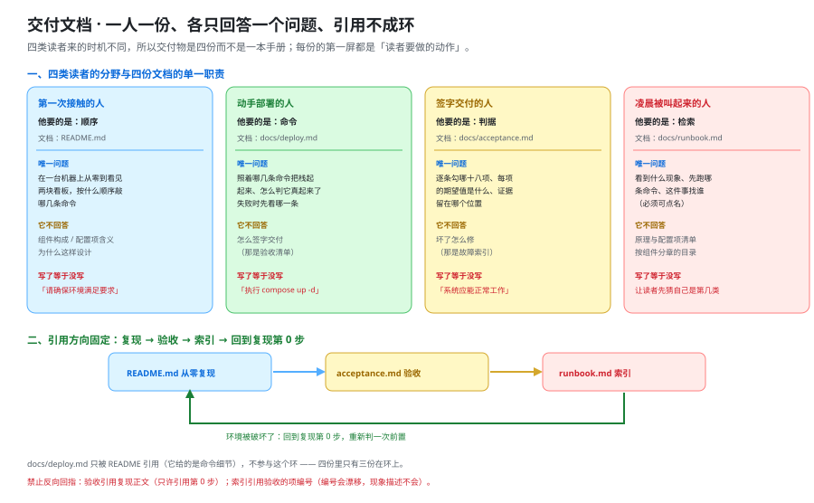

# 交付文档：四份文档各自只回答一个问题

这一页回答「月末交付时，读者拿到的是哪四份文档、每份只回答什么问题、怎么用一条命令判出它写没写到位」——它把上一周期 [交付文档三件套](../../MonitoringDashboard/DeliveryDocs/index.md) 的读者分野、第一屏纪律与「期望值不许是形容词」整套口径**继承下来并补成四份**；它**不回答**「栈是怎么编排起来的」（那是 [部署脚本](../DeployScripts/index.md) 的事）、「指标与告警挂在哪几条规则上」（那是 [监控与告警接入](../Monitoring/index.md) 的事）、「这一周整体算不算完成」（那是 [第 4 周验收结论](../Week4Acceptance/index.md) 的事）。



::: warning 本仓库只有文档，没有代码
本页给出的四份文档骨架、前置检查脚本与校验命令，都要落在**你自己搭好的工程**里。`project/` 目录**只允许 `.md` 与配图**，所以这里的每一份交付物都只能以**围栏代码块**的形态出现在页面里——读者照着创建，本仓库不提供可执行副本。
:::

## 一、为什么是四份，而不是一本手册

一本《项目交付手册》看起来更省事：目录一列、章节一开，什么都在里面。它的问题不在篇幅，而在**读者不是同一个人、来的时机也不是同一个**。把四种需求塞进一份文档，结果一定是：第一次来的人被逐条验收清单劝退，凌晨被叫起来的人在目录里翻三分钟。

| 文档 | 读者与时机 | 他要的是 | 唯一回答的问题 | 它**不回答**什么 | 写了等于没写（反例） |
| --- | --- | --- | --- | --- | --- |
| `README.md` | 第一次接触这个项目的人 | **顺序** | 在一台机器上从零到看见两块看板，按什么顺序敲哪些命令 | 组件构成、配置项含义、为什么这样设计 | 「请确保环境满足要求」 |
| `docs/deploy.md` | 动手部署的人 | **命令** | 照着哪几条命令把栈起起来、怎么判它真起来了、失败时先看哪一条 | 怎么签字交付（那是验收清单） | 「执行 `docker compose up -d`」 |
| `docs/acceptance.md` | 签字交付的人 | **判据** | 逐条勾哪 18 项、每项的期望值是什么、证据留在哪个位置 | 坏了怎么修（那是故障索引） | 「系统应能正常工作」 |
| `docs/runbook.md` | 凌晨被叫起来的人 | **检索** | 看到什么现象、先跑哪条命令、这件事找谁 | 原理与配置项清单 | 按组件分章的目录 |

::: tip 一句话判据
**「读这份文档的人，现在手上要做什么动作？」** —— 答案是「按顺序敲命令」的归 `README.md`，是「排一条失败」的归 `deploy.md`，是「勾一格并留证据」的归 `acceptance.md`，是「从现象找到一条命令」的归 `runbook.md`。答不出来，说明这份文档还没定下唯一问题。
:::

::: danger 四份里最容易失守的一处：把「四份」写成「四段」
1. **把 `deploy.md` 写成 `README.md` 的第二章**：结果是同一条命令在两个地方各写一遍，改一处忘一处。正确写法是——`README.md` 只写**顺序与判定**，命令细节**引用** `docs/deploy.md`。
2. **把 `acceptance.md` 写成 `runbook.md` 的附表**：清单里的每一项都被要求「先看原理再操作」。正确写法是——清单每项只有**期望值 + 证据位置**，修法由索引回答。
3. **把四份写成同一批段落的四个副本**：判据是**两两之间的重复段落数为 0**（`sort | uniq -d` 输出为空），与周期 5 的 `DD-F` 同一条。
4. **把 `runbook.md` 的门写成「按组件」**：被叫起来的人不知道自己属于哪一类。正确写法是——第一层分类必须是**现象**，不是组件。
:::

## 二、四份文档的目录结构与篇幅目标

篇幅上限不是一个审美偏好，而是一条**可复算的判据**：交付文档最贵的成本是「没人读完」。

| 文件 | 行数上限 | 第一屏必须是 | 骨架 | 可复算校验 |
| --- | --- | --- | --- | --- |
| `README.md` | ≤ 80 | 「读者要做的动作：按 0 → 4 的顺序执行」 | 前置 → 一条命令 → 访问地址 → 预期看到什么 | `wc -l README.md` |
| `docs/deploy.md` | ≤ 160 | 环境前置检查那一行命令 | 前置检查 → 起栈 → 就绪判定 → 常见失败 | `grep -c '^### ' docs/deploy.md` |
| `docs/acceptance.md` | ≤ 180 | 「逐条跑，填满三格再走下一条」 | 分层勾选项（期望值 / 证据位置） | `grep -c '^- \[ \]' docs/acceptance.md` |
| `docs/runbook.md` | ≤ 120 | 「先在最左列找到现象，再往右执行」 | 现象 → 命令 → 角色 | `grep -c '项目组' docs/runbook.md`（期望 0） |

::: tip 上限怎么定出来的
四份合计上限 **540 行**，与周期 5 的三件套（288 行）同一个数量级。多出来的是 `deploy.md`——协作看板的命令序列比周期 5 的最小栈长：两个实例 + PostgreSQL + Redis + 对象存储 + 迁移脚本，`README.md` 塞不下。**多一份文档的成本是多维护一份，收益是每一份都能在第一屏结束读者的犹豫。**
:::

## 三、`README.md`：第一次接触的人要的是顺序

> **它只回答**：在一台机器上从零到看见两块看板，按什么顺序敲哪些命令。

```text [README.md —— 快速开始（约 76 行）]
在线协作任务看板 · 快速开始

读者要做的动作：按 0 → 4 的顺序执行，每一步之后停一下核对「应该看到什么」。
对不上就停在第几步，不要往下走 —— 后面每一步都依赖前面那一步是真的通的。

第 0 步  判定这台机器是否满足前置（不要跳过，也不要凭印象）
         bash scripts/preflight.sh      # 0 = 满足 / 1 = 缺前置（逐条列出）/ 2 = 用法错误

第 1 步  取交付件并起两个实例（实时链路至少要两个实例才能验证）
         cd /tmp && git clone "$BOARD_REPO" board && cd board
         bash bin/up.sh                 # 起实例 A、实例 B、PostgreSQL 18、Redis、对象存储

第 2 步  等就绪（三级：进程活 → 迁移完成 → 两块看板都能读）
         bash bin/wait-ready.sh         # 冷启动上界写在配置里，超时即以退出码 1 结束

第 3 步  打开两块看板（实例 A 与实例 B 各一个标签页）
         open http://localhost:8080/boards/seed-board
         open http://localhost:8081/boards/seed-board

第 4 步  预期看到什么（这一条看不过，前面三步都不算通过）
         在实例 A 拖动一张卡片 → 实例 B 的标签页在 1 秒内出现同一张卡片的新位置
         断开实例 B 的网络 10 秒后再恢复 → 界面自动追平，不丢改动
```

| 可数判据 | 命令 | 期望 |
| --- | --- | --- |
| 第一屏纪律 | `head -8 README.md \| grep -c '读者要做的动作'` | `1` |
| 是动作不是介绍 | `head -8 README.md \| grep -c '^本项目\|^本系统'` | `0` |
| 能起两个实例 | `grep -c 'localhost:8081' README.md` | `≥ 1` |
| 篇幅 | `wc -l README.md` | `≤ 80` |

::: danger 写了等于没写：第 0 步写成「请确保环境满足要求」
读者能做的动作是**点头**；他点完头，第 2 步失败，然后回来问「环境要求是什么」。

**正确写法**是一条命令 + **三个退出码**：`0` 满足、`1` 缺前置且逐条列出、`2` 脚本自身的用法错误——**判据从文档里搬进了脚本**。这与周期 5 的第 0 步（`bash scripts/preflight.sh` 返回 1 并列出缺失前置）是同一个形状。
:::

## 四、`docs/deploy.md`：动手部署的人要的是命令

> **它只回答**：照着哪几条命令把栈起起来、怎么判它真起来了、失败时先看哪一条。

```shell [scripts/preflight.sh —— 前置检查（读者工程内，约 40 行）]
#!/usr/bin/env bash
# 退出码语义三分：0 = 满足 / 1 = 缺前置（逐条列出）/ 2 = 用法错误
set -uo pipefail

missing=0
need() { command -v "$1" >/dev/null 2>&1 || { echo "缺前置：$1"; missing=1; }; }
check_port() { lsof -nP -iTCP:"$1" -sTCP:LISTEN >/dev/null 2>&1 || { echo "缺前置：端口 $1 未监听"; missing=1; }; }

need docker; need docker-compose || need docker; need jq
check_port 5432; check_port 6379        # PostgreSQL 18 与 Redis
[ "$missing" -eq 0 ] && echo "前置满足，可以继续" && exit 0
echo "前置缺失：逐条装上后重跑本脚本"; exit 1
```

```shell [docs/deploy.md —— 部署手册骨架（约 150 行），命令逐条可复制]
# 一、前置检查（先判机器，不要凭印象）
bash scripts/preflight.sh; echo "退出码=$?"                      # 期望 0

# 二、起栈（幂等：二次执行不应出现任何 Recreated）
bash bin/up.sh && docker compose up -d

# 三、就绪判定（三级，逐级判，不许跳）
docker compose ps                                                  # 第 1 级：全部 running
docker compose exec -T appA curl -s localhost:8080/actuator/health # 第 2 级：迁移完成
curl -s -o /dev/null -w '%{http_code}\n' localhost:8080/boards/seed-board   # 第 3 级：200

# 四、常见失败（现象 → 先看哪一条，见下页的对照表）
```

| 现象 | 先看哪一条命令 | 期望读数 |
| --- | --- | --- |
| `up.sh` 后容器立刻退出 | `docker compose logs --tail=50 appA` | 日志里能读到具体缺失的配置项名 |
| 第 2 级一直不过 | `docker compose exec -T db psql -U app -d board -c '\dt'` | 14 张表存在（迁移已执行） |
| 第 3 级返回 `404` | `curl -s localhost:8080/api/v1/boards` | 种子数据已导入，返回非空数组 |
| 实例 B 起不来、A 正常 | `docker compose logs --tail=50 appB` | 端口或实例标识冲突 |
| 拖动返回 `422` | `tail -n 50 logs/appA.log` | 请求体字段级校验失败原因 |

::: tip `deploy.md` 与 `README.md` 的引用方向
`README.md` 的第 1 步**引用** `docs/deploy.md`（命令细节在那边），`docs/deploy.md` **不引用** `README.md` 的步骤编号。理由是编号会漂移——这条纪律与第七节同源。
:::

## 五、`docs/acceptance.md`：签字交付的人要的是判据

> **它只回答**：逐条勾哪 18 项、每项的期望值是什么、证据留在哪个位置。

**四层 18 项**，每一项都带**证据留存位置**——没有落点的判据，事后无法复核：

| 层 | 项数 | 检查对象 | 证据留存位置 |
| --- | --- | --- | --- |
| **第 0 层 · 交付件一致性**（起栈之前） | 3 | 编排与规则文件的哈希成对声明、镜像 tag 固定、种子数据版本 | `evidence/00-hashes.txt` |
| **第 1 层 · 起栈与幂等** | 4 | 五个服务 `running`、二次 `up -d` 无 `Recreated`、迁移可重跑、端口只绑本机 | `evidence/10-compose-ps.txt` |
| **第 2 层 · 功能与实时通道** | 6 | 拖动、评论、`@` 提及、附件预签名、广播到达、断线重连补拉 | `evidence/20-realtime.txt` |
| **第 3 层 · 权限与错误码** | 5 | 18 格权限抽样、`401` / `403` / `404` / `409` / `422` 五条实跑 | `evidence/30-authz.txt` |
| **合计** | **18** | —— | 四个证据文件缺一不可 |

```text [docs/acceptance.md —— 勾选项的关键形态（约 175 行）]

第 2 层 · 功能与实时通道

- [ ] 在实例 A 拖动一张卡片，实例 B 的标签页在 1 秒内出现同一张卡片的新位置
      期望：1 s 内 / 证据：evidence/20-realtime.txt（两个标签页的时间戳）
- [ ] 拖动一张卡片后，数据库里被更新的行数恰好为 1
      期望：UPDATE 1 / 证据：evidence/20-realtime.txt（拖动前后的行数差）
- [ ] 断开实例 B 的网络 10 秒后恢复，界面自动追平且不丢改动
      期望：本地 seq 追平服务端 seq / 证据：evidence/20-realtime.txt（两端 seq 读数）
- [ ] 越权请求被拒且不留数据痕迹
      期望：另一种角色的令牌访问该看板返回 404 / 证据：evidence/30-authz.txt
```

::: danger 期望值那一格不许出现形容词
这是 18 项里**最容易集体失守**的地方：期望值一旦是形容词，整条判据就作废了——任何一次交付都能宣称满足它，任何一次故障也都能被解释成「没到标准」。

| 坏写法（不可判） | 好写法（可判） | 为什么 |
| --- | --- | --- |
| 服务应当正常运行 | `docker compose ps` 里 5 个服务 `State=running` | 「正常」没有取值 |
| 实时推送应当及时 | 实例 B 的标签页在 **1 s** 内出现新位置 | 「及时」没有阈值 |
| 越权请求应当被拒绝 | 另一种角色的令牌请求返回 **404** | 「被拒绝」要落到具体状态码 |
| 拖动应当不打架 | 两个人同时拖同一张卡片时，一次 `200` 一次 `409` | 「不打架」没有判据 |

**判据**：`grep -nE '正常|稳定|良好|较快|适当' docs/acceptance.md` 必须无命中。
:::

## 六、`docs/runbook.md`：凌晨被叫起来的人要的是检索

> **它只回答**：看到什么现象、先跑哪条命令、这件事找谁。

| 现象（你看到什么） | 先跑什么（一条可复制命令） | 找谁（可点名的角色） |
| --- | --- | --- |
| 两块看板都打不开 | `curl -s -o /dev/null -w '%{http_code}\n' localhost:8080/actuator/health` | 值班后端（`board-backend`） |
| 页面能开，拖动没反应 | `curl -s localhost:8080/actuator/prometheus \| grep '^tb_card_moves_total'` | 值班前端（`board-frontend`） |
| 自己拖能动，别人屏幕不动 | `curl -s localhost:8080/actuator/prometheus \| grep '^tb_ws_broadcast_duration_seconds_count'` | 值班后端 · 实时通道 |
| 某个人的界面莫名偏旧 | `curl -s localhost:8080/actuator/prometheus \| grep '^tb_ws_resync_required_total'` | 值班后端 · 实时通道 |
| 评论成功但对方没收到通知 | `curl -s localhost:8080/actuator/prometheus \| grep '^tb_outbox_oldest_age_seconds'` | 值班后端 · 通知投递 |
| 拖动偶尔失败且界面回弹 | `curl -s localhost:8080/actuator/prometheus \| grep 'tb_card_moves_total{result="conflict"}'` | 值班后端 · 并发 |
| 越权请求看起来没被拒 | `curl -s -o /dev/null -w '%{http_code}\n' -H "Authorization: Bearer $B_TOKEN" localhost:8080/api/v1/boards/$A_BOARD_ID` | 值班后端 · 权限 |
| 磁盘或内存告急 | `docker stats --no-stream` | 平台负责人 |

::: danger 「找谁」这一列写成团体名 = 没人
**「项目组」这类写法必须为 0**：`grep -c '项目组\|相关人员\|有关人员' docs/runbook.md` 期望 `0`。

**正确写法**是一个可点名的角色或值班编号（`board-backend` / `board-frontend` / 平台负责人）。这一列里出现了一次团体名，就意味着凌晨三点**没有一个人会因为这条记录而被叫醒**——它会退化成一份「看过就当处理过」的文档。
:::

::: tip 本项目比周期 5 多出来的两个排查项
周期 5 的索引有 6 行现象，本项目有 8 行，多出来的是**实时通道**（广播延迟 / `resync_required` / 连接数）与**权限越权**两组。理由很直接：周期 5 的项目里，最坏的结果是「大盘没有数据」；本项目里最坏的结果是「某个人看到的看板比别人旧，而所有指标都正常」——后者**必须由现象描述来兜住**。
:::

## 七、引用方向不成环（方向固定，且不许引用会漂移的编号）

```text
README.md（从零复现）
   └─引用─▶ docs/acceptance.md（验收清单）
                  └─引用─▶ docs/runbook.md（故障索引）
                                  └─引用─▶ README.md 第 0 步（环境被破坏了：重判前置）

禁止：验收清单引用复现指南的正文（只许引用它的第 0 步）
禁止：故障索引引用验收清单的某一项编号（编号会漂移，改用现象描述）
说明：docs/deploy.md 只被 README 引用（它给的是命令细节），不参与这个环
```

**为什么禁止引用编号**：`A6`、`TB-G`、`CV-B` 这类内部编号**会随迭代漂移**（本项目已经因为「新立编号族以免旧编号漂移」改过一次），而索引是长期存在的文档。**引用编号等于引用一个会过期的东西**；引用现象描述则永远有效。

| 检查 | 命令 | 期望 |
| --- | --- | --- |
| 索引里没有验收项编号 | `grep -cE '\b[A-Z]{2,3}-[0-9A-H]\b' docs/runbook.md` | `0` |
| 验收清单只引用复现的第 0 步 | `grep -n 'README' docs/acceptance.md` | 只命中第 0 步那一处 |
| 四份互不复制 | `cat README.md docs/*.md \| grep -vE '^\s*$\|^#\|^```' \| sort \| uniq -d` | 无输出 |

## 八、交付物台账与「`project/` 只允许 `.md` 与配图」这条硬边界

| 交付物 | 落盘形态 | 校验命令 | 状态 |
| --- | --- | --- | --- |
| `README.md` | 读者工程根目录；本页以围栏代码块给出骨架 | `head -8 README.md \| grep -c '读者要做的动作'` → `1` | ⏳ 未落盘（本仓库无工程代码，`BL-2`） |
| `docs/deploy.md` | 同上 | `grep -c '^### ' docs/deploy.md` → `≥ 4` | ⏳ 同上 |
| `docs/acceptance.md` | 同上 | `grep -c '^- \[ \]' docs/acceptance.md` → `≥ 18` | ⏳ 同上 |
| `docs/runbook.md` | 同上 | `grep -c '项目组\|相关人员\|有关人员' docs/runbook.md` → `0` | ⏳ 同上 |
| 编排文件 / 告警规则 / 前置脚本 / 种子数据 | **只以围栏代码块形态**出现在本仓页面（[部署脚本](../DeployScripts/index.md)、[监控与告警接入](../Monitoring/index.md)、本页） | `find project -type f ! -name "*.md" ! -name "*.png" ! -name "*.svg" ! -name "*.jpg"` → 空输出 | ✅ 本机可判 |
| 本页与两张配图 | 本仓 `.md` + `.svg` | `wc -l index.md`；`python3 -c 'import xml.dom.minidom,sys;xml.dom.minidom.parse(sys.argv[1])'` | ✅ 本机可判 |

```shell
# 硬边界自查：输出必须为空（非 Markdown、非配图的文件一个都不许有）
find project -type f ! -name "*.md" ! -name "*.png" ! -name "*.svg" ! -name "*.jpg"
```

::: danger 「顺手把脚本也提交上去吧」是这条边界的唯一破法
1. **把 `preflight.sh` / `up.sh` / 校验脚本提交进 `project/`**：目录立刻退化成代码仓库，且长期无人维护、与文档漂移。正确写法是把**脚本完整内容**写进页面（如本页第四节），读者自行落地。
2. **文档里写「运行仓库里的 `xxx.sh` 验证」**：读者找不到这个文件，验证步骤直接失效。正确写法是「新建 `scripts/preflight.sh`，内容如下：……」。
3. **把 `compose.yaml`、`application.yml`、`.sql` 当作交付物提交**：它们**是可以交付的**，但交付形态是**页面里的围栏代码块**，不是仓库里的文件——**内容照给，副本不给**。
:::

## 九、与周期 5 `DeliveryDocs` 的继承与差异

| 维度 | 周期 5 的三件套 | 本项目 | 处置 |
| --- | --- | --- | --- |
| **份数** | 3（复现 / 验收 / 索引） | **4**（+ 部署手册） | 起栈命令独立成一份：两个实例 + 库 + Redis + 对象存储 + 迁移，`README.md` 塞不下 |
| 读者分野 | 第一次接触 / 签字交付 / 凌晨被叫起来 | 同，多一类「动手部署的人」 | **继承**：一人一份，谁也不读别人的那份 |
| 第一屏纪律 | 「读者要做的动作」 | 逐字沿用 | **继承**：第一份与第四份都不以「本项目」「本系统」开头 |
| 期望值纪律 | 不许形容词，必须是数字或布尔 | 逐字沿用 | **继承**：`grep -nE '正常\|稳定\|良好' docs/acceptance.md` 无命中 |
| 责任人纪律 | 「找谁」不许写团体名 | 逐字沿用 | **继承**：`grep -c '项目组' docs/runbook.md` 为 `0` |
| **实时通道** | 无 | **多一条排查项**：广播延迟 / `resync_required` / 连接数 | **差异**：本项目最坏的结果是「有人屏幕比别人旧而指标全绿」 |
| **权限越权** | 无 | **多一条验收项**：越权请求全部被拒（`401` / `403` / `404`） | **差异**：见 [权限矩阵验证](../PermissionMatrix/index.md) 的 18 格 |
| **起栈形态** | 单实例最小栈 | **两个实例** + 共享库与 Redis | **差异**：只起一个实例时，实时链路根本无法验证 |
| 索引的分类轴 | 现象 | 现象 | **继承**：`runbook.md` 的第一层分类绝不是组件 |
| 文件名 | `reproduce.md` / `acceptance.md` / `runbook-index.md` | `README.md` / `docs/deploy.md` / `docs/acceptance.md` / `docs/runbook.md` | **差异登记**：不做跨项目文件名对齐——对齐会让两边的历史判据都失真 |

::: tip 继承的是纪律，不是文件
`DD-A` ~ `DD-H` 里真正可跨项目复用的只有四条：**一人一份、第一屏是动作、期望值不许是形容词、责任人可点名**。其余四条（零占位符、互不复制、第 0 步可判、反例齐全）在本项目**重新判定**，编号不沿用——沿用会让「上一周期验过什么」这件事失真。
:::

## 十、判据族：`DL-A ~ DL-H`

### 10.1 判据族声明

| 项 | 内容 |
| --- | --- |
| 族名 | `DL`（DeliveryDocs，交付文档） |
| 条数 | **8** |
| 覆盖 | 分野与反例 1 条 · 目录与篇幅 1 条 · 四份骨架各 1 条 · 引用不成环 1 条 · 运行期 1 条 |
| 级别分布 | 文档级 7 + 运行期 1 |
| 与周期 5 的关系 | 继承 [交付文档三件套](../../MonitoringDashboard/DeliveryDocs/index.md) 的四条纪律，**不沿用** `DD-A ~ DD-H` 的编号与期望值 |
| 运行期判据的唯一阻塞项 | **本仓库无工程代码**（`BL-2`）——不是容器运行时：本机 `docker` 客户端与服务端均为 27.1.1、`docker compose` 为 v2.29.1（2026-10-17 复验，见 [第 3 周验收结论](../Week3Acceptance/index.md) 第三节） |

### 10.2 判据定义

| 判据 | 判什么 | 级别 | 状态 |
| --- | --- | --- | --- |
| **`DL-A`** | 四份各只回答一个问题，且每份给出「不回答什么」与一个「写了等于没写」的反例 | 文档级 | ✅ 本机可判 |
| **`DL-B`** | 四份的篇幅上限与第一屏纪律可数，且校验命令可复算 | 文档级 | ✅ 本机可判 |
| **`DL-C`** | `README.md` 骨架齐全（前置 → 一条命令 → 访问地址 → 预期看到什么），且能起**两个实例** | 文档级 | ✅ 本机可判 |
| **`DL-D`** | `docs/deploy.md` 骨架齐全（前置检查脚本 → 起栈 → 就绪判定 → 常见失败），前置脚本退出码语义三分 | 文档级 | ✅ 本机可判 |
| **`DL-E`** | `docs/acceptance.md` 分层可勾选，每项含证据留存位置，且期望值那一格无形容词 | 文档级 | ✅ 本机可判 |
| **`DL-F`** | `docs/runbook.md` 三列齐全（现象 → 一条命令 → 可点名角色），团体名写法为 `0` | 文档级 | ✅ 本机可判 |
| **`DL-G`** | 引用方向写成单向环且不成环，并禁止索引引用会漂移的内部编号 | 文档级 | ✅ 本机可判 |
| **`DL-H`** | 按四份文档在一台干净机器上完整走一遍：起两个实例、实时到达、断线追平、越权被拒 | 运行期 | `⏳ 未跑 · 原因：本仓库无工程代码（BL-2）` |

## 当日做了什么

1. 论证**为什么是四份而不是一本手册**（四类读者的时机不同），给出「唯一问题 / 不回答什么 / 写了等于没写」三列齐备的总表，并写死四份里最容易失守的一处（把「四份」写成「四段」）与四条正确写法。
2. 定稿**四份文档的篇幅上限与第一屏纪律**（80 / 160 / 180 / 120 行，合计上限 540 行），给出逐份可复算的 `wc -l` 与 `grep -c` 校验命令。
3. 给出 **`README.md` 快速开始的完整骨架**（约 76 行）：前置判定 → 起两个实例 → 三级就绪 → 两块看板的访问地址 → 预期看到什么（含「拖动后 1 s 内出现在另一个标签页」与「断网 10 秒后追平」两条可判读数）。
4. 给出 **`docs/deploy.md` 的骨架与前置检查脚本**（约 150 行 + 40 行脚本），前置脚本采用**退出码语义三分**（`0` / `1` / `2`），并附五条常见失败的现象到命令对照。
5. 给出 **`docs/acceptance.md` 的四层 18 项**（每项带证据留存位置）与「期望值不许形容词」的坏 / 好写法对照表；其中实时通道 6 项、权限与错误码 5 项。
6. 给出 **`docs/runbook.md` 的八行现象索引**（现象 → 一条可复制命令 → 可点名角色），多出周期 5 的两组是**实时通道**与**权限越权**；并写死「找谁」列出现团体名即为缺陷。
7. 写死**引用方向不成环**（复现 → 验收 → 索引 → 回到复现第 0 步）与「禁止索引引用会漂移的内部编号」，并说明 `docs/deploy.md` 不参与这个环。
8. 产出**交付物台账**（六行：四份文档 + 编排与脚本类 + 本页与配图）与硬边界自查命令；给出**与周期 5 `DeliveryDocs` 的继承与差异表**（继承四条纪律、差异四处），并产出 `DL-A ~ DL-H` 八条判据（文档级 7 + 运行期 1）。

## 如何验证

### 11.1 四份文档的判据（在读者的交付件目录里执行）

```shell
cd /tmp/board            # 读者的交付件目录

# DL-B：篇幅上限（超过上限判 FAIL，不是「建议」）
wc -l README.md docs/deploy.md docs/acceptance.md docs/runbook.md
# 期望：≤ 80 / ≤ 160 / ≤ 180 / ≤ 120
# DL-E：验收清单是「可勾选项」而不是段落
grep -c '^- \[ \]' docs/acceptance.md          # 期望 ≥ 18
grep -nE '正常|稳定|良好|较快|适当' docs/acceptance.md      # 期望：无输出
# DL-F：索引的「找谁」必须可点名（团体名一律 0）
grep -c '项目组\|相关人员\|有关人员' docs/runbook.md       # 期望 0
grep -c '^- ' docs/runbook.md                              # 期望 ≥ 8（八行现象）
# DL-C：快速开始是动作、且能起两个实例
head -8 README.md | grep -c '读者要做的动作'                # 期望 1
head -8 README.md | grep -c '^本项目\|^本系统'              # 期望 0
grep -c 'localhost:8081' README.md                         # 期望 ≥ 1
# DL-D：前置脚本有对象可判（本机可跑静态部分）
grep -c 'exit 1' scripts/preflight.sh                      # 期望 ≥ 1
grep -c 'exit 2' scripts/preflight.sh                      # 期望 ≥ 1
# DL-G：索引里不许出现验收项编号；四份互不复制
grep -cE '\b[A-Z]{2,3}-[0-9A-H]\b' docs/runbook.md        # 期望 0
cat README.md docs/*.md | grep -vE '^\s*$|^#|^```' | sort | uniq -d   # 期望：无输出
```

### 11.2 本页自身的可判部分（在本仓库根或本页目录执行）

```shell
cd project/Complete/TeamBoard/DeliveryDocs

# DL-A：唯一问题表四行 + 四份各有一个反例
grep -cE '^\| `(README\.md|docs/deploy\.md|docs/acceptance\.md|docs/runbook\.md)` \|' index.md   # 期望 12
grep -c '写了等于没写' index.md                              # 期望 5
# DL-B：篇幅上限四行
grep -cE '^\| `(README\.md|docs/deploy\.md|docs/acceptance\.md|docs/runbook\.md)` \| ≤ ' index.md  # 期望 4
# DL-E / DL-F：两组纪律都在本页写死
grep -c '期望值那一格不许出现形容词' index.md                 # 期望 3
grep -c '找谁' index.md                                     # 期望 8
# DL-G：引用方向与「禁止引用编号」写死
grep -c '引用方向不成环' index.md                            # 期望 4
grep -c '会随迭代漂移' index.md                              # 期望 2
# 硬边界：project/ 下不许有非 Markdown、非配图的文件（期望：空输出）
cd "$(git rev-parse --show-toplevel)"
find project -type f ! -name "*.md" ! -name "*.png" ! -name "*.svg" ! -name "*.jpg"
# 配图与判据条数（回到本页目录执行）
cd - >/dev/null
grep -c 'assets/tb-delivery-docs.sv[g]' index.md             # 期望 1
grep -cE '^\| \*\*`DL-[A-H]`\*\* \|' index.md                # 期望 8
wc -l index.md                                               # 期望 280 ~ 400
```

**预期结果读法**：11.1 的对象是**读者工程里的四份文档**，11.2 的对象是**本页自己**。两组的期望值都是本机实跑后回填的。其中最有价值的两条是「期望值那一格不许出现形容词」与「索引里不许出现团体名」——它们把**只会在事故现场暴露**的缺陷，提前变成两条能在 CI 里跑的 `grep`。

### 11.3 需要真实环境的部分

`DL-H` 的判据对象是**一台干净机器 + 真跑起来的两个实例**，本仓库按约定只有文档，因此如实标 `⏳ 未跑`，只给命令序列：

```shell
# DL-H（需要：容器运行时 + 工程代码；本机 docker 27.1.1 / compose v2.29.1 可用，缺的是工程）
cd /tmp && git clone "$BOARD_REPO" board && cd board
bash scripts/preflight.sh; echo "退出码=$?"     # 期望 0；若为 1，先把缺的前置装上
bash bin/up.sh && bash bin/wait-ready.sh
open http://localhost:8080/boards/seed-board    # 实例 A
open http://localhost:8081/boards/seed-board    # 实例 B
# 在 A 拖动一张卡片 → B 的标签页应在上界时间内出现新位置
# 断开 B 的网络 10 s 后恢复 → 界面自动追平，本地 seq 与服务端 seq 相等
# 用工作区 B 的令牌请求工作区 A 的看板 → 期望 404（不是 200、也不是空数组）
```

::: warning 状态列的读法
`DL-A` ~ `DL-G` 的结论是**逐条 `grep` 数出来的**，不是推断的；`DL-H` 的状态不是「结论」而是「当前可执行性」，它的唯一阻塞项是**本仓库没有可执行的工程与前端**（`BL-2`）——**不是容器运行时**：本机实测 `docker version` 为 Client/Server 27.1.1、`docker compose version` 为 v2.29.1（2026-10-17 复验）。**不把「写完了」当成「验过了」**：交付文档的验收方式从来不是「读一遍觉得写清楚了」，而是在一台干净机器上照着做一遍。
:::

## 下一步

1. **把四份文档与 [上线验收](../LaunchAcceptance/index.md) 的清单对齐一次**：验收清单里的每一项，都要能在四份文档里找到它的**操作来源**；找不到来源的那一项，说明缺一份文档或文档缺一节。
2. **把「期望值不许形容词」「索引不许出现团体名」「指标名与大盘查询对账」三条并入 CI 门禁**：它们都是确定性 `grep`，跑在提交阶段比跑在签字阶段便宜得多（对账那条见 [监控与告警接入](../Monitoring/index.md) 第三节）。
3. **在第 4 周收口里登记 `DL-H` 的读数**：干净机器上完成一次「起两个实例 → 实时到达 → 断线追平 → 越权被拒」，并把四个证据文件一并归档；这一条不以「文档写完了」代替。

## 参考资料

- [交付文档三件套：三份文档，各只回答一个问题](../../MonitoringDashboard/DeliveryDocs/index.md)（`DD-A` ~ `DD-H`、第一屏纪律与「期望值不许是形容词」的出处；本页的继承与差异对象） · [上线验收收口：把四项交付判据逐条变成可勾选的项](../../MonitoringDashboard/LaunchAcceptance/index.md)（六层 24 项与证据留存形态）
- [部署脚本](../DeployScripts/index.md) · [配置与密钥](../ConfigSecrets/index.md) · [发布与回滚手册](../ReleaseRunbook/index.md) · [上线验收](../LaunchAcceptance/index.md) · [监控与告警接入：把本项目的指标接进周期 5 那条链路](../Monitoring/index.md)
- [第 4 周验收结论](../Week4Acceptance/index.md) · [第 3 周验收结论](../Week3Acceptance/index.md)（`BL-1` 口径更正与残余清单的三类分法） · [压测与容量验收](../CapacityTest/index.md)（容量结论的四个前提要写进验收清单）
- [权限矩阵验证：把 18 格变成 18 个会失败的用例](../PermissionMatrix/index.md)（验收清单第 3 层的 18 格来源） · [实时网关：订阅鉴权、事件序号与断线追平](../RealtimeGateway/index.md)（实时通道三项排查项的实现口径）
- [完整项目交付 · 验收与交付](/docs/Others/ProjectDelivery/index.md)（交付文档该产出什么的通用方法论） · [完整项目交付 · 架构文档](/docs/Others/ProjectDelivery/Architecture/index.md)
- Diátaxis 文档框架（Tutorial / How-to / Reference / Explanation 四类文档的读者差异，四份拆分的理论依据）：<https://diataxis.fr/>
- Google SRE Workbook · Launch Coordination Checklist（可勾选清单的形态）：<https://sre.google/workbook/launch-checklist/>
