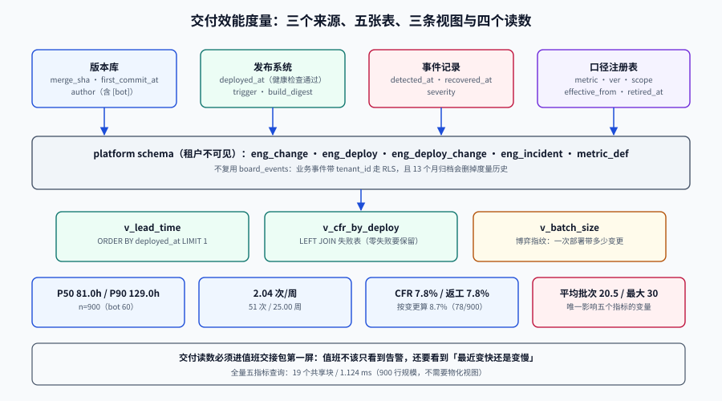

# 交付效能度量：让「我们变快了」成为一句可复算的话

第 169~171 天交付的是「**能不能发**」「**发坏了怎么退**」「**上线后谁看着**」。这三件事都有一个共同的前置条件：**你得先知道现在有多快、多稳。** 而这个项目从第 151 天到现在，一直没有一个能回答它的东西。

本页补的是最后一块基础设施：把版本库、发布系统、事件记录三条流水接成五张表，算出五个数，并把「口径」写成表里的一行。判据族 `DME-A` ~ `DME-H`。

::: tip 一句话
度量在这个项目里不是「管理需求」，而是**发布链路的自检仪表**：它要能回答「这次上线之后，我们的批次是变大了还是变小了」，而这个答案必须能被下一个人用同一条 SQL 复算出来。
:::

## 判据族声明

本页判据族 `DME-A` ~ `DME-H`，共 8 条。定义表在第九节。




## 本页不讲什么

- 不讲五个指标的定义与官方口径演进（四指标 → 五指标、四档退役），归 [交付指标](../../../../docs/Tools/EngineeringMetrics/DeliveryMetrics/index.md)。
- 不讲周期时间、流动效率与 Little 定律，归 [流动指标](../../../../docs/Tools/EngineeringMetrics/FlowMetrics/index.md)。
- 不讲度量为什么不能进个人绩效、三个博弈指纹怎么算，归 [反指标](../../../../docs/Tools/EngineeringMetrics/AntiMetrics/index.md)。
- 不讲项目已有的业务事件表 `board_events`（第 153 天），本页只说明**为什么不能复用它**。
- 不讲上线验收的 12 项一票否决，归 [上线前置闸门](../PreLaunchGate/index.md)。

## 一、为什么度量表不能复用 `board_events`

第 153 天建的 `board_events` 是**业务事件**（拖卡片、评论、创建列），它看起来和「变更事件」很像，但四个属性全不一样：

| 维度 | `board_events`（业务） | 度量事件（本页） |
| --- | --- | --- |
| **租户归属** | 强归属，带 `tenant_id`，走 RLS | **无租户**：一次部署服务所有租户，不属于任何租户 |
| **写入量级** | 每次拖动 1 条，峰值与用户行为同阶 | 每次合并 1 条、每次部署 1 条，量级低两三个数量级 |
| **保留期** | 与看板同寿命（归档 13 个月） | 与发布历史同寿命（≥ 2 年），且要能重算历史 |
| **读权限** | 租户成员按角色读 | 只有平台运维读，**租户不可见** |

::: danger 把它塞进 `board_events` 会同时坏两件事
1. **RLS 会把度量数据切成碎片**：`board_events` 上 `FORCE ROW LEVEL SECURITY` 要求每行有 `tenant_id`，而一条部署没有租户——只能塞一个假租户，之后所有 `WHERE tenant_id = ?` 的查询都会看见它。
2. **保留期冲突**：归档任务按 13 个月删 `board_events`，度量历史跟着被删，第二年就再也算不出同比。

所以：**业务事件与平台事件必须分表**，哪怕字段看起来重复。
:::

## 二、五张表

```sql
-- 平台级 schema：与租户 schema 隔离，不给租户角色任何权限
CREATE SCHEMA IF NOT EXISTS platform;

CREATE TABLE platform.eng_change (
  change_id       bigserial PRIMARY KEY,
  service         text        NOT NULL DEFAULT 'svc-board',
  author          text        NOT NULL,
  is_bot          boolean     NOT NULL DEFAULT false,
  first_commit_at timestamptz NOT NULL,
  merged_at       timestamptz NOT NULL,
  merge_sha       text        NOT NULL,
  CONSTRAINT eng_change_sha_uniq UNIQUE (merge_sha),
  CONSTRAINT eng_change_time_ck  CHECK (merged_at >= first_commit_at)
);

CREATE TABLE platform.eng_deploy (
  deploy_id   bigserial PRIMARY KEY,
  service     text        NOT NULL,
  deployed_at timestamptz NOT NULL,          -- 健康检查通过的时刻
  trigger     text        NOT NULL,          -- planned / hotfix / rollback
  build_digest text       NOT NULL,          -- 与第 169 天 ISC 的 manifest digest 对齐
  CONSTRAINT eng_deploy_uniq UNIQUE (service, deployed_at),
  CONSTRAINT eng_deploy_trigger_ck CHECK (trigger IN ('planned','hotfix','rollback'))
);

CREATE TABLE platform.eng_deploy_change (
  deploy_id bigint NOT NULL REFERENCES platform.eng_deploy,
  change_id bigint NOT NULL REFERENCES platform.eng_change,
  PRIMARY KEY (deploy_id, change_id)
);

CREATE TABLE platform.eng_incident (
  incident_id  bigserial PRIMARY KEY,
  deploy_id    bigint      NOT NULL REFERENCES platform.eng_deploy,
  detected_at  timestamptz NOT NULL,
  recovered_at timestamptz,
  severity     text        NOT NULL
);

CREATE TABLE platform.metric_def (
  metric         text NOT NULL,
  ver            int  NOT NULL,
  scope          text NOT NULL,
  events         text NOT NULL,
  formula        text NOT NULL,
  aggregation    text NOT NULL,
  effective_from date NOT NULL,
  retired_at     date,
  PRIMARY KEY (metric, ver)
);
```

四条设计取舍：

| 取舍 | 理由 |
| --- | --- |
| `build_digest` 落库 | 第 169 天定过「本地构建没有 `RepoDigests`，只能写 manifest digest」；度量表必须能反查「这次部署到底是哪个产物」 |
| `deployed_at` 取健康检查通过 | 取滚动开始会让恢复时间偏短（流量还没切回来就算恢复了） |
| `severity` 用文本不用枚举 | 事故等级会随组织调整；用 `CHECK` 锁死枚举会让历史数据迁移变成一次 DDL 冒险 |
| `metric_def` 单独成表 | 口径是**数据**，不是代码注释；改口径要留痕 |

## 三、口径先落地，再谈数字

初始化口径（本页只落三个，够用且能互相制衡）：

```sql
INSERT INTO platform.metric_def (metric, ver, scope, events, formula, aggregation, effective_from)
VALUES
 ('change_lead_time', 1, 'service:svc-board',
  'first_commit_at -> deployed_at（第一次部署）',
  'percentile(deployed_at - first_commit_at)', 'median + p90', DATE '2026-10-01'),
 ('cfr_by_deploy', 1, 'service:svc-board',
  'deploy -> incident（需立即介入）',
  'failed_deploys / all_deploys', 'ratio', DATE '2026-10-01'),
 ('rework_rate', 1, 'service:svc-board',
  'deploy.trigger in (hotfix, rollback)',
  'unplanned_deploys / all_deploys', 'ratio', DATE '2026-10-01');
```

::: warning 口径表里最容易漏的是 `scope`
不写 `scope`，半年后一定会有人把 `svc-board` 与移动端的数字合在一起，然后得到「77 小时」这种谁都不是的数（[总览](../../../../docs/Tools/EngineeringMetrics/Overview/index.md) 有完整复算）。
本项目写死为 `service:svc-board`，要加服务就新增一行，不改旧行。
:::

## 四、三条视图

```sql
-- V1 变更前置时间：第一次部署
CREATE VIEW platform.v_lead_time AS
SELECT c.change_id, c.is_bot, c.first_commit_at, d.deployed_at,
       extract(epoch FROM d.deployed_at - c.first_commit_at)/3600 AS lead_time_h
FROM platform.eng_change c
JOIN LATERAL (
  SELECT dd.deployed_at
  FROM platform.eng_deploy_change dc JOIN platform.eng_deploy dd USING (deploy_id)
  WHERE dc.change_id = c.change_id
  ORDER BY dd.deployed_at
  LIMIT 1
) d ON true;

-- V2 失败率（分母写进视图名）
CREATE VIEW platform.v_cfr_by_deploy AS
WITH failed AS (SELECT DISTINCT deploy_id FROM platform.eng_incident)
SELECT count(*) AS deploys,
       count(*) FILTER (WHERE f.deploy_id IS NOT NULL) AS failed_deploys,
       round(100.0 * count(*) FILTER (WHERE f.deploy_id IS NOT NULL) / count(*), 1) AS cfr_pct
FROM platform.eng_deploy d LEFT JOIN failed f USING (deploy_id);

-- V3 批次大小（博弈指纹）
CREATE VIEW platform.v_batch_size AS
SELECT d.deploy_id, d.deployed_at, count(dc.change_id) AS changes_in_batch
FROM platform.eng_deploy d LEFT JOIN platform.eng_deploy_change dc USING (deploy_id)
GROUP BY d.deploy_id, d.deployed_at;
```

::: danger 两处必须照抄的细节
1. `LIMIT 1` **必须**配 `ORDER BY deployed_at`：没有排序时 `LIMIT 1` 的结果不确定，同一条 SQL 两次跑出不同的前置时间。
2. `v_cfr_by_deploy` **必须** `LEFT JOIN`：用内连接时「一个失败都没有」的那段时间会直接从报表消失，看起来像「没有数据」而不是「零失败」。
:::

## 五、本机读数（沙盒，非推演）

沙盒用 900 条变更、51 次部署、4 次失败部署、4 次 hotfix 造了一组与真实形状接近的数据（PostgreSQL 18.6）：

| 指标 | 读数 | 备注 |
| --- | --- | --- |
| 变更前置时间 P50 | **81.0 h** | 900 条；人工 81.0 h / 机器人 73.0 h（60 条，6.7%） |
| 变更前置时间 P90 | **129.0 h** | 均值 86.2 h、最长 377.0 h（24 条 > 10 天） |
| 部署频率 | **2.04 次/周** | 51 次部署跨 25.00 周（周二/周五两个窗口） |
| 变更失败率（按部署） | **7.8%** | 4/51 |
| 变更失败率（按变更） | **8.7%** | 4 次失败带走 **78** 个变更 |
| 返工率 | **7.8%** | 4/51，与 CFR 相等（一坏就 hotfix） |
| 平均 / 最大批次 | **20.5 / 30** | 一次部署带二十个变更 |
| 全量五指标查询 | **19 个共享块 / 1.124 ms** | 900 行规模下不需要物化视图 |

::: tip 这组数字里最该被带进会议的是「批次 20.5」
前置时间与失败率都是结果，批次是**原因侧**且唯一一个「改了就同时影响五个指标」的变量。
第 4 周的其他闸门（镜像、迁移、冒烟）保的是「这一次不出事」；批次保的是「以后每次都不容易出事」。
:::

## 六、去重与过滤：三条规则在项目里的落点

| 规则 | 本项目做法 | 不做的后果 |
| --- | --- | --- |
| 按 `merge_sha` 去重 | `UNIQUE (merge_sha)`；GitLab/GitHub webhook 重投时 `ON CONFLICT DO NOTHING` | 一次重投让样本 +1，且前置时间被算两次 |
| 机器人标记 | 作者名匹配 `[bot]$` 或 `dependabot`/`renovate` 白名单 | 依赖升级把中位数拉低（本项目差异 8 小时） |
| `trigger` 三值 | 发布脚本必须显式传 `planned`/`hotfix`/`rollback`；缺失即失败 | 返工率恒为 0，「悄悄回退」完全不可见 |

::: warning 不要在 SQL 里「顺手」过滤机器人
把 `WHERE NOT is_bot` 写死在视图里，后面就再也看不到机器人占比了——而这个占比是数据管道健康度的重要信号（基线 6.7%，突增到 25% 说明采集口径坏了）。
正确做法：视图保留全部行，报表层用参数过滤。
:::

## 七、S1~S10 验收

| 步骤 | 动作 | 预期 |
| --- | --- | --- |
| **S1** | `\dt platform.*` | 五张表齐全 |
| **S2** | `SELECT count(*) FROM platform.eng_change` | 与版本库同期合并数一致（含 bot） |
| **S3** | 跑六条质量校验（见[数据管道](../../../../docs/Tools/EngineeringMetrics/DataPipeline/index.md)） | 全部 0 |
| **S4** | `v_lead_time` 条数 = `eng_change` 条数 | 相等（说明每个变更都能关联到部署） |
| **S5** | 复算 P50/P90 | 81.0 / 129.0（与看板一致） |
| **S6** | 手动插一条重复 `merge_sha` | 被 `23505` 拒绝 |
| **S7** | 手动把某次部署 `trigger` 改成空 | `CHECK` 拒绝（不允许无标签部署） |
| **S8** | 用租户角色查 `platform.*` | `permission denied`（租户不可见） |
| **S9** | `EXPLAIN (ANALYZE, BUFFERS)` 五指标查询 | < 50 ms、共享块 < 100 |
| **S10** | 把本页读数与 [观察窗交接](../ObserveHandover/index.md) 的交接包对账 | 交接包第一屏含 P50/P90/CFR/批次四个数 |

::: danger S8 是本项目独有的验收项
度量表放在 `platform` schema、**不给租户角色任何权限**，这是「租户不可见平台运维数据」这条边界的具体落点。
如果哪天有人为了方便给 `app_tenant` 授了 `SELECT`，S8 会立刻变红——这比事后审计有效。
:::

## 八、下一步

1. 把度量读数接进 [观察窗与值班交接](../ObserveHandover/index.md) 的交接包第一屏（S10 已把它列为验收项）。
2. 批次大小接入第 169 天的 [上线前置闸门](../PreLaunchGate/index.md) 作为**软闸门**：单次部署变更数 > 15 时要求填理由（不阻断，只留痕）。
3. 下一周期（周期 7）把 `metric_def` 扩到多服务，届时**先加 `scope`，再加服务**，不改任何既有口径行。

## 九、判据族

| 判据 | 约定 | 定错了会怎样 | 怎么验证 |
| --- | --- | --- | --- |
| `DME-A` | 度量事件必须独立成 schema，不复用业务事件表 | RLS 把数据切碎 + 归档误删历史 | `\dn` 有 `platform`，`board_events` 无度量字段 |
| `DME-B` | 租户角色对 `platform.*` 无任何权限 | 租户能看到平台运维数据 | S8 返回 `permission denied` |
| `DME-C` | `merge_sha` 唯一，webhook 重投幂等 | 样本虚高、前置时间重复计入 | S6 返回 `23505` |
| `DME-D` | 每次部署必须有 `trigger`，且枚举固定三值 | 返工率恒为 0，回滚不可见 | S7 被 `CHECK` 拒绝 |
| `DME-E` | 前置时间取第一次部署（`ORDER BY` + `LIMIT 1`） | 回滚过的变更被记成「极慢」 | `v_lead_time` 定义含排序 |
| `DME-F` | 每个指标必须有 `scope`，不得跨服务聚合原始数据 | 混算产生「谁都不是」的数（77.0 h） | `metric_def.scope` 非空且为单服务 |
| `DME-G` | 视图不得内嵌机器人过滤，过滤在报表层 | 机器人占比突变不可见（基线 6.7%） | `v_lead_time` 保留 `is_bot` 列 |
| `DME-H` | 交付读数必须进值班交接包第一屏 | 值班只看到告警，看不到「最近变快还是变慢」 | S10 对账通过 |

## 十、与相邻章节的分工

| 你想知道 | 去哪 |
| --- | --- |
| 五个指标怎么定义、四档为什么退役 | [交付指标](../../../../docs/Tools/EngineeringMetrics/DeliveryMetrics/index.md) |
| 周期时间、流动效率、WIP 上限怎么算 | [流动指标](../../../../docs/Tools/EngineeringMetrics/FlowMetrics/index.md) |
| 度量会不会被博弈、怎么检测 | [反指标](../../../../docs/Tools/EngineeringMetrics/AntiMetrics/index.md) |
| 表结构与六条质量校验 | [数据管道](../../../../docs/Tools/EngineeringMetrics/DataPipeline/index.md) |
| 这一次能不能发 | [上线前置闸门](../PreLaunchGate/index.md) |
| 上线后谁看着、怎么交接 | [观察窗与值班交接](../ObserveHandover/index.md) |
| 部署产物怎么唯一指认 | [镜像供应链](../ImageSupplyChain/index.md) |

## 参考资料

- DORA，《DORA's software delivery performance metrics》：<https://dora.dev/guides/dora-metrics-four-keys/>
- DORA，《A history of DORA's software delivery metrics》：<https://dora.dev/insights/dora-metrics-history>
- 本站：[交付指标](../../../../docs/Tools/EngineeringMetrics/DeliveryMetrics/index.md) · [数据管道](../../../../docs/Tools/EngineeringMetrics/DataPipeline/index.md) · [反指标](../../../../docs/Tools/EngineeringMetrics/AntiMetrics/index.md)
- PostgreSQL 18 文档，`LATERAL` 与有序集聚合：<https://www.postgresql.org/docs/18/queries-table-expressions.html>
