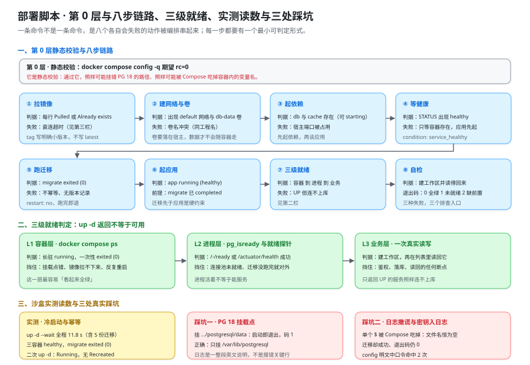

# 部署脚本：一条命令起全栈，以及它凭什么可重复

这一页回答「**一条命令起全栈**由哪几步组成、每一步的最小可判定形式是什么、为什么第二次跑必须得到同样的结果」——它给出与实测沙盒同构的 `compose.yaml`、可逐字复制的 `bin/one-click-up.sh`、三级就绪判定、迁移的执行方式与三处真实踩坑；它**不回答**「密钥放在哪一级、`docker compose config` 会不会把它打出来」（那是 [配置与密钥](../ConfigSecrets/index.md) 的事），也**不回答**「发布与回滚的动作序列」（那是 [发布与回滚手册](../ReleaseRunbook/index.md) 的事）。

::: info 本页判据族为什么取 `DY-` 前缀
本页判据族是 **`DY-A` ~ `DY-H`**。**不用 `DS-`** 是因为 `DS-A` ~ `DS-H` 已被 [分发与私有 registry](/docs/Tools/Toolchain/Distribution/index.md) 占用——那一族讲的是「包怎么送到使用者机器上、私有源怎么配」，与本页的「脚本能不能重复跑」不是同一件事。**两族撞号会让读者误以为它们是同一组判据。**
:::



::: warning 本仓库只有文档，没有代码
下面的 `compose.yaml`、`.env.example`、`bin/one-click-up.sh`、迁移脚本与所有 `docker compose` / `psql` 命令，都要在**你自己搭好的工程**里创建并执行。本仓库不存放源码、脚本与配置文件（`project/` 只允许 `*.md` 与配图）；「运行 `xxx`」一律指「先按本节把该文件建出来，再执行」。
:::

::: tip 本页读数的采集方式
本页所有实测读数来自**本机沙盒 `/tmp/tb-run`**（2026-10-17 采集）：`compose.yaml` 由 `postgres:18` + `redis` + `migrate` 一次性容器 + nginx 占位应用组成；**迁移脚本是从 [数据库设计](../Database/index.md) 的五个 `sql` 围栏里原样抽出来的**（V1~V4 四个文件，含 `CREATE EXTENSION citext`）。这套沙盒验的是**编排层与数据层**的动作，**不验 Java 应用**——凡涉及应用自身启动与接口可用性的判据，原因一律写 `BL-2`（本仓库无工程代码），不写成「环境不具备」。本机环境事实见 [环境与工程骨架](../Environment/index.md) 与 [第 3 周验收结论](../Week3Acceptance/index.md) 第三节。
:::

## 一、一条命令到底包含哪八步

「一条命令」不是一条命令，而是**八个可以各自失败的动作**被 `depends_on` 与 `--wait` 串起来。拆开它的价值在于：**每一步都有一个最小可判定形式**，失败时你不必猜它卡在哪一步。

| 层 | 步骤 | 做什么 | 最小可判定形式 |
| --- | --- | --- | --- |
| **第 0 层** | **静态校验** | 解析编排文件、检查变量引用与字段拼写 | `docker compose config -q` → `rc=0` |
| ① | 拉镜像 | 把 `postgres:18` / `redis:8-alpine` 等拉到本地 | 每行是 `Pulled` 或 `Already exists`，**没有 `error`** |
| ② | 建网络与卷 | 创建编排网络与 `db-data` 卷 | `docker network ls` 出现 `<name>_default`、`docker volume ls` 出现 `<name>_db-data` |
| ③ | 起依赖 | 先起 `db` / `cache`，暂不起 `app` | `docker compose ps` 里两者存在（此时可能还是 `starting`） |
| ④ | 等健康 | 等依赖的 healthcheck 转 `healthy`，而不是「容器起来了」 | `docker compose ps` 的 STATUS 列出现 `(healthy)` |
| ⑤ | 跑迁移 | `migrate` 一次性容器跑完 V1~V4 后退出 | `migrate` 的 STATUS 为 `exited (0)` |
| ⑥ | 起应用 | `app` 在迁移**成功之后**启动 | `app` 的 STATUS 为 `running (healthy)` |
| ⑦ | 三级就绪判定 | 容器 → 进程 → 业务，逐级确认 | 见第四节（`/-/ready` 或 `/actuator/health`，再加一次真实读写） |
| ⑧ | 自检 | 把交付判据里的「一键起」跑一次 | 见第八节的判据表 |

::: tip 第 0 层为什么单列成一层
`docker compose config -q` 只用**几毫秒**就能判掉三类问题：YAML 缩进错、引用了不存在的变量名、`condition` 字段拼写错——它们如果留到第 ④ 步才暴露，代价是**几十秒的等待加上一轮误判**（你会先去怀疑数据库）。本机实测 `rc=0`，**但它是静态校验**：通过了它，照样可能把数据卷挂错 PG 18 的路径（见 2.3 第一行），照样可能让 Compose 把容器内的变量名吃掉（见第五节第 2 条）。**「`rc=0` 不代表能起起来」这句话要写在脚本注释里。**
:::

## 二、完整编排文件与逐条解释

### 2.1 `compose.yaml`

```yaml [compose.yaml]
name: teamboard

services:
  db:
    image: docker.m.daocloud.io/library/postgres:18      # 见 2.3：镜像站前缀是为了绕开直连超时
    environment:
      POSTGRES_DB: ${POSTGRES_DB:-teamboard}
      POSTGRES_USER: ${POSTGRES_USER:-teamboard}
      POSTGRES_PASSWORD: ${POSTGRES_PASSWORD:?POSTGRES_PASSWORD is required}
      TZ: ${TZ:-Asia/Shanghai}
    ports:
      - "${DB_PORT:-5432}:5432"
    volumes:
      - db-data:/var/lib/postgresql
    healthcheck:
      test: ["CMD-SHELL", "pg_isready -U ${POSTGRES_USER:-teamboard} -d ${POSTGRES_DB:-teamboard}"]
      interval: 5s
      retries: 30
      start_period: 10s
  cache:
    image: docker.m.daocloud.io/library/redis:8-alpine
    healthcheck:
      test: ["CMD", "redis-cli", "ping"]
      interval: 5s
      retries: 30
  migrate:                                               # 一次性服务：跑完即退出
    image: docker.m.daocloud.io/library/postgres:18
    restart: "no"                                        # 不是常驻服务，失败后不许无限重启
    depends_on:
      db:
        condition: service_healthy                       # 等的是「就绪」，不是「起来了」
    environment:
      PGPASSWORD: ${POSTGRES_PASSWORD:?POSTGRES_PASSWORD is required}
      POSTGRES_USER: ${POSTGRES_USER:-teamboard}
      POSTGRES_DB: ${POSTGRES_DB:-teamboard}
    volumes:
      - ./deploy/db/migrations:/migrations:ro
    entrypoint: ["/bin/sh", "-c"]
    command: >
      set -e;
      for f in /migrations/*.sql; do
        echo "== apply $$f";
        psql -h db -U "$$POSTGRES_USER" -d "$$POSTGRES_DB" -v ON_ERROR_STOP=1 -f "$$f";
      done
  app:
    image: nginx:alpine                                   # 沙盒占位；真实项目换成本项目自己的镜像
    depends_on:
      db:
        condition: service_healthy
      cache:
        condition: service_healthy
      migrate:
        condition: service_completed_successfully         # 迁移成功才允许起应用
    ports:
      - "${APP_PORT:-8080}:80"
volumes:
  db-data:
```

### 2.2 `.env.example`

```properties [.env.example]
TZ=Asia/Shanghai
POSTGRES_DB=teamboard
POSTGRES_USER=teamboard
POSTGRES_PASSWORD=change-me-locally
DB_PORT=5432
APP_PORT=8080
UP_WAIT_TIMEOUT=60
```

`.env` 由它复制而来（`cp .env.example .env`），**不进版本控制**；结构进仓库、值进环境变量、密钥进密钥管理这三层划分与 [配置与密钥](../ConfigSecrets/index.md) 第一节逐字一致。

### 2.3 逐条解释：为什么非得这么写

| 行 / 写法 | 为什么这么写 | 不这么写的后果（本机实测） |
| --- | --- | --- |
| `db-data:/var/lib/postgresql` | **PG 18 官方镜像把数据放在「与主版本号绑定的目录」里**，并要求挂载这一个父目录 | 挂 `/var/lib/postgresql/data`（PG 17 及以前的习惯）时，`db` **启动即退出、退出码 1**，日志是一整段英文说明（出处见第五节） |
| `condition: service_healthy` | 等的是 healthcheck 的结论，不是容器的存在 | 默认的 `depends_on: [db]` 只等「容器已创建」，应用会比 `initdb` 快，报 `relation "users" does not exist` |
| `condition: service_completed_successfully`（`app` 等 `migrate`） | 把「迁移先于应用」变成编排层的**硬约束** | 写成人肉顺序（先手动跑迁移再 `up app`）时，一次忘记就是「应用起来了但表没建」 |
| `restart: "no"`（`migrate`） | 一次性动作失败就该**停在那里让人看日志** | `restart: always` 会让失败的 migrate 无限重启，把「一次性动作」变成一个正在崩溃的常驻进程 |
| `$$f` / `$$POSTGRES_USER`（双美元） | Compose 在宿主侧做一次插值，**容器里要用的 `$` 必须写成 `$$`** | 写单个 `$f`：Compose 解析期把变量吃掉，`config` 渲染成 `echo "== apply "`，容器里打印五行空名字（见第五节第 2 条） |
| `healthcheck` 的 `start_period` | 给 `initdb` 一段不被计失败的时间 | 不给它时，慢机器上的首次启动会因连续失败被判不健康，编排直接失败 |
| 镜像前缀 `docker.m.daocloud.io/library/` 与明确的小版本 tag | 直连 Docker Hub 在本机**超时**（实测见第五节）；`latest` 则让「今天能起」推不出「明天能起」 | 直连报 `net/http: request canceled while waiting for connection`；用 `latest` 时上游一发新版，同一份编排在两台机器上跑出两个结果，而发布记录里没有痕迹 |

## 三、`bin/one-click-up.sh`：起栈 + 三级等待 + 自检

### 3.1 完整脚本

```shell [bin/one-click-up.sh]
#!/usr/bin/env bash
# 一条命令起全栈：起栈 + 三级等待 + 自检
# 退出码：0 = 全绿；1 = 未就绪；2 = 前置缺失
set -euo pipefail

readonly EXIT_OK=0 EXIT_NOT_READY=1 EXIT_PREREQ=2
cd "$(dirname "$0")/.."                  # 脚本在 bin/ 下，工程根是它的上一级

# ── 前置检查：缺一样就退出 2，不制造「起了一半」的环境 ─────────────
command -v docker >/dev/null 2>&1 || { echo "缺前置：docker"; exit "$EXIT_PREREQ"; }
command -v curl   >/dev/null 2>&1 || { echo "缺前置：curl";   exit "$EXIT_PREREQ"; }
docker compose version >/dev/null 2>&1 || { echo "缺前置：docker compose v2"; exit "$EXIT_PREREQ"; }
test -f .env                 || { echo "缺前置：.env（先 cp .env.example .env）"; exit "$EXIT_PREREQ"; }
test -d deploy/db/migrations || { echo "缺前置：deploy/db/migrations"; exit "$EXIT_PREREQ"; }

set -a; . ./.env; set +a                 # 读入 UP_WAIT_TIMEOUT / APP_PORT / POSTGRES_*
: "${UP_WAIT_TIMEOUT:?缺前置：.env 里必须有 UP_WAIT_TIMEOUT}"   # 等待上界来自配置，不写死在脚本里

# ── 第 0 层：静态校验（只解析，不打印渲染结果，避免把密钥打进日志）──
docker compose config -q || { echo "编排结构不合法"; exit "$EXIT_PREREQ"; }

# ── 起栈：等待由上界开关执行，脚本自己不数秒 ────────────────────
docker compose up -d --wait --wait-timeout "$UP_WAIT_TIMEOUT" || {
  echo "未就绪：没在 ${UP_WAIT_TIMEOUT}s 内到 healthy / completed"
  docker compose ps; docker compose logs --tail=30 migrate
  exit "$EXIT_NOT_READY"
}

# ── L1 容器层：三个长驻 running，migrate 必须 exited (0) ──────────
for svc in db cache app; do
  docker compose ps --status running --format '{{.Service}}' | grep -qx "$svc" \
    || { echo "L1 失败：$svc 不在 running"; exit "$EXIT_NOT_READY"; }
done
mig_rc="$(docker compose ps -a --format '{{.Service}} {{.ExitCode}}' | awk '$1=="migrate"{print $2}')"
[ "$mig_rc" = "0" ] || { echo "L1 失败：migrate 退出码是 ${mig_rc:-空}"; exit "$EXIT_NOT_READY"; }

# ── L2 进程层：依赖用 pg_isready 探，应用用就绪探针探 ────────────
docker compose exec -T db pg_isready -U "$POSTGRES_USER" -d "$POSTGRES_DB" >/dev/null \
  || { echo "L2 失败：db 不接受连接"; exit "$EXIT_NOT_READY"; }
curl -sf "http://localhost:${APP_PORT:-8080}/-/ready" >/dev/null \
  || { echo "L2 失败：应用进程未就绪"; exit "$EXIT_NOT_READY"; }   # 本项目应用是 /actuator/health

# ── L3 业务层：一次真实读写，而不是「有个端口在听」──────────────
ws_id="$(curl -sf -X POST "http://localhost:${APP_PORT:-8080}/api/v1/workspaces" \
  -H "Authorization: Bearer ${TOKEN:?自检需要一个 TOKEN}" \
  -H 'Content-Type: application/json' -d '{"name":"selftest"}' \
  | sed -n 's/.*"id":"\([^"]*\)".*/\1/p')"
test -n "$ws_id" || { echo "L3 失败：建工作区没返回 id"; exit "$EXIT_NOT_READY"; }

echo "全绿：容器 running、进程就绪、业务读写通过（workspace=${ws_id}）"
exit "$EXIT_OK"
```

### 3.2 退出码语义：三个码对应三种「谁的问题」

| 退出码 | 含义 | 读到它的第一反应 | 谁的问题 |
| --- | --- | --- | --- |
| **`0`** | 全绿：容器、进程、业务三级都过 | 可以开始自检与验收 | —— |
| **`1`** | **未就绪**：栈起了，但没到该到的状态 | 看脚本已经打出来的 `docker compose ps` 与 `migrate` 日志 | 编排、依赖、迁移脚本 |
| **`2`** | **前置缺失**：脚本根本没开始起栈 | 补前置，别去翻容器日志（它们多半不存在） | 使用者的机器与工作目录 |

三个码而不是一个 `1`，理由是**这三种失败的排查入口完全不同**。一个 `exit 1` 会把「没装 docker」与「迁移失败了」混在一起，而前者的日志库里根本没有对应容器——查两小时也查不到东西。`2` 与 `1` 的边界写在脚本里：**`2` 只可能由前置检查与静态校验产生，`1` 只可能由起栈与三级等待产生。**

### 3.3 它为什么不自己等 41 秒，而是从配置里读出上界

本机沙盒冷启动实测：`docker compose up -d --wait` 总耗时 **11.8 s**（含 5 份迁移）。写 `sleep 41` 的脚本在三种情况下都是错的：

1. **机器快时白等 29 秒**，而且白等的时间会随机器变好而继续变长；
2. **机器慢时 41 秒不够**——实测直连 Docker Hub 拉 `postgres:18` 时超时，改走镜像站后**拉镜像一项就用了 1 分 44 秒**；此时脚本会报「未就绪」，而栈其实正在正常起；
3. **依赖数量一变就得改数字**——本项目真实形态还要加对象存储与 outbox 投递循环，上界与「等几个服务」相关，而改这个数字的人不会同时改文档。

正确写法是把上界交给**有语义的那个开关**：`docker compose up -d --wait --wait-timeout "$UP_WAIT_TIMEOUT"`。`--wait` 的语义是「等到所有带 healthcheck 的服务转为 `healthy`、一次性服务转为 `completed`」，`--wait-timeout` 的语义是「这个等待的上界（秒）」。**两者都由 Compose 执行，脚本只负责把上界从配置里读出来。** 于是「调大等待」是一个配置动作（改 `.env`），不是一次「改代码 + 改文档 + 忘记同步」。

判据（本机可判）：`grep -nE 'sleep [0-9]+' bin/one-click-up.sh` **应当无输出**——脚本里出现裸的秒数，就说明上界被写死在了一处没人会看的地方。

## 四、三级就绪判定：容器 running → 进程就绪 → 业务就绪

**`up -d` 返回 ≠ 可用。** 三级的划分依据是「每一级挡住的失败类型不同」：

| 级 | 判据 | 命令 | 它挡住的失败 |
| --- | --- | --- | --- |
| **L1 容器层** | 每个长驻服务 `running`；每个一次性服务 `exited (0)` | `docker compose ps` | 挂载点写错、镜像拉不下来、依赖没起来（表现为容器反复重启或直接退出） |
| **L2 进程层** | 依赖端口可接受连接；应用就绪探针返回成功 | `pg_isready`、`curl -sf /-/ready`（本项目应用是 `/actuator/health`） | 进程活着但还没连上数据库、连接池未初始化、迁移没跑完就对外服务 |
| **L3 业务层** | 一次**真实读写**：建工作区 → 列表里能读回它 | 两条 `curl`（见 3.1 脚本与 [环境与工程骨架](../Environment/index.md) 第六节第 4 条） | 鉴权、落库、读回这条链路里的任何断点——**一个只返回 `UP` 的服务照样可能连不上数据库** |

沙盒实测的三级读数：`time docker compose up -d --wait` → **11.8 s**（含 5 份迁移）；`docker compose ps` 给出 `app` / `cache` / `db` 三个 `Up (healthy)` 与 `migrate` 的 `Exited (0)`。`--wait` 期间的打印顺序是这条编排的**证据**：`db` / `cache` 先转 `healthy`，`migrate` 与 `app` 才开始启动——说明 `condition: service_healthy` 真的在等，而不是恰好顺序对了。

::: warning 11.8 s 是量级，不是常数
它随三件事增长：**依赖数量**（加对象存储、加一个投递循环）、**采集与预热周期**（`start_period`、连接池预热、JIT 预热）、**机器与镜像的来源**（本地已有镜像与走镜像站拉取差一个数量级）。写文档与写脚本时把它当「十秒级」用，**不要把它抄成一个验收阈值**。
:::

幂等性同样要有读数：二次 `docker compose up -d` 后三个容器报 **`Running`**，**没有 `Recreated`**。这条读数回答的是「再跑一遍会不会重建数据卷」——重建就意味着第二次运行会清掉上一次的数据，「可重复」也就无从谈起。

## 五、迁移的执行方式，以及它今天暴露的三个缺口

### 5.1 为什么是独立的一次性服务

| 写法 | 谁在什么时候跑 | 失败时的表现 |
| --- | --- | --- |
| **塞进应用启动脚本** | **每个实例**启动时各跑一次 | 两个实例同时执行同一份 DDL，随机失败；迁移失败表现为「应用起不来」，日志混在应用日志里 |
| **独立的一次性服务**（本页写法） | 排在 `app` 之前，跑完即退出 | 失败就是 `migrate` 自己的退出码非 0，日志在它自己的容器里，`docker compose logs migrate` 一眼看完 |

`restart: "no"` 是与它配对的一半：migrate 不是常驻服务，**写成 `restart: always` 会让它在失败后无限重启**，把「一次性动作」变成「一个正在崩溃的进程」，而 `docker compose ps` 上永远显示它在 `Restarting`。

### 5.2 缺口一：迁移不幂等

把 V1 再跑一遍（本机实测）：

```shell
docker compose exec -T db psql -U teamboard -d teamboard -v ON_ERROR_STOP=1 -f /migrations/10_V1.sql
# 实测：psql: ERROR:  relation "users" already exists
```

「重跑一次迁移」在今天是**必然失败**的。这不是小问题：恢复演练（见 [备份与恢复](../BackupRestore/index.md) 第四节）要在一台新机器上重放迁移，而重放的前提是它可重放。

### 5.3 缺口二与缺口三：没有版本记录、`audit_log` 分区一个都没有

```sql
-- 两个缺口一次查完：版本表有没有、分区有没有
select count(*) from pg_tables
 where schemaname = 'public'
   and (tablename like '%version%' or tablename like '%migration%' or tablename like '%schema%');
-- 实测：0
select count(*) from pg_inherits where inhparent = 'audit_log'::regclass;
-- 实测：0
insert into audit_log (workspace_id, actor_id, action, target_type, target_id, diff)
values ('00000000-0000-0000-0000-000000000001'::uuid, '00000000-0000-0000-0000-000000000002'::uuid,
        'card.move', 'card', 'x', '{}'::jsonb);
-- 实测：ERROR:  no partition of relation "audit_log" found for row
```

**两个 0 的后果不同**：版本表为 0 意味着 **「哪些迁移跑过了」这件事不在数据库里**，它只在人的记忆里，或者在「表已经存在」这种间接信号里——而后者正是缺口一报出的那个错；分区数为 0 意味着迁移的**语义不完整**。[环境与工程骨架](../Environment/index.md) 第 19 行写着迁移会建「14 张表**与 `audit_log` 的按月分区**」，实测只建了前者。

同一批迁移的**正面读数**要对得上：[数据库设计](../Database/index.md) 声称 14 张表，实测 `select count(*) from pg_tables where schemaname='public'` = **14**；`select version()` = **PostgreSQL 18.6 (Debian 18.6-1.pgdg13+2)**；`citext` 扩展存在；`select uuidv7() < uuidv7()` = **`t`**（时间有序成立）。**「建立对了」与「漏建了」是两条独立读数，缺一条就说不清迁移到底执行到哪一步。**

分区缺失的后果不是「审计少记一条」，而是 [卡片拖动](../CardMove/index.md) 第 ⑨ 步「写 `cards` + `audit_log` + `board_events` + outbox」在**第一个事务提交时整笔回滚**——一次拖动会因为审计写不进去而整体失败。**分区父表是空壳这件事，只有真的插一行才会暴露。**

另一处同类缺口在索引上：`cards` 上实测 **6 条**索引，其中 `cards_list_position_key`（UNIQUE，`(list_id, position)`）与 `cards_list_order_idx`（`(list_id, position)`）**键完全相同**——这正是 [卡片拖动](../CardMove/index.md) 第 5.1 节写下的「按纪律应只保留一条」；实测证实两份迁移各建了一条，主张被读数证实。

### 5.4 两条可落地路线

缺口一、二必须一起解——**「幂等」与「版本记录」是同一件事的两面**：只有记下跑过哪些，才能跳过已跑过的。

| 路线 | 做什么 | 判据（怎么验证） |
| --- | --- | --- |
| **A · 引入迁移工具**（Flyway / Liquibase） | 把 `deploy/db/migrations/` 按工具命名规范重命名，由工具在应用启动前执行；版本表由工具自己维护 | ① 版本表（如 `flyway_schema_history`）行数 **等于** `deploy/db/migrations/` 里的文件数；② 第二次执行输出 `No migration necessary` / `Schema is up to date` 且 `rc=0`；③ 表数仍为 14（不因重跑而增长或报错） |
| **B · 自建 `schema_version` + 幂等 DDL** | 建一张 `schema_version(version text primary key, applied_at timestamptz)`；DDL 一律用 `CREATE TABLE IF NOT EXISTS` / `CREATE INDEX IF NOT EXISTS` / `DO $$ ... $$` 包住扩展与函数；每份脚本跑完插一行版本号 | ① `select count(*) from schema_version` **等于**脚本份数（实测今天为 **0**，因为没有这张表）；② `select version from schema_version order by version` 连续无缺号；③ 重跑脚本打印 `skip v1`…且表数仍为 14 |

路线 B 的两处细节值得写清：**`CREATE EXTENSION` 没有 `IF NOT EXISTS` 的通用写法**，要包在 `DO $$ BEGIN IF NOT EXISTS (select 1 from pg_extension where extname='citext') THEN CREATE EXTENSION citext; END IF; END $$;` 里；**函数用 `CREATE OR REPLACE FUNCTION`**，它本身就是幂等的。

::: danger 迁移相关的三处真实踩坑（每条都附本机读数）
1. **把数据卷挂到 PG 17 及以前的路径。** 挂 `db-data:/var/lib/postgresql/data` 时，`db` 容器**启动即退出、退出码 1**，日志是一整段英文说明：PG 18+ 官方镜像把数据放在与主版本号绑定的目录里，并要求挂 `/var/lib/postgresql` 这一个挂载点（出处 `docker-library/postgres#1259`）。实测用 `docker inspect` 打印 db 容器的 `State.ExitCode` = **1**。**正确写法**：`- db-data:/var/lib/postgresql`。
2. **在 `command` 里写单个 `$` 引用容器内变量。** migrate 的命令里写 `for f in /migrations/*.sql; do echo "== apply $f"; psql ... -f "$$f"; done`——`$f` 被 Compose 在**解析期**吃掉，`docker compose config` 渲染出来是 `echo "== apply "`，容器里实际打印五行 **`== apply `**（文件名恒为空）。而迁移**照样全部成功**（因为 `-f "$$f"` 到容器里才是 `$f`），**退出码仍是 0**，唯一的信号是 stderr 上一行 `level=warning msg="The \"f\" variable is not set. Defaulting to a blank string."`。**正确写法**：容器里要用的变量一律写 `$$`；并把「日志里每个文件名都不为空」当作一条判据——**执行结果对、人读到的日志是错的，这类问题只有日志判据能抓到。**
3. **把 `docker compose config` 的输出贴进 CI 日志。** 实测：`docker compose config | grep -c '<.env 里的明文口令>'` 命中 **2** 次（`db` 与 `migrate` 两个服务的 `PGPASSWORD`）——`docker compose config` 会把**插值后的明文密钥**打印到标准输出，CI 里一条命令就把它记进了长期留存的日志。**正确写法**：CI 里只跑 `docker compose config --no-interpolate -q`（不展开、不打印），排查用 `--no-interpolate` 看引用了哪些变量（详见 [配置与密钥](../ConfigSecrets/index.md) 第四节）。
:::

## 六、判据族声明（`DY-A` ~ `DY-H`）

八条判据分三类：六条**文档级**（验「口径是否自洽、命令是否可执行」）、一条**运行期·本机已跑**（沙盒栈上真跑过）、一条**运行期·未跑**（需要本项目自己的应用）。

| 判据 | 一句话声明：它回答什么 | 级别 | 状态 |
| --- | --- | --- | --- |
| **`DY-A`** | 八步链路齐全，每步有最小可判定形式，且**静态校验在第 0 层** | 文档级 | ✅ 本机可判 |
| **`DY-B`** | 编排文件完整（db / cache / migrate / app），`condition: service_healthy` 与 PG 18 挂载点逐条解释 | 文档级 | ✅ 本机可判 |
| **`DY-C`** | `bin/one-click-up.sh` 可逐字复制，退出码语义三分（0 / 1 / 2），`set -euo pipefail`，等待上界从配置读出而不是 `sleep 41` | 文档级 | ✅ 本机可判 |
| **`DY-D`** | 三级就绪判定齐全（容器 / 进程 / 业务），且写死「`up -d` 返回 ≠ 可用」 | 文档级 | ✅ 本机可判 |
| **`DY-E`** | 迁移写成一次性服务（`restart: "no"`）的理由与两条幂等路线（工具 / 自建 `schema_version`），每条有判据 | 文档级 | ✅ 本机可判 |
| **`DY-F`** | 三处真实踩坑写清并附读数（PG 18 挂载点退出码 1 / Compose 吃掉 `$f` / `config` 打印明文密钥命中 2 次） | 文档级 | ✅ 本机可判 |
| **`DY-G`** | 整条编排链路真跑过：冷启动 `--wait` **11.8 s**、`migrate` `exited (0)`、三容器 `healthy`、二次 `up -d` 幂等无 `Recreated` | 运行期 | ✅ 本机已跑（沙盒 `/tmp/tb-run`） |
| **`DY-H`** | 应用侧三级就绪全绿：`/-/ready`（本项目为 `/actuator/health`）返回 `{"status":"UP"}`，且 L3 业务自检（建工作区 → 读回）通过 | 运行期 | `⏳ 未跑 · 原因：本仓库无工程代码（BL-2），沙盒里的 `app` 是 nginx 占位` |

## 七、当日做了什么

1. 把「一条命令」拆成**第 0 层静态校验 + 八步链路**，逐步给出最小可判定形式，并写死「`config -q` 是静态校验，`rc=0` 不代表能起起来」；同时产出**完整 `compose.yaml` 与 `.env.example`**（db / cache / migrate / app 四服务 + healthcheck + 两级 `depends_on` 条件），逐条解释八处「为什么非得这么写」，每条附不这么写的实测后果。
2. 产出**可逐字复制的 `bin/one-click-up.sh`**：`set -euo pipefail`、前置检查、静态校验、`--wait` 起栈、L1/L2/L3 三级等待、自检，并把退出码语义拆成 `0` / `1` / `2` 三个码（三种失败的排查入口不同）。
3. 论证脚本**为什么不写 `sleep 41`**：三条理由（机器快白等、机器慢不够——实测拉镜像一项 1 分 44 秒、依赖数量一变就要改），并给出正确写法（`--wait` + `--wait-timeout` 读 `.env`）与判据（脚本里不许出现裸秒数）。
4. 产出**三级就绪判定表**（容器 `running` / 进程就绪探针 / 业务真实读写），附沙盒实测读数（冷启动 **11.8 s**、三容器 `healthy`、`migrate` `exited (0)`、二次起栈无 `Recreated`），并写死 11.8 s 是量级不是常数。
5. 论证**迁移写成独立一次性服务**的理由（对比「塞进应用启动脚本」的两种失败形态），并登记今天实测出的**三个缺口**：不幂等（重跑 V1 报 `relation "users" already exists`）、**库里没有任何版本记录（版本表计数 0）**、`audit_log` 分区未建（`pg_inherits` 计数 0，插入报 `no partition of relation` 导致拖动整笔回滚），另附索引重复（`cards` 6 条中两条键相同）。
6. 产出**两条可落地的幂等路线**（引入迁移工具 / 自建 `schema_version` + 幂等 DDL，每条三条判据）与**三处真实踩坑**（PG 18 挂载点退出码 1 / Compose 吃掉 `$f` 而日志撒谎 / `config` 打印明文密钥命中 2 次），以及 **`DY-A` ~ `DY-H` 八条判据**：六条文档级、一条运行期本机已跑、一条运行期如实标 `⏳`。

## 八、如何验证

### 8.1 判据定义表（`DY-A` ~ `DY-H`）

| 判据 | 判什么 | 怎么验证 | 级别 | 状态 |
| --- | --- | --- | --- | --- |
| **`DY-A`** | 八步链路表 8 行 + 第 0 层 1 行，且「静态校验不代表能起起来」写死 | 8.2 第 1 组 `grep` | 文档级 | ✅ 本机可判 |
| **`DY-B`** | 四个服务齐全、两级 `depends_on` 条件齐全、PG 18 挂载点写法正确 | 8.2 第 2 组 | 文档级 | ✅ 本机可判 |
| **`DY-C`** | 脚本三要素齐全（`set -euo pipefail`、三个退出码、`--wait-timeout` 读配置） | 8.2 第 3 组 | 文档级 | ✅ 本机可判 |
| **`DY-D`** | 三级就绪表 3 行，且含「`up -d` 返回 ≠ 可用」 | 8.2 第 4 组 | 文档级 | ✅ 本机可判 |
| **`DY-E`** | 三个迁移缺口 + 两条路线 + 每条三条判据 | 8.2 第 4 组 | 文档级 | ✅ 本机可判 |
| **`DY-F`** | 三处踩坑的关键读数都在（退出码 1 / `== apply ` / 命中 2 次） | 8.2 第 5 组 | 文档级 | ✅ 本机可判 |
| **`DY-G`** | 沙盒栈真起一次：11.8 s、`exited (0)`、三容器 `healthy`、二次起栈幂等 | 8.3 第 1 组 | 运行期 | ✅ 本机已跑（沙盒） |
| **`DY-H`** | 应用侧三级就绪与业务自检全绿 | 8.3 第 2 组 | 运行期 | `⏳ 未跑 · 原因：本仓库无工程代码（BL-2）` |

### 8.2 本机可判的部分

以下命令在 `DeployScripts/` 目录内执行（也就是本页所在目录），期望值均为**本机实跑后回填**：

```shell
# 1) DY-A：八步链路表 8 行 + 第 0 层 1 行（用显式枚举避开多字节字符类的坑）
grep -cE '^\| (①|②|③|④|⑤|⑥|⑦|⑧) \|' index.md                    # 期望 8
grep -c '^| \*\*第 0 层\*\* | \*\*静态校验\*\*' index.md             # 期望 1
# 2) DY-B：四个服务 + 两级依赖条件 + PG18 挂载点（行尾就是 postgresql，不带 /data）
grep -cE '^  (db|cache|migrate|app):' index.md                     # 期望 4
grep -cE '^ *condition: service_health[y]' index.md                # 期望 3
grep -cE '^ *condition: service_completed_successfull[y]' index.md # 期望 1
grep -cE 'db-data:/var/lib/postgresql$' index.md                   # 期望 1
# 3) DY-C：脚本三要素
grep -c '^set -euo pipefai[l]' index.md                            # 期望 1
grep -c 'readonly EXIT_OK=0 EXIT_NOT_READY=1 EXIT_PREREQ=[2]' index.md   # 期望 1
grep -c 'wait-timeou[t]' index.md                                  # 期望 5
# 4) DY-D 与 DY-E：三级就绪 + 三个缺口 + 两条路线
grep -cE '^\| \*\*L[123] ' index.md                                # 期望 3
grep -cE '^### 5\.[1-4] ' index.md                                 # 期望 4
grep -cE '^\| \*\*(A|B) · ' index.md                               # 期望 2
# 5) DY-F：三处踩坑读数
grep -c 'State.ExitCod[e]' index.md                                # 期望 1
grep -c '== appl[y] ' index.md                                     # 期望 4
grep -c 'no-interpolat[e]' index.md                                # 期望 2
# 配图与判据族（声明表 8 行 + 定义表 8 行）
grep -c 'assets/tb-deploy-scripts.sv[g]' index.md                  # 期望 1
grep -cE '^\| \*\*`DY-[A-H]`\*\*' index.md                         # 期望 16
```

### 8.3 需要真实环境的部分

`DY-G` 的判据对象是**一套能起的编排栈**——本页用沙盒栈跑过（读数见 `DY-G` 一行与第四节）；`DY-H` 的判据对象是**本项目自己的应用**，本仓库按约定没有工程代码，因此如实标 `⏳`，只给命令。

```shell
# DY-G（沙盒即可复现：容器运行时 + 一份 compose.yaml + 四份迁移脚本）
docker compose config -q && echo "rc=$?"                 # 期望 rc=0
time docker compose up -d --wait                         # 期望十秒级（本机实测 11.8 s）
docker compose ps --format '{{.Service}}\t{{.Status}}'    # 期望三容器 healthy、migrate exited (0)
docker compose up -d && docker compose ps                # 二次起栈：期望 Running，无 Recreated

# DY-H（需要：本项目自己的 app 镜像 + 一份可用令牌）
curl -sf localhost:8080/actuator/health                  # 期望 {"status":"UP"}
curl -sf localhost:8080/-/ready                          # 期望 200（通用就绪探针形态）
TOKEN=... ./bin/one-click-up.sh; echo "rc=$?"            # 期望全绿 rc=0
```
原因**不是**「本机没有容器运行时」：本机 `docker` 客户端与服务端均为 **27.1.1**、`docker compose` 为 **v2.29.1-desktop.1**（2026-10-17 复验，见 [第 3 周验收结论](../Week3Acceptance/index.md) 第三节），且宿主上**运行中容器 11 个 / 全部容器 12 个 / 卷 14 个 / 镜像 15 个**。挡住 `DY-H` 的是 `BL-2`：**本仓库只有文档，没有可执行的工程**。

本机环境还有一处**真实的版本偏差**必须如实登记：`java -version` 实测为 **17.0.8**，而本项目技术基线是 **Java 25 (LTS)**（见 [技术选型与版本基线](../TechStack/index.md)）。它对应阻塞项台账里的 **`BL-3`（本机运行时与基线不一致）**，挡住的是「工程能不能编译与启动」——**它不挡本页的文档级判据，也不挡 `DY-G`**（沙盒栈只用到容器，不用 JDK）。落到动作上：**先按 `BL-3` 的解除判据核对运行时，再动手建工程**，否则返工的不只是环境。

::: warning 状态列的读法
`DY-A` ~ `DY-F` 的期望值是**本机 `grep -c` 数出来的**，不是从模式里反推的。`DY-G` 的状态是「本机沙盒真跑过」，`DY-H` 的状态**不是结论而是当前可执行性**，其唯一阻塞项与 [验收](../Acceptance/index.md) 的 `BL-2` 是同一条。**不把「编排跑通了」写成「应用可用」**——这正是本页把三级就绪分开的原因。
:::

### 8.4 一条恒假判据：`EXPLAIN` 的 `rows` 必须等于 1

本项目的成本判据是「**一次拖动只更新一行**」。有人在部署脚本的自检里验证它时，会写成「`EXPLAIN (ANALYZE)` 的 `rows` 必须等于 1」——**这条判据在现在的 PostgreSQL 上是恒假的**，实测如下：

```sql
EXPLAIN (ANALYZE) UPDATE cards SET version = version + 1 WHERE id = :id AND version = 1;
-- 实测：Update on cards  (actual rows=0.00 loops=1)；内层 Index Scan ... (actual rows=1.00 loops=1)
EXPLAIN (ANALYZE) UPDATE cards SET version = version + 1 WHERE id = :id AND version = 1 RETURNING id;
-- 实测：Update on cards  (actual rows=1.00 loops=1)
```

同一条语句，**带 `RETURNING` 读到 1、不带读到 0**；而两边的命令标签都是 **`UPDATE 1`**。已联网核对（PostgreSQL 官方邮件列表与文档）：这是刻意的改动，commit `f0f13a3a08b2757997410f3a1c38bdc22973c525`（"Fix estimates for ModifyTable paths without RETURNING"，2020-10-12）——**不带 `RETURNING` 时 `ModifyTable` 节点正确地输出 0 行**；`UPDATE` 的影响行数以**命令标签 `UPDATE count`** 为准（官方 `UPDATE` 文档 Outputs 节）。正确写法有两条，**任选其一但必须写清是哪一条**：① 判「命令标签」——`UPDATE 1` 才算命中一行；② 用 `RETURNING id` 再看 `actual rows`。配套的两条读数也要一起写进自检：乐观锁同一版本号第二次更新时命令标签是 `UPDATE 1` 然后 **`UPDATE 0`**；同位置插入报 `duplicate key value violates unique constraint "cards_list_id_position_key"`，**SQLSTATE 23505**。

::: danger 把这三种写法当判据会得到「永远红」或「永远绿」
1. **`EXPLAIN (ANALYZE)` 的 `rows` 必须等于 1**：在 PG 上是恒假，它会一直红，然后被人加 `|| true` 忽略掉。**正确写法**：只认命令标签，或加 `RETURNING id`。
2. **数 `updated_at > now() - '5 seconds'`**：全列后移的实现也能做到「只给目标行写 `updated_at`」，判据立刻失真。**正确写法**：用数据库自己的痕迹（`xmin` / `pg_stat_statements` 的 `rows` 增量 / 序列列）。
3. **只数被拖动那几张卡片所在的列**：如果实现顺手重排了别的列，只数一列就漏了。**正确写法**：对 `cards` **全表**统计被改动的行数。三种证法的完整口径见 [卡片拖动](../CardMove/index.md) 第七节。
:::

## 九、下一步

1. **装上应用侧的三级就绪**：`DY-H` 要等本项目自己的镜像；`/-/ready` 与 `/actuator/health` 两条探针的语义差异（进程就绪 vs 依赖就绪）在补它时定稿，并把 L3 的读写自检写成脚本而不是手敲两条 `curl`。
2. **迁移的幂等要在本周内落一条路线**：路线 A 与 B 选一条，并把「版本表行数 = 脚本份数」与「重跑 `rc=0`」写进 CI 门禁——它是 [备份与恢复](../BackupRestore/index.md) 里「恢复演练能重放迁移」的前置。
3. **`audit_log` 的分区与索引重复要各出一条迁移**：前者不补，拖动会整笔回滚；后者不补，每次写入多维护一份索引。两条都属于「先补结构，再谈容量」。
4. **把 L1/L2/L3 的读数接进监控**：容器重启次数、就绪探针失败率、L3 自检耗时三个量，是 [监控与告警接入](../Monitoring/index.md) 里「部署是否健康」的输入——它们比 CPU 与内存更早暴露「起是起来了但不可用」。同时把 `bin/one-click-up.sh` 与 `.env.example` 收进 [交付文档](../DeliveryDocs/index.md) 与 [上线验收](../LaunchAcceptance/index.md)（它们是「别人怎么照着做一遍」的直接对象）；本周期的收口写在第 4 周验收结论（[第 4 周验收结论](../Week4Acceptance/index.md)）。

## 参考资料

- [环境与工程骨架](../Environment/index.md)（`compose.yaml` 与 `.env` 的另一份写法、五类启动失败排查；本页第二节的挂载点口径比它更严——PG 18 要求挂父目录） · [配置与密钥](../ConfigSecrets/index.md)（密钥四级落点、`docker compose config` 的泄漏口径） · [数据库设计](../Database/index.md)（14 张表、迁移三分法与 `audit_log` 的分区设计）
- [发布与回滚手册](../ReleaseRunbook/index.md)（迁移先于应用这道门禁的发布侧写法、回滚演练） · [备份与恢复](../BackupRestore/index.md)（迁移必须可重放：本页缺口一的直接下游） · [卡片拖动](../CardMove/index.md)（成本判据的三种证法，8.4 的出处） · [压测与容量验收](../CapacityTest/index.md) · [第 3 周验收结论](../Week3Acceptance/index.md)（`BL-1` 口径更正与「本机具备 X 必须复验一次」的纪律）
- [交付文档](../DeliveryDocs/index.md) · [上线验收](../LaunchAcceptance/index.md) · [监控与告警接入](../Monitoring/index.md)（三级就绪读数接进告警的位置）
- Docker 官方文档 · Compose 的 `depends_on` 条件与健康检查 https://docs.docker.com/compose/compose-file/05-services/#depends_on ；`docker compose up --wait` / `--wait-timeout` https://docs.docker.com/reference/cli/docker/compose/up/ ；`docker compose config` 的 `--no-interpolate` 与 `-q` https://docs.docker.com/reference/cli/docker/compose/config/
- docker-library/postgres · PG 18 起数据目录与挂载点变更（issue #1259）：https://github.com/docker-library/postgres/issues/1259
- PostgreSQL 18 文档 · `UPDATE`（Outputs 节的命令标签口径，8.4 的判据依据）：https://www.postgresql.org/docs/18/sql-update.html
- PostgreSQL 18 文档 · 表分区（分区父表与子表的存在性判定）：https://www.postgresql.org/docs/18/ddl-partitioning.html
- [Docker Compose 编排](/docs/Ops/Docker/DockerCompose/index.md) · [Compose 进阶](/docs/Ops/Docker/ComposeAdvanced/index.md)（多文件与多档位编排） · [完整项目交付 · 一键部署](/docs/Others/ProjectDelivery/Delivery/index.md)
